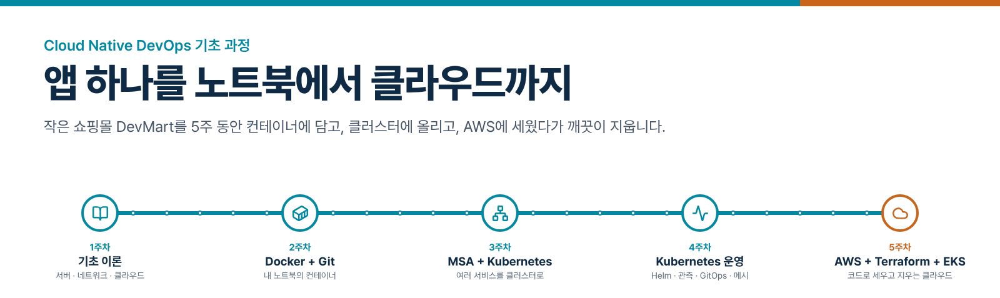
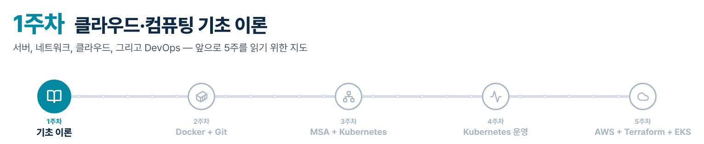
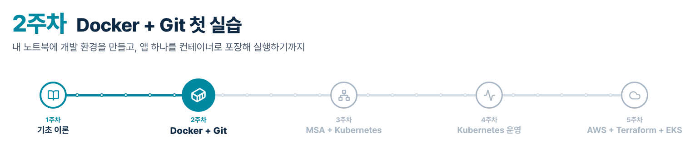
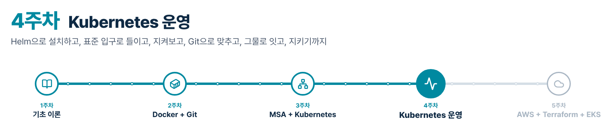
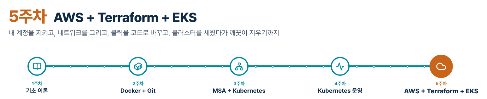

<p align="center"></p>

<p align="center">
  
  
  
  
  
  
</p>

<p align="center">
  <a href="week1/day1/README.md"><b>1주차 1일차부터 시작하기</b></a> &nbsp;·&nbsp;
  <a href="appendix/install.md">도구 설치 가이드</a> &nbsp;·&nbsp;
  <a href="#내려받기">PDF · PPTX 내려받기</a>
</p>

<br>

## 이 과정에서 다루는 기술

주차가 지날수록 DevMart가 올라가는 자리가 바뀌고, 쓰는 도구도 그 자리에 맞게 늘어납니다.

| 주차 | 기술 |
|:--|:--|
| [**1주차**](week1/README.md)<br><sub>클라우드·컴퓨팅 기초 이론</sub> |     |
| [**2주차**](week2/README.md)<br><sub>Docker + Git 첫 실습</sub> |          |
| [**3주차**](week3/README.md)<br><sub>MSA + Kubernetes 입문</sub> |        |
| [**4주차**](week4/README.md)<br><sub>Kubernetes 운영</sub> |          |
| [**5주차**](week5/README.md)<br><sub>AWS + Terraform + EKS</sub> |      |

## 시작하기

1. **[1주차 1일차](week1/day1/README.md)부터** 엽니다. 모든 페이지 맨 아래의 **다음 ➡️** 링크를 따라가면 교시 순서대로 이어집니다.
2. 도구는 그 도구를 처음 쓰는 교시에서 설치합니다. Windows(PowerShell · WSL) · macOS별 방법을 모은 것은 [부록 A · 도구 설치 가이드](appendix/install.md)입니다.
3. 3주차부터는 이 저장소의 실습 파일을 복사해 씁니다.

```bash
cd ~
git clone https://github.com/niceguy61/kdt_devops_lecture_2026_rev2.git course
ls ~/course/labs        # week2 … week5
```

## 내려받기

| | 이북 PDF | 일차별 슬라이드 PPTX |
|:--|:--|:--|
| **1주차** 클라우드·컴퓨팅 기초 이론 | 📕 [보기](downloads/pdf/week1.pdf) · [받기](https://github.com/niceguy61/kdt_devops_lecture_2026_rev2/raw/main/downloads/pdf/week1.pdf) | 📊 [1일차](https://github.com/niceguy61/kdt_devops_lecture_2026_rev2/raw/main/downloads/pptx/week1-day1.pptx) [2일차](https://github.com/niceguy61/kdt_devops_lecture_2026_rev2/raw/main/downloads/pptx/week1-day2.pptx) [3일차](https://github.com/niceguy61/kdt_devops_lecture_2026_rev2/raw/main/downloads/pptx/week1-day3.pptx) [4일차](https://github.com/niceguy61/kdt_devops_lecture_2026_rev2/raw/main/downloads/pptx/week1-day4.pptx) [5일차](https://github.com/niceguy61/kdt_devops_lecture_2026_rev2/raw/main/downloads/pptx/week1-day5.pptx) |
| **2주차** Docker + Git 첫 실습 | 📕 [보기](downloads/pdf/week2.pdf) · [받기](https://github.com/niceguy61/kdt_devops_lecture_2026_rev2/raw/main/downloads/pdf/week2.pdf) | 📊 [1일차](https://github.com/niceguy61/kdt_devops_lecture_2026_rev2/raw/main/downloads/pptx/week2-day1.pptx) [2일차](https://github.com/niceguy61/kdt_devops_lecture_2026_rev2/raw/main/downloads/pptx/week2-day2.pptx) [3일차](https://github.com/niceguy61/kdt_devops_lecture_2026_rev2/raw/main/downloads/pptx/week2-day3.pptx) [4일차](https://github.com/niceguy61/kdt_devops_lecture_2026_rev2/raw/main/downloads/pptx/week2-day4.pptx) [5일차](https://github.com/niceguy61/kdt_devops_lecture_2026_rev2/raw/main/downloads/pptx/week2-day5.pptx) |
| **3주차** MSA + Kubernetes 입문 | 📕 [보기](downloads/pdf/week3.pdf) · [받기](https://github.com/niceguy61/kdt_devops_lecture_2026_rev2/raw/main/downloads/pdf/week3.pdf) | 📊 [1일차](https://github.com/niceguy61/kdt_devops_lecture_2026_rev2/raw/main/downloads/pptx/week3-day1.pptx) [2일차](https://github.com/niceguy61/kdt_devops_lecture_2026_rev2/raw/main/downloads/pptx/week3-day2.pptx) [3일차](https://github.com/niceguy61/kdt_devops_lecture_2026_rev2/raw/main/downloads/pptx/week3-day3.pptx) [4일차](https://github.com/niceguy61/kdt_devops_lecture_2026_rev2/raw/main/downloads/pptx/week3-day4.pptx) [5일차](https://github.com/niceguy61/kdt_devops_lecture_2026_rev2/raw/main/downloads/pptx/week3-day5.pptx) |
| **4주차** Kubernetes 운영 | 📕 [보기](downloads/pdf/week4.pdf) · [받기](https://github.com/niceguy61/kdt_devops_lecture_2026_rev2/raw/main/downloads/pdf/week4.pdf) | 📊 [1일차](https://github.com/niceguy61/kdt_devops_lecture_2026_rev2/raw/main/downloads/pptx/week4-day1.pptx) [2일차](https://github.com/niceguy61/kdt_devops_lecture_2026_rev2/raw/main/downloads/pptx/week4-day2.pptx) [3일차](https://github.com/niceguy61/kdt_devops_lecture_2026_rev2/raw/main/downloads/pptx/week4-day3.pptx) [4일차](https://github.com/niceguy61/kdt_devops_lecture_2026_rev2/raw/main/downloads/pptx/week4-day4.pptx) [5일차](https://github.com/niceguy61/kdt_devops_lecture_2026_rev2/raw/main/downloads/pptx/week4-day5.pptx) |
| **5주차** AWS + Terraform + EKS | 📕 [보기](downloads/pdf/week5.pdf) · [받기](https://github.com/niceguy61/kdt_devops_lecture_2026_rev2/raw/main/downloads/pdf/week5.pdf) | 📊 [1일차](https://github.com/niceguy61/kdt_devops_lecture_2026_rev2/raw/main/downloads/pptx/week5-day1.pptx) [2일차](https://github.com/niceguy61/kdt_devops_lecture_2026_rev2/raw/main/downloads/pptx/week5-day2.pptx) [3일차](https://github.com/niceguy61/kdt_devops_lecture_2026_rev2/raw/main/downloads/pptx/week5-day3.pptx) [4일차](https://github.com/niceguy61/kdt_devops_lecture_2026_rev2/raw/main/downloads/pptx/week5-day4.pptx) [5일차](https://github.com/niceguy61/kdt_devops_lecture_2026_rev2/raw/main/downloads/pptx/week5-day5.pptx) |
| **부록 A** 도구 설치 가이드 | 📕 [보기](downloads/pdf/appendix-install.pdf) · [받기](https://github.com/niceguy61/kdt_devops_lecture_2026_rev2/raw/main/downloads/pdf/appendix-install.pdf) | |

<sub>PDF의 <b>보기</b>는 GitHub에서 바로 열고, <b>받기</b>는 파일로 저장합니다. PPTX는 누르면 내려받습니다.</sub>

## 과정 목차

<a href="week1/README.md"></a>

| 일차 | 주제 | 교시 |
|:--|:--|:--|
| [**1일차**](week1/day1/README.md) | OT와 클라우드의 큰 그림 | [1](week1/day1/lesson-01.md) [2](week1/day1/lesson-02.md) [3](week1/day1/lesson-03.md) [4](week1/day1/lesson-04.md) [5](week1/day1/lesson-05.md) |
| [**2일차**](week1/day2/README.md) | 컴퓨터와 운영체제, 가상화 | [1](week1/day2/lesson-01.md) [2](week1/day2/lesson-02.md) [3](week1/day2/lesson-03.md) [4](week1/day2/lesson-04.md) [5](week1/day2/lesson-05.md) [6](week1/day2/lesson-06.md) [7](week1/day2/lesson-07.md) |
| [**3일차**](week1/day3/README.md) | 네트워크 기초 | [1](week1/day3/lesson-01.md) [2](week1/day3/lesson-02.md) [3](week1/day3/lesson-03.md) [4](week1/day3/lesson-04.md) [5](week1/day3/lesson-05.md) [6](week1/day3/lesson-06.md) [7](week1/day3/lesson-07.md) |
| [**4일차**](week1/day4/README.md) | 현대 애플리케이션 구조 | [1](week1/day4/lesson-01.md) [2](week1/day4/lesson-02.md) [3](week1/day4/lesson-03.md) [4](week1/day4/lesson-04.md) [5](week1/day4/lesson-05.md) [6](week1/day4/lesson-06.md) [7](week1/day4/lesson-07.md) |
| [**5일차**](week1/day5/README.md) | DevOps 문화와 협업 | [1](week1/day5/lesson-01.md) [2](week1/day5/lesson-02.md) [3](week1/day5/lesson-03.md) [4](week1/day5/lesson-04.md) [5](week1/day5/lesson-05.md) [6](week1/day5/lesson-06.md) [7](week1/day5/lesson-07.md) |

<br>

<a href="week2/README.md"></a>

| 일차 | 주제 | 교시 |
|:--|:--|:--|
| [**1일차**](week2/day1/README.md) | 개발 환경 세팅과 Git 첫걸음 | [1](week2/day1/lesson-01.md) [2](week2/day1/lesson-02.md) [3](week2/day1/lesson-03.md) [4](week2/day1/lesson-04.md) [5](week2/day1/lesson-05.md) [6](week2/day1/lesson-06.md) [7](week2/day1/lesson-07.md) |
| [**2일차**](week2/day2/README.md) | Docker 기본 | [1](week2/day2/lesson-01.md) [2](week2/day2/lesson-02.md) [3](week2/day2/lesson-03.md) [4](week2/day2/lesson-04.md) [5](week2/day2/lesson-05.md) [6](week2/day2/lesson-06.md) [7](week2/day2/lesson-07.md) |
| [**3일차**](week2/day3/README.md) | 이미지와 Dockerfile | [1](week2/day3/lesson-01.md) [2](week2/day3/lesson-02.md) [3](week2/day3/lesson-03.md) [4](week2/day3/lesson-04.md) [5](week2/day3/lesson-05.md) [6](week2/day3/lesson-06.md) [7](week2/day3/lesson-07.md) |
| [**4일차**](week2/day4/README.md) | 볼륨 · 네트워크 · 환경 변수 | [1](week2/day4/lesson-01.md) [2](week2/day4/lesson-02.md) [3](week2/day4/lesson-03.md) [4](week2/day4/lesson-04.md) [5](week2/day4/lesson-05.md) [6](week2/day4/lesson-06.md) [7](week2/day4/lesson-07.md) |
| [**5일차**](week2/day5/README.md) | Docker Compose와 GitHub 협업 | [1](week2/day5/lesson-01.md) [2](week2/day5/lesson-02.md) [3](week2/day5/lesson-03.md) [4](week2/day5/lesson-04.md) [5](week2/day5/lesson-05.md) [6](week2/day5/lesson-06.md) [7](week2/day5/lesson-07.md) |

<br>

<a href="week3/README.md"></a>

| 일차 | 주제 | 교시 |
|:--|:--|:--|
| [**1일차**](week3/day1/README.md) | MSA 개념과 실행 | [1](week3/day1/lesson-01.md) [2](week3/day1/lesson-02.md) [3](week3/day1/lesson-03.md) [4](week3/day1/lesson-04.md) [5](week3/day1/lesson-05.md) [6](week3/day1/lesson-06.md) [7](week3/day1/lesson-07.md) |
| [**2일차**](week3/day2/README.md) | MSA 장애와 CI | [1](week3/day2/lesson-01.md) [2](week3/day2/lesson-02.md) [3](week3/day2/lesson-03.md) [4](week3/day2/lesson-04.md) [5](week3/day2/lesson-05.md) [6](week3/day2/lesson-06.md) [7](week3/day2/lesson-07.md) |
| [**3일차**](week3/day3/README.md) | Kubernetes 아키텍처 | [1](week3/day3/lesson-01.md) [2](week3/day3/lesson-02.md) [3](week3/day3/lesson-03.md) [4](week3/day3/lesson-04.md) [5](week3/day3/lesson-05.md) [6](week3/day3/lesson-06.md) [7](week3/day3/lesson-07.md) |
| [**4일차**](week3/day4/README.md) | Pod · Deployment · Service | [1](week3/day4/lesson-01.md) [2](week3/day4/lesson-02.md) [3](week3/day4/lesson-03.md) [4](week3/day4/lesson-04.md) [5](week3/day4/lesson-05.md) [6](week3/day4/lesson-06.md) [7](week3/day4/lesson-07.md) |
| [**5일차**](week3/day5/README.md) | 운영 가능한 워크로드 | [1](week3/day5/lesson-01.md) [2](week3/day5/lesson-02.md) [3](week3/day5/lesson-03.md) [4](week3/day5/lesson-04.md) [5](week3/day5/lesson-05.md) [6](week3/day5/lesson-06.md) [7](week3/day5/lesson-07.md) |

<br>

<a href="week4/README.md"></a>

| 일차 | 주제 | 교시 |
|:--|:--|:--|
| [**1일차**](week4/day1/README.md) | Helm + Gateway API | [1](week4/day1/lesson-01.md) [2](week4/day1/lesson-02.md) [3](week4/day1/lesson-03.md) [4](week4/day1/lesson-04.md) [5](week4/day1/lesson-05.md) [6](week4/day1/lesson-06.md) [7](week4/day1/lesson-07.md) |
| [**2일차**](week4/day2/README.md) | Observability | [1](week4/day2/lesson-01.md) [2](week4/day2/lesson-02.md) [3](week4/day2/lesson-03.md) [4](week4/day2/lesson-04.md) [5](week4/day2/lesson-05.md) [6](week4/day2/lesson-06.md) [7](week4/day2/lesson-07.md) |
| [**3일차**](week4/day3/README.md) | GitOps | [1](week4/day3/lesson-01.md) [2](week4/day3/lesson-02.md) [3](week4/day3/lesson-03.md) [4](week4/day3/lesson-04.md) [5](week4/day3/lesson-05.md) [6](week4/day3/lesson-06.md) [7](week4/day3/lesson-07.md) |
| [**4일차**](week4/day4/README.md) | Service Mesh | [1](week4/day4/lesson-01.md) [2](week4/day4/lesson-02.md) [3](week4/day4/lesson-03.md) [4](week4/day4/lesson-04.md) [5](week4/day4/lesson-05.md) [6](week4/day4/lesson-06.md) [7](week4/day4/lesson-07.md) |
| [**5일차**](week4/day5/README.md) | Kubernetes 보안 | [1](week4/day5/lesson-01.md) [2](week4/day5/lesson-02.md) [3](week4/day5/lesson-03.md) [4](week4/day5/lesson-04.md) [5](week4/day5/lesson-05.md) [6](week4/day5/lesson-06.md) [7](week4/day5/lesson-07.md) |

<br>

<a href="week5/README.md"></a>

| 일차 | 주제 | 교시 |
|:--|:--|:--|
| [**1일차**](week5/day1/README.md) | AWS 계정과 VPC | [1](week5/day1/lesson-01.md) [2](week5/day1/lesson-02.md) [3](week5/day1/lesson-03.md) [4](week5/day1/lesson-04.md) [5](week5/day1/lesson-05.md) [6](week5/day1/lesson-06.md) [7](week5/day1/lesson-07.md) |
| [**2일차**](week5/day2/README.md) | EC2 · ALB · Auto Scaling · S3 | [1](week5/day2/lesson-01.md) [2](week5/day2/lesson-02.md) [3](week5/day2/lesson-03.md) [4](week5/day2/lesson-04.md) [5](week5/day2/lesson-05.md) [6](week5/day2/lesson-06.md) [7](week5/day2/lesson-07.md) |
| [**3일차**](week5/day3/README.md) | Terraform 기초 | [1](week5/day3/lesson-01.md) [2](week5/day3/lesson-02.md) [3](week5/day3/lesson-03.md) [4](week5/day3/lesson-04.md) [5](week5/day3/lesson-05.md) [6](week5/day3/lesson-06.md) [7](week5/day3/lesson-07.md) |
| [**4일차**](week5/day4/README.md) | Terraform으로 EKS | [1](week5/day4/lesson-01.md) [2](week5/day4/lesson-02.md) [3](week5/day4/lesson-03.md) [4](week5/day4/lesson-04.md) [5](week5/day4/lesson-05.md) [6](week5/day4/lesson-06.md) [7](week5/day4/lesson-07.md) |
| [**5일차**](week5/day5/README.md) | 통합 · 장애 · 정리 · 회고 | [1](week5/day5/lesson-01.md) [2](week5/day5/lesson-02.md) [3](week5/day5/lesson-03.md) [4](week5/day5/lesson-04.md) [5](week5/day5/lesson-05.md) [6](week5/day5/lesson-06.md) [7](week5/day5/lesson-07.md) |

<br>

## 저장소 구성

```
README.md            지금 이 페이지 (과정 목차)
week1/ … week5/      교재: 주차 목차 → 일차 목차 → 교시
appendix/            부록 A · 도구 설치 가이드
downloads/pdf/       주차별 이북 PDF
downloads/pptx/      일차별 슬라이드
labs/                실습 파일 (3주차부터 복사해서 사용)
v3/                  원고와 빌드 도구 (강사용)
archive/rev2/        이전 판 교재 (보관)
```
