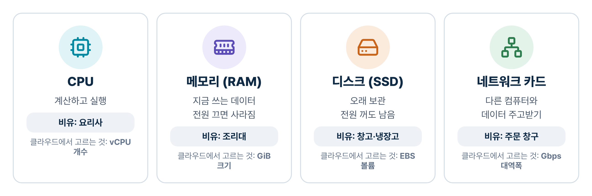
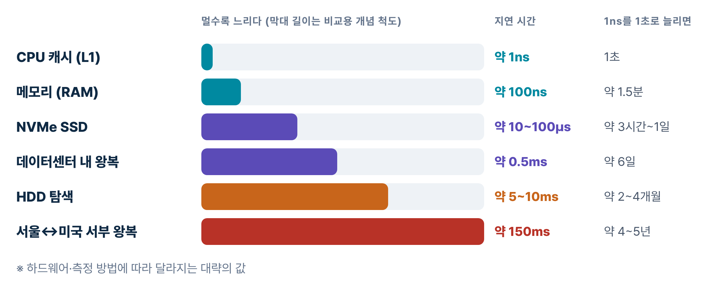

# 1교시 · 컴퓨터는 무엇으로 이루어져 있나

> [!NOTE]
> **이번 시간에 할 일**
>
> - 어제 배운 클라우드의 큰 그림을 10분 동안 되짚습니다.
> - CPU, 메모리, 디스크, 네트워크 카드가 각각 무슨 일을 하는지 설명합니다.
> - 부품마다 속도가 **수천~수백만 배** 차이 난다는 것을 숫자로 느껴 봅니다.
> - 클라우드에서 "인스턴스 타입"을 고른다는 것이 무슨 뜻인지 연결합니다.

## 어제 10분 요약

| 어제 배운 것 | 한 문장 |
|---|---|
| 클라우드 | 가상화된 자원을 셀프서비스로, 쓴 만큼 빌려주는 방식 |
| 가상화 | 물리 서버 한 대를 하이퍼바이저가 여러 VM으로 나눠 주는 기술 |
| IaaS·PaaS·SaaS | 내가 관리하는 층이 어디까지인가의 차이 |
| 공유 책임 | AWS는 클라우드 "자체", 고객은 클라우드 "안"을 책임진다 |

어제 "EC2 인스턴스 = AWS 물리 서버 위의 VM 하나"라고 했습니다. 그런데 VM이든 물리 서버든, 결국 **컴퓨터**입니다. 오늘은 그 컴퓨터를 열어 봅니다.

## 컴퓨터의 네 가지 핵심 부품

| 부품 | 하는 일 | 식당 비유 | 클라우드에서 고르는 것 |
|---|---|---|---|
| CPU (중앙처리장치) | 명령을 하나씩 계산하고 실행한다 | 요리사 | vCPU 개수, CPU 종류(Intel·AMD·Graviton) |
| 메모리 (RAM) | 지금 쓰는 데이터를 잠깐 올려 둔다. 전원이 꺼지면 사라진다 | 조리대 | GiB 단위 메모리 크기 |
| 디스크 (SSD·HDD) | 데이터를 오래 보관한다. 전원이 꺼져도 남는다 | 창고·냉장고 | EBS 볼륨 크기와 종류(gp3, io2 등) |
| 네트워크 카드 (NIC) | 다른 컴퓨터와 데이터를 주고받는다 | 주문 창구·배달 통로 | 네트워크 대역폭(Gbps) |

> **🧩 비유 — 요리사, 조리대, 창고**
>
> 요리사(CPU)가 아무리 빨라도 **조리대(메모리)**가 좁으면 재료를 계속 창고에 갔다 와야 해서 느려집니다. 창고(디스크)는 크지만 멀리 있습니다. 그래서 자주 쓰는 재료는 조리대에, 덜 쓰는 재료는 창고에 둡니다. 컴퓨터 성능 문제의 대부분은 **"요리사가 느린가, 조리대가 좁은가, 창고가 먼가, 창구가 막혔나"** 중 하나입니다. 4주차 모니터링에서 CPU·메모리·디스크·네트워크 지표를 따로 보는 이유입니다.

### CPU — 코어와 클럭

CPU 안에는 실제로 계산하는 **코어(core)**가 여러 개 들어 있습니다. 코어가 8개면 동시에 8가지 일을 처리할 수 있습니다. **클럭(clock)**은 코어가 1초에 몇 번 박자를 맞추는지를 나타내며, 3GHz는 1초에 30억 번입니다.

클라우드에서는 **vCPU(가상 CPU)**라는 단위를 씁니다. 하이퍼바이저가 물리 코어를 나눠 VM에게 주는 단위로, 보통 Intel·AMD 서버에서는 vCPU 1개가 물리 코어의 하드웨어 스레드 1개에 해당합니다. 그래서 "4 vCPU" 인스턴스는 물리 코어 2개(하이퍼스레딩 포함)에 해당하는 경우가 많습니다.

### 메모리 — 빠르지만 휘발성

메모리(RAM)는 CPU가 지금 계산하는 데이터를 올려 두는 곳입니다. 디스크보다 훨씬 빠르지만 **전원이 꺼지면 내용이 사라집니다(휘발성)**. 프로그램이 메모리를 너무 많이 쓰면 운영체제가 그 프로그램을 강제로 종료하기도 합니다. 이것을 **OOM(Out Of Memory) Kill**이라고 하며, 4주차 Kubernetes에서 `OOMKilled`라는 상태로 직접 만나게 됩니다.

### 디스크 — 느리지만 영구적

디스크는 전원이 꺼져도 데이터를 보관합니다. 예전에는 회전하는 원판에 자기로 기록하는 **HDD**가 주류였고, 지금은 반도체로 만든 **SSD**, 그중에서도 PCIe 버스에 직접 연결해 훨씬 빠른 **NVMe SSD**가 서버의 표준입니다.

### 네트워크 카드 — 바깥과 통하는 문

NIC(Network Interface Card)는 컴퓨터가 네트워크에 연결되는 출입구입니다. 서버용 NIC는 초당 10~100Gbps를 넘나들고, 클라우드에서는 인스턴스 크기가 클수록 네트워크 대역폭도 커집니다. 내일(3일차) 네트워크 수업에서 이 문을 통해 데이터가 어떻게 오가는지 자세히 봅니다.

## 속도의 차이 — 메모리 계층

부품들의 속도 차이는 상상보다 훨씬 큽니다. 아래 그림은 데이터를 한 번 읽어 오는 데 걸리는 대략의 시간입니다.

| 위치 | 대략의 지연 시간 | 1초로 늘려 보면 |
|---|---|---|
| CPU L1 캐시 | 약 1ns | 1초 |
| 메인 메모리(RAM) | 약 100ns | 약 1.5분 |
| NVMe SSD 읽기 | 약 10~100µs | 약 3시간~1일 |
| 같은 데이터센터 안 왕복 | 약 0.5ms | 약 6일 |
| HDD 탐색 | 약 5~10ms | 약 2~4개월 |
| 서울↔미국 서부 왕복 | 약 130~150ms | 약 4~5년 |

※ 하드웨어와 측정 방법에 따라 달라지는 대략의 값입니다.

> [!IMPORTANT]
> **이 표가 클라우드 설계에 주는 교훈**
>
> - **같은 일이라도 어디서 데이터를 가져오느냐에 따라 수천 배 차이**가 납니다. 그래서 자주 읽는 데이터는 메모리 캐시(Redis 같은)에 둡니다. → 1주차 4일차
> - **멀리 있는 서버와의 통신은 매우 비쌉니다.** 그래서 사용자 가까운 리전에 서버를 두고, 정적 파일은 CDN으로 가까운 곳에서 내보냅니다. → 1주차 3일차
> - 서비스끼리 네트워크로 통신하는 **MSA는 함수 호출보다 수천 배 느린 호출**을 많이 만듭니다. → 3주차

> **🎓 학술 노트 — 폰 노이만 구조 (1945)**
>
> 오늘날 거의 모든 컴퓨터는 수학자 존 폰 노이만(John von Neumann)이 1945년 「EDVAC에 관한 보고서 초안(First Draft of a Report on the EDVAC)」에서 정리한 구조를 따릅니다. 핵심은 **프로그램(명령)과 데이터를 같은 메모리에 저장**하고, CPU가 메모리에서 명령을 하나씩 가져와(fetch) 해석하고(decode) 실행(execute)한다는 것입니다.
>
> 이 구조 덕분에 하드웨어를 바꾸지 않고 **소프트웨어만 바꿔서** 다른 일을 시킬 수 있게 됐습니다. 클라우드와 가상화가 "같은 물리 서버로 수많은 고객의 서로 다른 프로그램을 돌리는" 것도 이 원리 위에 서 있습니다.
>
> 한편 CPU는 계속 빨라지는데 메모리는 그만큼 빨라지지 못해서, CPU가 메모리를 기다리며 노는 문제를 **폰 노이만 병목(von Neumann bottleneck)**이라고 부릅니다. 1977년 존 배커스(John Backus)가 튜링상 강연에서 이 말을 썼습니다. 위 표의 캐시 계층은 이 병목을 줄이기 위한 장치입니다.

> **🎓 학술 노트 — 모든 프로그래머가 알아야 할 지연 시간**
>
> 구글의 제프 딘(Jeff Dean)은 강연에서 "모든 프로그래머가 알아야 할 지연 시간(Latency Numbers Every Programmer Should Know)"이라는 표를 소개해 유명해졌습니다. 위 표도 같은 생각을 따릅니다. 시스템을 설계할 때는 **"이 동작이 어느 층에서 일어나는가"**를 먼저 생각하면, 코드를 보지 않고도 성능 문제를 상당 부분 예측할 수 있습니다.

## 서버와 PC는 무엇이 다를까

서버도 컴퓨터이지만, 24시간 많은 사용자에게 서비스해야 하므로 설계 목표가 다릅니다.

| 항목 | 개인 PC | 서버 |
|---|---|---|
| 목표 | 한 사람이 쓰기 편하게 | 많은 요청을 멈춤 없이 |
| 메모리 | 일반 메모리 | 오류를 스스로 고치는 **ECC 메모리** |
| 전원 | 1개 | **이중화** (하나가 고장 나도 동작) |
| 디스크 | 1~2개 | 여러 개를 묶어 고장에 대비 (RAID 등) |
| 관리 | 모니터·키보드로 | 원격 관리 칩(BMC)으로 꺼져 있어도 원격 제어 |
| 모양 | 데스크톱·노트북 | 랙에 꽂는 납작한 형태(1U, 2U) |

클라우드를 쓰면 이런 하드웨어를 직접 고르지 않지만, **"하드웨어는 언젠가 고장 난다"**는 전제는 그대로입니다. 그래서 5주차에 여러 가용 영역에 서버를 나눠 두는 설계를 배웁니다.

## 2025–2026 트렌드 — CPU 전쟁과 AI 칩

> **📈 트렌드 — ARM 서버 CPU의 부상 (AWS Graviton)**
>
> 오랫동안 서버 CPU는 Intel과 AMD의 x86이 거의 전부였습니다. 그런데 스마트폰에 쓰이던 **ARM** 설계가 전력 효율을 무기로 데이터센터에 들어오고 있습니다. AWS는 직접 설계한 ARM 기반 CPU **Graviton**을 2018년부터 내놓았고, 2025년 12월 re:Invent에서 192코어의 **Graviton5**를 발표하며 **3년 연속 AWS가 새로 추가한 CPU 용량의 절반 이상이 Graviton**이고, EC2 상위 1,000개 고객의 98%가 Graviton을 쓰고 있다고 밝혔습니다.
>
> 초보자에게 이것이 중요한 이유는 하나입니다. **CPU 종류(아키텍처)가 다르면 같은 프로그램이 그대로 돌지 않을 수 있습니다.** Apple Silicon Mac(ARM)에서 만든 Docker 이미지가 x86 서버에서 안 도는 일이 실제로 자주 생깁니다. 2주차 Docker 수업에서 `linux/amd64`, `linux/arm64` 같은 **플랫폼** 표기를 보게 되는 이유입니다.

> **📈 트렌드 — GPU와 AI 전용 칩**
>
> CPU가 "무엇이든 잘하는 요리사 몇 명"이라면, **GPU**는 "같은 동작을 동시에 수천 번 하는 보조 요리사 수천 명"입니다. AI 학습과 추론은 같은 계산을 엄청나게 많이 반복하므로 GPU가 유리합니다. AWS의 Trainium·Inferentia, 구글의 TPU처럼 클라우드 회사들이 AI 전용 칩을 직접 만드는 흐름도 빨라지고 있습니다. 어제 본 AI 데이터센터 전력 문제의 주인공이 바로 이 칩들입니다.

## 정리

- 컴퓨터는 **CPU(계산), 메모리(빠른 임시 저장), 디스크(느린 영구 저장), NIC(통신)**로 이루어집니다.
- 부품 사이 속도 차이는 **수천~수백만 배**입니다. 데이터가 어디 있느냐가 성능을 좌우합니다.
- 클라우드에서 인스턴스 타입을 고른다는 것은 **vCPU·메모리·네트워크의 조합**을 고르는 것입니다.
- CPU 아키텍처(x86 vs ARM)가 다르면 실행 파일과 이미지도 달라질 수 있습니다.

> **✅ 확인 문제**
>
> 1. 전원이 꺼지면 내용이 사라지는 부품은 메모리와 디스크 중 무엇인가요?
> 2. 메모리에서 데이터를 읽는 것과 HDD에서 읽는 것은 대략 몇 배 차이가 나나요?
> 3. 프로그램이 메모리를 너무 많이 써서 운영체제가 강제로 종료하는 것을 무엇이라고 하나요?
> 4. 프로그램과 데이터를 같은 메모리에 두는 컴퓨터 구조의 이름은?
> 5. Apple Silicon Mac에서 만든 Docker 이미지가 Intel 서버에서 실행되지 않을 수 있는 이유는?
>
> 

정답

>
> 1. 메모리(RAM)
> 2. 약 5만~10만 배 (100ns vs 5~10ms)
> 3. OOM(Out Of Memory) Kill
> 4. 폰 노이만 구조
> 5. CPU 아키텍처가 다르기 때문(ARM vs x86). 이미지가 특정 아키텍처용으로 빌드되어 있으면 다른 아키텍처에서 그대로 실행되지 않습니다.
>
> 

## 참고 문헌

- von Neumann, J. (1945). *First Draft of a Report on the EDVAC*. University of Pennsylvania.
- Backus, J. (1978). Can programming be liberated from the von Neumann style? *Communications of the ACM*, 21(8). (1977 튜링상 강연)
- Dean, J. *Latency Numbers Every Programmer Should Know* (강연 자료).
- Hennessy, J. L., & Patterson, D. A. (2017). *Computer Architecture: A Quantitative Approach* (6th ed.). Morgan Kaufmann.
- Amazon (2025.12). AWS Introduces Graviton5 — press.aboutamazon.com
