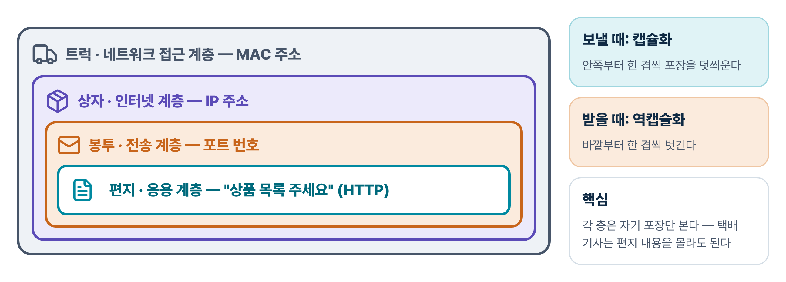
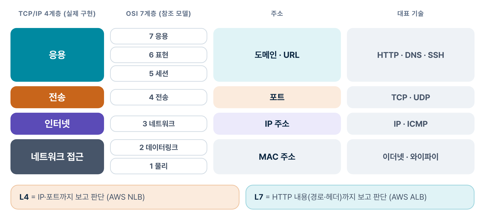

# 1교시 · 네트워크 큰 그림

> [!NOTE]
> **이번 시간에 할 일**
>
> - 어제 배운 컴퓨터·운영체제·컨테이너를 10분 동안 되짚습니다.
> - 데이터가 **패킷**으로 잘려서 전달된다는 것을 이해합니다.
> - 네트워크 계층 모델(OSI 7계층, TCP/IP 4계층)을 **택배**에 비유해 설명합니다.
> - 인터넷이 어떻게 탄생했는지, 왜 지금의 모습이 되었는지 압니다.

## 어제 10분 요약

| 어제 배운 것 | 한 문장 |
|---|---|
| 부품과 속도 | 데이터가 어디 있느냐에 따라 수천~수백만 배 속도 차이 |
| 운영체제 | 프로그램은 시스템 콜로 커널에 부탁한다 |
| 프로세스 | 실행 중인 프로그램, 종료 코드 0은 성공 |
| 파일 | 설정은 `/etc`, 로그는 `/var/log`, 권한은 최소로 |
| 컨테이너 | 네임스페이스와 cgroups로 격리된 프로세스 |

어제 컴퓨터 부품 중 **네트워크 카드(NIC)**는 "주문 창구"라고만 하고 넘어갔습니다. 오늘은 그 창구를 통해 데이터가 어떻게 세상 반대편까지 가는지 따라가 봅니다. 그리고 어제 배운 **"서울↔미국 서부 왕복 약 150ms"**가 왜 그렇게 오래 걸리는지도 이해하게 됩니다.

## 네트워크란 무엇인가

**네트워크**는 컴퓨터들이 서로 데이터를 주고받을 수 있게 연결된 것입니다. 집 안의 와이파이도, 회사의 사내망도, 전 세계를 잇는 인터넷도 모두 네트워크입니다. **인터넷(internet)**은 이름 그대로 "네트워크(net)들 사이(inter)"를 연결한 **네트워크의 네트워크**입니다.

### 데이터는 잘게 잘려서 간다 — 패킷

1GB 동영상 파일을 보낼 때, 파일 전체가 한 덩어리로 날아가지 않습니다. 데이터는 보통 1,500바이트 안팎의 작은 조각으로 잘려서 각각 따로 전달되고, 받는 쪽에서 다시 조립됩니다. 이 조각을 **패킷(packet)**이라고 합니다.

| 한 덩어리로 보낸다면 | 패킷으로 잘라 보내면 |
|---|---|
| 중간에 한 바이트만 깨져도 전부 다시 보내야 한다 | 깨진 조각만 다시 보내면 된다 |
| 큰 파일 하나가 길을 독차지한다 | 여러 사람의 패킷이 길을 나눠 쓴다 |
| 길 하나가 끊기면 실패 | 조각마다 다른 길로 돌아서 갈 수 있다 |

## 택배로 이해하는 계층 모델

네트워크는 한 번에 모든 문제를 풀지 않고, 문제를 **층(layer)**으로 나눠서 각 층이 한 가지 일만 하도록 설계되어 있습니다. 어제 배운 Unix 철학("한 가지 일을 잘하라")과 같은 생각입니다.

> **🧩 비유 — 택배 보내기**
>
> 여러분이 친구에게 편지를 보낸다고 합시다.
>
> 1. **편지 내용**을 쓴다. → 응용 계층 (HTTP 요청: "상품 목록 주세요")
> 2. 편지를 **봉투에 넣고 몇 번 창구 앞으로 보낼지** 적는다. → 전송 계층 (TCP, **포트 번호**)
> 3. 봉투를 **상자에 넣고 받는 사람 주소**를 적는다. → 인터넷 계층 (IP, **IP 주소**)
> 4. 택배 기사가 **다음 물류센터까지 트럭에 싣는다**. → 네트워크 접근 계층 (이더넷·와이파이, **MAC 주소**)
>
> 받는 쪽에서는 거꾸로 트럭에서 내리고, 상자를 열고, 봉투를 열어 편지를 읽습니다. 이렇게 층마다 포장을 덧씌우는 것을 **캡슐화(encapsulation)**, 벗기는 것을 **역캡슐화**라고 합니다. 각 층은 자기 포장에 적힌 정보만 보면 되므로, 택배 기사는 편지 내용을 몰라도 배달할 수 있습니다.

## OSI 7계층과 TCP/IP 4계층

| TCP/IP 4계층 | OSI 7계층 | 하는 일 | 주소 | 대표 기술 | 이 과정에서 |
|---|---|---|---|---|---|
| 응용 | 7 응용 · 6 표현 · 5 세션 | 사람이 원하는 서비스 | 도메인, URL | HTTP, DNS, SSH | 5교시, 4주차 Gateway API |
| 전송 | 4 전송 | 어느 프로그램에, 얼마나 확실히 | **포트** | TCP, UDP | 3교시, Docker 포트 |
| 인터넷 | 3 네트워크 | 어느 컴퓨터로, 어떤 길로 | **IP 주소** | IP, ICMP(ping) | 2교시, AWS VPC |
| 네트워크 접근 | 2 데이터링크 · 1 물리 | 바로 옆 장비까지 | **MAC 주소** | 이더넷, 와이파이 | (클라우드가 대신 관리) |

> [!TIP]
> **현업에서 쓰는 'L4', 'L7'이라는 말**
>
> 현업에서는 OSI 번호로 말하는 경우가 많습니다. **"L4 로드밸런서"**는 IP와 포트까지만 보고 나누는 장비(AWS NLB), **"L7 로드밸런서"**는 HTTP 내용(URL 경로, 헤더)까지 보고 나누는 장비(AWS ALB)입니다. **"L7 방화벽"**은 HTTP 내용까지 검사하는 웹 방화벽(WAF)입니다. 7교시와 5주차에서 다시 만납니다.

### 왜 OSI는 7계층인데 실제로는 4계층을 쓸까?

OSI 모델은 국제표준화기구(ISO)가 1984년에 표준으로 발표한 **참조 모델**입니다. 체계적이지만, 실제 인터넷은 그보다 먼저 만들어지고 이미 널리 퍼진 **TCP/IP**로 돌아갑니다. 그래서 공부와 대화에는 OSI 번호(L4, L7)를, 실제 구현에는 TCP/IP 모델을 쓰는 것이 현실입니다. "잘 설계된 표준보다 먼저 돌아가는 구현이 이긴다"는 인터넷 역사의 교훈이기도 합니다.

> **🎓 학술 노트 — 인터넷을 만든 세 편의 글**
>
> **1. 패킷 교환의 아이디어 (Baran, 1964)**
> 미국 RAND 연구소의 폴 배런(Paul Baran)은 핵전쟁으로 통신망 일부가 파괴되어도 살아남는 네트워크를 연구했습니다. 그의 답은 메시지를 작은 블록으로 잘라 **여러 경로로 나눠 보내는** 분산형 네트워크였습니다. 영국의 도널드 데이비스(Donald Davies)도 비슷한 시기에 같은 아이디어를 독립적으로 내고 **"패킷"**이라는 이름을 붙였습니다. 이 아이디어로 1969년 **ARPANET**이 탄생했습니다.
>
> **2. TCP/IP의 설계 (Cerf & Kahn, 1974)**
> 빈트 서프(Vint Cerf)와 밥 칸(Bob Kahn)은 1974년 논문 「패킷 네트워크 상호 통신을 위한 프로토콜(A Protocol for Packet Network Intercommunication)」에서 **서로 다른 네트워크를 하나로 잇는 방법**을 제시했습니다. 이것이 TCP/IP의 원형이고, ARPANET은 1983년 1월 1일 TCP/IP로 전면 전환했습니다. 두 사람은 이 공로로 2004년 튜링상을 받았고 "인터넷의 아버지"로 불립니다.
>
> **3. 종단 간 원칙 (Saltzer, Reed & Clark, 1984)**
> MIT 연구진은 「시스템 설계에서의 종단 간 논증(End-to-End Arguments in System Design)」에서, 네트워크 **중간은 단순하게** 두고 오류 확인이나 암호화 같은 기능은 **양 끝(사용자 컴퓨터)에서** 처리해야 한다고 주장했습니다. 덕분에 인터넷 중간 장비는 "패킷을 다음으로 넘기는 일"만 하면 되었고, 새로운 서비스는 끝단의 소프트웨어만 바꿔서 얼마든지 만들 수 있었습니다. 웹, 스트리밍, 클라우드가 인터넷 구조를 바꾸지 않고 등장할 수 있었던 이유입니다.
>
> - Baran, P. (1964). On distributed communications networks. *IEEE Transactions on Communications Systems*, 12(1).
> - Cerf, V. G., & Kahn, R. E. (1974). A protocol for packet network intercommunication. *IEEE Transactions on Communications*, 22(5).
> - Saltzer, J. H., Reed, D. P., & Clark, D. D. (1984). End-to-end arguments in system design. *ACM Transactions on Computer Systems*, 2(4).

## 빛도 시간이 걸린다

어제 "서울↔미국 서부 왕복 약 150ms"라고 했습니다. 왜 이렇게 오래 걸릴까요? 데이터는 바다 밑 **해저 광케이블**을 빛의 형태로 지나가는데, 광섬유 안에서 빛의 속도는 진공의 약 3분의 2(초속 약 20만 km)입니다. 서울에서 미국 서부까지 케이블 길이를 약 1만 km라고 하면 편도 50ms, 왕복 100ms가 **물리 법칙만으로** 걸리고, 여기에 중간 장비를 거치는 시간이 더해집니다.

> [!IMPORTANT]
> **클라우드 설계에 주는 교훈**
>
> 아무리 서버를 빠르게 만들어도 **빛의 속도는 바꿀 수 없습니다.** 그래서 클라우드에서는 사용자 가까운 **리전**에 서버를 두고, 이미지·동영상 같은 정적 파일은 전 세계에 흩어진 **CDN**에 복사해 둡니다. 한국 사용자 대상 서비스라면 서울 리전(ap-northeast-2)을 고르는 가장 근본적인 이유입니다. 6교시에서 요청 하나가 겪는 시간을 단계별로 쪼개 봅니다.

## 2025–2026 트렌드

> **📈 트렌드 — 인터넷의 '배관'이 다시 주목받는 이유**
>
> 2025년 10월 20일 AWS 버지니아(us-east-1) 리전에서 약 15시간 동안 이어진 대형 장애가 있었습니다. Slack, Snapchat 등 수많은 서비스가 영향을 받았는데, AWS가 공개한 사후 보고서에 따르면 시작점은 DynamoDB의 **DNS 레코드가 비어 버린 것**이었습니다. 서버도 데이터베이스도 멀쩡했지만, **이름을 주소로 바꾸는 단계(DNS)**가 실패하자 연결 자체가 불가능해졌습니다. 오늘 4교시에서 이 사건을 자세히 봅니다. 네트워크는 "평소엔 보이지 않다가 고장 나면 모든 것을 멈추는 배관"입니다.

## 정리

- 데이터는 **패킷**으로 잘려서 전달되고 받는 쪽에서 다시 조립됩니다.
- 네트워크는 **층**으로 나뉘며, 각 층이 포장을 덧씌우는 것을 **캡슐화**라고 합니다.
- 공부·대화는 **OSI 7계층**(L4, L7)으로, 실제 구현은 **TCP/IP 4계층**으로 합니다.
- 인터넷은 패킷 교환(1964) → TCP/IP(1974) → 종단 간 원칙(1984)이라는 설계 위에 서 있습니다.
- 빛의 속도 때문에 **거리 = 지연 시간**이고, 그래서 리전과 CDN을 고릅니다.

> **✅ 확인 문제**
>
> 1. 큰 데이터를 작은 조각으로 나눠 보내는 단위를 무엇이라고 하나요?
> 2. 택배 비유에서 "받는 사람 주소"와 "몇 번 창구 앞"은 각각 어떤 계층의 무엇에 해당하나요?
> 3. URL 경로를 보고 트래픽을 나누는 로드밸런서는 L4와 L7 중 무엇인가요?
> 4. TCP/IP를 설계해 "인터넷의 아버지"로 불리는 두 사람은?
> 5. 한국 사용자를 위한 서비스를 서울 리전에 두는 가장 근본적인 이유는?
>
> 

정답

>
> 1. 패킷(packet)
> 2. 받는 사람 주소 = 인터넷 계층의 IP 주소, 몇 번 창구 = 전송 계층의 포트 번호
> 3. L7
> 4. 빈트 서프(Vint Cerf)와 밥 칸(Bob Kahn)
> 5. 거리가 가까울수록 빛이 이동하는 시간(지연 시간)이 짧기 때문
>
> 

## 참고 문헌

- Baran, P. (1964). On distributed communications networks. *IEEE Transactions on Communications Systems*, 12(1).
- Cerf, V. G., & Kahn, R. E. (1974). A protocol for packet network intercommunication. *IEEE Transactions on Communications*, 22(5).
- Saltzer, J. H., Reed, D. P., & Clark, D. D. (1984). End-to-end arguments in system design. *ACM TOCS*, 2(4).
- ISO/IEC 7498-1 (1984/1994). *Open Systems Interconnection — Basic Reference Model*.
- Kurose, J. F., & Ross, K. W. (2021). *Computer Networking: A Top-Down Approach* (8th ed.). Pearson.
- AWS (2025). *Summary of the Amazon DynamoDB Service Disruption in the Northern Virginia (US-EAST-1) Region*.
