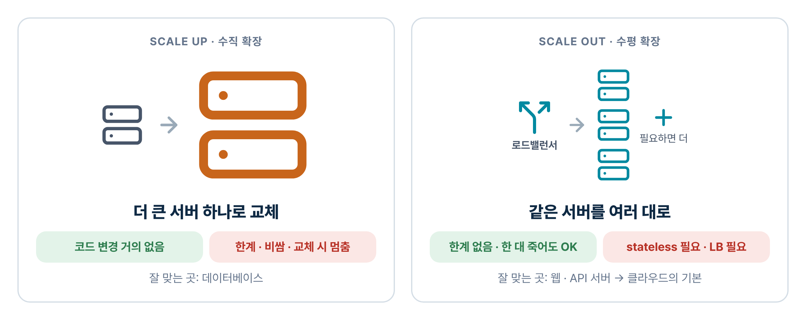
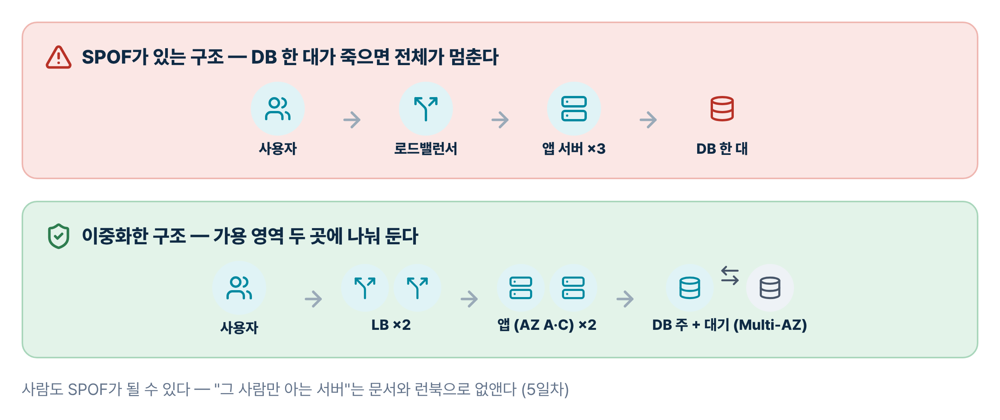

# 3교시 · 확장성과 가용성

> [!NOTE]
> **이번 시간에 할 일**
>
> - 스케일 업과 스케일 아웃의 차이를 설명합니다.
> - 가용성을 "9의 개수"로 읽고, 허용되는 장애 시간을 계산합니다.
> - 단일 장애점(SPOF)을 찾고 없애는 방법을 압니다.
> - 분산 시스템의 CAP 정리를 이해합니다.

## 확장성 — 손님이 10배로 늘면

**확장성(scalability)**은 일이 늘어났을 때 시스템이 그만큼 더 많은 일을 처리할 수 있는 능력입니다. 방법은 크게 두 가지입니다.

| 비교 | 스케일 업 (Scale Up, 수직 확장) | 스케일 아웃 (Scale Out, 수평 확장) |
|---|---|---|
| 방법 | 서버를 **더 큰 것**으로 바꾼다 | 서버를 **여러 대로** 늘린다 |
| 비유 | 요리사를 더 실력 좋은 사람으로 교체 | 요리사를 여러 명 고용 |
| 장점 | 코드를 거의 바꿀 필요 없음 | 이론상 한계 없음, 한 대가 죽어도 버팀 |
| 단점 | 한계가 있고, 클수록 비싸며, 교체 시 멈춤 | 앱이 **stateless**여야 하고, 로드밸런서 필요 |
| AWS 예 | EC2 `t3.small` → `m7g.4xlarge` | EC2 여러 대 + ALB + Auto Scaling |
| 잘 맞는 곳 | 데이터베이스 (나누기 어려움) | 웹·API 서버 |

> [!IMPORTANT]
> **클라우드는 스케일 아웃의 시대**
>
> 1일차의 클라우드 정의 중 **"빠른 탄력성"**은 스케일 아웃을 자동으로 한다는 뜻입니다. 트래픽이 늘면 서버를 자동으로 늘리고(Auto Scaling), 줄면 다시 줄여 비용을 아낍니다. 이것이 가능하려면 2교시의 **stateless**와 어제 7교시의 **로드밸런서·헬스 체크**가 모두 갖춰져야 합니다. 3주차 Kubernetes의 `replicas: 3`, 4주차의 HPA(자동 확장)가 바로 이 개념입니다.

## 가용성 — "9의 개수"로 말한다

**가용성(availability)**은 시스템이 **정상적으로 쓸 수 있는 시간의 비율**입니다. 현업에서는 퍼센트의 9 개수로 말합니다.

| 가용성 | 별칭 | 1년 동안 허용되는 장애 시간 | 한 달 동안 |
|---|---|---|---|
| 99% | 투 나인 | 약 3.65일 | 약 7.3시간 |
| 99.9% | 쓰리 나인 | 약 8.8시간 | 약 43분 |
| 99.95% | | 약 4.4시간 | 약 22분 |
| 99.99% | 포 나인 | 약 53분 | 약 4.3분 |
| 99.999% | 파이브 나인 | 약 5.3분 | 약 26초 |

9가 하나 늘 때마다 허용 장애 시간은 **10분의 1**로 줄어들고, 그것을 달성하는 비용은 크게 늘어납니다. 그래서 "무조건 높게"가 아니라 **서비스에 맞는 목표**를 정합니다. 사내 관리 도구는 99%여도 괜찮지만, 결제 시스템은 99.99%를 목표로 할 수 있습니다.

> **📘 직렬 연결은 가용성을 깎는다**
>
> 웹 서버(99.9%) → API 서버(99.9%) → DB(99.9%)가 **모두 살아 있어야** 요청이 성공한다면, 전체 가용성은 곱셈입니다.
>
> 0.999 × 0.999 × 0.999 ≈ **0.997 (99.7%)**
>
> 각각은 쓰리 나인인데 전체는 쓰리 나인이 안 됩니다. 의존하는 부품이 많을수록 전체 가용성은 떨어집니다. 7교시에서 MSA가 서비스를 잘게 나눌 때 조심해야 하는 이유이기도 합니다.
>
> 반대로 같은 서버를 **병렬로 두 대** 두면 둘 다 동시에 죽을 확률만 실패이므로, 99% 서버 두 대로 1 − (0.01 × 0.01) = **99.99%**를 얻을 수 있습니다(서로 독립적으로 고장 난다는 가정). 이것이 **이중화**의 힘입니다.

## 단일 장애점(SPOF)

**단일 장애점(SPOF, Single Point of Failure)**은 그것 하나가 고장 나면 **전체가 멈추는 부분**입니다.

| SPOF 예 | 없애는 방법 | AWS에서 |
|---|---|---|
| 서버 한 대 | 여러 대 + 로드밸런서 | EC2 여러 대 + ALB |
| 가용 영역 하나 | 두 개 이상의 가용 영역에 분산 | **Multi-AZ** 배치 |
| DB 한 대 | 대기 복제본(standby)을 두고 자동 전환 | RDS Multi-AZ |
| 리전 하나 | 다른 리전에 복제 | 멀티 리전 (비용 큼) |
| 사람 한 명 | 문서화, 지식 공유, 당번 교대 | 5일차 런북 |

어제 4교시의 2025년 AWS 장애를 다시 떠올려 보세요. 많은 서비스가 **us-east-1 리전 하나**와 **DynamoDB 엔드포인트 하나**에 의존하고 있었다는 것을 장애가 나고 나서야 알았습니다. SPOF는 설계도에 잘 드러나지 않고, 고장 났을 때 비로소 보입니다.

> **🎓 학술 노트 — CAP 정리 (Brewer, 2000 / Gilbert & Lynch, 2002)**
>
> 데이터를 여러 서버에 복제해 두는 분산 시스템에는 세 가지 바람직한 성질이 있습니다.
>
> - **C (Consistency, 일관성)** — 모든 서버가 같은 순간 같은 데이터를 보여 준다.
> - **A (Availability, 가용성)** — 모든 요청이 (에러가 아닌) 응답을 받는다.
> - **P (Partition tolerance, 분할 내성)** — 서버들 사이 네트워크가 끊겨도 시스템이 계속 동작한다.
>
> UC 버클리의 에릭 브루어(Eric Brewer)는 2000년 PODC 학회 기조연설에서 **세 가지를 동시에 모두 만족할 수는 없다**고 추측했고, 2002년 MIT의 세스 길버트(Seth Gilbert)와 낸시 린치(Nancy Lynch)가 이를 수학적으로 증명했습니다.
>
> 실제로는 어제 배운 "네트워크는 믿을 수 없다"는 착각 때문에 **P는 포기할 수 없습니다.** 그래서 네트워크가 끊겼을 때 **C와 A 중 무엇을 택할지**를 고르는 문제가 됩니다.
>
> | 선택 | 네트워크가 끊기면 | 어울리는 곳 |
> |---|---|---|
> | **CP** | 틀린 답을 주느니 응답을 거부한다 | 은행 잔액, 재고 수량 |
> | **AP** | 조금 오래된 답이라도 일단 준다 | SNS 좋아요 수, 상품 리뷰 |
>
> 브루어 자신도 2012년 회고에서 "셋 중 둘을 고른다"는 표현이 지나치게 단순하며, 평소에는 세 가지를 모두 최대한 누리다가 **네트워크 분할이 일어났을 때만** 선택이 필요하다고 정리했습니다. 4교시의 RDB와 NoSQL 선택이 바로 이 문제와 연결됩니다.
>
> - Brewer, E. (2000). Towards robust distributed systems. *PODC Keynote*.
> - Gilbert, S., & Lynch, N. (2002). Brewer's conjecture and the feasibility of consistent, available, partition-tolerant web services. *ACM SIGACT News*, 33(2).
> - Brewer, E. (2012). CAP twelve years later: How the "rules" have changed. *IEEE Computer*, 45(2).

> **📈 트렌드 — SLO와 오류 예산**
>
> "가용성 100%"는 불가능할 뿐 아니라 바람직하지도 않습니다. 100%를 추구하면 아무것도 바꿀 수 없기 때문입니다. 구글 SRE는 대신 **SLO(Service Level Objective, 서비스 수준 목표)**를 정하고, 그 목표와 100% 사이의 차이를 **오류 예산(error budget)**이라고 부릅니다. 예를 들어 SLO가 99.9%면 한 달에 약 43분의 장애가 "예산"입니다. 예산이 남아 있으면 새 기능을 과감히 배포하고, 다 쓰면 배포를 멈추고 안정화에 집중합니다. 개발(속도)과 운영(안정) 사이의 오래된 갈등을 **숫자 하나로 합의**하게 만드는 방법으로, 4주차 관찰 가능성 시간에 직접 다룹니다.

## 정리

- **스케일 업**은 더 큰 서버로, **스케일 아웃**은 여러 대로. 클라우드는 스케일 아웃의 시대입니다.
- 가용성은 **9의 개수**로 말하며, 9가 하나 늘면 허용 장애 시간은 1/10이 됩니다.
- 직렬 의존은 가용성을 **곱해서 깎고**, 병렬 이중화는 높입니다.
- **SPOF**는 하나뿐인 부품이며, 서버·AZ·DB·사람까지 찾아서 이중화합니다.
- **CAP**: 네트워크가 끊기면 일관성과 가용성 중 하나를 골라야 합니다.

> **✅ 확인 문제**
>
> 1. 서버를 더 큰 것으로 바꾸는 것과 여러 대로 늘리는 것의 이름은?
> 2. 99.9% 가용성이면 한 달에 대략 몇 분의 장애가 허용되나요?
> 3. 가용성 99.9%인 부품 세 개가 직렬로 연결되면 전체 가용성은 대략?
> 4. RDS를 두 가용 영역에 나눠 두는 기능의 이름은?
> 5. 네트워크가 끊겼을 때 은행 잔액 조회는 CP와 AP 중 무엇을 택해야 할까요?
>
> 

정답

>
> 1. 스케일 업(수직 확장), 스케일 아웃(수평 확장)
> 2. 약 43분
> 3. 약 99.7%
> 4. Multi-AZ
> 5. CP — 틀린 잔액을 보여 주느니 응답을 거부하는 편이 낫다
>
> 

## 참고 문헌

- Brewer, E. (2000). Towards robust distributed systems. *PODC Keynote*.
- Gilbert, S., & Lynch, N. (2002). Brewer's conjecture and the feasibility of consistent, available, partition-tolerant web services. *ACM SIGACT News*, 33(2).
- Brewer, E. (2012). CAP twelve years later. *IEEE Computer*, 45(2).
- Beyer, B. et al. (2016). *Site Reliability Engineering*. O'Reilly. (Ch. 3 Embracing Risk, Ch. 4 SLOs)
- AWS. *Reliability Pillar — AWS Well-Architected Framework*.
