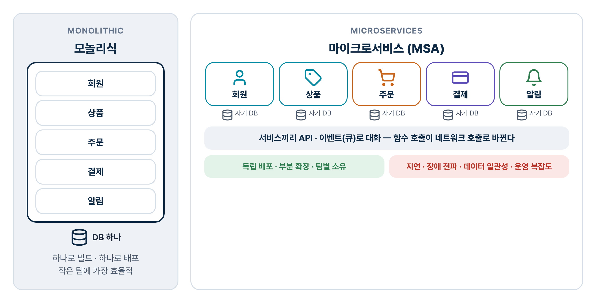
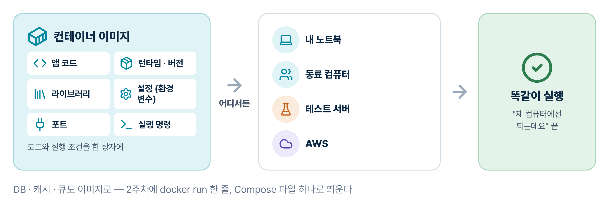

# 7교시 · 모놀리식과 MSA, 그리고 왜 Docker인가

> [!NOTE]
> **이번 시간에 할 일**
>
> - 모놀리식과 마이크로서비스(MSA)의 차이를 설명합니다.
> - MSA가 해결하는 문제와 새로 만드는 문제를 압니다.
> - "MSA가 항상 정답은 아니다"라는 사례를 봅니다.
> - 오늘 배운 실행 조건을 바탕으로 왜 2주차에 Docker를 배우는지 정리합니다.

## 모놀리식 — 하나의 큰 덩어리

**모놀리식(monolithic)** 애플리케이션은 회원, 상품, 주문, 결제 기능이 **하나의 프로그램**으로 만들어져 하나로 배포됩니다. 나쁜 말이 아닙니다. 대부분의 서비스는 모놀리식으로 시작하고, 작은 팀에게는 가장 효율적인 구조입니다.

## 마이크로서비스(MSA) — 작은 서비스 여러 개

**마이크로서비스 아키텍처(MSA, Microservices Architecture)**는 기능을 **독립적으로 배포할 수 있는 작은 서비스 여러 개**로 나누고, 서비스끼리 API나 이벤트로 대화하게 하는 구조입니다.

| 비교 | 모놀리식 | 마이크로서비스 |
|---|---|---|
| 배포 | 전체를 한 번에 | 서비스별로 **독립 배포** |
| 확장 | 전체를 통째로 늘린다 | **바쁜 서비스만** 늘린다 |
| 장애 | 한 기능의 버그가 전체를 멈출 수 있다 | 잘 설계하면 **장애가 격리**된다 |
| 기술 | 한 가지 언어·프레임워크 | 서비스마다 다르게 고를 수 있다 |
| 팀 | 모두가 한 코드베이스를 함께 수정 | 팀마다 서비스를 **소유** |
| 통신 | 함수 호출 (빠르고 확실) | **네트워크 호출** (느리고 실패할 수 있다) |
| 데이터 | 하나의 DB, 트랜잭션 쉬움 | 서비스별 DB, **데이터 일관성이 어렵다** |
| 운영 | 단순 | **복잡** — 배포·모니터링·추적 대상이 수십 배 |

> [!IMPORTANT]
> **MSA는 기술 문제를 조직 문제와 바꾼다**
>
> MSA의 가장 큰 장점은 사실 기술이 아니라 **조직**에 있습니다. 개발자가 수백 명이 되면 하나의 코드베이스에서 서로 기다리고 충돌하는 비용이 엄청나게 커집니다. MSA는 팀마다 자기 서비스를 독립적으로 배포하게 해서 이 비용을 줄입니다(2교시 콘웨이의 법칙). 대신 그 대가로 **네트워크 통신, 데이터 일관성, 운영 복잡도**라는 새로운 기술 문제를 떠안습니다. 어제 배운 **분산 컴퓨팅의 여덟 가지 착각**이 모두 현실이 되는 순간입니다.

## MSA가 새로 만드는 문제들

| 새로운 문제 | 왜 생기나 | 해결 도구 (이 과정에서) |
|---|---|---|
| 서비스가 서로를 어떻게 찾나 | IP가 계속 바뀐다 | K8s Service·DNS (3주차) |
| 한 서비스의 장애가 번진다 | 동기 호출의 연쇄 | 타임아웃·재시도·서킷 브레이커 (3주차, Istio 4주차) |
| 요청이 어디서 느려졌나 | 한 요청이 여러 서비스를 거친다 | 분산 추적, OpenTelemetry (4주차) |
| 수십 개 서비스 배포 | 수작업으로는 불가능 | CI/CD, GitOps Argo CD (3~4주차) |
| 서비스 간 보안 | 내부 통신도 믿을 수 없다 | mTLS, 제로 트러스트 (4주차) |
| 실행 환경이 제각각 | 서비스마다 언어·버전이 다르다 | **컨테이너 (2주차)** |

이 표가 사실상 **2~4주차의 목차**입니다. 이 과정의 도구들은 대부분 "MSA를 운영 가능하게 만들기 위해" 등장한 것입니다.

> **🎓 학술 노트 — 마이크로서비스라는 이름 (Lewis & Fowler, 2014)**
>
> "마이크로서비스"라는 말은 2011~2012년 무렵 소프트웨어 아키텍트들의 워크숍에서 쓰이기 시작했고, 2014년 제임스 루이스(James Lewis)와 마틴 파울러(Martin Fowler)가 쓴 글 「Microservices」로 널리 알려졌습니다. 이 글은 마이크로서비스의 특징으로 **비즈니스 기능 중심의 조직, 독립 배포, 서비스별 데이터 관리, 인프라 자동화, 장애를 전제로 한 설계** 등을 꼽았습니다.
>
> 그런데 같은 해 파울러는 「MonolithFirst」라는 글에서 **"처음부터 마이크로서비스로 시작한 성공 사례는 드물다"**고 경고했습니다. 서비스 경계를 처음부터 정확히 알기는 어렵고, 잘못 나눈 경계는 모놀리식보다 훨씬 고치기 어렵기 때문입니다. 그래서 **잘 정리된 모놀리식으로 시작해, 경계가 분명해지고 조직이 커질 때 나눠 가라**고 권했습니다. 1교시의 파나스(1972)와 2교시의 콘웨이(1968)가 말한 "어떻게 나눌 것인가"라는 오래된 질문이 다시 등장한 것입니다.
>
> - Lewis, J., & Fowler, M. (2014). *Microservices: a definition of this new architectural term*. martinfowler.com
> - Fowler, M. (2015). *MonolithFirst*. martinfowler.com

> **📘 사례 — Amazon Prime Video: 다시 모놀리식으로 (2023)**
>
> 2023년 3월, 아마존 Prime Video 팀은 기술 블로그에 동영상 품질 모니터링 서비스를 **분산된 서버리스 마이크로서비스 구조에서 하나의 프로세스(모놀리식)로 다시 합쳐 인프라 비용을 90% 줄였다**는 글을 올렸습니다. 각 단계가 서로 데이터를 주고받는 비용(네트워크 전송, 중간 저장)이 너무 컸던 것입니다. 이 글은 "MSA의 본가인 아마존도 모놀리식으로 돌아갔다"며 큰 화제가 되었습니다.
>
> 하지만 정확히 읽어야 합니다. Prime Video 전체가 모놀리식이 된 것이 아니라, **하나의 서비스 내부 구조**를 바꾼 것입니다. 교훈은 "MSA는 나쁘다"가 아니라, **"나눌지 합칠지는 데이터 흐름과 비용, 조직에 맞춰 판단하는 것"**입니다. 아키텍처에는 유행이 아니라 **트레이드오프**만 있습니다.

## 그래서, 왜 Docker인가

오늘 하루 동안 본 모든 사례에는 공통점이 있었습니다. 애플리케이션이 돌아가려면 **코드 외에도 많은 실행 조건**이 맞아야 한다는 것입니다.

| 실행 조건 | 손으로 맞추면 생기는 일 |
|---|---|
| 언어 런타임과 버전 | "제 컴퓨터는 Node 18인데 서버는 Node 22예요" |
| 라이브러리 의존성 | 어떤 사람은 설치되고 어떤 사람은 버전 충돌 |
| DB·캐시·큐 | 설치·설정·초기화에 하루, 지우기도 어렵다 |
| 포트와 네트워크 | 이미 쓰는 포트와 충돌 |
| 설정과 비밀값 | 누군가의 노트북에만 있는 `.env` 파일 |
| OS 차이 | Windows·Mac·Linux에서 각자 다르게 동작 |
| GPU 드라이버 | AI 환경 설치에만 며칠 |

> [!IMPORTANT]
> **2주차를 여는 한 문장**
>
> **Docker는 애플리케이션과 그 실행 조건을 '이미지' 하나로 포장해서, 어디서든 똑같이 실행되게 해 주는 도구입니다.** 개발자 노트북에서, 동료의 컴퓨터에서, 테스트 서버에서, AWS에서 — 같은 이미지는 같은 방식으로 실행됩니다. 12-Factor의 "개발/운영 일치"를 현실로 만드는 도구입니다. 그제 배운 **네임스페이스와 cgroups**가 그 기술적 바탕이고, 다음 주에는 직접 명령을 입력해 봅니다.

> **📈 트렌드 — 플랫폼 엔지니어링: MSA의 복잡도를 팀이 대신 진다**
>
> MSA를 도입한 조직들이 겪은 공통 문제는 "모든 개발팀이 Kubernetes, CI/CD, 모니터링 전문가가 되어야 한다"는 부담이었습니다. 그래서 최근에는 전담 **플랫폼 팀**이 이 복잡도를 감싸서, 개발자가 셀프서비스로 쓸 수 있는 **내부 개발자 플랫폼(IDP)**과 "**포장된 길(golden path)**"을 제공하는 **플랫폼 엔지니어링**이 확산되고 있습니다. 5교시의 카카오 공용 메시지 플랫폼, 6교시의 카카오페이 AI 플랫폼이 모두 이 흐름의 예입니다. 이 과정을 마친 여러분이 일하게 될 자리가 바로 이 플랫폼 팀일 가능성이 높습니다.

## 정리

- **모놀리식**은 하나로 배포되는 구조이며, 대부분의 서비스가 여기서 시작합니다.
- **MSA**는 독립 배포되는 작은 서비스들이며, 조직 확장 문제를 풀고 대신 **분산 시스템의 문제**를 떠안습니다.
- MSA가 만드는 문제(서비스 찾기, 장애 전파, 추적, 배포, 보안, 실행 환경)가 **2~4주차의 목차**입니다.
- **"모놀리식 먼저"**, 그리고 Prime Video 사례처럼 아키텍처에는 **트레이드오프**만 있습니다.
- **Docker**는 앱과 실행 조건을 이미지 하나로 포장해 어디서든 똑같이 실행합니다.

> **✅ 확인 문제**
>
> 1. MSA에서 "바쁜 서비스만 늘릴 수 있다"는 장점은 3교시의 무엇과 연결되나요?
> 2. MSA에서 함수 호출이 네트워크 호출로 바뀌면 생기는 문제 두 가지는?
> 3. 파울러가 2015년 「MonolithFirst」에서 권한 것은?
> 4. Prime Video 사례의 올바른 교훈은 "MSA는 나쁘다"인가요?
> 5. Docker를 한 문장으로 설명해 보세요.
>
> 

정답

>
> 1. 스케일 아웃(수평 확장)
> 2. 느려진다(지연), 실패할 수 있다(장애 전파) — 데이터 일관성 문제도 있음
> 3. 잘 정리된 모놀리식으로 시작해, 경계가 분명해지면 나눠 가라
> 4. 아니다. 하나의 서비스 내부 구조를 비용과 데이터 흐름에 맞게 바꾼 것이며, 교훈은 트레이드오프에 따라 판단하라는 것
> 5. 애플리케이션과 실행 조건을 이미지 하나로 포장해, 어디서든 똑같이 실행되게 해 주는 도구
>
> 

> [!NOTE]
> **오늘의 배움일기**
>
> - 오늘 본 회사 사례 중 가장 기억에 남는 것 하나와, 그 회사에서 "늘어난 것"과 "함께 늘어난 시스템 부담"
> - 내가 만들어 보고 싶은 서비스를 1교시의 구성요소 10가지로 나눠 보기 (화면, API, 데이터, 캐시, 큐, 설정…)
> - "모두가 손으로 설치하면 가장 귀찮거나 위험한 것"을 하나 적고, 2주차 Docker가 그것을 어떻게 해결할지 예상해 보기

## 참고 문헌

- Lewis, J., & Fowler, M. (2014). *Microservices*. martinfowler.com/articles/microservices.html
- Fowler, M. (2015). *MonolithFirst*. martinfowler.com/bliki/MonolithFirst.html
- Kolny, M. (2023). *Scaling up the Prime Video audio/video monitoring service and reducing costs by 90%*. Prime Video Tech Blog.
- Newman, S. (2019). *Monolith to Microservices*. O'Reilly.
- Wiggins, A. (2011). *The Twelve-Factor App*. 12factor.net
- CNCF Platforms Working Group (2023). *CNCF Platforms White Paper*.
