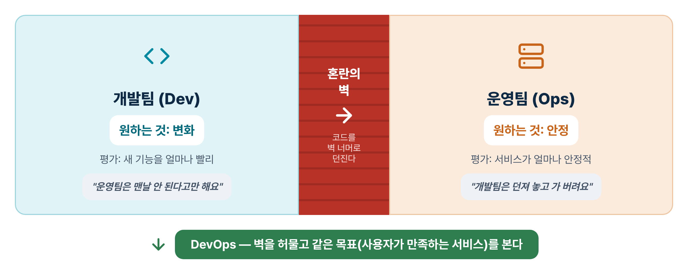
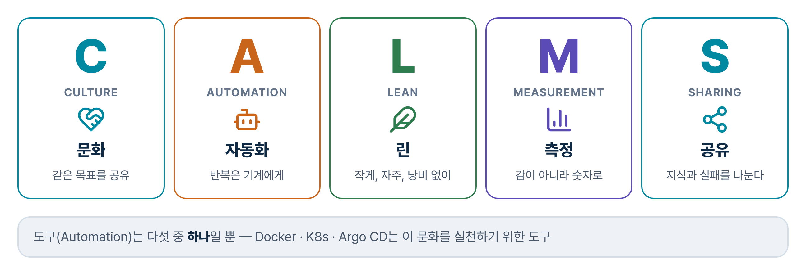

# 1교시 · DevOps는 왜 생겼나

> [!NOTE]
> **이번 시간에 할 일**
>
> - 어제 배운 애플리케이션 구조를 10분 동안 되짚습니다.
> - 개발팀과 운영팀 사이의 "혼란의 벽"이 무엇이었는지 이해합니다.
> - DevOps가 어떻게 탄생했고, 무엇을 바꾸려 하는지 설명합니다.
> - 조직 문화가 성과에 영향을 준다는 연구를 봅니다.

## 어제 10분 요약

| 어제 배운 것 | 한 문장 |
|---|---|
| 현대 앱의 지도 | 애플리케이션 = 코드 + 실행 조건 |
| 프론트·백엔드 | API는 약속, stateless여야 늘릴 수 있다 |
| 확장성·가용성 | 스케일 아웃, 9의 개수, SPOF 제거, CAP |
| 데이터 | RDB는 ACID, NoSQL은 다양한 모양 |
| 캐시·큐 | 캐시는 가까이, 큐는 맡겨 두기 — 대가는 멱등성 |
| MSA | 조직 문제를 풀고 분산 시스템 문제를 떠안는다 |

어제 2교시의 **콘웨이의 법칙**을 기억하시나요? "시스템은 조직의 의사소통 구조를 닮는다." 오늘은 그 **조직과 의사소통** 쪽을 정면으로 봅니다.

## 혼란의 벽 — 개발과 운영이 갈라져 있던 시절

2000년대까지 많은 회사에서 **개발팀**과 **운영팀**은 완전히 다른 조직이었습니다.

| | 개발팀 (Dev) | 운영팀 (Ops) |
|---|---|---|
| 평가 기준 | 새 기능을 **얼마나 빨리** 내놓았나 | 서비스가 **얼마나 안정적**이었나 |
| 원하는 것 | **변화** | **안정** |
| 상대방이 보기엔 | "운영팀은 맨날 안 된다고만 해요" | "개발팀은 던져 놓고 가 버려요" |
| 배포 | 몇 달에 한 번, 밤샘 작업 | 배포 날은 장애 날 |

개발팀이 코드를 다 만들어 벽 너머로 **던지면**(throw it over the wall), 운영팀이 받아서 서버에 올리다가 문제가 생기고, 서로 책임을 미루는 일이 반복됐습니다. 이 둘 사이의 간극을 **혼란의 벽(wall of confusion)**이라고 부릅니다.

> **🧩 비유 — 요리사와 홀 직원**
>
> 요리사(개발)는 새 메뉴를 빨리 내고 싶고, 홀 직원(운영)은 손님 불만이 없기를 바랍니다. 요리사가 레시피만 던져 주고 퇴근하면, 홀 직원은 손님이 "이거 너무 짜요"라고 할 때 아무것도 할 수 없습니다. 반대로 홀 직원이 "새 메뉴는 위험하니 내지 마세요"라고만 하면 식당은 발전하지 못합니다. 둘이 **같은 목표**(손님이 만족하는 식당)를 보고 함께 일해야 합니다.

## DevOps의 탄생 (2009)

> **🎓 학술 노트 — 하루 10번 배포 (Flickr, 2009)와 DevOpsDays**
>
> **2009년 6월**, 사진 공유 서비스 Flickr의 존 올스포(John Allspaw, 운영)와 폴 해먼드(Paul Hammond, 개발)는 O'Reilly Velocity 학회에서 「하루 10번 이상 배포: Flickr의 개발과 운영 협력(10+ Deploys Per Day: Dev and Ops Cooperation at Flickr)」을 발표했습니다. 당시 대부분의 회사가 몇 달에 한 번 배포하던 시절, 개발과 운영이 **함께** 일하면 하루에 열 번 넘게 배포하면서도 안정적일 수 있다는 것을 보여 줬습니다. 핵심은 도구가 아니라 **신뢰, 공유된 목표, 서로의 일을 존중하는 문화**였습니다.
>
> 이 발표를 온라인으로 본 벨기에의 패트릭 드부아(Patrick Debois)는 같은 해 **10월** 벨기에 겐트에서 첫 **DevOpsDays** 행사를 열었습니다. 행사 이름을 줄인 해시태그 **#DevOps**가 이후 이 운동 전체의 이름이 되었습니다.
>
> - Allspaw, J., & Hammond, P. (2009). *10+ Deploys Per Day: Dev and Ops Cooperation at Flickr*. O'Reilly Velocity Conference.
> - Kim, G., Humble, J., Debois, P., & Willis, J. (2016). *The DevOps Handbook*. IT Revolution.

## DevOps란 무엇인가 — CALMS

DevOps에는 공식 정의가 없습니다. 대신 널리 쓰이는 정리가 **CALMS**입니다.

| 글자 | 뜻 | 실천 예 | 이 과정에서 |
|---|---|---|---|
| **C**ulture 문화 | 개발과 운영이 **같은 목표**를 공유 | 함께 당번, 함께 회고 | 오늘 4~5교시 |
| **A**utomation 자동화 | 반복 작업은 기계에게 | 빌드·테스트·배포 자동화 | 3주차 CI, 4주차 GitOps |
| **L**ean 린 | 작게, 자주, 낭비 없이 | 작은 배포, 빠른 피드백 | 오늘 2교시 |
| **M**easurement 측정 | 감이 아니라 **숫자**로 | DORA 지표, SLO | 1일차, 4주차 |
| **S**haring 공유 | 지식과 실패를 **나눈다** | 문서, 포스트모템 | 오늘 5~6교시 |

> [!IMPORTANT]
> **DevOps는 도구가 아니라 일하는 방식**
>
> "우리 회사는 Kubernetes를 쓰니까 DevOps를 한다"는 말은 반만 맞습니다. 도구(Automation)는 CALMS의 다섯 글자 중 하나일 뿐입니다. 아무리 좋은 CI/CD 파이프라인이 있어도, 개발팀과 운영팀이 서로 탓하고 장애를 숨기는 조직이라면 DevOps라고 할 수 없습니다. 이 과정에서 배우는 Docker, Kubernetes, Argo CD는 모두 **이 문화를 실천하기 위한 도구**입니다.

### "DevOps 엔지니어"라는 직무

원래 DevOps는 직무가 아니라 문화의 이름이었습니다. 하지만 지금은 **개발과 운영 사이의 자동화와 플랫폼을 책임지는 직무**를 흔히 DevOps 엔지니어라고 부릅니다. 비슷한 직무로 **SRE**(Site Reliability Engineer, 구글이 시작한 신뢰성 엔지니어), **플랫폼 엔지니어**(어제 7교시)가 있습니다. 회사마다 이름과 범위가 다르지만, 공통점은 **개발자가 빠르고 안전하게 배포할 수 있는 길을 만드는 사람**이라는 것입니다.

## 문화는 측정할 수 있다 — Westrum 조직 문화

> **🎓 학술 노트 — 웨스트럼의 조직 문화 유형 (2004)**
>
> 사회학자 론 웨스트럼(Ron Westrum)은 항공·의료처럼 안전이 중요한 조직을 연구해, 조직 문화를 **정보가 어떻게 흐르는가**로 세 가지로 나눴습니다.
>
> | 유형 | 특징 | 실패가 생기면 | 새로운 아이디어 |
> |---|---|---|---|
> | **병리적** (권력 지향) | 정보를 무기로 쥔다 | **희생양**을 찾는다 | 짓밟는다 |
> | **관료적** (규칙 지향) | 정보가 규정 경로로만 | **처벌**하거나 규정 탓 | 문제로 여긴다 |
> | **생성적** (성과 지향) | 정보가 **필요한 사람에게** 흐른다 | **조사**하고 배운다 | 환영한다 |
>
> 1일차에 본 **DORA 연구**는 수만 명의 설문을 분석해, **생성적 문화를 가진 조직일수록 소프트웨어 배포 성과와 조직 성과가 높다**는 것을 반복해서 확인했습니다. 즉 "문화가 좋으면 좋다"는 막연한 말이 아니라, **측정 가능한 성과 차이**로 나타난다는 것입니다. 5교시의 "비난 없는 회고"는 생성적 문화를 만드는 대표적인 실천입니다.
>
> - Westrum, R. (2004). A typology of organisational cultures. *BMJ Quality & Safety*, 13(suppl 2).
> - Forsgren, N., Humble, J., & Kim, G. (2018). *Accelerate*. IT Revolution.

> **📈 트렌드 — AI 시대의 DevOps: 코드는 빨라졌는데 배포는?**
>
> 1일차에 본 DORA 2025 보고서는 개발자의 약 90%가 AI를 쓰지만, AI가 **"증폭기"**라고 결론지었습니다. 2026년에는 숫자가 더 극적입니다. GitHub Octoverse 2026에 따르면 9월 한 달 PR의 **40% 이상을 AI 에이전트가 시작**했고, 1년 동안의 코드 push가 **179억 번**으로 앞선 2년을 합친 것보다 많았습니다. 좋은 팀은 더 좋아지고, 문제가 있는 팀은 문제가 더 커집니다. AI로 코드를 빨리 많이 만들어도, 리뷰·테스트·배포가 그 속도를 받쳐 주지 못하면 병목만 뒤로 밀려날 뿐입니다. 그래서 AI 시대에 DevOps는 오히려 더 중요해지고 있습니다. **작은 단위로 자주 배포하고, 자동으로 검증하고, 문제가 생기면 빨리 되돌리는** 능력이 AI가 만든 코드를 안전하게 받아들이는 유일한 방법이기 때문입니다.

## 정리

- 개발(변화)과 운영(안정)의 목표가 갈라진 간극을 **혼란의 벽**이라고 합니다.
- DevOps는 2009년 Flickr의 발표와 첫 **DevOpsDays**에서 시작된 운동입니다.
- **CALMS** — 문화, 자동화, 린, 측정, 공유. 도구는 다섯 중 하나일 뿐입니다.
- 정보가 필요한 곳으로 흐르는 **생성적 문화**가 성과와 연결된다는 것이 연구로 확인됐습니다.
- AI가 코드를 빠르게 만들수록, 안전하게 받아들이는 **DevOps 역량**이 더 중요해집니다.

> **✅ 확인 문제**
>
> 1. 개발팀과 운영팀이 원하는 것은 각각 무엇이었나요?
> 2. 2009년 Flickr 발표의 제목에 들어간 숫자는?
> 3. CALMS의 다섯 글자는 각각 무엇인가요?
> 4. 웨스트럼 분류에서 실패가 생기면 "조사하고 배우는" 문화의 이름은?
> 5. "우리는 Kubernetes를 쓰니까 DevOps다"라는 말이 왜 반만 맞나요?
>
> 

정답

>
> 1. 개발팀은 변화(빠른 기능 출시), 운영팀은 안정
> 2. 10 (하루 10번 이상 배포)
> 3. Culture(문화), Automation(자동화), Lean(린), Measurement(측정), Sharing(공유)
> 4. 생성적(generative) 문화
> 5. 도구(자동화)는 DevOps의 일부일 뿐이고, 문화·측정·공유가 함께 있어야 하기 때문
>
> 

## 참고 문헌

- Allspaw, J., & Hammond, P. (2009). *10+ Deploys Per Day: Dev and Ops Cooperation at Flickr*. Velocity 2009.
- Westrum, R. (2004). A typology of organisational cultures. *BMJ Quality & Safety*, 13(suppl 2).
- Forsgren, N., Humble, J., & Kim, G. (2018). *Accelerate: The Science of Lean Software and DevOps*. IT Revolution.
- Kim, G., Humble, J., Debois, P., & Willis, J. (2016). *The DevOps Handbook*. IT Revolution.
- DORA (2025). *State of AI-assisted Software Development*. Google Cloud.
