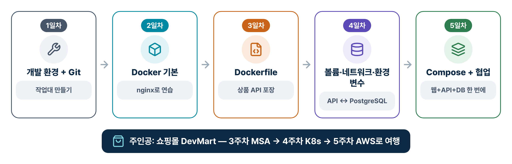
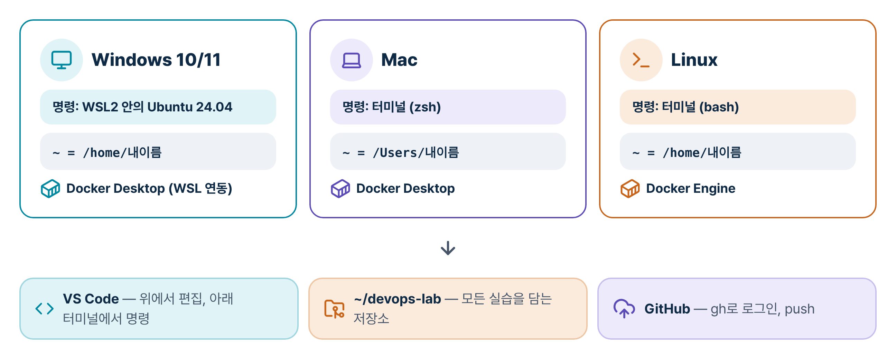

# 1교시 · 1주차 요약과 작업 환경 준비

> [!NOTE]
> **이번 시간에 할 일**
>
> - 1주차에 배운 것을 10분 동안 되짚습니다.
> - 2주차 전체 흐름과 "앱 하나의 여행"을 봅니다.
> - Windows 사용자는 WSL2와 Ubuntu를 설치하고, Mac 사용자는 터미널을 준비합니다.
> - Ubuntu 터미널에서 첫 명령을 실행합니다.

## 1주차 10분 요약

| 일차 | 한 문장 | 오늘부터 쓰는 곳 |
|---|---|---|
| 1일차 | 클라우드는 남의 컴퓨터를 셀프서비스로, 쓴 만큼 빌린다 | 5주차 AWS |
| 2일차 | 컨테이너 = 네임스페이스와 cgroups로 격리된 프로세스 | 이번 주 내내 |
| 3일차 | IP는 건물, 포트는 호실, DNS는 전화번호부 | 2일차 `-p 8080:80` |
| 4일차 | 애플리케이션 = 코드 + 실행 조건 | 3일차 Dockerfile |
| 5일차 | Git으로 기록하고, PR로 함께 일하고, 문서로 남긴다 | 오늘 5교시, 5일차 |

## 2주차의 흐름 — 앱 하나의 여행

이 과정에는 5주 동안 함께 여행하는 앱이 하나 있습니다. 작은 쇼핑몰 **DevMart**입니다. 1주차 4일차의 "상품 페이지 하나를 분해하면" 그림을 실제로 돌아가는 코드로 만든 것입니다.



| 일차 | 주제 | DevMart의 상태 |
|---|---|---|
| 1일차 | 개발 환경 + Git | 아직 없음 — 작업대를 만든다 |
| 2일차 | Docker 기본 | 남이 만든 nginx 이미지로 연습 |
| 3일차 | Dockerfile | **상품 API를 이미지로 포장** |
| 4일차 | 볼륨·네트워크·환경 변수 | API가 **PostgreSQL**과 대화한다 |
| 5일차 | Compose + GitHub 협업 | 웹 + API + DB를 **파일 하나로** 띄우고 PR로 공유 |

3주차에는 이 앱에 주문 서비스와 큐가 붙어 MSA가 되고, 4~5주차에는 Kubernetes와 AWS로 이사 갑니다.

## 작업 환경 지도



| 사용하는 컴퓨터 | 명령을 입력하는 곳 | 파일을 두는 곳 | Docker |
|---|---|---|---|
| **Windows 10/11** | WSL2 안의 **Ubuntu** 터미널 | Ubuntu의 홈 `~` (`/home/내이름`) | Docker Desktop (WSL2 연동) |
| **Mac** (Apple Silicon / Intel) | **터미널** 앱 | 홈 `~` (`/Users/내이름`) | Docker Desktop |
| **Linux** (Ubuntu 등) | 터미널 | 홈 `~` | Docker Engine |

> [!TIP]
> **왜 Windows에서 굳이 Linux를 쓰나요?**
>
> 서버의 대부분은 Linux입니다(1주차 2일차). 컨테이너도 Linux 커널 기능입니다. Windows의 명령 프롬프트나 PowerShell로도 Docker를 쓸 수는 있지만, 명령어와 경로 표기가 달라 교재와 현업 문서를 그대로 따라 하기 어렵습니다. **WSL2(Windows Subsystem for Linux 2)**는 Windows 안에 진짜 Linux 커널을 띄워 주므로, Windows 노트북에서도 Mac·Linux 사용자와 **같은 명령**을 쓸 수 있습니다.

## 명령은 어느 창에? — PowerShell과 bash

이 교재의 명령은 **두 종류의 창**에서 칩니다. 코드 블록 오른쪽 위에 어느 창인지 적혀 있습니다.

| 코드 블록 표시 | 여는 창 | 프롬프트 모양 | 언제 |
|---|---|---|---|
| **PowerShell · Windows** | Windows **터미널**(PowerShell) | `PS C:\Users\me>` | WSL 설치, winget으로 Windows 앱 설치 — **Windows 사용자만, 몇 번뿐** |
| **bash · WSL Ubuntu · macOS** | Windows는 **Ubuntu** 터미널, Mac은 **터미널** 앱 | `me@PC:~$` · `me@Mac ~ %` | **나머지 전부** — 5주 동안 거의 모든 명령 |

> [!WARNING]
> **치기 전에 프롬프트를 한 번 본다**
>
> `PS`로 시작하면 PowerShell, `$`(Mac은 `%`)로 끝나면 bash입니다. PowerShell에 `export A=1`을 치면 "인식되지 않습니다", WSL에 `winget`을 치면 `command not found`가 나옵니다. 도구를 **Homebrew · winget · 직접 다운로드** 등 다른 방법으로 깔고 싶다면 **부록 A · 도구 설치 가이드**에 OS별로 모아 두었습니다.

## 실습 1 · Windows — WSL2와 Ubuntu 설치

> **🧪 실습: 실습 목표**
>
> Windows에 WSL2와 Ubuntu 24.04 LTS를 설치하고, Ubuntu 터미널에서 첫 명령을 실행합니다. **Mac 사용자는 실습 2로 건너뜁니다.**

### 단계 1 — 가상화가 켜져 있는지 확인

1. `Ctrl` + `Shift` + `Esc`로 **작업 관리자**를 엽니다.
2. **성능** 탭 → **CPU**를 누릅니다.
3. 오른쪽 아래에 **가상화: 사용**이라고 적혀 있는지 봅니다.

> **🛠️ 막혔다면: 가상화: 사용 안 함**
>
> 컴퓨터의 BIOS/UEFI 설정에서 가상화(Intel VT-x 또는 AMD-V/SVM)를 켜야 합니다. 제조사마다 메뉴가 다르므로 **혼자 하지 말고 강사에게 알려 주세요.** 회사·학교 노트북은 관리자 정책으로 막혀 있을 수 있습니다.

### 단계 2 — 관리자 권한으로 PowerShell 열기

1. 시작 버튼을 오른쪽 클릭 → **터미널(관리자)** 또는 **Windows PowerShell(관리자)**를 선택합니다.
2. "이 앱이 디바이스를 변경할 수 있도록 허용하시겠어요?"에 **예**를 누릅니다.

### 단계 3 — WSL과 Ubuntu 설치

```powershell
wsl --install -d Ubuntu-24.04
```

- `wsl --install` : WSL을 켜고 필요한 구성요소를 설치합니다.
- `-d Ubuntu-24.04` : 설치할 Linux 배포판을 Ubuntu 24.04 LTS로 정합니다. 수업에서 모두 같은 버전을 쓰기 위해 버전을 명시합니다.

설치가 끝나면 **컴퓨터를 다시 시작**하라는 안내가 나옵니다. 다시 시작합니다.

### 단계 4 — Ubuntu 사용자 만들기

재시작 후 Ubuntu 창이 자동으로 열립니다(안 열리면 시작 메뉴에서 **Ubuntu 24.04 LTS** 실행).

```text
Enter new UNIX username: devops
New password:
Retype new password:
```

- **사용자 이름**: 영문 소문자로 짧게 (예: `devops`, 본인 이름 영문).
- **비밀번호**: 입력할 때 **화면에 아무것도 표시되지 않는 것이 정상**입니다. 잊지 않게 기억해 두세요. `sudo`(관리자 권한 명령)를 쓸 때마다 물어봅니다.

### 단계 5 — WSL 버전 확인

PowerShell(관리자 아니어도 됨)에서:

```powershell
wsl -l -v
```

> **🟢 확인: 이렇게 나오면 성공**
>
> ```text
>   NAME            STATE           VERSION
> * Ubuntu-24.04    Running         2
> ```
> **VERSION이 2**인지 확인합니다. 1이라면 `wsl --set-version Ubuntu-24.04 2`를 실행합니다.

### 단계 6 — 첫 명령

Ubuntu 터미널에서:

```bash
whoami
uname -r
```

> **🟢 확인: 이렇게 나오면 성공**
>
> ```text
> devops
> 6.6.87.2-microsoft-standard-WSL2
> ```
> 첫 줄은 내가 만든 사용자 이름, 둘째 줄은 커널 버전입니다. 커널 버전 숫자는 달라도 되고, 끝에 **WSL2**가 붙어 있으면 됩니다. 1주차 2일차에 배운 "Windows 안의 진짜 Linux 커널"이 바로 이것입니다.

### 단계 7 — 패키지 목록 최신화

```bash
sudo apt update && sudo apt upgrade -y
```

- `sudo` : 관리자 권한으로 실행 (비밀번호를 물어봅니다)
- `apt update` : 설치 가능한 프로그램 목록을 새로 받습니다
- `apt upgrade -y` : 설치된 프로그램을 최신으로 올립니다 (`-y`는 "예"를 미리 답함)
- `&&` : 앞 명령이 **성공했을 때만** 뒤 명령을 실행 (1주차의 종료 코드 0!)

### 단계 8 — 기본 도구 설치

5주 동안 계속 쓰는 작은 도구들을 미리 깝니다.

```bash
sudo apt install -y curl wget unzip jq ca-certificates gnupg lsb-release
python3 --version
```

- `curl` · `wget` : 인터넷에서 파일 받기 (3주차부터 도구 설치에 계속 씀)
- `unzip` : zip 풀기 (5주차 AWS CLI) · `jq` : JSON 보기 좋게 고르기
- `ca-certificates` · `gnupg` · `lsb-release` : 공식 저장소를 안전하게 추가할 때 필요 (5주차 Terraform)
- `python3` : Ubuntu 24.04에 이미 들어 있습니다. `Python 3.12.x`가 나오면 됩니다

> **🛠️ 막혔다면: WSL 설치 중 자주 만나는 문제**
>
> | 증상 | 원인 | 해결 |
> |---|---|---|
> | `WslRegisterDistribution failed with error: 0x80370102` | 가상화가 꺼져 있음 | 단계 1로 돌아가 BIOS 설정 (강사에게 알림) |
> | `Invalid distribution name` | WSL 프로그램이 오래됨 | `wsl --update` 실행 후 다시 설치 |
> | 설치 후 Ubuntu 창이 바로 닫힘 | 재시작을 안 함 | 컴퓨터 재시작 후 시작 메뉴에서 Ubuntu 실행 |
> | 비밀번호가 입력되지 않는 것 같음 | 원래 화면에 안 보임 | 그냥 입력하고 Enter |
> | `sudo` 비밀번호를 잊음 | — | PowerShell에서 `wsl -u root` → `passwd devops`로 재설정 |

## 실습 2 · Mac — 터미널과 Homebrew 준비

> **🧪 실습: 실습 목표**
>
> Mac의 터미널을 열고, 개발 도구 설치 관리자 **Homebrew**를 준비합니다. **Windows 사용자는 건너뜁니다.**

### 단계 1 — 칩 종류 확인

화면 왼쪽 위 **사과 메뉴 → 이 Mac에 관하여**에서 **칩**이 `Apple M1/M2/M3/M4…`인지 `Intel`인지 확인합니다. 1주차 2일차의 ARM과 x86 차이가 실제로 나타나는 순간입니다. Docker Desktop을 받을 때 고르게 됩니다.

### 단계 2 — 터미널 열기

`Command` + `Space` → **터미널** 입력 → Enter.

```bash
whoami
uname -m
```

> **🟢 확인: 이렇게 나오면 성공**
>
> ```text
> 내이름
> arm64
> ```
> Apple Silicon이면 `arm64`, Intel이면 `x86_64`입니다.

### 단계 3 — Homebrew 설치

[brew.sh](https://brew.sh) 첫 화면의 설치 명령을 **그대로 복사해** 터미널에 붙여 넣습니다. (교재에 옮겨 적지 않는 이유: 설치 명령이 바뀔 수 있으므로 항상 공식 페이지에서 복사합니다.) 설치가 끝나면 화면 마지막의 **Next steps** 안내에 나오는 명령 두 줄도 실행해야 `brew`가 동작합니다.

```bash
brew --version
```

> **🟢 확인: 이렇게 나오면 성공**
>
> ```text
> Homebrew 4.x.x
> ```

### 단계 4 — 기본 도구 설치

```bash
brew install jq
python3 --version
```

`curl` · `unzip`은 macOS에 이미 있습니다. `python3`를 처음 실행하면 **명령줄 개발자 도구**를 설치하겠냐는 창이 뜰 수 있습니다 — **설치**를 누릅니다(Homebrew 설치 때 이미 깔렸다면 버전만 나옵니다).

> **🎓 학술 노트 — 생산적 실패 (Productive Failure)**
>
> 싱가포르 국립교육원의 마누 카푸르(Manu Kapur)는 2008년부터의 연구에서, 학생들이 정답을 바로 배우기 전에 **먼저 스스로 시도하다 실패하는 경험**을 거치면, 처음부터 정답 풀이를 배운 학생들보다 개념을 더 깊이 이해하고 새로운 문제에 더 잘 적용한다는 결과를 반복해서 보고했습니다. 그는 이것을 **생산적 실패(productive failure)**라고 불렀습니다. 핵심은 실패 자체가 아니라, 실패한 뒤 **왜 실패했는지 정리하는 단계**가 반드시 따라온다는 점입니다.
>
> 이번 주 실습에서 에러를 만나면, 그것은 학습이 망가진 것이 아니라 **배울 재료가 생긴 것**입니다. 그래서 이 교재는 모든 실습에 "막혔다면" 표를 붙였고, 7교시에는 일부러 실패를 만들어 보는 시간도 있습니다.
>
> - Kapur, M. (2008). Productive failure. *Cognition and Instruction*, 26(3).
> - Kapur, M. (2016). Examining productive failure, productive success, unproductive failure, and unproductive success in learning. *Educational Psychologist*, 51(2).

> **📈 트렌드 — WSL은 이제 '진짜 Linux'**
>
> 2016년의 첫 WSL(WSL1)은 Linux 시스템 콜을 Windows 커널 호출로 **번역**하는 방식이라 Docker처럼 커널 기능을 깊이 쓰는 프로그램은 돌릴 수 없었습니다. 2019년 발표된 WSL2는 가벼운 가상 머신 안에서 **진짜 Linux 커널**을 실행하도록 구조를 바꿨고(1주차 2일차의 하이퍼바이저), 그 덕분에 Docker Desktop도 WSL2 위에서 동작합니다. Microsoft는 2025년 WSL을 오픈소스로 공개했고, Ubuntu는 2026년 4월 26.04 LTS를 내놓았습니다. 이 수업은 지원 기간이 2029년까지 남아 있고 자료가 가장 많은 **24.04 LTS**로 통일합니다. 회사에서는 26.04를 만날 수도 있지만 명령은 거의 같습니다.

## 정리

- 1주차의 개념이 이번 주부터 **손으로 하는 실습**이 됩니다.
- 2주차의 주인공은 쇼핑몰 앱 **DevMart**이며, 5일 동안 컨테이너로 포장되고 함께 띄워집니다.
- Windows는 **WSL2 + Ubuntu 24.04**, Mac은 **터미널 + Homebrew**가 작업대입니다.
- WSL 버전은 **2**여야 하고, 비밀번호는 화면에 안 보이는 것이 정상입니다.
- 에러는 **배울 재료**입니다. 먼저 "막혔다면" 표를 봅니다.

> **✅ 확인 문제**
>
> 1. 이번 주에 컨테이너로 포장할 실습 앱의 이름은?
> 2. Windows에서 Linux 명령을 쓰기 위해 설치하는 것은?
> 3. `wsl -l -v`에서 확인해야 할 값은?
> 4. `sudo apt update && sudo apt upgrade -y`에서 `&&`의 의미는?
> 5. Mac에서 `uname -m` 결과가 `arm64`라면 어떤 칩인가요?
>
> <details><summary>정답</summary>
>
> 1. DevMart
> 2. WSL2와 Ubuntu
> 3. VERSION이 2인지
> 4. 앞 명령이 성공(종료 코드 0)했을 때만 뒤 명령을 실행한다
> 5. Apple Silicon (M 시리즈)
>
> </details>

## 참고 문헌

- Microsoft. *Install WSL*. learn.microsoft.com/windows/wsl/install
- Canonical. *Ubuntu on WSL documentation*. documentation.ubuntu.com/wsl
- Homebrew. *Installation*. brew.sh
- Kapur, M. (2008). Productive failure. *Cognition and Instruction*, 26(3).
- Microsoft (2025). *The Windows Subsystem for Linux is now open source*. Windows Developer Blog.
