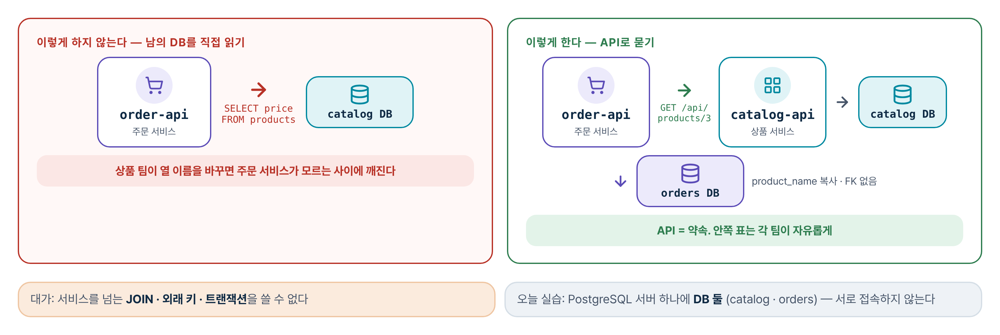

# 2교시 · 서비스 경계와 데이터 소유

> [!NOTE]
> **이번 시간에 할 일**
>
> - 서비스를 **어디서 나누는지** 기준을 압니다.
> - 서비스마다 **자기 데이터를 소유**하는 이유와, 그 대가를 이해합니다.
> - 콘웨이의 법칙으로 "팀 구조와 시스템 구조"의 관계를 봅니다.
> - DevMart를 직접 서비스로 나눠 봅니다.

## 어디서 나눌까 — 기술이 아니라 업무로

서비스를 나눌 때 가장 흔한 실수는 **기술 계층**으로 나누는 것입니다. "화면 서비스, 로직 서비스, DB 서비스"처럼요. 이렇게 나누면 기능 하나를 바꿀 때 세 서비스를 모두 고쳐야 해서, 따로 배포한다는 장점이 사라집니다.

MSA는 **업무 능력(business capability)**으로 나눕니다. 쇼핑몰이라면 "상품을 보여 준다", "주문을 받는다", "결제한다", "배송한다"가 각각 하나의 업무입니다. 좋은 경계는 다음 질문에 "예"라고 답할 수 있습니다.

| 질문 | 좋은 경계라면 |
|---|---|
| 이 서비스만 고쳐서 배포할 수 있나? | 대부분의 변경이 서비스 하나 안에서 끝난다 |
| 이 서비스가 멈춰도 다른 업무는 돌아가나? | 주문이 멈춰도 상품 구경은 된다 |
| 한 팀이 책임질 수 있나? | 한 팀이 처음부터 운영까지 맡는다 |
| 자기 데이터를 혼자 바꿀 수 있나? | 다른 서비스와 표를 함께 고치지 않는다 |

> **🧩 비유 — 회사의 부서**
>
> 회사를 "엑셀 담당 부서, 이메일 담당 부서, 전화 담당 부서"로 나누지 않습니다. **영업부, 회계부, 물류부**처럼 **하는 일**로 나눕니다. 그리고 회계부의 장부는 회계부만 고칩니다. 영업부가 매출을 알고 싶으면 회계부의 장부를 직접 열지 않고 **회계부에 물어봅니다.** 서비스 경계와 데이터 소유가 정확히 이렇습니다.

## 데이터도 나눈다 — 서비스마다 자기 DB

MSA에서 가장 중요하면서도 어려운 원칙은 **"서비스마다 자기 데이터를 소유한다(database per service)"**입니다. 다른 서비스의 데이터가 필요하면 그 DB에 직접 접속하지 않고, 그 서비스의 **API를 호출**합니다.



왜 이렇게까지 할까요? 만약 주문 서비스가 상품 DB의 `products` 표를 직접 읽는다면:

- 상품 팀이 `price` 열 이름을 `unit_price`로 바꾸는 순간 **주문 서비스가 깨집니다.** 상품 팀은 주문 서비스가 그 열을 읽는지조차 모릅니다.
- 상품 DB가 느려지면 주문 서비스도 함께 느려집니다.
- 결국 두 서비스는 **늘 함께 바꾸고 함께 배포해야** 하는 분산 모놀리스가 됩니다.

API는 서비스 사이의 **약속(계약)**입니다. 상품 팀은 API의 약속(`GET /api/products/3` → `{"price": …}`)만 지키면 안쪽 표는 마음대로 바꿀 수 있습니다.

### 대가 — 조인과 트랜잭션

데이터를 나누면 잃는 것도 있습니다.

| 모놀리식에서는 쉬웠던 것 | MSA에서는 |
|---|---|
| `JOIN`으로 주문과 상품을 한 번에 조회 | 주문 서비스가 상품 이름을 **주문할 때 복사**해 둔다 (오늘 DevMart의 `product_name`) |
| 외래 키(FOREIGN KEY)로 "없는 상품 주문" 막기 | DB가 막아 주지 못한다. 주문 서비스가 **API로 확인**한다 |
| 트랜잭션 하나로 "주문 저장 + 재고 차감" | 두 서비스에 걸친 일은 **한 번에 성공/실패시킬 수 없다.** 사가(saga) 같은 별도 설계가 필요 |

오늘 DevMart의 `orders` 표를 미리 보면 이 대가가 그대로 보입니다.

```sql
CREATE TABLE IF NOT EXISTS orders (
    id           SERIAL PRIMARY KEY,
    product_id   INTEGER NOT NULL,      -- 다른 서비스의 데이터라 FOREIGN KEY를 걸 수 없다
    product_name TEXT    NOT NULL,      -- 주문 당시 이름을 복사해 둔다
    ...
```

> [!TIP]
> **복사해 두는 것이 오히려 맞을 때**
>
> 주문서에 적힌 상품 이름과 가격은 **주문 당시의 값**이어야 합니다. 나중에 상품 이름이 바뀌어도 지난 주문 내역은 바뀌면 안 되지요. 그래서 주문 시점에 복사해 두는 것은 MSA의 타협이자, 업무적으로도 자연스러운 설계입니다.

## 콘웨이의 법칙 — 팀 구조가 시스템 구조가 된다

> 시스템을 설계하는 조직은, 그 조직의 의사소통 구조를 닮은 설계를 만들어 낸다.
> — 멜빈 콘웨이(Melvin Conway), 1968

컴파일러 팀이 네 개면 4단계 컴파일러가 나온다는 농담처럼, **팀이 나뉜 모양대로 시스템이 나뉩니다.** 그래서 MSA를 하는 회사들은 거꾸로, 원하는 시스템 구조에 맞게 **팀을 먼저 나누기도** 합니다. 이것을 **역 콘웨이 전략(inverse Conway maneuver)**이라고 합니다. 아마존의 "피자 두 판으로 배불리 먹을 수 있는 크기의 팀이 서비스 하나를 처음부터 운영까지 책임진다"는 원칙이 유명한 예입니다.

인프라 엔지니어에게 이것은 남의 이야기가 아닙니다. 서비스마다 팀이 다르면 **장애가 났을 때 누구를 불러야 하는지**, **배포 일정을 누구와 맞춰야 하는지**가 서비스 경계를 따라 정해집니다. 1주차 5일차 4교시 "타 부서와 협업하기"이 MSA에서 매일 일어납니다.

## 실습 1 · DevMart를 서비스로 나눠 보기 (종이 실습)

> **🧪 실습: 실습 목표**
>
> DevMart에 주문 기능을 더할 때 어떤 서비스로 나눌지 직접 그려 보고, 오늘 실습 앱의 설계와 비교합니다.

### 단계 1 — 업무 목록 적기

DevMart가 하는 일을 적습니다. 예:

- 상품 목록과 가격을 보여 준다
- 주문을 받는다
- 주문을 처리한다 (결제 확인, 재고 확인, 상태 변경)
- 화면을 보여 준다

### 단계 2 — 묶고 나누기

종이나 `~/devops-lab/notes/week3-day1.md`에 박스를 그립니다. 각 박스에 **서비스 이름 · 소유한 데이터 · 다른 서비스에 묻는 것**을 적습니다.

```markdown
# DevMart 서비스 경계 (내 설계)

| 서비스 | 하는 일 | 소유 데이터 | 다른 서비스에 묻는 것 |
|---|---|---|---|
| | | | |
```

### 단계 3 — 오늘 설계와 비교

| 서비스 | 하는 일 | 소유 데이터 | 다른 서비스에 묻는 것 |
|---|---|---|---|
| `web` (nginx) | 화면 파일, 주소에 따라 알맞은 서비스로 안내 | 없음 | 모든 API |
| `catalog-api` | 상품 목록 · 상품 하나 조회 | `catalog` DB의 `products` | 없음 |
| `order-api` | 주문 접수, 주문 목록 | `orders` DB의 `orders` | 상품 가격 → `catalog-api` |
| `order-worker` | 접수된 주문 처리 (오래 걸리는 일) | `orders` DB의 `orders` (상태만) | 큐에서 일거리를 받는다 |
| `redis` | 주문 → 처리기 사이 **메시지 큐** | 처리 대기 중인 메시지 | 없음 |
| `db` (PostgreSQL) | `catalog`, `orders` **두 DB**를 담은 서버 | — | — |

> [!WARNING]
> **DB 서버 하나에 DB 둘 — 실습용 타협**
>
> 원칙대로라면 상품 DB와 주문 DB는 **서버(컨테이너)도 따로**입니다. 오늘은 노트북 자원을 아끼려고 PostgreSQL 서버 **하나**에 데이터베이스를 **두 개**(`catalog`, `orders`) 만들었습니다. 서비스끼리 **서로의 데이터베이스에 접속하지 않는다**는 규칙은 지킵니다. 5주차 AWS에서는 서비스마다 RDS를 따로 두는 구성과 비용을 비교해 봅니다.

`order-api`와 `order-worker`는 **같은 `orders` 데이터를 쓰는 한 팀의 두 프로그램**입니다. "주문"이라는 하나의 업무를 **빠르게 접수하는 쪽**과 **천천히 처리하는 쪽**으로 나눈 것이고, 이 둘을 이어 주는 것이 큐입니다(6교시).

> **🎓 학술 노트 — 콘웨이의 법칙은 데이터로도 확인되었다**
>
> 멜빈 콘웨이는 1968년 잡지 *Datamation*에 실린 「위원회는 어떻게 발명하는가(How Do Committees Invent?)」에서 이 관찰을 처음 내놓았습니다. 처음엔 재치 있는 관찰로 여겨졌지만, 이후 실증 연구가 이어졌습니다. 하버드 경영대학원의 맥코맥(Alan MacCormack) 등은 2012년 *Research Policy* 논문에서 같은 기능을 하는 소프트웨어를 **긴밀한 한 회사 팀이 만든 경우**와 **흩어진 오픈소스 공동체가 만든 경우**를 비교했습니다. 그 결과 흩어진 조직이 만든 소프트웨어가 **훨씬 더 잘게 나뉜(모듈화된) 구조**를 보였습니다. 조직의 모양이 코드의 모양에 그대로 비친다는 **거울 가설(mirroring hypothesis)**의 근거입니다.
>
> 서비스 경계를 나누는 또 하나의 이론적 뿌리는 에릭 에반스(Eric Evans)의 『도메인 주도 설계(Domain-Driven Design)』(2003)의 **경계 컨텍스트(bounded context)**입니다. 같은 "상품"이라는 단어도 카탈로그에서는 사진과 설명, 주문에서는 가격과 수량, 배송에서는 무게와 크기를 뜻합니다. 단어의 뜻이 바뀌는 지점이 경계의 좋은 후보입니다.
>
> - Conway, M. E. (1968). How do committees invent? *Datamation, 14*(4), 28–31.
> - MacCormack, A., Baldwin, C., & Rusnak, J. (2012). Exploring the duality between product and organizational architectures. *Research Policy, 41*(8).
> - Evans, E. (2003). *Domain-Driven Design*. Addison-Wesley.

> **📈 트렌드 — 팀의 인지 부하를 기준으로 나눈다**
>
> 매튜 스켈턴(Matthew Skelton)과 마누엘 페이스(Manuel Pais)의 『팀 토폴로지(Team Topologies)』(2019)는 서비스 경계를 정할 때 **"한 팀이 머릿속에 담을 수 있는 양(인지 부하)"**을 기준으로 삼으라고 제안했습니다. 서비스가 너무 크면 한 팀이 감당하지 못하고, 너무 잘게 나누면 팀 사이 조율이 폭발합니다. 이 책이 말하는 **플랫폼 팀** — 다른 팀들이 인프라를 몰라도 서비스를 배포 · 운영할 수 있게 도구를 제공하는 팀 — 이 1주차 1일차에 본 플랫폼 엔지니어링의 바탕이고, 이 과정을 마친 여러분이 일하게 될 가능성이 큰 팀입니다.

## 정리

- 서비스는 기술 계층이 아니라 **업무 능력**으로 나눈다.
- 서비스마다 **자기 데이터를 소유**하고, 남의 데이터는 **API로 묻는다.** API는 서비스 사이의 약속.
- 대가: 서비스를 넘는 조인 · 외래 키 · 트랜잭션을 쓸 수 없다 → 복사해 두기, API로 확인하기, 별도 설계.
- **콘웨이의 법칙**: 팀 구조가 시스템 구조가 된다.
- 오늘 DevMart: web · catalog-api · order-api · order-worker · redis · db (DB 둘).

> **✅ 확인 문제**
>
> 1. "화면 서비스 / 로직 서비스 / DB 서비스"로 나누면 생기는 문제는?
> 2. 주문 서비스가 상품 DB의 표를 직접 읽으면 어떤 일이 생길 수 있나요?
> 3. DevMart의 `orders` 표에 `product_name`을 복사해 두는 이유 두 가지는?
> 4. 콘웨이의 법칙을 한 문장으로?
> 5. 오늘 실습에서 원칙과 다르게 타협한 부분은?
>
> <details><summary>정답</summary>
>
> 1. 기능 하나를 바꿀 때 세 서비스를 모두 고쳐야 해서 따로 배포하는 장점이 사라진다
> 2. 상품 팀이 표 구조를 바꾸면 주문 서비스가 모르는 사이에 깨진다. 두 서비스가 늘 함께 배포되어야 한다
> 3. 다른 서비스의 DB와 조인할 수 없어서, 그리고 주문 당시의 이름이 기록으로 남아야 해서
> 4. 시스템을 설계하는 조직은 자기 의사소통 구조를 닮은 시스템을 만든다
> 5. DB 서버 하나에 두 데이터베이스를 만들었다 (원칙은 서버도 따로). 서로의 DB에 접속하지 않는 규칙은 지킨다
>
> </details>

## 참고 문헌

- Conway, M. E. (1968). How do committees invent? *Datamation*.
- Evans, E. (2003). *Domain-Driven Design*. Addison-Wesley.
- Newman, S. (2021). *Building Microservices* (2nd ed.). O'Reilly.
- Richardson, C. *Pattern: Database per service*. microservices.io
- Skelton, M., & Pais, M. (2019). *Team Topologies*. IT Revolution.
