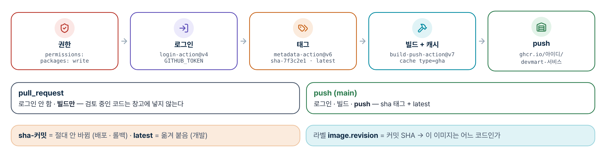

# 6교시 · 이미지 자동 빌드와 GHCR

> [!NOTE]
> **이번 시간에 할 일**
>
> - 워크플로의 `build` 잡을 한 줄씩 읽습니다 (권한 · 로그인 · 태그 · 캐시).
> - PR을 병합해 `main`에서 이미지 세 개가 **자동으로 GHCR에 올라가는** 것을 봅니다.
> - 올라간 이미지를 내 노트북에서 받아 실행합니다.
> - 태그 전략 — 커밋 SHA 태그와 `latest` — 을 정리합니다.

## GHCR — GitHub의 이미지 창고

2주차 3일차 6교시에는 Docker Hub에 손으로 push 했습니다. 오늘은 **GHCR(GitHub Container Registry, `ghcr.io`)**에 CI가 올립니다. GHCR을 고른 이유는 셋입니다.

| | Docker Hub | GHCR |
|---|---|---|
| 로그인 | Docker ID + 토큰을 시크릿으로 저장해야 함 | 워크플로가 받는 **`GITHUB_TOKEN`**으로 바로 |
| 코드와의 연결 | 따로 관리 | 이미지가 **저장소와 연결**되어 표시된다 |
| 주소 | `docker.io/아이디/이름` | `ghcr.io/아이디/이름` |

`GITHUB_TOKEN`은 워크플로가 실행될 때마다 GitHub가 **자동으로 만들어 주고, 끝나면 사라지는** 임시 토큰입니다. 비밀번호를 시크릿에 저장할 필요가 없습니다. 2주차 4일차 6교시 트렌드에서 말한 "숨길 비밀값을 없애기"의 작은 예입니다.

## build 잡 읽기

```yaml
  build:
    name: build (${{ matrix.service }})
    needs: [test, compose-check]      # 앞의 두 작업이 성공해야 시작
    runs-on: ubuntu-latest
    permissions:
      contents: read
      packages: write                 # GHCR에 이미지를 올릴 권한
    strategy:
      matrix:
        service: [catalog-api, order-api, order-worker]
    steps:
      - uses: actions/checkout@v6
      - uses: docker/setup-buildx-action@v4
      - name: GHCR 로그인 (main에 push될 때만)
        if: github.event_name == 'push'
        uses: docker/login-action@v4
        with:
          registry: ghcr.io
          username: ${{ github.actor }}
          password: ${{ secrets.GITHUB_TOKEN }}
      - name: 태그 정하기
        id: meta
        uses: docker/metadata-action@v6
        with:
          images: ghcr.io/${{ github.repository_owner }}/devmart-${{ matrix.service }}
          tags: |
            type=sha
            type=raw,value=latest,enable={{is_default_branch}}
      - name: 빌드 (main이면 push까지)
        uses: docker/build-push-action@v7
        with:
          context: devmart-msa/${{ matrix.service }}
          push: ${{ github.event_name == 'push' }}
          tags: ${{ steps.meta.outputs.tags }}
          labels: ${{ steps.meta.outputs.labels }}
          cache-from: type=gha,scope=${{ matrix.service }}
          cache-to: type=gha,mode=max,scope=${{ matrix.service }}
```



| 부분 | 뜻 |
|---|---|
| `permissions: packages: write` | **이 잡만** GHCR에 쓸 수 있다. 워크플로 전체의 기본은 읽기 (5교시) |
| `if: github.event_name == 'push'` | PR에서는 로그인하지 않는다. **PR은 빌드만, main만 push** |
| `docker/setup-buildx-action` | 2주차 3일차에 쓴 BuildKit 빌더 준비 |
| `docker/metadata-action` | 이미지 이름과 **태그를 규칙대로** 만들어 준다 |
| `type=sha` | 태그 `sha-7f3c2e1` — 어느 커밋으로 만든 이미지인지 |
| `type=raw,value=latest,enable={{is_default_branch}}` | **main일 때만** `latest`도 붙인다 |
| `push: ${{ github.event_name == 'push' }}` | 참/거짓 계산 결과 — main push일 때만 레지스트리에 올린다 |
| `cache-from / cache-to: type=gha` | 빌드 캐시를 GitHub Actions 캐시에 저장 · 재사용 (2주차 3일차 5교시의 `CACHED`가 CI에서도) |

> [!IMPORTANT]
> **왜 PR에서는 push 하지 않나**
>
> PR은 아직 **검토 중인** 코드입니다. 그 이미지가 레지스트리에 올라가면, 누군가 실수로 그 이미지를 배포할 수 있습니다. 그리고 다른 사람의 저장소를 포크해 PR을 보내는 경우, 그 PR의 코드가 내 레지스트리에 쓸 권한을 가지면 위험합니다. 그래서 PR에서는 **"빌드가 되는가"만 확인**하고, 리뷰와 병합을 거친 `main`만 올립니다.

## 실습 15 · 병합하고 이미지 확인하기

> **🧪 실습: 실습 목표**
>
> 5교시의 PR을 병합해 `main`에서 이미지 세 개가 GHCR에 올라가는 것을 봅니다.

### 단계 1 — 병합

5교시에 짝을 리뷰어로 지정했다면 승인을 받고, 아니면 바로 병합합니다(2주차 5일차 5교시).

```bash
cd ~/devops-lab
gh pr merge --squash --delete-branch
sleep 5
gh run list --workflow devmart-ci --limit 2
gh run watch
```

> **🟢 확인: 이렇게 나오면 성공**
>
> ```text
> STATUS  TITLE                    WORKFLOW    BRANCH  EVENT         …
> ✓       CI: DevMart 자동 테스트 …  devmart-ci  main    push          …
> ✓       order-api: health 되돌리기  devmart-ci  ci/…    pull_request  …
> ```
> 이번 실행의 이벤트는 **`push`**(main)입니다. 실행 화면에서 `build (order-api)` → **Build and push** 스텝을 펼치면 마지막에 이런 줄이 보입니다.
>
> ```text
> #12 pushing ghcr.io/내아이디/devmart-order-api:sha-7f3c2e1 with docker-container driver
> #12 pushing layers 2.1s done
> #12 DONE 4.3s
> ```

### 단계 2 — GHCR에서 확인

브라우저에서 `https://github.com/내아이디?tab=packages` 를 엽니다.

> **🟢 확인: 이렇게 보이면 성공**
>
> 패키지 세 개: **devmart-catalog-api**, **devmart-order-api**, **devmart-order-worker**. 하나를 눌러 보면 태그 `latest`와 `sha-7f3c2e1`이 같은 다이제스트를 가리키고, 오른쪽에 **devops-lab 저장소와 연결**되어 있다고 나옵니다. `metadata-action`이 붙여 준 라벨(`org.opencontainers.image.source`) 덕분입니다.

명령줄로도 확인합니다.

```bash
gh auth refresh -s read:packages        # 패키지 목록을 읽을 권한 추가 (처음 한 번, 브라우저 인증)
gh api "user/packages?package_type=container" --jq '.[].name'
```

### 단계 3 — 공개로 바꾸기

GHCR의 새 패키지는 **비공개(private)**로 시작합니다. 내일 이후 Kubernetes(kind)가 로그인 없이 받을 수 있도록 공개로 바꿉니다. 패키지 세 개 각각에서:

**Package settings** (오른쪽 아래) → **Danger Zone** → **Change visibility** → **Public** → 패키지 이름 입력 → 확인

> [!WARNING]
> **공개 전에 다시 한 번**
>
> 이미지 안에 비밀값이 없는지 확인합니다(2주차 3일차 4교시). 우리 Dockerfile은 `COPY app.py .`처럼 필요한 파일만 넣고, `.dockerignore`가 `.env`를 막으므로 안전합니다. 회사 저장소라면 이미지는 보통 **비공개로 두고**, 클러스터에 레지스트리 로그인 정보를 넣습니다(3주차 5일차 Secret, 5주차 ECR).

### 단계 4 — 내 노트북에서 받아 실행

```bash
docker pull ghcr.io/내아이디/devmart-order-api:latest
docker image inspect ghcr.io/내아이디/devmart-order-api:latest \
  --format '{{index .Config.Labels "org.opencontainers.image.revision"}}'
git -C ~/devops-lab log -1 --format=%H
```

> **🟢 확인: 이렇게 나오면 성공**
>
> ```text
> latest: Pulling from 내아이디/devmart-order-api
> …
> Status: Downloaded newer image for ghcr.io/내아이디/devmart-order-api:latest
> 7f3c2e1a9d0b4c…
> 7f3c2e1a9d0b4c…
> ```
> 이미지 라벨에 적힌 커밋과 내 저장소의 마지막 커밋이 **같습니다.** "지금 돌고 있는 이 이미지는 어느 코드로 만들었나?"에 정확히 답할 수 있습니다.

## 태그 전략

| 태그 | 예 | 바뀌나 | 언제 쓰나 |
|---|---|---|---|
| 커밋 SHA | `sha-7f3c2e1` | **절대 안 바뀜** — 커밋 하나에 이미지 하나 | 배포 · 롤백 기록 |
| `latest` | `latest` | main에 병합될 때마다 **옮겨 붙음** | 개발 중 "최신 것 아무거나" |
| 유의적 버전 | `1.1.0` | 사람이 릴리스할 때 | 사람이 읽고 말할 때 (2주차 3일차) |

2주차 3일차에 "운영에 `latest`를 쓰지 않는다"고 했습니다. CI가 만드는 SHA 태그가 그 대안입니다. 3주차 4일차부터 Kubernetes에 배포할 때 **SHA 태그**를 쓰고, 4주차 ArgoCD는 "Git의 이 커밋 = 클러스터의 이 이미지"를 자동으로 맞춥니다.

> **❓ 오해 — 'CI가 이미지를 올렸으니 배포도 됐다'**
>
> CI는 **이미지를 만들어 창고에 넣는 데까지**입니다. 그 이미지로 서버의 컨테이너를 바꾸는 것은 **CD(지속적 배포)**의 일입니다. 오늘은 창고까지 왔고, 내 노트북의 `docker compose`는 여전히 로컬에서 빌드한 이미지로 돌고 있습니다. 창고의 이미지를 클러스터에 자동으로 내보내는 일은 4주차 ArgoCD에서 완성합니다.

> **🎓 학술 노트 — 재현 가능한 빌드와 출처 증명**
>
> "이 이미지는 정말 그 커밋으로 만든 것인가?"는 소프트웨어 공급망 보안의 핵심 질문입니다. 2020년 솔라윈즈(SolarWinds) 사건에서는 공격자가 회사의 **빌드 서버**에 침입해, 소스 코드에는 없는 악성 코드를 빌드 결과물에 끼워 넣었습니다. 코드를 아무리 리뷰해도 막을 수 없는 공격이었습니다.
>
> 이에 대한 학계와 업계의 답이 두 가지입니다. 하나는 **재현 가능한 빌드(reproducible builds)** — 같은 소스로 누가 빌드해도 **비트 하나까지 같은** 결과가 나오게 만들어, 독립적으로 다시 빌드해 비교할 수 있게 하는 것입니다(Lamb & Zacchiroli, *IEEE Software* 2022). 다른 하나는 **출처 증명(provenance)** — 빌드 시스템이 "이 이미지는 이 저장소의 이 커밋을 이 워크플로가 빌드했다"는 서명된 증명서를 함께 발행하는 것입니다. 구글이 주도한 **SLSA** 프레임워크가 이 수준을 단계로 정의했고, 2주차 3일차 3교시 트렌드에서 본 빌드 증명서가 그것입니다. 오늘 이미지 라벨에 커밋 SHA가 들어간 것은 그 첫걸음입니다.
>
> - Lamb, C., & Zacchiroli, S. (2022). Reproducible builds: Increasing the integrity of software supply chains. *IEEE Software, 39*(2).
> - SLSA. *Supply-chain Levels for Software Artifacts*. slsa.dev

> **📈 트렌드 — 빌드 증명서를 기본으로**
>
> GitHub는 워크플로 안에서 `actions/attest-build-provenance` 같은 액션 한 줄로 **빌드 출처 증명서**를 만들고, `gh attestation verify` 명령으로 누구나 검증할 수 있게 했습니다. Docker의 `build-push-action`도 `provenance`와 `sbom`(이미지에 들어간 부품 목록) 옵션을 제공합니다. 쿠버네티스 쪽에서는 "서명 · 증명서가 없는 이미지는 배포 금지" 정책을 입구에서 거는 것이 점점 흔해지고 있습니다. 4주차 Kyverno 실습에서 이 정책을 흉내 내 봅니다.

## 정리

- **GHCR** + `GITHUB_TOKEN` — 비밀번호를 저장하지 않고 CI가 이미지를 올린다.
- `permissions: packages: write`는 **build 잡에만**. 워크플로 기본은 읽기.
- **PR은 빌드만, main만 push** (`if:`, `push: ${{ … }}`).
- 태그: `sha-커밋`(안 바뀜, 배포용) + `latest`(main만, 개발용). 캐시는 `type=gha`.
- 이미지 라벨의 커밋 = 저장소의 커밋 → "이 이미지는 어느 코드인가"에 답할 수 있다.
- CI는 창고까지, 배포는 CD(4주차 ArgoCD).

> **✅ 확인 문제**
>
> 1. GHCR에 올릴 때 비밀번호를 시크릿에 저장하지 않아도 되는 이유는?
> 2. PR에서는 이미지를 push 하지 않는 이유 두 가지는?
> 3. `type=sha` 태그와 `latest` 태그의 차이는?
> 4. 새로 만든 GHCR 패키지를 공개로 바꾼 이유는? 회사라면 보통 어떻게 하나요?
> 5. CI가 GHCR에 이미지를 올렸을 때, 내 노트북의 DevMart도 새 버전으로 바뀌나요?
>
> <details><summary>정답</summary>
>
> 1. 워크플로마다 GitHub가 자동으로 만들어 주는 임시 토큰 `GITHUB_TOKEN`을 쓰기 때문 (packages: write 권한)
> 2. 검토 중인 코드의 이미지가 실수로 배포될 수 있고, 포크 PR의 코드가 내 레지스트리에 쓰는 권한을 가지면 위험하기 때문
> 3. sha 태그는 커밋마다 하나로 절대 바뀌지 않고, latest는 main에 병합될 때마다 새 이미지로 옮겨 붙는다
> 4. 내일 이후 kind 클러스터가 로그인 없이 받기 위해. 회사는 비공개로 두고 클러스터에 레지스트리 로그인 정보(Secret)를 넣는다
> 5. 아니다. CI는 창고에 넣는 데까지이고, 배포(CD)는 따로 해야 한다
>
> </details>

## 참고 문헌

- GitHub Docs. *Working with the Container registry*, *Publishing Docker images*. docs.github.com/packages
- GitHub Docs. *Automatic token authentication — GITHUB_TOKEN permissions*. docs.github.com/actions
- Docker Docs. *GitHub Actions — Cache management (type=gha)*, *metadata-action*. docs.docker.com/build/ci/github-actions
- Lamb, C., & Zacchiroli, S. (2022). Reproducible builds. *IEEE Software, 39*(2).
- SLSA. slsa.dev
