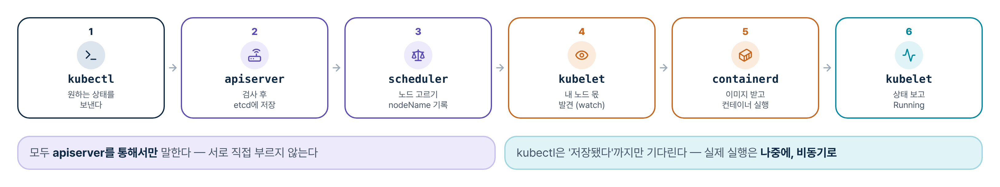

# 3교시 · 노드와 Pod — 실제로 돌리는 현장

> [!NOTE]
> **이번 시간에 할 일**
>
> - 노드의 세 부품 — **kubelet · 컨테이너 런타임 · kube-proxy** — 과 네트워크 플러그인(CNI)의 역할을 구분합니다.
> - Kubernetes가 컨테이너가 아니라 **Pod**를 기본 단위로 삼는 이유를 이해합니다.
> - `kubectl` 명령 하나가 Pod 실행으로 이어지는 **6단계**를 따라갑니다.

## 노드의 부품

노드는 앱 컨테이너가 실제로 도는 컴퓨터입니다. 노드마다 같은 부품이 깔립니다.

| 부품 | 역할 | 물류 회사 비유 |
|---|---|---|
| **kubelet** | apiserver를 지켜보다가 **내 노드에 배정된 Pod**를 발견하면 띄우고, 상태를 보고한다. 헬스 체크(probe)도 여기서 한다 | 창고 반장 |
| **컨테이너 런타임** (containerd) | kubelet의 지시로 이미지를 받고 컨테이너를 만든다 | 지게차 기사 |
| **kube-proxy** | Service 주소로 온 요청을 실제 Pod로 넘기는 규칙을 노드에 깐다 | 창고 입구의 안내판 |
| **CNI 플러그인** (kind는 kindnet) | Pod마다 IP를 주고, 노드가 달라도 Pod끼리 통신하게 한다 | 창고 사이의 도로 |

> [!IMPORTANT]
> **kubelet만 기억해도 된다**
>
> 노드에서 가장 중요한 것은 **kubelet**입니다. 컨트롤 플레인이 "worker2에 Pod를 놓아라"라고 **적기만** 하면, worker2의 kubelet이 그것을 보고 **실제로 띄웁니다**. kubelet이 멈추면 그 노드는 본부와 연락이 끊긴 창고가 되어, 잠시 뒤 `NotReady`로 표시됩니다(7교시에 직접 봅니다).

### 컨테이너 런타임과 "Docker를 버렸다"는 오해

kubelet은 **CRI**(Container Runtime Interface)라는 정해진 방식으로 런타임에게 말합니다. CRI를 지키는 런타임이면 무엇이든 끼울 수 있습니다. 오늘날 기본은 **containerd**입니다(2주차에 `docker` 명령 아래에서 실제로 일하던 그것).

2022년 v1.24에서 없어진 것은 Docker 자체가 아니라 **dockershim**, 즉 CRI를 모르는 옛 Docker와 kubelet을 잇던 임시 연결부입니다. 지금은 kubelet → containerd로 바로 갑니다.

- `docker build`로 만든 이미지 → **그대로 돈다.** 이미지 형식은 OCI 표준이라 런타임과 상관없다.
- 노드 안에서 `docker ps` → **안 된다.** 노드에 Docker가 없다. 대신 `crictl ps`를 쓴다(7교시).

## Pod — Kubernetes의 가장 작은 단위

Kubernetes는 컨테이너를 하나씩 다루지 않습니다. **Pod**라는 묶음으로 다룹니다.

> **📖 용어 — Pod**
>
> **함께 배치되고, 네트워크와 저장 공간을 공유하는 컨테이너 1개 이상의 묶음.** 영어로 고래 떼(pod of whales)라는 뜻입니다. Docker 로고가 고래라서 붙은 이름입니다.

Pod 안의 컨테이너들은:

- **항상 같은 노드에** 함께 놓인다.
- **IP 하나를 공유한다.** 서로 `localhost`로 부른다.
- 볼륨을 함께 붙일 수 있다.
- 함께 만들어지고 함께 사라진다.

> **🧩 비유 — 한 집에 사는 가족**
>
> 컨테이너가 사람이라면 Pod는 **집**입니다. 주소(IP)는 집마다 하나이고, 가족은 같은 주소를 씁니다. 가족끼리는 집 안에서(`localhost`) 이야기합니다. 이사를 가면 가족이 다 같이 갑니다. 대부분의 집에는 한 사람만 삽니다(컨테이너 1개짜리 Pod가 대부분).

**대부분의 Pod는 컨테이너가 하나**입니다. 두 개 이상을 넣는 것은 "꼭 붙어 있어야 하는" 보조 역할이 있을 때뿐입니다 — 로그를 모아 보내는 컨테이너, 4주차 서비스 메시의 프록시(사이드카) 등.

> **❓ 오해 — Pod 하나에 DevMart 전체를 넣으면 편하다**
>
> `web` · `order-api` · `catalog-api`를 Pod 하나에 넣으면 안 됩니다. Pod는 **같이 늘고 같이 줄고 같이 죽습니다.** `catalog-api`만 3개로 늘리고 싶어도 Pod째로 늘어나 `web`까지 3개가 됩니다. 하나가 죽으면 같은 Pod의 나머지도 다시 시작됩니다. 1일차 MSA에서 "따로 배포하고 따로 늘리려고" 나눴던 이점이 사라집니다. **서비스 하나 = Pod 종류 하나**가 기본입니다.

### Pod는 '소모품'이다

Pod에는 중요한 성질이 있습니다. **Pod는 죽으면 고쳐 쓰지 않고, 새 Pod로 바꿉니다.**

- 새 Pod는 **이름도 IP도 다릅니다.** (`order-api-7c9f…-x2k8p`가 죽으면 `…-m4q7z`가 생긴다)
- 그래서 Pod의 IP를 직접 적어 두고 부르면 안 됩니다. → 고정된 이름과 주소를 주는 **Service**(내일)
- 그래서 Pod 안에 중요한 데이터를 두면 안 됩니다. → DB 데이터는 볼륨으로 (5일차)
- 그래서 Pod를 사람이 직접 만들지 않습니다. → "늘 2개" 같은 **원하는 상태를 적어 두고**, 컨트롤러가 Pod를 만들고 바꾸게 한다(4교시 · 내일의 Deployment)

1주차 4일차의 **"애완동물이 아니라 가축"**(pets vs cattle) 원칙이 Kubernetes에서 가장 철저하게 지켜지는 곳이 Pod입니다.

## Pod 하나가 뜨기까지 — 6단계

내일 `kubectl`로 Pod를 만들 때 실제로 일어나는 일입니다.

| 단계 | 누가 | 무엇을 | 이때 Pod 상태 |
|---|---|---|---|
| 1 | kubectl | 원하는 상태(YAML)를 apiserver에 보낸다 | |
| 2 | apiserver | 인증 · 인가 · 검사 후 **etcd에 저장**. kubectl은 여기서 "created"를 받고 끝난다 | `Pending` |
| 3 | scheduler | 노드가 정해지지 않은 Pod를 발견 → 노드를 골라 `nodeName`을 적는다 | `Pending` |
| 4 | kubelet (해당 노드) | "내 노드에 새 Pod가 배정됐다"를 발견 | `Pending` → `ContainerCreating` |
| 5 | containerd | 이미지를 받고(pull) 컨테이너를 만든다 | `ContainerCreating` |
| 6 | kubelet | 컨테이너가 떴음을 apiserver에 **보고** | `Running` |

> [!IMPORTANT]
> **kubectl이 성공했다 ≠ 앱이 떴다**
>
> 2단계에서 kubectl은 이미 "created"를 받고 끝납니다. 그 뒤 이미지 이름이 틀렸거나(5단계 실패), 놓을 노드가 없거나(3단계 실패), 앱이 시작하자마자 죽어도(6단계 이후) **kubectl은 성공이라고 말합니다.** 그래서 Kubernetes에서는 "명령 → **상태 확인**"이 한 쌍입니다. 내일 이 상태를 읽는 법(`get` · `describe` · `logs`)을 집중적으로 익힙니다.

> **📘 예시 — 단계마다 실패하면 보이는 상태**
>
> | 실패한 단계 | 보이는 상태 | 흔한 원인 (내일 직접 만들어 봄) |
> |---|---|---|
> | 2 | kubectl 오류 메시지 | YAML 오타, 권한 없음 |
> | 3 | `Pending`에서 멈춤 | 메모리 부족, 조건에 맞는 노드 없음 |
> | 5 | `ErrImagePull` → `ImagePullBackOff` | 이미지 이름 · 태그 오타, 비공개 레지스트리 |
> | 6 이후 | `CrashLoopBackOff` | 앱이 시작하자마자 죽음 (어제의 크래시 루프!) |

> **🎓 학술 노트 — 레벨 트리거와 '지켜보기(watch)'**
>
> kubelet과 컨트롤러는 apiserver에 "바뀌면 알려 줘"라고 **watch** 요청을 걸어 둡니다. 그런데 알림(사건, edge)만 믿지 않고, 받을 때마다 **지금 전체 상태(level)**를 다시 보고 판단합니다. 전자공학의 **엣지 트리거 vs 레벨 트리거** 구분에서 온 설계입니다. 알림 하나를 놓쳐도 다음에 상태를 보면 따라잡을 수 있어서, 네트워크가 끊겼다 붙어도 결국 맞는 상태로 돌아옵니다. Kubernetes 설계 원칙 문서는 이를 "**레벨 기반**(level-based)이어야 한다 — 중간 변화를 몇 번 놓쳤든, 원하는 상태와 지금 관찰한 상태만으로 올바르게 동작해야 한다"고 적어 두었습니다.

> **📈 트렌드 2026 — 노드 쪽의 최근 변화**
>
> - **cgroup v1 지원 종료** — v1.35(2025년 12월)부터 kubelet은 기본 설정으로 cgroup v1 리눅스에서 시작하지 않습니다. 최신 리눅스 배포판 · WSL2 · Docker Desktop은 모두 cgroup v2라 보통 문제없지만, 오래된 서버에서는 걸립니다. 6교시에 확인합니다.
> - **Pod 자원의 실행 중 변경** — v1.35에서 정식(stable) 기능이 되었습니다. 예전에는 Pod의 CPU · 메모리를 바꾸려면 Pod를 다시 만들어야 했지만, 이제 재시작 없이 바꿀 수 있습니다(5일차 requests/limits와 연결).
> - **사이드카 컨테이너** — 보조 컨테이너를 주 컨테이너보다 먼저 시작하고 나중에 끝내는 정식 방법이 생겨(v1.33 stable), 4주차 서비스 메시와 로그 수집에 쓰입니다.

## 실습 3 · Pod가 뜨기까지 6단계 그리기

> **🧪 실습: 실습 목표**
>
> 그림을 보지 않고, 6단계를 내 손으로 다시 그립니다. 내일 Pod가 안 뜰 때 "몇 단계에서 멈췄나"를 묻는 습관을 만드는 것이 목적입니다.

1. 배움 노트에 상자 여섯 개를 그리고, 각 상자에 **누가 · 무엇을** 적습니다.
2. 상자마다 "여기서 실패하면 보이는 상태"를 한 단어로 적습니다.
3. 짝과 바꿔 보고, 빠진 단계가 있으면 서로 채웁니다.

> **🟢 확인: 스스로 점검**
>
> - **etcd에 저장하는** 상자는 몇 번인가요? (2)
> - **이미지를 받는** 상자는 컨트롤 플레인인가요, 노드인가요? (노드의 containerd — 그래서 비공개 이미지는 **노드가** 레지스트리에 로그인할 수 있어야 한다)

> **✅ 확인 문제**
>
> 1. Pod 안의 두 컨테이너가 서로 부를 때 쓰는 주소는?
> 2. Pod가 죽고 새로 생기면 바뀌는 두 가지는?
> 3. Kubernetes v1.24 이후 노드 안에서 `docker ps`가 안 되는 이유는? 그래도 Docker로 만든 이미지가 도는 이유는?
> 4. `kubectl`이 "created"라고 말했는데 앱이 안 뜨는 경우를 두 가지 드세요.
>
> 

정답

>
> 1. `localhost` (IP를 공유하므로)
> 2. 이름과 IP
> 3. 노드는 Docker 없이 containerd를 직접 쓰기 때문. 이미지는 OCI 표준 형식이라 어떤 런타임에서도 돈다
> 4. 이미지 이름 오타(ImagePullBackOff), 놓을 노드가 없음(Pending), 앱이 시작하자마자 죽음(CrashLoopBackOff) 중 둘
>
> 

## 참고 문헌

- Kubernetes Docs. *Nodes* · *Pods* · *Pod Lifecycle* · *Container Runtime Interface (CRI)*. kubernetes.io/docs/concepts
- Kubernetes Blog (2022). *Kubernetes is Moving on From Dockershim: Commitments and Next Steps*. kubernetes.io/blog
- Kubernetes Blog (2025-12-17). *Kubernetes v1.35: Timbernetes* (cgroup v1 지원 제거 · 실행 중 Pod 자원 변경). kubernetes.io/blog
- Kubernetes Community. *Design Principles* (design-proposals/architecture/principles.md). github.com/kubernetes/design-proposals-archive
