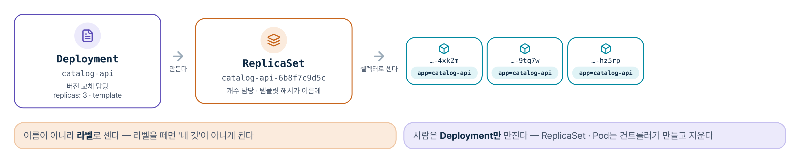

# 4교시 · Deployment

> [!NOTE]
> **이번 시간에 할 일**
>
> - **Deployment** 매니페스트를 읽고, Pod 매니페스트와 무엇이 다른지 구분합니다.
> - catalog-api를 3개 띄우고, **Deployment → ReplicaSet → Pod** 사슬을 라벨과 이름으로 따라갑니다.
> - 개수를 늘리고 줄이며(scale) 선언형으로 바꾸는 법과 명령형으로 바꾸는 법을 비교합니다.

## 매니페스트 읽기

```bash
cd ~/devops-lab/k8s/day4
cat deployment.yaml
```

```yaml
apiVersion: apps/v1
kind: Deployment
metadata:
  name: catalog-api
  labels:
    app: catalog-api
spec:
  replicas: 3                       # 몇 개
  selector:                         # 어떤 Pod를 '내 것'으로 셀까
    matchLabels:
      app: catalog-api
  template:                         # 이 틀로 Pod를 찍는다 — 아래는 2교시 pod.yaml과 거의 같다
    metadata:
      labels:
        app: catalog-api            # selector와 반드시 일치
    spec:
      containers:
        - name: catalog-api
          image: ghcr.io/niceguy61/devmart-catalog-api:sha-7f3c2e1
          ports:
            - containerPort: 8000
          env:
            - name: APP_VERSION
              value: "2.0.0"
            - name: APP_ENV
              value: "kind"
      tolerations: …                # 5교시 노드 끄기 실험용 (지금은 건너뛴다)
```

Pod 매니페스트를 `template:` 아래에 통째로 넣고, 그 위에 **개수(`replicas`)와 셀렉터(`selector`)**를 얹은 모양입니다.

| 칸 | 뜻 |
|---|---|
| `apiVersion: apps/v1` | 어제 7교시 `api-resources --api-group=apps`에서 본 그 묶음 |
| `replicas: 3` | 원하는 Pod 개수 — 어제 4교시의 '원하는 상태' |
| `selector.matchLabels` | 이 라벨이 붙은 Pod를 센다 |
| `template` | 모자라면 이 틀로 새 Pod를 만든다. Pod 이름은 없다 — 자동으로 붙는다 |
| `env` | 환경 변수 (2주차 Compose의 `environment:`) — 7교시에 이 값을 바꿔 새 버전을 배포한다 |

> [!WARNING]
> **selector와 template의 라벨이 다르면**
>
> `selector`가 `app: catalog-api`인데 `template`의 라벨이 `app: catalog`라면, Deployment는 자기가 만든 Pod를 자기 것으로 셀 수 없습니다. 이런 매니페스트는 apiserver가 **처음부터 거절**합니다(`selector does not match template labels`). 그리고 한 번 만든 Deployment의 selector는 **바꿀 수 없습니다.** 처음에 정한 라벨 이름을 계속 씁니다.

## 실습 7 · catalog-api × 3

### 단계 1 — 만들고 지켜보기

```bash
kubectl apply -f deployment.yaml
kubectl rollout status deployment/catalog-api
```

- `rollout status` : 원하는 개수가 모두 준비될 때까지 기다렸다가 알려 준다. **`apply` 다음의 `get`을 대신하는 명령**이다

> **🟢 확인: 보이는 것**
>
> ```text
> deployment.apps/catalog-api created
> Waiting for deployment "catalog-api" rollout to finish: 0 of 3 updated replicas are available...
> Waiting for deployment "catalog-api" rollout to finish: 1 of 3 updated replicas are available...
> Waiting for deployment "catalog-api" rollout to finish: 2 of 3 updated replicas are available...
> deployment "catalog-api" successfully rolled out
> ```
> 이미지는 2교시에 이미 받았으므로 금방 끝납니다.

### 단계 2 — 사슬 따라가기

```bash
kubectl get deployment,replicaset,pod -l app=catalog-api -o wide
```

> **🟢 확인: 보이는 것 (칸 일부 생략)**
>
> ```text
> NAME                          READY   UP-TO-DATE   AVAILABLE   AGE
> deployment.apps/catalog-api   3/3     3            3           30s
>
> NAME                                     DESIRED   CURRENT   READY   AGE
> replicaset.apps/catalog-api-6b8f7c9d5c   3         3         3       30s
>
> NAME                               READY   STATUS    RESTARTS   AGE   IP           NODE
> pod/catalog-api-6b8f7c9d5c-4xk2m   1/1     Running   0          30s   10.244.1.5   devmart-worker
> pod/catalog-api-6b8f7c9d5c-9tq7w   1/1     Running   0          30s   10.244.2.4   devmart-worker2
> pod/catalog-api-6b8f7c9d5c-hz5rp   1/1     Running   0          30s   10.244.1.6   devmart-worker
> ```



이름을 보면 사슬이 보입니다.

| 이름 | 누가 만들었나 | 이름의 규칙 |
|---|---|---|
| `catalog-api` | 나 (`apply`) | 매니페스트의 `metadata.name` |
| `catalog-api-6b8f7c9d5c` | Deployment 컨트롤러 | Deployment 이름 + **템플릿 해시** |
| `catalog-api-6b8f7c9d5c-4xk2m` | ReplicaSet 컨트롤러 | ReplicaSet 이름 + 임의 5글자 |

**템플릿 해시**는 `template:` 내용으로 계산한 값입니다. 템플릿이 바뀌면(7교시: 환경 변수, 이미지) 해시가 바뀌고, **새 ReplicaSet**이 생깁니다. 이것이 롤링 업데이트의 열쇠입니다.

### 단계 3 — '누구 것인가' 확인

```bash
POD=$(kubectl get pod -l app=catalog-api -o jsonpath='{.items[0].metadata.name}')
kubectl get pod $POD -o jsonpath='{.metadata.ownerReferences[0].kind}/{.metadata.ownerReferences[0].name}{"\n"}'
kubectl get pod $POD --show-labels
```

- `-o jsonpath='{…}'` : 출력에서 필요한 칸만 뽑는다 (2일차 `--jq`와 비슷)
- `ownerReferences` : 이 리소스의 **주인**
- `--show-labels` : 붙은 라벨을 모두 보기

> **🟢 확인: 보이는 것**
>
> ```text
> ReplicaSet/catalog-api-6b8f7c9d5c
> NAME                           READY   STATUS    RESTARTS   AGE   LABELS
> catalog-api-6b8f7c9d5c-4xk2m   1/1     Running   0          2m    app=catalog-api,pod-template-hash=6b8f7c9d5c
> ```
> - Pod의 주인은 ReplicaSet, ReplicaSet의 주인은 Deployment입니다. **주인을 지우면 딸린 것도 지워집니다**(가비지 컬렉션) — `kubectl delete deployment catalog-api` 한 줄이면 셋 다 사라집니다.
> - `pod-template-hash` 라벨은 **내가 붙이지 않았습니다.** Deployment가 ReplicaSet끼리 Pod를 헷갈리지 않게 덧붙인 것입니다.

> [!IMPORTANT]
> **Deployment와 ReplicaSet은 할 일이 다르다**
>
> **ReplicaSet**은 "**지금 템플릿으로 N개**"만 지킵니다. 버전을 모릅니다. **Deployment**는 ReplicaSet을 여러 개 거느리고 "**옛 버전에서 새 버전으로 조금씩 옮기기**"를 맡습니다. 사람은 Deployment만 만지고, ReplicaSet은 직접 만들거나 고치지 않습니다.

## 실습 8 · 늘리고 줄이기

### 방법 1 — 명령형: `kubectl scale`

```bash
kubectl scale deployment/catalog-api --replicas=5
kubectl get pods -l app=catalog-api
```

> **🟢 확인: 보이는 것**
>
> ```text
> deployment.apps/catalog-api scaled
> NAME                           READY   STATUS    RESTARTS   AGE
> catalog-api-6b8f7c9d5c-4xk2m   1/1     Running   0          5m
> catalog-api-6b8f7c9d5c-9tq7w   1/1     Running   0          5m
> catalog-api-6b8f7c9d5c-hz5rp   1/1     Running   0          5m
> catalog-api-6b8f7c9d5c-m2v8c   1/1     Running   0          3s
> catalog-api-6b8f7c9d5c-xq4lp   1/1     Running   0          3s
> ```
> 2주차 `docker compose up --scale`과 같은 일을 클러스터가 했습니다. 새 두 개는 **같은 ReplicaSet**(같은 해시)입니다 — 템플릿은 그대로이고 개수만 바뀌었으니까요.

### 방법 2 — 선언형: 파일을 다시 적용

```bash
kubectl apply -f deployment.yaml
kubectl get deployment catalog-api
```

> **🟢 확인: 보이는 것**
>
> ```text
> deployment.apps/catalog-api configured
> NAME          READY   UP-TO-DATE   AVAILABLE   AGE
> catalog-api   3/3     3            3           6m
> ```
> 파일에는 여전히 `replicas: 3`이 적혀 있으니, 다시 적용하면 **3개로 돌아갑니다.** 방금 `scale`로 늘린 것이 사라졌습니다.

> **❓ 오해 — scale로 바꿨으니 그게 지금 설정이다**
>
> 명령형으로 바꾼 것은 **파일에 남지 않습니다.** 다음에 누군가(또는 CI, 4주차의 Argo CD) 파일을 다시 적용하면 조용히 원래대로 돌아갑니다. 반대로, 파일을 모르는 채로 운영 중 `scale`을 하면 "누가 언제 왜 5개로 바꿨지?"를 아무도 모릅니다. 원칙은 **파일을 고치고 apply**입니다. `scale`은 장애 중 급한 대응처럼 예외일 때만 쓰고, 끝나면 파일에 반영합니다. 이 어긋남을 **드리프트**(drift)라고 하며, 4주차 3일차 GitOps가 해결하는 바로 그 문제입니다.

> **🎓 학술 노트 — '고정된 이름'과 '찍어 낸 것'**
>
> Deployment의 Pod 이름에는 임의 문자열이 붙고, 어느 것이 몇 번째인지 구분하지 않습니다. 모두 **같은 틀에서 찍은 같은 것**이기 때문입니다. 반대로 DB처럼 "1번은 주 서버, 2번은 복제본"처럼 **각자 정체성과 자기 디스크**가 있어야 하는 앱을 위해서는 **StatefulSet**이 따로 있습니다(Pod 이름이 `db-0`, `db-1`로 고정된다). 1주차 4일차의 '애완동물 vs 가축'에서 가축 쪽이 Deployment, 이름표를 단 소 쪽이 StatefulSet입니다. 이 비유는 Bill Baker가 서버 확장 방식을 설명하며 쓰고, Randy Bias가 클라우드 운영의 맥락에서 널리 알린 것으로 알려져 있습니다.

> **📈 트렌드 2026 — 개수를 사람이 정하지 않는다**
>
> 오늘은 `replicas`를 손으로 정했습니다. 운영 환경에서는 **HorizontalPodAutoscaler**(HPA)가 CPU 사용률이나 요청 수를 보고 개수를 자동으로 바꿉니다. Kubernetes v1.37(2026년 8월)에서 HPA의 **0개까지 줄이기**(scale to zero)가 베타로 기본 활성화되어, 밤에 아무도 안 쓰는 서비스는 Pod를 0개로 두었다가 요청이 오면 다시 띄우는 일이 기본 기능으로 가능해졌습니다(외부 지표를 쓰는 경우). 4주차 2일차에 부하 테스트와 함께 다룹니다.

> **✅ 확인 문제**
>
> 1. Deployment의 `template:` 아래는 무엇과 거의 같나요?
> 2. ReplicaSet 이름 뒤의 `6b8f7c9d5c`는 무엇이고, 언제 바뀌나요?
> 3. `kubectl scale --replicas=5` 뒤 `kubectl apply -f deployment.yaml`(replicas: 3)을 하면 몇 개가 되나요? 왜?
> 4. Deployment를 지우면 ReplicaSet과 Pod는 어떻게 되나요?
>
> <details><summary>정답</summary>
>
> 1. Pod 매니페스트의 `metadata`(라벨)와 `spec`
> 2. 템플릿 해시. `template:` 내용(이미지, 환경 변수 등)이 바뀌면 바뀐다. `replicas`만 바꾸면 그대로
> 3. 3개 — 선언형 적용은 파일의 원하는 상태로 맞춘다. scale로 바꾼 것은 파일에 없었다
> 4. 함께 지워진다 (ownerReferences에 따른 가비지 컬렉션)
>
> </details>

## 참고 문헌

- Kubernetes Docs. *Deployments* · *ReplicaSet*. kubernetes.io/docs/concepts/workloads/controllers
- Kubernetes Docs. *Owners and Dependents* · *Garbage Collection*. kubernetes.io/docs/concepts
- Kubernetes Docs. *Horizontal Pod Autoscaling*. kubernetes.io/docs/tasks/run-application
- Kubernetes Blog (2026-08-26). *Kubernetes v1.37: Garhwal*. kubernetes.io/blog
