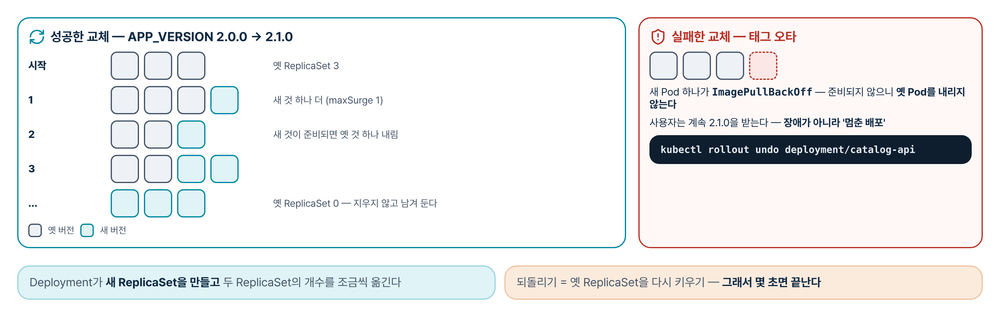

# 7교시 · 롤링 업데이트와 되돌리기

> [!NOTE]
> **이번 시간에 할 일**
>
> - catalog-api를 새 설정(`APP_VERSION 2.1.0`)으로 **조금씩** 교체하며, 요청이 끊기는지 지켜봅니다.
> - 교체 중 두 ReplicaSet의 개수가 옮겨 가는 것을 확인합니다.
> - 잘못된 이미지로 배포를 **망가뜨리고**, 서비스가 왜 멀쩡한지 이해한 뒤 **되돌립니다.**
> - 배포 이력(`rollout history`)을 남기고 읽습니다.



## 롤링 업데이트의 규칙

4교시에 "템플릿이 바뀌면 해시가 바뀌고 **새 ReplicaSet**이 생긴다"고 했습니다. Deployment는 새 ReplicaSet을 0에서 키우고, 옛 ReplicaSet을 줄입니다. 한꺼번에가 아니라 정해진 폭으로 조금씩입니다.

| 설정 | 기본값 | 뜻 | replicas 3일 때 |
|---|---|---|---|
| `maxSurge` | 25% | 원하는 개수보다 **잠시 더** 띄울 수 있는 수 (올림) | 1 → 최대 4개까지 |
| `maxUnavailable` | 25% | 원하는 개수보다 **잠시 덜** 준비돼도 되는 수 (내림) | 0 → 항상 3개는 준비 |

즉 지금 catalog-api는 "**새 것 하나를 먼저 띄우고, 그게 준비되면 옛것 하나를 내린다**"를 세 번 반복합니다.

> **🧩 비유 — 달리는 열차의 바퀴 갈기**
>
> 열차를 세우지 않고 바퀴를 하나씩 바꿉니다. 새 바퀴를 먼저 끼워 단단히 붙었는지 확인한 뒤에 헌 바퀴를 뺍니다. 새 바퀴가 안 맞으면? 헌 바퀴를 빼지 않습니다. 열차는 계속 달립니다.

## 실습 14 · 새 버전으로 교체

### 단계 1 — 지켜볼 창 띄우기

브라우저 대신 터미널로 0.3초마다 버전을 묻습니다.

```bash
# 터미널 A — 실습 끝까지 켜 둔다
while true; do
  curl -s -m 1 localhost:30080/api/info | grep -o '"version":"[^"]*"' || echo FAIL
  sleep 0.3
done
```

- `-m 1` : 1초 안에 답이 없으면 포기
- `grep -o '…'` : 응답에서 버전 부분만
- `|| echo FAIL` : 실패하면 FAIL을 찍는다

> **🟢 확인: 보이는 것**
>
> ```text
> "version":"2.0.0"
> "version":"2.0.0"
> "version":"2.0.0"
> ```

### 단계 2 — 파일 고치고 적용

```bash
# 터미널 B
cd ~/devops-lab/k8s/day4
sed -i 's/value: "2.0.0"/value: "2.1.0"/' deployment.yaml      # Mac: sed -i ''
grep -A1 APP_VERSION deployment.yaml
kubectl apply -f deployment.yaml
kubectl annotate deployment/catalog-api kubernetes.io/change-cause="APP_VERSION 2.1.0"
kubectl rollout status deployment/catalog-api
```

- `annotate … change-cause` : 이번 변경의 이유를 적어 둔다. `rollout history`에 표시된다

> **🟢 확인: 터미널 B**
>
> ```text
>           - name: APP_VERSION
>             value: "2.1.0"
> deployment.apps/catalog-api configured
> deployment.apps/catalog-api annotated
> Waiting for deployment "catalog-api" rollout to finish: 1 out of 3 new replicas have been updated...
> Waiting for deployment "catalog-api" rollout to finish: 2 out of 3 new replicas have been updated...
> Waiting for deployment "catalog-api" rollout to finish: 1 old replicas are pending termination...
> deployment "catalog-api" successfully rolled out
> ```

> **🟢 확인: 터미널 A — 몇 초 동안 섞이다가 바뀐다**
>
> ```text
> "version":"2.0.0"
> "version":"2.1.0"
> "version":"2.0.0"
> "version":"2.1.0"
> FAIL
> "version":"2.1.0"
> "version":"2.1.0"
> ```
> - 교체 중에는 옛 Pod와 새 Pod가 **함께** 손님을 받습니다. 그래서 두 버전이 섞여 보입니다. 이 몇 초 동안 두 버전이 동시에 돌아도 괜찮도록 앱을 만들어야 합니다(DB 구조를 바꾸는 배포라면 특히).
> - **FAIL이 한두 줄** 보일 수 있습니다. 아직 무중단이 아닙니다. 왜일까요? 아래 '오해'를 보세요.

> **❓ 오해 — 롤링 업데이트면 저절로 무중단이다**
>
> Kubernetes는 새 Pod가 **준비되면** 옛 Pod를 내립니다. 그런데 지금 매니페스트에는 '준비됐다'를 판단할 방법이 없습니다. 그래서 컨테이너가 **시작하자마자** 준비된 것으로 칩니다 — gunicorn이 아직 8000 포트를 열기도 전에 손님이 올 수 있습니다. 반대쪽 끝에서는, 내려가는 Pod가 Service 목록에서 빠지기 전 잠깐 동안 요청을 받다가 끊길 수 있습니다. 해결은 내일 3교시의 **readiness probe**(정말 준비됐는지 물어보기)와 종료 처리입니다. 오늘 본 FAIL 한두 줄이 내일 probe를 배우는 이유입니다.

### 단계 3 — ReplicaSet 두 개

```bash
kubectl get replicaset -l app=catalog-api
```

> **🟢 확인: 보이는 것**
>
> ```text
> NAME                     DESIRED   CURRENT   READY   AGE
> catalog-api-6b8f7c9d5c   0         0         0       2h
> catalog-api-7d9c4b8f6a   3         3         3       45s
> ```
> 옛 ReplicaSet(`6b8f…`)은 **지워지지 않고 0개**로 남았습니다. 되돌리기를 위해서입니다. 기본으로 옛 ReplicaSet 10개까지 남깁니다(`revisionHistoryLimit`).

### 단계 4 — 이력

```bash
kubectl rollout history deployment/catalog-api
```

> **🟢 확인: 보이는 것**
>
> ```text
> deployment.apps/catalog-api
> REVISION  CHANGE-CAUSE
> 1         <none>
> 2         APP_VERSION 2.1.0
> ```
> 1번은 처음 만들 때 이유를 적지 않아 `<none>`입니다.

## 실습 15 · 망가진 배포와 되돌리기

### 단계 1 — 없는 태그로 배포

이번엔 일부러 **명령형**으로, 없는 이미지 태그를 넣습니다. 3교시의 `sha-0000000`입니다.

```bash
GH=$(gh api user --jq .login | tr 'A-Z' 'a-z')     # 새 터미널이면 다시 정한다 (1교시 단계 2)
kubectl set image deployment/catalog-api catalog-api=ghcr.io/$GH/devmart-catalog-api:sha-0000000
kubectl annotate deployment/catalog-api kubernetes.io/change-cause="잘못된 태그 sha-0000000" --overwrite
kubectl rollout status deployment/catalog-api --timeout=60s
```

- `set image 디플로이먼트 컨테이너이름=새이미지` : 이미지만 바꾼다
- `--timeout=60s` : 60초 기다려도 안 끝나면 포기

> **🟢 확인: 터미널 B — 끝나지 않는다**
>
> ```text
> deployment.apps/catalog-api image updated
> deployment.apps/catalog-api annotated
> Waiting for deployment "catalog-api" rollout to finish: 1 out of 3 new replicas have been updated...
> error: timed out waiting for the condition
> ```

> **🟢 확인: 터미널 A — 여전히 멀쩡하다**
>
> ```text
> "version":"2.1.0"
> "version":"2.1.0"
> "version":"2.1.0"
> ```

```bash
kubectl get pods -l app=catalog-api
```

> **🟢 확인: 보이는 것**
>
> ```text
> NAME                           READY   STATUS             RESTARTS   AGE
> catalog-api-5f6b9d7c8e-q2wzx   0/1     ImagePullBackOff   0          75s
> catalog-api-7d9c4b8f6a-8vkqp   1/1     Running            0          6m
> catalog-api-7d9c4b8f6a-dn4ts   1/1     Running            0          6m
> catalog-api-7d9c4b8f6a-p9xwz   1/1     Running            0          6m
> ```
> 새 ReplicaSet의 Pod 하나가 `ImagePullBackOff`에서 멈췄습니다. **준비되지 않았으니 옛 Pod를 하나도 내리지 않았습니다**(`maxUnavailable: 0`). 사용자는 아무것도 모릅니다. 이것은 **장애가 아니라 '멈춘 배포'**입니다.

> [!WARNING]
> **멈춘 배포를 방치하면**
>
> 10분(`progressDeadlineSeconds: 600`)이 지나면 Deployment는 `Progressing=False`(ProgressDeadlineExceeded)로 표시하지만, **스스로 되돌리지는 않습니다.** 그 사이 누가 노드를 정리하거나 옛 Pod가 죽으면, 새로 만들어지는 것은 **망가진 템플릿**의 Pod입니다. 멈춘 배포는 바로 되돌리거나 고칩니다.

### 단계 2 — 되돌리기

```bash
kubectl rollout undo deployment/catalog-api
kubectl rollout status deployment/catalog-api
kubectl get pods -l app=catalog-api
```

> **🟢 확인: 보이는 것**
>
> ```text
> deployment.apps/catalog-api rolled back
> deployment "catalog-api" successfully rolled out
> NAME                           READY   STATUS    RESTARTS   AGE
> catalog-api-7d9c4b8f6a-8vkqp   1/1     Running   0          8m
> catalog-api-7d9c4b8f6a-dn4ts   1/1     Running   0          8m
> catalog-api-7d9c4b8f6a-p9xwz   1/1     Running   0          8m
> ```
> 망가진 Pod가 사라지고, 2.1.0 Pod 셋은 **그대로**(AGE가 그대로)입니다. 되돌리기 = **바로 앞 ReplicaSet을 다시 원하는 상태로** 만든 것이라, 이미 떠 있던 Pod를 건드릴 필요가 없었습니다.

```bash
kubectl rollout history deployment/catalog-api
```

> **🟢 확인: 보이는 것**
>
> ```text
> REVISION  CHANGE-CAUSE
> 1         <none>
> 3         잘못된 태그 sha-0000000
> 4         APP_VERSION 2.1.0
> ```
> 2번이 사라지고 **4번**이 생겼습니다. 되돌리기도 '새 배포'로 기록됩니다. 특정 번호로 가려면 `kubectl rollout undo deployment/catalog-api --to-revision=1`.

> [!IMPORTANT]
> **되돌리기 뒤에는 파일을 맞춘다**
>
> 방금 망가뜨린 것은 `set image`(명령형)였고, 되돌린 결과는 마침 `deployment.yaml`과 같습니다. 하지만 **파일을 고쳐 apply한 배포가 문제였다면**, `rollout undo` 뒤에도 파일에는 문제의 내용이 남아 있습니다. 다음 `apply`에서 문제가 돌아옵니다. 되돌린 뒤에는 **반드시 파일(Git)도 되돌립니다.** 4교시의 드리프트, 4주차 GitOps에서 "되돌리기 = Git revert"가 되는 이유입니다.

## 실습 16 · 다시 고르게 — rollout restart

5교시 노드 끄기 실험 뒤 Pod가 한 노드에 몰려 있었다면, 템플릿은 그대로 두고 Pod만 새로 만들게 해서 다시 나눕니다.

```bash
kubectl rollout restart deployment/catalog-api
kubectl rollout status deployment/catalog-api
kubectl get pods -l app=catalog-api -o wide
```

> **🟢 확인: 보이는 것**
>
> Pod 셋이 새 이름으로 바뀌고, NODE 칸에 worker와 worker2가 섞여 나옵니다. `rollout restart`는 템플릿에 '재시작한 시각' 주석을 넣어 **해시를 바꾸는** 방식이라, 이것도 롤링 업데이트로 조금씩 진행됩니다.

터미널 A는 Ctrl+C로 멈춥니다. **Deployment와 Service는 지우지 않습니다** — 내일 아침 정리합니다.

> **🎓 학술 노트 — 배포가 장애의 가장 큰 원인이라면**
>
> 3교시 학술 노트에서 장애의 상당 부분이 **변경**에서 온다고 했습니다. 그래서 대규모 서비스 회사들은 배포를 "작게, 조금씩, 되돌릴 수 있게" 합니다. 구글 SRE 책(Beyer 외, 2016)의 **릴리스 엔지니어링**(8장)과 **점진적 출시**(canary) 원칙, 1주차 5일차의 DORA 연구가 공통으로 말하는 것은 **작은 배치(small batch)를 자주** 내보내고 **빨리 되돌리는** 팀이 더 안정적이라는 것입니다. 오늘의 롤링 업데이트는 가장 기본적인 점진 배포이고, 4주차 4일차 서비스 메시에서 "새 버전에 요청의 10%만" 보내는 **카나리**로 한 걸음 더 갑니다.

> **📈 트렌드 2026 — 지표를 보고 스스로 되돌리는 배포**
>
> 오늘은 사람이 `rollout status`를 보고 `undo`를 쳤습니다. **Argo Rollouts**나 Flagger 같은 도구는 새 버전에 트래픽을 조금씩 보내면서 오류율 · 지연 지표(4주차 2일차 Prometheus)를 자동으로 보고, 나빠지면 **스스로 되돌립니다**(progressive delivery). 사람은 기준만 정합니다. 그 기준이 되는 것이 오늘 터미널 A로 손수 본 "FAIL이 몇 번 났나"입니다.

> **✅ 확인 문제**
>
> 1. replicas 3, 기본 설정에서 롤링 업데이트 중 최대 몇 개의 Pod가 동시에 존재할 수 있나요? 준비된 Pod는 최소 몇 개?
> 2. 교체 중에 FAIL이 보인 이유와 내일 배울 해결책은?
> 3. 잘못된 태그로 배포했는데 사용자가 아무것도 모른 이유는?
> 4. `rollout undo`가 몇 초 만에 끝나는 이유는?
> 5. 파일을 고쳐 배포한 것이 문제여서 `rollout undo`를 했습니다. 다음에 할 일은?
>
> <details><summary>정답</summary>
>
> 1. 최대 4개 (maxSurge 1), 준비된 Pod는 최소 3개 (maxUnavailable 0)
> 2. '준비됨'을 판단할 방법이 없어 컨테이너가 시작하자마자 손님을 받거나, 내려가는 Pod가 목록에서 빠지기 전에 요청을 받았다. 해결은 readiness probe와 종료 처리 (5일차)
> 3. 새 Pod가 준비되지 않아 옛 Pod를 하나도 내리지 않았기 때문 (maxUnavailable 0)
> 4. 옛 ReplicaSet이 0개로 남아 있다가 다시 키워지기만 하면 되고, 이미 떠 있던 Pod는 건드리지 않기 때문
> 5. 파일(Git)도 되돌린다 — 아니면 다음 apply에서 문제가 돌아온다
>
> </details>

> [!NOTE]
> **오늘의 배움일기**
>
> - kubectl 루프 다섯 동사 중 오늘 가장 많이 쓴 것과, 가장 도움이 된 것
> - 장애 셋(Pending · ImagePullBackOff · CrashLoopBackOff) 중 하나를 골라, 처음 보는 동료에게 진단 순서를 설명하듯이
> - 자가 치유 실험 넷 중 가장 의외였던 것 — 왜?
> - Pod · ReplicaSet · Deployment · Service의 관계를 **라벨**이라는 말을 넣어 한 문단으로
> - 롤링 업데이트 중 FAIL이 몇 번 났는지, 그게 실제 쇼핑몰이었다면 어떤 일이 생겼을지
> - 내일 전에 궁금한 것: catalog-api가 DB 비밀번호를 받으려면? DB 데이터는 Pod가 바뀌면 어떻게 될까?

## 참고 문헌

- Kubernetes Docs. *Deployments — Updating a Deployment · Rolling Back · Rolling Update Deployment · Progress Deadline Seconds*. kubernetes.io/docs/concepts/workloads/controllers/deployment
- Kubernetes Docs. *kubectl rollout*. kubernetes.io/docs/reference/kubectl
- Beyer, B., Jones, C., Petoff, J., & Murphy, N. R. (Eds.) (2016). *Site Reliability Engineering*, Ch. 8 "Release Engineering". O'Reilly.
- Argo Project. *Argo Rollouts — Progressive Delivery*. argoproj.github.io/rollouts
