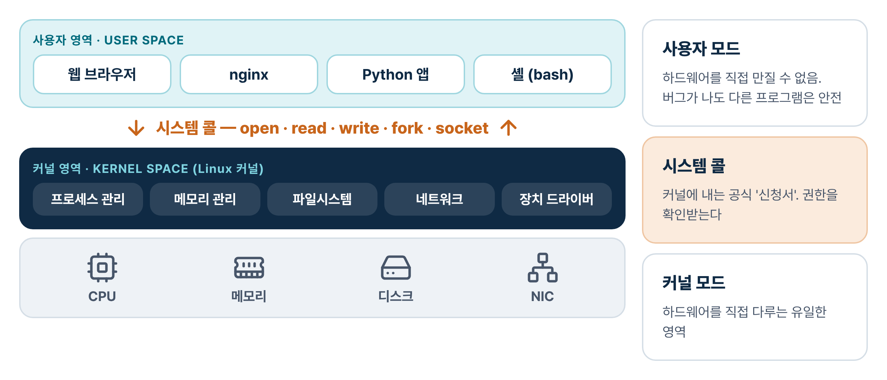

# 2교시 · 운영체제가 하는 일

!!! goal "이번 시간에 할 일"
    - 운영체제(OS)와 커널이 무엇인지 설명합니다.
    - 프로그램이 하드웨어를 쓰려면 왜 **시스템 콜**을 거쳐야 하는지 이해합니다.
    - 서버와 클라우드에서 왜 거의 Linux를 쓰는지 설명합니다.
    - Unix와 Linux의 역사, 그리고 "Unix 철학"을 맛봅니다.

## 운영체제 — 하드웨어와 프로그램 사이의 관리자

1교시에서 본 CPU, 메모리, 디스크, 네트워크 카드는 그 자체로는 아무것도 하지 않습니다. 수많은 프로그램이 이 부품들을 **안전하고 공평하게 나눠 쓰도록** 관리하는 소프트웨어가 필요합니다. 그것이 **운영체제(Operating System, OS)**입니다.

!!! analogy "비유 — 건물 관리소"
    여러 회사가 입주한 빌딩을 떠올려 보세요. 각 회사(프로그램)는 전기, 엘리베이터, 회의실(하드웨어)을 써야 합니다. 회사들이 전기 배선을 마음대로 건드리면 건물 전체가 위험해집니다. 그래서 **관리소(운영체제)**가 있고, 회사들은 관리소에 **신청서(시스템 콜)**를 내서 자원을 씁니다. 관리소는 공평하게 나눠 주고, 한 회사가 다른 회사 사무실에 들어가지 못하게 막습니다.

## 커널과 사용자 영역

운영체제의 핵심을 **커널(kernel)**이라고 합니다. 커널은 하드웨어를 직접 다룰 수 있는 유일한 소프트웨어입니다.

| 층 | 무엇이 있나 | 권한 |
|---|---|---|
| 사용자 영역 (user space) | 웹 브라우저, nginx, Python 프로그램, 셸 | 하드웨어 직접 접근 불가 |
| 시스템 콜 (system call) | `open`, `read`, `write`, `fork`, `socket` 같은 요청 창구 | 사용자 → 커널로 넘어가는 공식 통로 |
| 커널 영역 (kernel space) | 프로세스 관리, 메모리 관리, 파일시스템, 네트워크, 장치 드라이버 | 하드웨어 직접 접근 가능 |
| 하드웨어 | CPU, 메모리, 디스크, NIC | — |

예를 들어 Python 프로그램이 파일 하나를 읽을 때 실제로는 이런 일이 일어납니다.

1. 프로그램이 `open()` 시스템 콜로 "이 파일 열어 주세요"라고 커널에 요청합니다.
2. 커널은 **권한**을 확인합니다. 이 사용자가 이 파일을 읽어도 되는가?
3. 커널이 파일시스템과 디스크 드라이버를 통해 데이터를 읽어 메모리에 올립니다.
4. `read()` 시스템 콜의 결과로 프로그램에 데이터를 넘겨줍니다.

!!! key "왜 이렇게 번거롭게 할까?"
    모든 프로그램이 하드웨어를 직접 만질 수 있다면, 버그 하나가 컴퓨터 전체를 멈추게 하거나 다른 프로그램의 데이터를 훔쳐볼 수 있습니다. CPU에는 **사용자 모드**와 **커널 모드**라는 하드웨어 수준의 권한 구분이 있어서, 일반 프로그램은 커널을 거치지 않고는 위험한 일을 할 수 없습니다. 이 **격리** 개념은 오늘 6~7교시의 가상화와 컨테이너, 그리고 4주차 보안에서 계속 반복됩니다.

## 운영체제의 다섯 가지 일

| 일 | 설명 | 이 과정에서 다시 만나는 곳 |
|---|---|---|
| 프로세스 관리 | 어떤 프로그램을 언제 CPU에서 돌릴지 정한다 | 3교시, Kubernetes 스케줄링 |
| 메모리 관리 | 프로그램마다 메모리를 나눠 주고 서로 침범하지 못하게 한다 | 컨테이너 메모리 제한, OOMKilled |
| 파일시스템 | 디스크의 데이터를 파일과 폴더로 정리한다 | 4교시, Docker 볼륨 |
| 네트워크 | 데이터를 패킷으로 나눠 주고받는다 | 3일차, Docker 네트워크 |
| 보안·권한 | 누가 무엇을 할 수 있는지 통제한다 | 파일 권한, IAM, RBAC |

## 왜 서버는 Linux인가

여러분이 쓰는 노트북은 Windows나 macOS일 가능성이 높습니다. 그런데 서버와 클라우드 세계는 거의 **Linux**입니다.

| 이유 | 설명 |
|---|---|
| 무료·오픈소스 | 서버 수천 대에 설치해도 라이선스 비용이 없고, 소스 코드를 직접 볼 수 있다 |
| 가볍고 안정적 | 화면(GUI) 없이 꼭 필요한 것만 설치해 오래 켜 둘 수 있다 |
| 자동화에 최적 | 모든 작업을 명령어와 스크립트로 할 수 있어 수천 대를 똑같이 관리하기 쉽다 |
| 컨테이너의 기반 | Docker와 Kubernetes가 쓰는 핵심 기능(네임스페이스, cgroups)이 Linux 커널 기능이다 |
| 생태계 | 클라우드 이미지, 문서, 커뮤니티가 Linux 중심이다 |

!!! trend "트렌드 — 세계 최고 슈퍼컴퓨터 500대가 모두 Linux"
    전 세계 슈퍼컴퓨터 순위를 매기는 TOP500 목록에서는 2017년 11월부터 **500대 전부가 Linux**를 쓰고 있습니다. 클라우드도 마찬가지로, AWS·구글·마이크로소프트 클라우드에서 돌아가는 가상 머신과 컨테이너의 대다수가 Linux입니다. 마이크로소프트조차 Windows 안에서 진짜 Linux 커널을 돌리는 **WSL2(Windows Subsystem for Linux 2)**를 만들었고, 이 과정의 2주차 실습도 Windows 사용자는 WSL2 위에서 진행합니다.

### Linux 배포판

Linux는 엄밀히 말하면 **커널의 이름**입니다. 커널에 각종 도구, 패키지 관리자, 설정을 묶어서 바로 쓸 수 있게 만든 것을 **배포판(distribution)**이라고 합니다.

| 배포판 | 특징 | 어디서 만나나 |
|---|---|---|
| Ubuntu | 가장 대중적, 자료가 많음 | WSL2 기본, 실습 서버 |
| Debian | 안정성 중시, 많은 배포판의 뿌리 | 많은 Docker 이미지의 기반 |
| Amazon Linux | AWS가 직접 관리, AWS 도구 기본 포함 | 5주차 EC2 |
| Red Hat Enterprise Linux (RHEL) 계열 | 기업 지원, 금융·공공에서 많이 씀 | 국내 대기업·공공기관 |
| Alpine | 매우 작음(수 MB) | 가벼운 Docker 이미지 |

!!! academic "학술 노트 — Unix의 탄생과 Unix 철학"
    1969년 미국 벨 연구소의 켄 톰프슨(Ken Thompson)과 데니스 리치(Dennis Ritchie)는 **Unix**를 만들었습니다. 리치는 Unix를 다시 쓰기 위해 **C 언어**까지 만들었고, 덕분에 Unix는 다른 하드웨어로 옮기기 쉬운 최초의 운영체제 중 하나가 됐습니다. 두 사람은 1974년 *Communications of the ACM*에 「The UNIX Time-Sharing System」 논문을 발표했고, 1983년 튜링상을 받았습니다.

    1991년 핀란드 대학생 리누스 토르발스(Linus Torvalds)는 Unix와 비슷하게 동작하는 커널을 취미로 만들어 공개했습니다. 이것이 **Linux**입니다. 리처드 스톨먼(Richard Stallman)의 **GNU 프로젝트**가 만든 도구들과 합쳐져 완전한 운영체제가 되었습니다.

    Unix를 만든 사람들은 **"Unix 철학"**이라 불리는 설계 원칙을 남겼습니다. 더그 매클로이(Doug McIlroy)가 정리한 핵심은 이렇습니다.

    1. 한 가지 일을 잘하는 프로그램을 만들어라.
    2. 프로그램들이 함께 일하도록 만들어라.
    3. 텍스트를 주고받게 만들어라. 텍스트는 모든 프로그램이 이해하는 공통 언어다.

    5교시에 볼 `ps aux | grep nginx` 같은 명령 조합(파이프)이 바로 이 철학의 결과입니다. 그리고 이 철학은 50년이 지나 **마이크로서비스(MSA)**라는 이름으로 다시 등장합니다. "작은 서비스가 한 가지 일을 잘하고, API로 협력한다." 3주차에 이 연결을 다시 확인합니다.

    - Ritchie, D. M., & Thompson, K. (1974). The UNIX time-sharing system. *Communications of the ACM*, 17(7), 365–375.
    - McIlroy, M. D., Pinson, E. N., & Tague, B. A. (1978). UNIX Time-Sharing System: Foreword. *Bell System Technical Journal*, 57(6).

## 커널 모드 진입은 비싸다

시스템 콜은 사용자 모드에서 커널 모드로 넘어갔다 돌아오는 과정이라 일반 함수 호출보다 시간이 더 걸립니다. 그래서 성능이 중요한 프로그램은 시스템 콜 횟수를 줄이려고 노력합니다. 예를 들어 파일을 한 글자씩 1,000번 쓰는 것보다 1,000글자를 한 번에 쓰는 것이 훨씬 빠릅니다. 이것을 **버퍼링(buffering)**이라고 합니다.

!!! trend "트렌드 — eBPF: 커널을 안전하게 확장하기"
    최근 클라우드 네이티브 세계에서 가장 주목받는 리눅스 기술 중 하나가 **eBPF**입니다. 커널 소스를 고치거나 재부팅하지 않고도, 검증된 작은 프로그램을 커널 안에서 안전하게 실행해 네트워크 패킷이나 시스템 콜을 관찰하고 제어할 수 있게 해 줍니다. 4주차에 소개할 **Cilium**(네트워크)과 **Hubble**(관찰 도구)이 eBPF를 기반으로 합니다. "커널은 건드리기 무서운 곳"이었던 시대에서 "커널을 프로그래밍하는 시대"로 바뀌고 있습니다.

## 정리

- 운영체제는 하드웨어를 여러 프로그램이 **안전하고 공평하게** 나눠 쓰도록 관리합니다.
- 핵심인 **커널**만 하드웨어를 직접 다루며, 프로그램은 **시스템 콜**로 요청합니다.
- 서버와 클라우드는 무료·자동화·컨테이너 친화성 때문에 대부분 **Linux**를 씁니다.
- Unix 철학("한 가지 일을 잘하고, 함께 일하게")은 오늘날 MSA 설계와 이어집니다.

!!! quiz "확인 문제"
    1. 하드웨어를 직접 다룰 수 있는 운영체제의 핵심 부분을 무엇이라고 하나요?
    2. 일반 프로그램이 파일을 읽으려면 커널에 무엇을 통해 요청하나요?
    3. Docker와 Kubernetes가 Linux를 기반으로 하는 이유 하나를 말해 보세요.
    4. Unix 철학의 세 가지 원칙 중 하나를 말해 보세요.
    5. 커널을 재부팅 없이 안전하게 확장해 네트워크를 관찰하는 기술의 이름은?

    ??? answer "정답"
        1. 커널(kernel)
        2. 시스템 콜(system call)
        3. 컨테이너의 핵심 기능인 네임스페이스와 cgroups가 Linux 커널 기능이기 때문
        4. 한 가지 일을 잘하라 / 함께 일하게 하라 / 텍스트로 주고받게 하라
        5. eBPF

## 참고 문헌

- Ritchie, D. M., & Thompson, K. (1974). The UNIX time-sharing system. *Communications of the ACM*, 17(7).
- McIlroy, M. D. et al. (1978). UNIX Time-Sharing System: Foreword. *Bell System Technical Journal*, 57(6).
- Silberschatz, A., Galvin, P. B., & Gagne, G. (2018). *Operating System Concepts* (10th ed.). Wiley.
- Arpaci-Dusseau, R. H., & Arpaci-Dusseau, A. C. (2018). *Operating Systems: Three Easy Pieces*. (무료 온라인 교재, ostep.org)
- TOP500. *Operating System Family statistics*. top500.org
- eBPF Foundation. *What is eBPF?* ebpf.io
