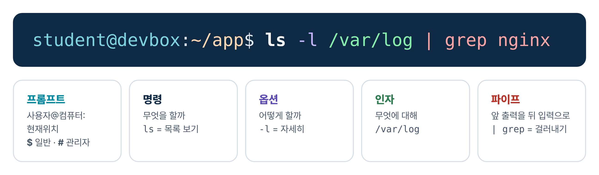

# 5교시 · Linux 명령어 맛보기 (강사 시연)

!!! goal "이번 시간에 할 일"
    - 터미널, 셸, 프롬프트가 무엇인지 압니다.
    - 명령어 한 줄을 **명령·옵션·인자**로 나눠 읽습니다.
    - 자주 쓰는 명령 열다섯 개가 **무엇을 확인하는 명령인지** 압니다.
    - 파이프(`|`)로 명령을 이어 붙이는 원리를 이해합니다.

!!! warn "오늘은 따라 치지 않습니다"
    1주차에는 직접 실습하지 않습니다. 강사가 화면으로 시연하고, 여러분은 **출력을 읽는 법**에 집중합니다. 2주차 1일차에 개발 환경을 설치한 뒤 같은 명령을 직접 실행해 봅니다. 지금 외우려 하지 마세요. "이런 질문에는 이 명령"이라는 감만 잡으면 됩니다.

## 터미널, 셸, 프롬프트

| 용어 | 뜻 | 비유 |
|---|---|---|
| 터미널 | 글자로 명령을 입력하고 결과를 보는 창 | 전화기 |
| 셸 (shell) | 입력한 명령을 해석해 운영체제에 전달하는 프로그램. 보통 `bash`나 `zsh` | 전화 교환원 |
| 프롬프트 | 명령을 기다린다는 표시 | 교환원의 "말씀하세요" |



```text
student@devbox:~/app$ ls -l /var/log
└──┬──┘ └──┬─┘ └─┬─┘│ └┬┘ └┬┘ └──┬───┘
 사용자   컴퓨터  현재위치 │ 명령 옵션   인자
                    └ $ = 일반 사용자 (# = 관리자 root)
```

- **명령(command)**: 무엇을 할지 — `ls`
- **옵션(option)**: 어떻게 할지 — `-l` (자세히 보여 줘). 보통 `-`나 `--`로 시작
- **인자(argument)**: 무엇에 대해 — `/var/log`

프롬프트 끝이 `$`면 일반 사용자, `#`이면 **관리자(root)**입니다. `#`가 보이면 무엇이든 지울 수 있는 상태이므로 한 번 더 조심합니다.

## 질문별로 정리한 기본 명령

명령을 외우는 대신, **"지금 무엇이 궁금한가"**로 정리합니다.

### 위치와 파일 — "여기가 어디고, 무엇이 있지?"

| 명령 | 질문 | 시연 예시 |
|---|---|---|
| `pwd` | 나는 지금 어디에 있나? | `/home/student/app` |
| `ls -l` | 여기에 어떤 파일이 있고 권한은? | 4교시의 권한 표기 확인 |
| `cd 경로` | 저쪽으로 이동 | `cd /var/log` |
| `cat 파일` | 파일 내용을 전부 보여 줘 | `cat /etc/os-release` (어떤 Linux인지) |
| `tail -f 파일` | 파일 끝을 계속 지켜보기 | 로그가 쌓이는 모습을 실시간으로 |

### 프로세스 — "무엇이 돌고 있지?"

| 명령 | 질문 | 출력에서 볼 것 |
|---|---|---|
| `ps aux` | 지금 실행 중인 프로세스는? | PID, 사용자, CPU%, MEM%, 명령 |
| `top` | 무엇이 CPU와 메모리를 많이 쓰나? | 실시간 순위, load average |
| `kill PID` | 이 프로세스를 끝내 줘 | 정상 종료 요청 (SIGTERM) |

### 자원 — "공간과 메모리가 충분한가?"

| 명령 | 질문 | 출력에서 볼 것 |
|---|---|---|
| `df -h` | 디스크가 얼마나 찼나? | Use% 가 90% 넘으면 위험 |
| `free -h` | 메모리가 얼마나 남았나? | available 열 |
| `du -sh 폴더` | 이 폴더가 얼마나 큰가? | 디스크를 누가 다 썼는지 찾을 때 |

### 네트워크와 환경 — "연결되고 설정됐나?"

| 명령 | 질문 | 내일 다시 볼 것 |
|---|---|---|
| `curl URL` | 이 주소에 요청하면 어떤 응답이 오나? | HTTP 상태 코드 (3일차) |
| `ss -tlnp` | 어떤 프로그램이 어느 포트에서 기다리나? | 포트 충돌 (3일차) |
| `env` | 어떤 환경 변수가 설정돼 있나? | 비밀값 노출 주의 |
| `grep 단어` | 이 단어가 들어간 줄만 보여 줘 | 로그에서 `error` 찾기 |

!!! example "강사 시연 — 서버 건강 검진 5분"
    서버에 처음 접속했을 때 강사가 실제로 확인하는 순서입니다.

    ```bash
    cat /etc/os-release      # 1. 어떤 OS인가
    uptime                   # 2. 얼마나 오래 켜져 있었고, 부하(load)는 어떤가
    free -h                  # 3. 메모리 여유
    df -h                    # 4. 디스크 여유
    ps aux --sort=-%cpu | head -5   # 5. CPU를 가장 많이 쓰는 프로세스 5개
    ```

    다섯 줄로 "이 서버가 지금 건강한가?"의 첫 답을 얻습니다. 4주차 Grafana 대시보드가 하는 일을, 그래프 없이 글자로 하는 셈입니다.

## 파이프 — 작은 명령을 이어 붙이기

`|`(파이프)는 **앞 명령의 출력을 뒤 명령의 입력으로** 넘겨 줍니다.

```bash
ps aux | grep nginx            # 전체 프로세스 중 nginx가 들어간 줄만
cat access.log | grep " 500 " | wc -l   # 접속 로그에서 500 에러가 몇 줄인지 세기
```

두 번째 예를 풀어 보면 이렇습니다. `cat`은 파일을 읽기만 하고, `grep`은 걸러내기만 하고, `wc -l`은 줄 수만 셉니다. **각자 한 가지 일만 하는 작은 도구**를 연결해서 "오늘 서버 에러가 몇 번 났나?"라는 질문에 답했습니다. 2교시에서 본 **Unix 철학**이 실제로 동작하는 모습입니다.

!!! academic "학술 노트 — 파이프의 탄생 (1973)"
    더그 매클로이는 1964년 벨 연구소 내부 메모에서 "프로그램을 정원 호스처럼 연결할 수 있어야 한다"고 썼습니다. 이 아이디어는 1973년 켄 톰프슨이 하룻밤 사이에 Unix에 파이프를 구현하면서 현실이 됐다고 전해집니다. 파이프는 **작은 부품을 표준 인터페이스(텍스트 스트림)로 연결해 큰 일을 하는** 설계의 원형입니다. 오늘날 CI/CD 파이프라인, 데이터 파이프라인이라는 말도 이 비유에서 나왔습니다.

## 위험한 명령 다시 보기

어제 3교시의 "실행 전에 멈춰야 하는 명령" 표를 오늘 배운 지식으로 다시 읽어 봅니다.

| 명령 | 오늘 배운 것으로 해석하면 |
|---|---|
| `rm -rf /` | 루트(`/`) 아래 **모든 것**을, 확인 없이(`-f`), 하위 폴더까지(`-r`) 삭제 |
| `chmod -R 777 /var/www` | 웹 폴더 전체를 누구나 쓰고 실행할 수 있게 → 최소 권한 원칙 위반 |
| `kill -9 1` | PID 1을 강제 종료 → 시스템 또는 컨테이너 전체가 멈출 수 있음 |
| `sudo` 앞에 붙은 낯선 명령 | 관리자 권한으로 실행 → 실수의 피해가 시스템 전체로 |

!!! trend "트렌드 — 터미널 안으로 들어온 AI"
    2025년부터 Claude Code, OpenAI Codex CLI, GitHub Copilot CLI처럼 **터미널에서 직접 명령을 제안하고 실행하는 AI 도구**가 빠르게 퍼졌습니다. Stack Overflow 2026 조사(2026년 10월 발표)에서는 응답자의 **66%**가 코딩 어시스턴트나 코딩 에이전트를 쓴다고 답했고, AI를 쓰는 개발자들은 코드 생성(67%), 디버깅(61%)에 이어 **운영 시스템의 배포·운영·문제 해결(20%)**에도 AI를 쓰기 시작했습니다. 편리하지만, AI가 제안한 명령을 **읽고 판단하는 능력**이 없으면 위 표의 위험한 명령도 그대로 실행하게 됩니다. 명령어를 "외울" 필요는 줄었지만 **"읽을" 필요는 오히려 커졌습니다.** 오늘 명령·옵션·인자로 나눠 읽는 연습을 한 이유입니다.

## 정리

- 터미널은 창, **셸**은 명령을 해석하는 프로그램, 프롬프트의 `$`는 일반 사용자 `#`는 관리자입니다.
- 명령 한 줄은 **명령 + 옵션 + 인자**로 읽습니다.
- 명령은 외우지 말고 **질문별로** 기억합니다: 위치·파일, 프로세스, 자원, 네트워크·환경.
- **파이프**로 작은 명령을 이어 붙여 큰 질문에 답합니다.

!!! quiz "확인 문제"
    1. 프롬프트 끝이 `#`이면 어떤 상태인가요?
    2. `ls -l /etc`에서 명령, 옵션, 인자는 각각 무엇인가요?
    3. 서버의 디스크가 얼마나 찼는지 확인하는 명령은?
    4. `ps aux | grep python`은 무엇을 보여 주나요?
    5. 로그 파일에 새로 쌓이는 줄을 실시간으로 지켜보려면 어떤 명령을 쓰나요?

    ??? answer "정답"
        1. 관리자(root) 권한 상태
        2. 명령 `ls`, 옵션 `-l`, 인자 `/etc`
        3. `df -h`
        4. 실행 중인 프로세스 중 `python`이라는 글자가 포함된 줄만
        5. `tail -f 파일명`

## 참고 문헌

- McIlroy, M. D. (1964). *Summary—what's most important* (Bell Labs 내부 메모, 파이프 아이디어).
- Kernighan, B. W., & Pike, R. (1984). *The UNIX Programming Environment*. Prentice Hall.
- Shotts, W. (2019). *The Linux Command Line* (2nd ed.). No Starch Press. (무료 온라인판 linuxcommand.org)
- Stack Overflow (2026). *2026 Developer Survey*. survey.stackoverflow.co/2026
