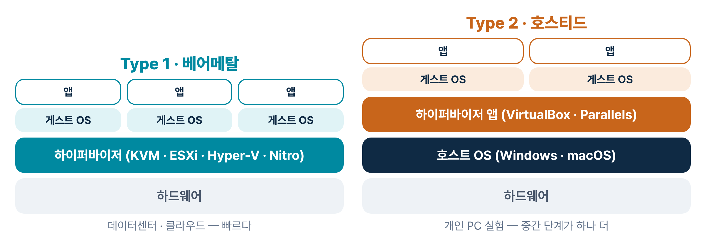

# 6교시 · 가상화와 하이퍼바이저

!!! goal "이번 시간에 할 일"
    - 하이퍼바이저의 두 종류(Type 1, Type 2)를 구분합니다.
    - 전가상화, 반가상화, 하드웨어 지원 가상화의 차이를 이해합니다.
    - AWS가 쓰는 Nitro, Lambda가 쓰는 Firecracker 같은 최신 가상화 기술을 압니다.
    - 2023년 이후 가상화 시장에서 일어난 큰 변화(VMware)를 압니다.

## 어제 배운 가상화 다시 보기

어제 4교시에 **하이퍼바이저가 물리 서버 한 대를 여러 VM으로 나눈다**고 배웠습니다. 오늘 2교시에서 운영체제가 하드웨어를 관리한다는 것도 배웠습니다. 그렇다면 하나의 하드웨어 위에 **운영체제가 여러 개** 올라가는 VM에서는, 누가 하드웨어를 관리할까요? 바로 **하이퍼바이저**가 운영체제들의 운영체제 역할을 합니다.

## 하이퍼바이저의 두 종류

| 구분 | Type 1 (베어메탈) | Type 2 (호스티드) |
|---|---|---|
| 위치 | 하드웨어 위에 **직접** 설치 | 일반 운영체제(Windows·macOS) 위에 **프로그램으로** 설치 |
| 성능 | 빠름 (중간 단계가 적음) | 상대적으로 느림 |
| 용도 | 데이터센터, 클라우드 | 개인 PC에서 실험·개발 |
| 예시 | VMware ESXi, Microsoft Hyper-V, Xen, **KVM**, AWS Nitro | VirtualBox, VMware Workstation, Parallels |

클라우드 서버는 거의 모두 **Type 1**입니다. 여러분이 5주차에 띄울 EC2 인스턴스는 AWS의 Nitro 하이퍼바이저(KVM 기반) 위에서 돌아갑니다.

!!! tip "KVM은 Linux 안에 들어 있다"
    **KVM(Kernel-based Virtual Machine)**은 2007년 Linux 커널(2.6.20)에 포함된 가상화 기능입니다. Linux 자체를 Type 1 하이퍼바이저처럼 만들어 줍니다. 오픈소스이고 Linux와 함께 발전하기 때문에, AWS Nitro와 구글 클라우드를 비롯한 많은 클라우드가 KVM 계열 기술을 씁니다. 2교시에서 "클라우드는 Linux 위에 서 있다"고 한 말이 하이퍼바이저 단계까지 해당하는 셈입니다.

## 가상화를 구현하는 세 가지 방법

어제 학술 노트에서, 오래된 x86 CPU는 포펙·골드버그의 가상화 조건을 완전히 만족하지 못했다고 했습니다. 이 문제를 풀기 위해 세 가지 방법이 차례로 등장했습니다.

| 방식 | 아이디어 | 대표 | 장단점 |
|---|---|---|---|
| 전가상화 (이진 변환) | 위험한 명령을 실행 직전에 안전한 명령으로 **바꿔치기** | VMware (1999) | 게스트 OS를 고칠 필요 없음 / 변환 비용 |
| 반가상화 (Paravirtualization) | 게스트 OS를 **고쳐서** 하이퍼바이저에 직접 요청하게 함 | Xen (2003) | 빠름 / 게스트 OS 수정 필요 |
| 하드웨어 지원 가상화 | CPU 자체에 가상화 전용 명령 추가 | Intel VT-x (2005), AMD-V (2006) | 빠르고 간단 / 지금의 표준 |

!!! academic "학술 노트 — Xen과 가상화의 재발견 (SOSP 2003)"
    2003년 케임브리지 대학의 폴 바햄(Paul Barham) 등은 운영체제 분야 최고 학회 SOSP에 「Xen and the Art of Virtualization」을 발표했습니다. 게스트 OS를 약간 고치는 **반가상화** 방식으로, 당시로서는 놀라울 만큼 낮은 성능 손실로 한 서버에 수많은 VM을 돌릴 수 있음을 보였습니다. 이 논문은 가상화 분야에서 가장 많이 인용되는 논문 중 하나이고, **AWS EC2도 2006년 출시 당시 Xen 하이퍼바이저를 썼습니다.** 학술 연구가 3년 만에 세계 최대 클라우드의 바탕이 된 사례입니다.

    한편 하이퍼바이저를 Type 1과 Type 2로 나누는 분류는 1972년 로버트 골드버그의 하버드 박사 논문 「가상 컴퓨터 시스템의 구조 원리(Architectural Principles for Virtual Computer Systems)」에서 나왔습니다.

    - Barham, P. et al. (2003). Xen and the art of virtualization. *Proceedings of the 19th ACM Symposium on Operating Systems Principles (SOSP)*.
    - Goldberg, R. P. (1972). *Architectural Principles for Virtual Computer Systems*. PhD Thesis, Harvard University.

## 클라우드 가상화의 최신 형태

### AWS Nitro — 하이퍼바이저를 하드웨어로

어제 트렌드 박스에서 본 **Nitro**를 오늘 배운 개념으로 다시 보면 이렇습니다. 원래 하이퍼바이저는 CPU 일부를 써서 네트워크, 디스크, 보안 처리를 했습니다. Nitro는 이 일들을 **전용 카드(하드웨어)로 떼어 내고**, 하이퍼바이저는 CPU와 메모리 나누기만 하는 아주 가벼운 KVM 기반 소프트웨어로 만들었습니다. 2025년 12월 발표된 Graviton5 인스턴스에는 6세대 Nitro 카드가 쓰였습니다.

### Firecracker — 1초도 안 걸려 뜨는 마이크로 VM

AWS Lambda(서버리스)는 요청이 올 때마다 함수를 실행해야 해서 **아주 빨리 뜨고, 아주 가볍고, 그러면서도 VM만큼 안전하게 격리된** 실행 환경이 필요했습니다. 그래서 AWS는 **Firecracker**라는 **마이크로 VM**을 만들어 오픈소스로 공개했습니다. 2020년 학회 NSDI에 발표된 논문에 따르면 Firecracker 마이크로 VM은 **약 125ms 만에 부팅**하고, VM당 메모리 오버헤드가 **5MiB 미만**입니다. VM의 강한 격리와 컨테이너의 가벼움 사이를 메우는 기술입니다.

!!! academic "학술 노트 — Firecracker (NSDI 2020)"
    Agache 등은 「Firecracker: Lightweight Virtualization for Serverless Applications」에서, 수천 명의 고객 코드를 한 서버에서 안전하게 돌려야 하는 서버리스 환경에서는 컨테이너의 격리 수준만으로는 부족하고, 기존 VM은 너무 무겁다는 문제를 제기했습니다. 그 해답으로 불필요한 장치 에뮬레이션을 모두 걷어낸 최소한의 VM을 설계했습니다. 7교시에서 볼 VM과 컨테이너의 장단점을 함께 생각해 보면, 이 논문이 왜 필요했는지 더 잘 이해됩니다.

    - Agache, A. et al. (2020). Firecracker: Lightweight virtualization for serverless applications. *17th USENIX Symposium on Networked Systems Design and Implementation (NSDI 20)*.

## VM의 한계 — 왜 컨테이너가 필요했을까

가상화는 서버 활용률을 크게 높였지만, 개발자 입장에서는 여전히 불편한 점이 있었습니다.

| 불편함 | 이유 |
|---|---|
| 무겁다 | VM마다 **운영체제 전체**(수 GB)가 들어간다 |
| 느리게 뜬다 | OS 부팅이 필요해 보통 수십 초~수 분 |
| 자원 낭비 | 같은 Linux 커널을 VM마다 따로 돌린다 |
| 배포 단위가 크다 | 앱 하나 바꾸려 해도 VM 이미지 전체를 다시 만든다 |

"OS는 하나만 두고, 앱만 격리하면 안 될까?" 이 질문에 대한 답이 7교시의 **컨테이너**입니다.

## 2023–2026 트렌드 — 가상화 시장의 지각 변동

!!! trend "트렌드 — Broadcom의 VMware 인수와 대이동"
    20년 넘게 기업 데이터센터 가상화의 사실상 표준이었던 **VMware**는 2023년 11월 반도체 기업 **Broadcom**에 인수됐습니다. 이후 영구 라이선스 판매 중단, 구독형 묶음 상품 강제 등 라이선스 정책이 크게 바뀌면서 비용이 올랐다는 고객이 많았습니다.

    클라우드 관리 기업 CloudBolt가 2026년 1월 북미 기업 IT 의사결정자 302명을 조사한 결과, **86%가 VMware 사용을 줄이고 있다**고 답했습니다. 다만 완전히 떠난 곳은 4%에 그쳤고, 워크로드를 옮긴 기업의 **72%는 퍼블릭 클라우드(IaaS)**로 옮겼습니다.

    여러분에게 이 사건이 의미하는 것은 두 가지입니다. 첫째, 기업들이 **온프레미스 VM을 클라우드나 컨테이너로 옮기는 프로젝트**가 늘고 있고, 이것이 DevOps·클라우드 엔지니어의 일자리입니다. 둘째, 특정 회사의 상용 제품에만 의존하면 정책 변경 하나에 크게 흔들린다는 교훈입니다. 이 과정이 KVM, Kubernetes, Terraform처럼 **오픈소스와 표준**을 중심으로 짜인 이유이기도 합니다.

## 정리

- **Type 1** 하이퍼바이저는 하드웨어 위에 직접, **Type 2**는 일반 OS 위에 프로그램으로 설치됩니다. 클라우드는 Type 1입니다.
- 가상화는 이진 변환 → 반가상화(Xen) → **하드웨어 지원 가상화**로 발전했고, KVM이 현재 클라우드의 중심입니다.
- AWS는 **Nitro**로 가상화 작업을 하드웨어로 넘기고, **Firecracker**로 서버리스용 초경량 VM을 만들었습니다.
- VM은 무겁고 느리게 뜬다는 한계가 있고, 이것이 컨테이너 등장의 배경입니다.

!!! quiz "확인 문제"
    1. 여러분 노트북에 VirtualBox를 설치해 Ubuntu를 띄웠습니다. 이것은 Type 1과 Type 2 중 무엇인가요?
    2. Linux 커널에 포함된 가상화 기능의 이름은?
    3. AWS EC2가 처음 출시될 때 사용한 하이퍼바이저는 무엇이고, 그 바탕이 된 2003년 논문의 학회는?
    4. AWS Lambda를 위해 만든 초경량 마이크로 VM의 이름은?
    5. VM의 한계 두 가지를 말해 보세요.

    ??? answer "정답"
        1. Type 2 (호스티드 하이퍼바이저)
        2. KVM (Kernel-based Virtual Machine)
        3. Xen, SOSP 2003
        4. Firecracker
        5. 무겁다(VM마다 OS 전체), 느리게 뜬다(OS 부팅), 같은 커널을 중복 실행해 자원이 낭비된다 중 두 가지

## 참고 문헌

- Goldberg, R. P. (1972). *Architectural Principles for Virtual Computer Systems*. Harvard University.
- Barham, P. et al. (2003). Xen and the art of virtualization. *SOSP '03*.
- Kivity, A. et al. (2007). kvm: the Linux Virtual Machine Monitor. *Proceedings of the Linux Symposium*.
- Agache, A. et al. (2020). Firecracker: Lightweight virtualization for serverless applications. *NSDI '20*.
- AWS. *The AWS Nitro System*. aws.amazon.com/ec2/nitro
- CloudBolt (2026). *VMware Customer Survey* (CIO.com, Ars Technica 보도).
