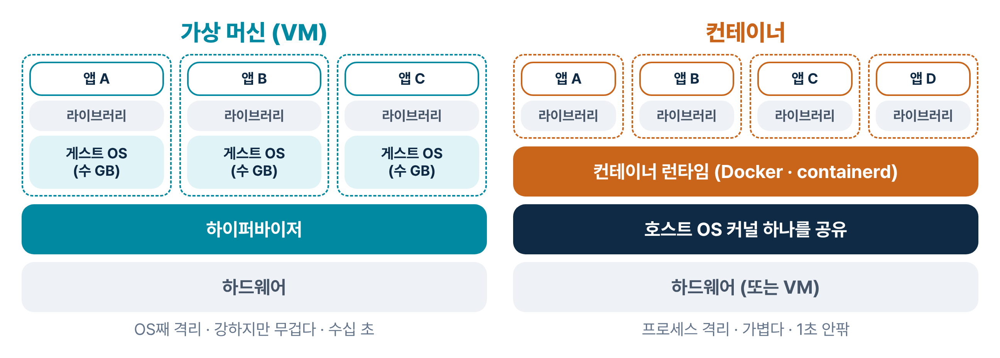
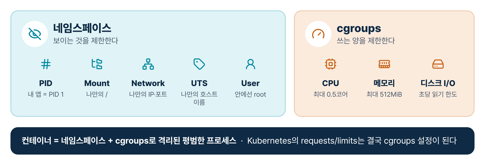
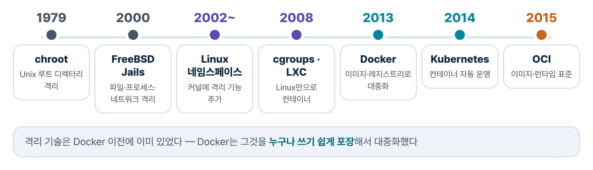

# 7교시 · VM에서 컨테이너로 (2주차 예고)

!!! goal "이번 시간에 할 일"
    - 컨테이너가 "격리된 프로세스"라는 것을 이해합니다.
    - VM과 컨테이너의 구조적 차이를 그림으로 설명합니다.
    - 컨테이너를 가능하게 한 Linux 기능(네임스페이스, cgroups)을 압니다.
    - 1979년 chroot부터 2015년 OCI까지 컨테이너의 역사를 훑습니다.

## 컨테이너는 "격리된 프로세스"다

6교시 마지막 질문, "OS는 하나만 두고 앱만 격리할 수는 없을까?"에 대한 답이 **컨테이너**입니다. 컨테이너는 새로운 종류의 가상 컴퓨터가 아닙니다. **3교시에서 배운 평범한 프로세스**인데, 운영체제가 다음 두 가지를 해 줘서 마치 혼자 컴퓨터를 쓰는 것처럼 느끼게 만든 것입니다.

1. **보이는 것을 제한한다** — 다른 프로세스, 다른 파일, 다른 네트워크가 안 보이게 한다. (네임스페이스)
2. **쓸 수 있는 양을 제한한다** — CPU와 메모리를 정해진 만큼만 쓰게 한다. (cgroups)

!!! analogy "비유 — 아파트와 단독주택"
    **VM**은 땅(하드웨어) 위에 **단독주택**을 여러 채 짓는 것입니다. 집마다 기초 공사, 보일러, 수도관(운영체제)을 따로 갖춥니다. 튼튼하게 분리되지만 짓는 데 오래 걸리고 자재가 많이 듭니다.

    **컨테이너**는 **아파트**입니다. 기초와 보일러실, 수도 본관(커널)은 건물 전체가 함께 쓰고, 각 세대(컨테이너)는 벽과 현관문으로 나뉩니다. 빨리 입주할 수 있고 공간 효율이 좋지만, 건물 기초(커널)에 문제가 생기면 모든 세대가 영향을 받습니다.

## VM과 컨테이너 비교



| 비교 | VM | 컨테이너 |
|---|---|---|
| 격리 단위 | 운영체제 전체 | 프로세스 |
| 커널 | VM마다 따로 | **호스트 커널을 공유** |
| 크기 | 수 GB | 수 MB ~ 수백 MB |
| 시작 시간 | 수십 초 ~ 수 분 | 보통 1초 안팎 |
| 격리 강도 | 강함 (하드웨어 수준) | 상대적으로 약함 (커널 공유) |
| 한 서버에 띄우는 수 | 수~수십 개 | 수십~수백 개 |
| 다른 OS 실행 | 가능 (Linux 위에 Windows VM) | 불가 (Linux 컨테이너는 Linux 커널 필요) |

!!! key "그래서 둘 중 무엇이 이겼나?"
    둘 다 씁니다. 실제 클라우드에서는 **VM 위에 컨테이너를 올리는** 구조가 가장 흔합니다. 5주차 마지막 날 여러분이 만들 EKS 클러스터도 이렇습니다.

    ```text
    AWS 물리 서버 → Nitro 하이퍼바이저 → EC2 인스턴스(VM) → Linux 커널 → 컨테이너들(파드)
    ```

    VM은 **고객 사이의 강한 격리**를, 컨테이너는 **앱 단위의 빠르고 가벼운 배포**를 담당합니다. 서로 다른 층에서 다른 문제를 풉니다.

## 컨테이너를 만드는 Linux 기능



### 네임스페이스 — 보이는 것을 제한

| 네임스페이스 | 격리하는 것 | 컨테이너 안에서 보이는 모습 |
|---|---|---|
| PID | 프로세스 번호 | 내 앱이 PID 1번 (3교시) |
| Mount | 파일시스템 | 나만의 `/` 디렉터리 |
| Network | 네트워크 | 나만의 IP 주소와 포트 |
| UTS | 호스트 이름 | 나만의 컴퓨터 이름 |
| IPC | 프로세스 간 통신 | 다른 컨테이너와 공유 메모리 분리 |
| User | 사용자 ID | 안에서는 root, 밖에서는 일반 사용자 |

### cgroups — 쓰는 양을 제한

**cgroups(control groups)**는 프로세스 묶음이 쓸 수 있는 **CPU, 메모리, 디스크 입출력**의 상한을 정합니다. 2007년 구글 엔지니어들이 개발해 2008년 Linux 커널(2.6.24)에 들어갔습니다. 4주차 Kubernetes에서 쓰는 `requests`와 `limits` 설정이 결국 cgroups 설정으로 바뀌어 커널에 전달됩니다. 3교시에서 본 **종료 코드 137(OOM Kill)**은 컨테이너가 cgroups 메모리 상한을 넘었을 때 흔히 보게 됩니다.

### 이미지 — 컨테이너의 설계도

컨테이너를 실행하려면 앱과 필요한 파일(라이브러리, 설정)을 담은 **이미지(image)**가 있어야 합니다. 1교시의 비유로 말하면 이미지는 **밀키트**, 컨테이너는 그 밀키트로 **지금 요리 중인 상태**입니다. 프로그램과 프로세스의 관계와 똑같습니다.

| 프로세스 세계 | 컨테이너 세계 |
|---|---|
| 프로그램 (디스크의 실행 파일) | 이미지 (레지스트리에 저장된 패키지) |
| 프로세스 (실행 중) | 컨테이너 (실행 중) |
| 같은 프로그램으로 프로세스 여러 개 | 같은 이미지로 컨테이너 여러 개 |

## 컨테이너의 역사 — 40년 넘게 쌓인 기술



| 연도 | 기술 | 의미 |
|---|---|---|
| 1979 | Unix **chroot** | 프로세스가 보는 루트 디렉터리를 바꾸는 최초의 격리 |
| 2000 | FreeBSD **Jails** | 파일·프로세스·네트워크까지 격리 |
| 2002~ | Linux **네임스페이스** 도입 시작 | 격리 기능이 Linux 커널에 하나씩 추가 |
| 2004 | Solaris **Zones** | 상용 OS의 컨테이너 |
| 2008 | **cgroups** 커널 포함, **LXC** 등장 | Linux만으로 컨테이너를 만들 수 있게 됨 |
| 2013 | **Docker** 공개 | 이미지·레지스트리·쉬운 명령으로 대중화 |
| 2014 | **Kubernetes** 발표 | 수많은 컨테이너를 자동으로 운영 |
| 2015 | **OCI** 설립 | 컨테이너 이미지와 런타임의 **표준** 제정 |

!!! key "Docker가 새로 발명한 것은 무엇일까?"
    표를 보면 격리 기술 자체는 Docker 이전에 이미 다 있었습니다. Docker가 한 일은 **"쓰기 쉽게 포장한 것"**입니다. 앱을 이미지로 만드는 표준 방법(Dockerfile), 이미지를 공유하는 저장소(Docker Hub), 한 줄로 실행하는 명령(`docker run`)을 묶어서, 개발자 누구나 컨테이너를 쓸 수 있게 만들었습니다. 기술의 성공은 발명만큼 **경험(UX)**에 달려 있다는 좋은 예입니다.

!!! academic "학술 노트 — 구글 Borg (EuroSys 2015)"
    구글은 Docker가 등장하기 10년 전부터 사내에서 컨테이너로 모든 서비스를 운영했습니다. 그 시스템의 이름이 **Borg**입니다. 2015년 학회 EuroSys에 발표된 「Large-scale cluster management at Google with Borg」 논문은 수십만 대의 서버에서 매일 수많은 작업을 컨테이너로 스케줄링하는 경험을 공개했습니다.

    Kubernetes는 Borg와 그 후속 시스템(Omega)을 만든 엔지니어들이 그 교훈을 바탕으로 **오픈소스로 다시 설계한 시스템**입니다. 그래서 3~4주차 Kubernetes를 배울 때 "왜 이렇게 설계했지?"라는 질문의 답은 이 논문에 있는 경우가 많습니다.

    같은 해 IBM 연구진(Felter 등)은 「VM과 Linux 컨테이너의 성능 비교」 논문에서 컨테이너가 대부분의 작업에서 VM과 같거나 더 나은 성능을 보인다고 보고해, 컨테이너 도입에 학술적 근거를 더했습니다.

    - Verma, A. et al. (2015). Large-scale cluster management at Google with Borg. *EuroSys '15*.
    - Felter, W. et al. (2015). An updated performance comparison of virtual machines and Linux containers. *IEEE ISPASS*.

!!! trend "트렌드 — 컨테이너는 이제 기본값"
    CNCF의 2025년 연례 조사(2026년 1월 발표)에서 **운영 환경에서 애플리케이션 컨테이너를 쓰는 조직은 56%**로 2023년 41%에서 크게 늘었고, 시범 운영에만 머무는 곳은 6%로 줄었습니다. GitHub의 Octoverse 2025 보고서는 **Dockerfile을 가진 저장소가 190만 개**로 1년 새 120% 늘었다며, Dockerfile을 "실험(노트북)에서 재현 가능한 운영으로 넘어가는 다리"라고 표현했습니다. 2026년 Octoverse에서는 GitHub Actions 작업 실행이 1년에 **454억 번**으로 3배 넘게 늘었는데, 그 작업의 상당수가 바로 컨테이너 이미지를 빌드하고 테스트하는 일입니다. 다음 주 여러분이 만들 첫 Dockerfile이 바로 그 다리입니다.

## 2주차를 기다리게 만드는 질문

오늘 배운 것만으로도 다음 질문에 미리 답해 볼 수 있습니다. 2주차에 직접 확인합니다.

| 질문 | 오늘 배운 것으로 예측해 보기 |
|---|---|
| 컨테이너 안에서 `ps`를 치면 무엇이 보일까? | PID 네임스페이스 → 내 앱만, PID 1번으로 |
| 컨테이너를 지우면 그 안의 데이터는? | 4교시 표 → 사라진다. 볼륨이 필요하다 |
| Mac(ARM)에서 만든 이미지가 서버(x86)에서 안 돈다면? | 1교시 → CPU 아키텍처 차이 |
| 컨테이너가 Exit 137로 계속 죽는다면? | 3교시 + cgroups → 메모리 상한 초과 |

## 정리

- 컨테이너는 **네임스페이스(보이는 것)와 cgroups(쓰는 양)로 격리된 프로세스**입니다.
- VM은 OS째 격리해 강하지만 무겁고, 컨테이너는 커널을 공유해 가볍고 빠릅니다. 클라우드에서는 **VM 위에 컨테이너**를 올립니다.
- 격리 기술은 1979년부터 쌓였고, Docker(2013)는 그것을 **쉽게 쓰게 포장**해 대중화했습니다.
- Kubernetes는 구글 Borg의 경험을 오픈소스로 다시 만든 것입니다.

!!! quiz "확인 문제"
    1. 컨테이너가 다른 프로세스를 볼 수 없게 해 주는 Linux 기능은?
    2. 컨테이너의 CPU와 메모리 사용량에 상한을 거는 Linux 기능은?
    3. VM과 컨테이너 중 Linux 서버 위에서 Windows를 실행할 수 있는 것은? 이유는?
    4. 이미지와 컨테이너의 관계는 프로그램과 무엇의 관계와 같나요?
    5. Kubernetes의 설계에 큰 영향을 준 구글 내부 시스템의 이름은?

    ??? answer "정답"
        1. 네임스페이스(namespace) — 특히 PID 네임스페이스
        2. cgroups (control groups)
        3. VM. 컨테이너는 호스트 커널을 공유하므로 Linux 커널 위에서는 Linux 컨테이너만 실행됩니다. VM은 자기만의 OS를 가집니다.
        4. 프로세스 (이미지 = 프로그램, 컨테이너 = 프로세스)
        5. Borg

!!! diary "오늘의 배움일기"
    - 오늘 가장 "아하!" 했던 순간 하나 (예: 컨테이너가 그냥 프로세스였다니)
    - 아직 헷갈리는 개념 하나와 그 이유 (예: 커널과 셸의 차이)
    - 내일(네트워크 기초) 수업 전에 궁금한 것 하나

## 참고 문헌

- Verma, A. et al. (2015). Large-scale cluster management at Google with Borg. *EuroSys '15*.
- Burns, B., Grant, B., Oppenheimer, D., Brewer, E., & Wilkes, J. (2016). Borg, Omega, and Kubernetes. *ACM Queue*, 14(1).
- Felter, W., Ferreira, A., Rajamony, R., & Rubio, J. (2015). An updated performance comparison of virtual machines and Linux containers. *IEEE ISPASS*.
- Open Container Initiative. *OCI Image and Runtime Specifications*. opencontainers.org
- CNCF (2026). *The CNCF Annual Cloud Native Survey*.
- GitHub (2025, 2026). *Octoverse 2025*, *Octoverse 2026*. github.blog/news-insights/octoverse
