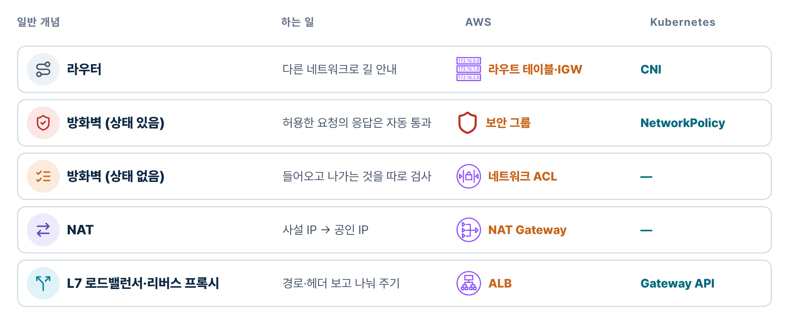

# 7교시 · 네트워크 장비의 역할

!!! goal "이번 시간에 할 일"
    - 라우터, 스위치, 방화벽, NAT, 프록시, 로드밸런서가 각각 무슨 일을 하는지 압니다.
    - 상태 없는(stateless) 방화벽과 상태 있는(stateful) 방화벽을 구분합니다.
    - 포워드 프록시와 리버스 프록시의 차이를 압니다.
    - 이 장비들이 AWS와 Kubernetes에서 어떤 이름으로 나타나는지 연결합니다.

## 클라우드에서도 장비는 사라지지 않았다

데이터센터에서는 이 장비들이 실제 랙에 꽂힌 상자였습니다. 클라우드에서는 상자 대신 **설정 화면이나 코드 몇 줄**로 만들지만, 하는 일은 똑같습니다. 그래서 장비의 역할을 알면 AWS 콘솔의 낯선 메뉴 이름도 금방 읽힙니다.

## 스위치와 라우터 — 같은 동네, 다른 동네

| 장비 | 하는 일 | 보는 주소 | 비유 | AWS에서는 |
|---|---|---|---|---|
| 스위치 | **같은 네트워크 안**에서 데이터 전달 | MAC 주소 (L2) | 아파트 단지 안 우편함 | AWS가 알아서 처리 (보이지 않음) |
| 라우터 | **다른 네트워크로** 가는 길 안내 | IP 주소 (L3) | 우체국 분류 센터 | **라우트 테이블**, **인터넷 게이트웨이** |

5주차에 VPC를 만들면 **라우트 테이블**을 직접 설정합니다. "`0.0.0.0/0`(인터넷 전체)으로 가는 트래픽은 인터넷 게이트웨이로 보내라"라는 한 줄이 있으면 퍼블릭 서브넷, 없으면 프라이빗 서브넷이 됩니다. 2교시의 CIDR와 오늘의 라우터가 만나는 지점입니다.

## 방화벽 — 들어오고 나가는 것을 검사

**방화벽(firewall)**은 정해진 규칙에 따라 트래픽을 허용하거나 막습니다. 규칙은 보통 "출발지 IP, 목적지 포트, 프로토콜" 조합으로 씁니다.

| 종류 | 동작 | 비유 | AWS에서는 |
|---|---|---|---|
| **상태 없는 (stateless)** | 들어오는 패킷과 나가는 패킷을 **각각 따로** 검사. 응답이 나갈 길도 직접 열어 줘야 함 | 입구와 출구에 각각 다른 경비원 | **네트워크 ACL** (서브넷 단위) |
| **상태 있는 (stateful)** | 연결을 **기억**해서, 허용한 요청의 응답은 자동으로 통과 | 출입증을 받은 손님은 나갈 때 자동 통과 | **보안 그룹** (인스턴스 단위) |

!!! example "보안 그룹 규칙 읽기 (5주차 미리 보기)"
    | 방향 | 프로토콜 | 포트 | 출발지 | 해석 |
    |---|---|---|---|---|
    | 인바운드 | TCP | 443 | `0.0.0.0/0` | 전 세계에서 HTTPS 접속 허용 — 웹 서버라면 정상 |
    | 인바운드 | TCP | 22 | `203.0.113.7/32` | **내 IP 하나**에서만 SSH 허용 — 좋은 습관 |
    | 인바운드 | TCP | 22 | `0.0.0.0/0` | **전 세계에서 SSH 허용 — 위험!** 자동 공격 봇의 표적 |
    | 인바운드 | TCP | 5432 | 앱 서버의 보안 그룹 | 앱 서버만 DB에 접속 — 모범 사례 |

    3교시의 `Connection timed out`이 나오면 가장 먼저 이 표를 확인합니다.

## NAT — 2교시 복습

2교시에서 배운 것처럼 **NAT**는 사설 IP를 공인 IP로 바꿔 주는 장비입니다. AWS에서는 프라이빗 서브넷의 서버가 밖으로만 나갈 수 있게 해 주는 **NAT Gateway**입니다. 들어오는 연결은 막고 나가는 연결만 허용하므로, 방화벽 역할도 일부 겸합니다.

## 프록시 — 대신 전달해 주는 중개자

**프록시(proxy)**는 클라이언트와 서버 사이에서 요청을 **대신 전달**하는 중개자입니다. 누구 편에 서 있느냐에 따라 두 가지로 나뉩니다.

| 종류 | 누구를 대신하나 | 하는 일 | 예시 |
|---|---|---|---|
| **포워드 프록시** | **클라이언트**를 대신 | 회사 직원들의 인터넷 접속을 대신 나가서 감시·차단·캐시 | 회사 인터넷 필터 |
| **리버스 프록시** | **서버**를 대신 | 바깥 요청을 받아 뒤의 여러 서버에 나눠 줌, HTTPS 처리, 캐시 | **nginx**, Envoy, AWS ALB |

!!! analogy "비유 — 비서와 안내 데스크"
    **포워드 프록시**는 내 일을 대신 처리해 주는 **내 비서**입니다. 상대방은 비서만 보고 나는 보지 못합니다. **리버스 프록시**는 회사 1층 **안내 데스크**입니다. 방문객은 안내 데스크와만 이야기하고, 안내 데스크가 알맞은 부서로 연결해 줍니다. 방문객은 회사 안에 부서가 몇 개인지, 어디 있는지 몰라도 됩니다.

## 로드밸런서 — 여러 서버에 일을 나눠 주기

**로드밸런서(load balancer)**는 리버스 프록시의 대표적인 형태로, 들어오는 요청을 **여러 서버에 고르게** 나눠 줍니다.

| 기능 | 설명 |
|---|---|
| 분산 | 요청을 여러 서버에 나눠 한 대에 몰리지 않게 한다 (라운드 로빈, 최소 연결 등) |
| **헬스 체크** | 주기적으로 서버 상태를 확인하고, 아픈 서버에는 요청을 보내지 않는다 |
| TLS 종료 | HTTPS 암호화를 로드밸런서에서 풀어, 뒤의 서버들의 부담을 줄인다 |
| 확장 | 서버를 늘리거나 줄여도 사용자는 같은 주소로 접속한다 |

| 종류 | 보는 정보 | AWS | 쓰임 |
|---|---|---|---|
| **L4 로드밸런서** | IP, 포트 | **NLB** (Network Load Balancer) | 매우 빠른 TCP/UDP 분산 |
| **L7 로드밸런서** | URL 경로, 헤더, 쿠키 | **ALB** (Application Load Balancer) | `/api`는 API 서버로, `/`는 웹 서버로 |

!!! key "헬스 체크가 '자동 복구'의 시작이다"
    로드밸런서가 아픈 서버를 자동으로 빼 주는 **헬스 체크**는, 3주차 Kubernetes의 **readiness probe**, 5주차 AWS ALB의 **대상 그룹 상태 확인**으로 이름만 바꿔 계속 등장합니다. 서버가 죽어도 사용자가 모르게 만드는 모든 자동화는 "정상인지 주기적으로 묻고, 아니면 빼고, 다시 건강해지면 넣는다"는 이 단순한 원리에서 출발합니다.

## AWS와 Kubernetes에서 만나는 이름 정리

| 일반 개념 | AWS | Kubernetes (3~4주차) |
|---|---|---|
| 라우터 / 경로 | 라우트 테이블, 인터넷 게이트웨이 | (CNI 플러그인이 처리) |
| 상태 있는 방화벽 | 보안 그룹 | NetworkPolicy |
| 상태 없는 방화벽 | 네트워크 ACL | — |
| NAT | NAT Gateway | — |
| L4 로드밸런서 | NLB | Service (type: LoadBalancer) |
| L7 로드밸런서 / 리버스 프록시 | ALB | **Gateway API** (Envoy Gateway), Ingress |
| DNS | Route 53 | CoreDNS (클러스터 내부 DNS) |

!!! academic "학술 노트 — 성벽에서 제로 트러스트로"
    전통적인 네트워크 보안은 **성과 해자(castle and moat)** 모델이었습니다. 회사 네트워크 바깥에는 두꺼운 방화벽(성벽)을 세우고, 안에 들어온 것은 믿는 방식입니다. 그런데 클라우드와 원격 근무로 "안"과 "밖"의 경계가 흐려지고, 한 번 뚫리면 내부에서 마음대로 돌아다니는 공격이 늘었습니다.

    구글은 2014년 「BeyondCorp: 엔터프라이즈 보안에 대한 새로운 접근」 논문에서 **회사 네트워크 안에 있다는 이유만으로 신뢰하지 않는** 모델을 공개했습니다. 미국 표준기술연구소(NIST)는 2020년 SP 800-207에서 이를 **제로 트러스트 아키텍처(Zero Trust Architecture)**로 표준화했습니다. 핵심은 **"절대 믿지 말고, 항상 확인하라(never trust, always verify)"** — 모든 요청마다 누가, 어떤 기기로, 무엇을 하려는지 확인하는 것입니다.

    4주차에 배울 **Istio의 mTLS**(서비스끼리도 서로 신분증을 확인), **Kubernetes NetworkPolicy**(같은 클러스터 안에서도 필요한 통신만 허용)가 제로 트러스트를 구현하는 대표 도구입니다.

    - Ward, R., & Beyer, B. (2014). BeyondCorp: A new approach to enterprise security. *;login:*, 39(6).
    - Rose, S. et al. (2020). *NIST SP 800-207: Zero Trust Architecture*. NIST.

!!! trend "트렌드 — Kubernetes의 '정문'이 바뀌는 중"
    Kubernetes에서 외부 요청을 받는 L7 리버스 프록시로 가장 많이 쓰이던 **Ingress NGINX** 프로젝트가 관리자 부족으로 **2026년 3월 은퇴**했습니다. 쿠버네티스 커뮤니티는 이후 새 릴리스, 버그 수정, 보안 패치를 제공하지 않으며, 후속 표준으로 **Gateway API**로 옮길 것을 권합니다. 그래서 이 과정의 4주차는 Ingress가 아니라 **Gateway API + Envoy Gateway**로 실습합니다. 오늘 배운 "리버스 프록시"와 "L7 로드밸런서"가 바로 Gateway API가 표준화한 개념입니다.

## 정리

- **라우터**는 다른 네트워크로 가는 길을, **스위치**는 같은 네트워크 안의 전달을 맡습니다.
- **보안 그룹**은 상태 있는 방화벽, **네트워크 ACL**은 상태 없는 방화벽입니다.
- **리버스 프록시**는 서버를 대신해 요청을 받고, **로드밸런서**는 그 요청을 여러 서버에 나눠 줍니다.
- **헬스 체크**는 자동 복구의 출발점이며, K8s probe와 ALB 대상 그룹으로 이어집니다.
- 보안은 **성벽 모델에서 제로 트러스트로**, K8s의 정문은 **Ingress에서 Gateway API로** 옮겨 가고 있습니다.

!!! quiz "확인 문제"
    1. 응답 트래픽을 자동으로 허용하는 방화벽은 상태 있는 방화벽과 상태 없는 방화벽 중 무엇이고, AWS에서는 무엇인가요?
    2. 보안 그룹에서 SSH(22)를 `0.0.0.0/0`으로 열면 어떤 위험이 있나요?
    3. 바깥 요청을 받아 뒤의 여러 서버에 나눠 주는 nginx는 포워드 프록시인가요, 리버스 프록시인가요?
    4. `/api`는 API 서버로, `/`는 웹 서버로 보내야 합니다. AWS에서 어떤 로드밸런서를 쓰나요?
    5. "절대 믿지 말고, 항상 확인하라"는 보안 모델의 이름은?

    ??? answer "정답"
        1. 상태 있는(stateful) 방화벽, AWS 보안 그룹
        2. 전 세계에서 SSH 접속을 시도할 수 있어 자동 공격 봇의 비밀번호 대입 공격 표적이 됩니다. 내 IP(`/32`)로만 제한해야 합니다.
        3. 리버스 프록시
        4. ALB (Application Load Balancer, L7)
        5. 제로 트러스트(Zero Trust)

## 참고 문헌

- Ward, R., & Beyer, B. (2014). BeyondCorp: A new approach to enterprise security. *;login:*, 39(6).
- Rose, S., Borchert, O., Mitchell, S., & Connelly, S. (2020). *NIST SP 800-207: Zero Trust Architecture*.
- AWS. *Amazon VPC User Guide — Security groups, Network ACLs, NAT gateways, Route tables*.
- AWS. *Elastic Load Balancing — Application Load Balancer, Network Load Balancer*.
- Kubernetes Blog (2025.11). *Ingress NGINX Retirement: What You Need to Know*.
- Kubernetes SIG Network. *Gateway API*. gateway-api.sigs.k8s.io
