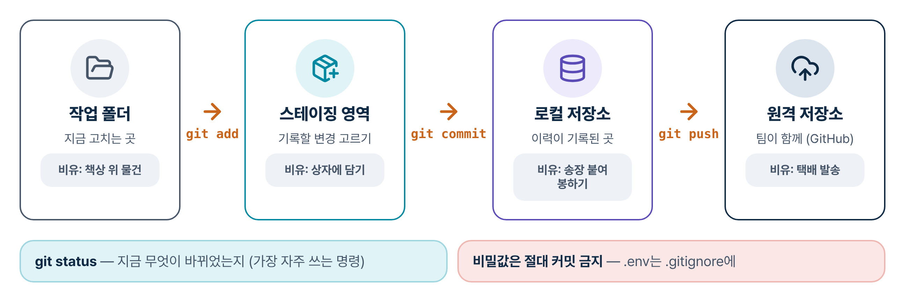
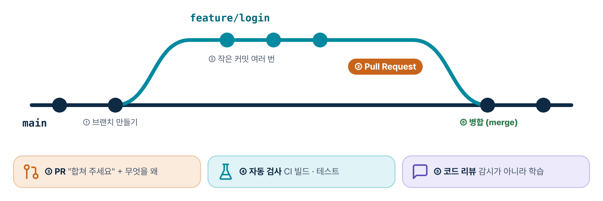

# 3교시 · Git과 GitHub 맛보기 (강사 시연)

!!! goal "이번 시간에 할 일"
    - 버전 관리가 왜 필요한지 이해합니다.
    - Git의 세 영역(작업 폴더, 스테이징, 저장소)과 커밋을 압니다.
    - 브랜치와 Pull Request로 협업하는 흐름을 봅니다.
    - Git과 GitHub의 차이를 구분합니다.

!!! tip "오늘은 보기만 합니다"
    1주차에는 직접 실습하지 않습니다. 강사가 시연하는 화면을 보며 **흐름**만 익히세요. 2주차 1일차에 환경을 설치하고, 오늘 본 명령을 한 단계씩 직접 입력합니다.

## 버전 관리 — "최종_진짜최종_v3.docx"를 끝내기

과제 파일을 이렇게 저장해 본 적이 있나요?

```text
보고서.docx
보고서_수정.docx
보고서_최종.docx
보고서_최종_진짜최종.docx
보고서_최종_진짜최종_교수님피드백반영_v3.docx
```

무엇이 언제, 왜 바뀌었는지 알 수 없고, 두 사람이 동시에 고치면 누구 것을 살려야 할지 모릅니다. **버전 관리 시스템**은 파일의 변경 이력을 체계적으로 기록하고, 여러 사람의 변경을 안전하게 합쳐 주는 도구입니다. 현업에서 가장 널리 쓰이는 것이 **Git**입니다.

## Git의 세 영역과 커밋



| 영역 | 뜻 | 비유 (택배) | 명령 |
|---|---|---|---|
| 작업 폴더 | 지금 파일을 고치고 있는 곳 | 책상 위 물건 | (파일 편집) |
| 스테이징 영역 | 이번에 기록할 변경만 골라 둔 곳 | **택배 상자에 담기** | `git add` |
| 로컬 저장소 | 변경 이력이 기록된 곳 | **송장 붙여 봉하기** | `git commit` |
| 원격 저장소 | 팀이 함께 쓰는 서버 (GitHub) | **택배 발송** | `git push` |

**커밋(commit)**은 "이 시점의 상태를 기록한다"는 뜻입니다. 각 커밋에는 **누가, 언제, 무엇을, 왜** 바꿨는지가 남습니다. 특히 "왜"를 적는 **커밋 메시지**가 중요합니다.

| 나쁜 커밋 메시지 | 좋은 커밋 메시지 |
|---|---|
| `수정` | `로그인 실패 시 에러 메시지 표시` |
| `asdf` | `DB 연결 타임아웃을 5초에서 10초로 늘림 (피크 시간 연결 실패)` |
| `최종` | `상품 목록 API에 페이지 나누기 추가` |

## 강사 시연 — 명령 흐름 보기

```bash
git init                        # 이 폴더에서 버전 관리 시작
git status                      # 지금 무엇이 바뀌었는지 확인 (가장 자주 쓰는 명령)
git add README.md               # 이번 커밋에 담을 파일 고르기
git commit -m "README에 실행 방법 추가"   # 기록하기
git log --oneline               # 지금까지의 기록 보기
git switch -c feature/login     # 새 브랜치 만들고 이동
git push origin feature/login   # GitHub에 올리기
```

!!! warn "절대 커밋하면 안 되는 것"
    비밀번호, API 키, 클라우드 접근 키(AWS Access Key)는 **절대** 커밋하지 않습니다. 한 번 GitHub에 올라간 비밀값은 지워도 이력에 남고, 공개 저장소라면 자동화된 봇이 몇 분 안에 찾아내 악용합니다. 클라우드 계정에 수백만 원의 요금이 나오는 사고의 단골 원인입니다. 비밀값은 `.env` 파일에 두고, 그 파일을 `.gitignore`에 등록해 Git이 무시하게 합니다. 1일차 공유 책임 모델에서 본 "고객의 책임"이 바로 이것입니다.

## 브랜치와 Pull Request — 함께 일하는 방법



1. **브랜치(branch)** — `main`(운영에 나가는 코드)을 직접 고치지 않고, 가지를 쳐서 따로 작업합니다. `feature/login`처럼 하는 일을 이름에 담습니다.
2. **커밋** — 브랜치에서 작은 단위로 여러 번 커밋합니다.
3. **Pull Request (PR)** — "제 변경을 `main`에 합쳐 주세요"라고 요청합니다. 무엇을, 왜 바꿨는지 설명을 적습니다.
4. **자동 검사** — 2교시의 CI가 자동으로 빌드·테스트를 돌립니다.
5. **코드 리뷰** — 동료가 변경을 읽고 질문하거나 개선을 제안합니다.
6. **병합(merge)** — 리뷰와 검사를 통과하면 `main`에 합칩니다.

!!! analogy "비유 — 공동 문서의 '제안 모드'"
    구글 문서의 "제안 모드"를 떠올려 보세요. 원문을 바로 고치지 않고, 수정 제안을 남기면 다른 사람이 보고 "수락" 또는 "의견"을 다는 방식입니다. Pull Request가 바로 그것입니다. 덕분에 `main`은 항상 **검토된 코드**만 담게 됩니다.

!!! key "코드 리뷰는 감시가 아니라 학습"
    코드 리뷰는 실수를 잡는 장치이기도 하지만, 더 큰 가치는 **지식 공유**입니다. 리뷰를 하면서 다른 사람의 코드를 배우고, 리뷰를 받으면서 더 나은 방법을 배웁니다. 그리고 "그 코드는 그 사람만 안다"는 어제의 **사람 SPOF**를 줄여 줍니다. 리뷰 코멘트는 사람이 아니라 **코드**에 대해 씁니다. "이건 틀렸어요"보다 "여기서 null이 들어오면 어떻게 될까요?"가 좋은 리뷰입니다.

## Git과 GitHub는 다르다

| | Git | GitHub |
|---|---|---|
| 정체 | 버전 관리 **프로그램** | Git 저장소를 호스팅하는 **서비스** |
| 위치 | 내 컴퓨터에서 동작 | 인터넷 (github.com) |
| 하는 일 | 커밋, 브랜치, 병합 | 원격 저장소, PR, 리뷰, 이슈, **Actions(CI/CD)** |
| 비슷한 것 | — | GitLab, Bitbucket |

!!! academic "학술 노트 — 2주 만에 만든 Git (2005)"
    Linux 커널 개발팀은 2002년부터 **BitKeeper**라는 상용 버전 관리 도구를 무료로 쓰고 있었습니다. 그런데 2005년 라이선스 분쟁으로 무료 사용이 중단되자, 리누스 토르발스(Linus Torvalds)는 직접 새 도구를 만들기 시작했습니다. 2005년 4월 초 개발을 시작해 며칠 만에 Git이 **자기 자신의 소스 코드를 관리**할 수 있게 되었고, 몇 주 만에 Linux 커널 개발에 쓰이기 시작했습니다. 그제 배운 Linux를 만든 바로 그 사람입니다.

    Git의 설계 핵심은 **분산**입니다. 중앙 서버가 없어도 모든 개발자가 **전체 이력의 완전한 복사본**을 가집니다. 서버가 사라져도 아무 개발자의 컴퓨터에서 전체를 복구할 수 있습니다. 어제 배운 **SPOF 제거**를 버전 관리에 적용한 셈입니다. 또 모든 내용을 **해시(내용으로 만든 고유 지문)**로 식별해, 이력이 몰래 바뀌면 바로 알 수 있습니다.

    - Chacon, S., & Straub, B. (2014). *Pro Git* (2nd ed.). Apress. git-scm.com/book

!!! trend "트렌드 — Octoverse 2026: 2억 2,500만 개발자와 AI 에이전트"
    GitHub가 2026년 10월 28일 발표한 연례 보고서 **Octoverse 2026**(2025년 10월~2026년 9월 집계)에 따르면 GitHub의 개발자는 **2억 2,500만 명**을 넘었고, **TypeScript**가 2년째 가장 많이 쓰이는 언어 1위를 지켰습니다. 가장 큰 변화는 **AI 에이전트**입니다. 2026년 9월에 만들어진 Pull Request의 **40% 이상을 AI 에이전트가 시작**했고(3월에는 17%), 1년간의 코드 push는 **179억 번**, 병합된 PR은 **13억 개**로 늘었습니다. 코드를 만드는 일이 쉬워질수록 **리뷰와 자동 검사**가 중요해집니다. 다음 주 5일차에 PR과 리뷰를 직접 해 보는 이유이고, 그 출발점인 Dockerfile도 다음 주에 처음 만듭니다.

## 정리

- **버전 관리**는 변경 이력을 기록하고, 여러 사람의 변경을 안전하게 합칩니다.
- Git은 **작업 폴더 → 스테이징(add) → 로컬 저장소(commit) → 원격(push)**으로 움직입니다.
- 커밋 메시지에는 **무엇을, 왜**를 적고, **비밀값은 절대 커밋하지 않습니다.**
- **브랜치 → PR → 자동 검사 → 코드 리뷰 → 병합**이 협업의 기본 흐름입니다.
- **Git**은 프로그램, **GitHub**는 서비스입니다. Git은 2005년 토르발스가 만들었습니다.

!!! quiz "확인 문제"
    1. 이번 커밋에 담을 변경을 고르는 명령은?
    2. 좋은 커밋 메시지에 꼭 들어가야 할 두 가지는?
    3. AWS 접근 키를 실수로 공개 저장소에 커밋하면 어떤 일이 생길 수 있나요?
    4. `main`을 직접 고치지 않고 "합쳐 주세요"라고 요청하는 것은?
    5. Git이 "분산" 버전 관리라는 말의 뜻은?

    ??? answer "정답"
        1. `git add`
        2. 무엇을 바꿨는지, 왜 바꿨는지
        3. 자동화된 봇이 찾아내 악용해 큰 요금이나 보안 사고가 날 수 있다 (지워도 이력에 남는다)
        4. Pull Request (PR)
        5. 모든 개발자가 전체 이력의 완전한 복사본을 가지므로 중앙 서버 하나에 의존하지 않는다

## 참고 문헌

- Chacon, S., & Straub, B. (2014). *Pro Git* (2nd ed.). Apress. git-scm.com/book/ko/v2
- GitHub (2026). *Octoverse 2026*. github.blog (발표 2026-10-28)
- GitHub Docs. *About pull requests*, *Ignoring files*. docs.github.com
- Bacchelli, A., & Bird, C. (2013). Expectations, outcomes, and challenges of modern code review. *ICSE 2013*.
