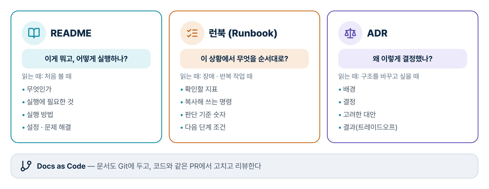

# 6교시 · 문서로 일하기

!!! goal "이번 시간에 할 일"
    - 문서가 왜 DevOps의 핵심 도구인지 이해합니다.
    - README, 런북, ADR이 각각 언제 필요한지 압니다.
    - 좋은 README에 들어가야 할 것을 정리합니다.
    - "문서도 코드처럼" 다루는 방식을 압니다.

## 문서는 미래의 나와 동료를 위한 것

"그 서버 설정은 김 선임님만 알아요." 어제 3교시에서 본 **사람 SPOF**입니다. 그 선임이 휴가를 가거나 퇴사하면, 그 지식은 회사에서 사라집니다. 문서는 지식을 **사람 머릿속에서 꺼내 팀의 것으로** 만듭니다. 그리고 가장 자주 그 문서를 읽게 될 사람은 **3개월 뒤의 나 자신**입니다.

## 세 가지 핵심 문서



| 문서 | 답하는 질문 | 언제 읽나 | 예 |
|---|---|---|---|
| **README** | 이게 뭐고, 어떻게 실행하나? | 처음 프로젝트를 볼 때 | 저장소 첫 화면 |
| **런북** (Runbook) | 이 상황에서 무엇을 순서대로 하나? | 장애·반복 작업 때 | "DB 디스크가 90% 넘으면" |
| **ADR** (Architecture Decision Record) | 왜 이렇게 결정했나? | 구조를 바꾸고 싶을 때 | "왜 PostgreSQL을 골랐나" |

## README — 프로젝트의 현관문

좋은 README는 처음 보는 사람이 **혼자서** 프로젝트를 이해하고 실행할 수 있게 해 줍니다.

```markdown
# 주문 API

상품 주문을 생성·조회하는 백엔드 API입니다.

## 실행에 필요한 것
- Docker 27 이상
- 포트 8080 (API), 5432 (PostgreSQL)

## 실행하기
cp .env.example .env          # 설정 파일 복사 (비밀값은 직접 채우기)
docker compose up -d          # API와 DB 함께 실행
curl localhost:8080/health    # {"status":"ok"} 가 나오면 성공

## 설정 (환경 변수)
| 이름 | 설명 | 예 |
| DB_HOST | DB 주소 | db |
| DB_PASSWORD | DB 비밀번호 | (.env에만, 커밋 금지) |

## 문제 해결
- `port is already allocated` → 8080을 쓰는 다른 프로그램 확인
```

어제 1교시의 **실행 조건**(런타임, 포트, 설정, 의존성, 실행 명령)이 그대로 README의 목차가 된다는 것을 눈여겨보세요. 2주차부터 여러분이 만드는 모든 실습 저장소에 이런 README를 함께 씁니다.

## 런북 — 새벽 3시의 나를 위한 문서

**런북**은 특정 상황에서 해야 할 일을 **순서대로** 적은 절차서입니다. 장애 알림은 보통 가장 피곤할 때 옵니다. 그때 머리로 생각하는 대신 **문서를 따라 하면** 되도록 만드는 것이 목표입니다.

!!! example "런북 예시 — 'API 응답 지연 경보'"
    1. **확인:** 대시보드에서 p99 지연 시간과 에러율을 본다. (링크)
    2. **최근 변경:** 지난 1시간 안에 배포가 있었나? 있었다면 → 4번.
    3. **DB 확인:** DB CPU가 80% 이상인가? 그렇다면 느린 쿼리 목록을 본다. (명령: …)
    4. **되돌리기:** 직전 배포로 되돌린다. (명령: …) 5분 뒤 지표 재확인.
    5. **올리기:** 15분 안에 나아지지 않으면 인시던트를 선언하고 당번 리더를 호출한다.

    좋은 런북은 **복사해서 바로 쓸 수 있는 명령**, **판단 기준이 되는 숫자**, **다음 단계로 넘어갈 조건**을 담습니다. 그리고 런북에서 반복되는 단계는 결국 **자동화의 후보**가 됩니다. 런북 → 스크립트 → 자동 복구로 이어지는 것이 DevOps의 자연스러운 진화입니다.

## ADR — "왜 이렇게 했지?"에 답하기

1년 전에 누군가 "DB는 PostgreSQL로 한다"고 결정했습니다. 지금 새로 온 사람은 "MongoDB가 더 낫지 않나요?"라고 묻습니다. 결정한 사람은 이미 다른 팀으로 갔습니다. 그때 무엇을 고려했는지 아무도 모릅니다.

**ADR(Architecture Decision Record)**은 중요한 기술 결정을 **짧게 기록**하는 문서입니다.

| ADR 항목 | 내용 (예) |
|---|---|
| 제목 | ADR-003: 주문 데이터베이스로 PostgreSQL 사용 |
| 상태 | 승인됨 (2026-11-27) |
| 배경 | 주문은 결제와 묶여 정확성이 중요하다. 팀에 RDB 경험자가 많다 |
| 결정 | PostgreSQL을 사용한다 |
| 고려한 대안 | MongoDB(유연하지만 트랜잭션 경험 부족), DynamoDB(벤더 종속) |
| 결과 | ACID 보장. 대신 수평 확장이 필요해지면 재검토 |

어제 배운 **트레이드오프**가 여기에 기록됩니다. "모든 선택에는 대가가 있다"는 것을 **문서로 남기는 것**이 ADR입니다.

!!! academic "학술 노트 — ADR (Nygard, 2011)과 아마존의 6쪽 메모"
    **ADR.** 마이클 나이가드(Michael Nygard)는 2011년 글 「아키텍처 결정 문서화하기(Documenting Architecture Decisions)」에서, 거대한 설계 문서는 아무도 읽지 않고 금방 낡는다고 지적했습니다. 대신 **결정 하나당 한두 쪽짜리 짧은 기록**을 코드 저장소 안에 번호를 붙여 쌓아 가자고 제안했습니다. 결정이 바뀌면 옛 기록을 지우지 않고 "대체됨"으로 표시하고 새 기록을 씁니다. 그래서 **결정의 역사**가 남습니다. 지금은 많은 회사와 오픈소스 프로젝트가 이 형식을 씁니다.

    **6쪽 메모.** 아마존의 제프 베이조스(Jeff Bezos)는 2004년 경영진 회의에서 **파워포인트 발표를 금지**하고, 대신 **서술형 메모**(흔히 "6쪽 메모"라 불림)를 쓰게 했습니다. 회의는 모두가 조용히 메모를 읽는 것으로 시작합니다. 글머리표로는 생각의 빈틈을 숨길 수 있지만, 완결된 문장으로 쓰려면 **논리를 끝까지 따져 봐야** 하기 때문입니다. "글을 잘 쓰는 것은 생각을 잘 하는 것"이라는 원칙입니다.

    - Nygard, M. (2011). *Documenting Architecture Decisions*. cognitect.com/blog
    - Bryar, C., & Carr, B. (2021). *Working Backwards*. St. Martin's Press. (아마존의 서술형 메모 문화)

## 문서도 코드처럼 — Docs as Code

| 옛날 방식 | Docs as Code |
|---|---|
| 워드 파일을 메일로 주고받는다 | 마크다운(.md) 파일을 **Git 저장소**에 둔다 |
| 어느 게 최신인지 모른다 | 커밋 이력이 곧 **변경 이력** |
| 코드와 문서가 따로 논다 | 코드를 바꾸는 **같은 PR에서** 문서도 고친다 |
| 검토 없이 고친다 | 문서도 **리뷰**를 받는다 |

이 과정의 교재도 바로 이 방식으로 만들어졌습니다. 마크다운 원본 하나에서 PDF 책, 강의 슬라이드, GitHub 안내 페이지가 자동으로 만들어집니다.

!!! trend "트렌드 — 사람과 AI가 함께 읽는 문서"
    최근 저장소에는 README 외에 **AI 코딩 도구가 읽도록 쓴 지침 파일**이 늘고 있습니다. 프로젝트 구조, 빌드·테스트 명령, 지켜야 할 규칙을 적어 두면 AI가 그것을 참고해 더 정확한 코드를 만듭니다. 흥미로운 점은 **AI에게 좋은 문서가 사람에게도 좋은 문서**라는 것입니다. 실행 방법이 분명하고, 결정의 이유가 적혀 있고, 최신 상태로 유지되는 문서. 1일차에 배운 "AI에게 맥락을 주는 질문"과 같은 원리입니다. 문서를 잘 쓰는 팀이 AI도 잘 활용합니다.

## 정리

- 문서는 지식을 **사람에게서 팀으로** 옮겨 사람 SPOF를 없앱니다.
- **README**는 무엇이고 어떻게 실행하나, **런북**은 이 상황에서 무엇을 하나, **ADR**은 왜 이렇게 결정했나에 답합니다.
- README의 목차는 어제 배운 **실행 조건**과 같습니다.
- 런북의 반복 단계는 **자동화 후보**입니다.
- **Docs as Code** — 문서를 Git에 두고, 코드와 함께 리뷰하고 고칩니다.

!!! quiz "확인 문제"
    1. 처음 저장소를 본 사람이 가장 먼저 읽는 문서는?
    2. 새벽 장애 때 순서대로 따라 할 절차를 적은 문서는?
    3. "왜 PostgreSQL을 골랐지?"에 답하는 문서는?
    4. ADR에서 결정이 바뀌면 옛 기록을 어떻게 하나요?
    5. 아마존이 회의에서 파워포인트 대신 쓰게 한 것은?

    ??? answer "정답"
        1. README
        2. 런북(Runbook)
        3. ADR (Architecture Decision Record)
        4. 지우지 않고 "대체됨"으로 표시한 뒤 새 기록을 쓴다
        5. 서술형 메모(6쪽 메모)

## 참고 문헌

- Nygard, M. (2011). *Documenting Architecture Decisions*. Cognitect Blog.
- Bryar, C., & Carr, B. (2021). *Working Backwards*. St. Martin's Press.
- Beyer, B. et al. (2018). *The Site Reliability Workbook*. O'Reilly. (플레이북·런북)
- Write the Docs. *Docs as Code*. writethedocs.org
- GitHub Docs. *About READMEs*. docs.github.com
