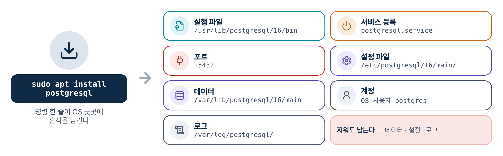
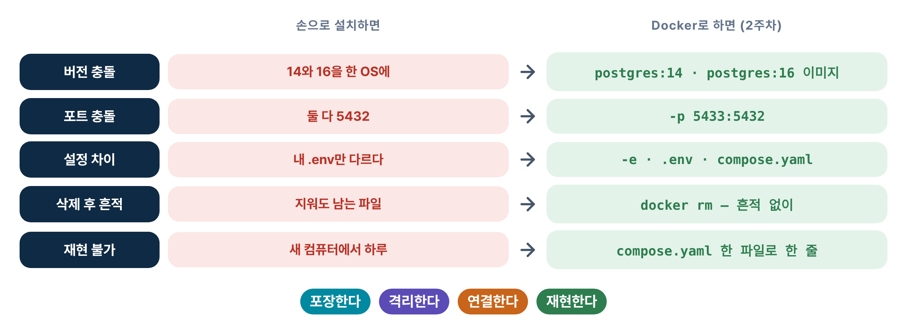
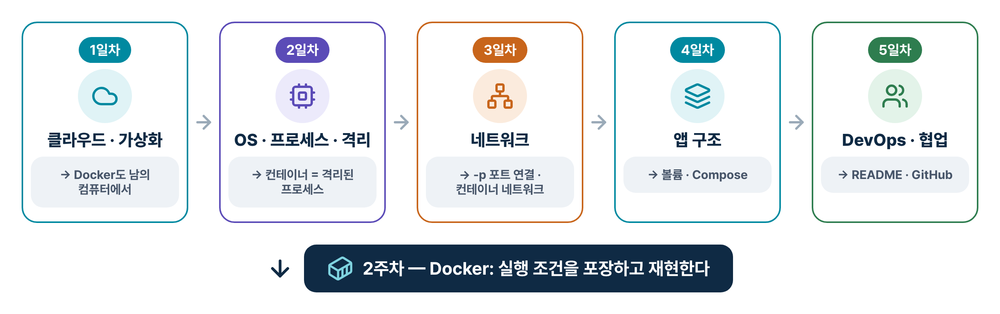

# 8교시 · 손으로 맞추는 실행 환경 (강사 시연) + 2주차 준비

!!! goal "이번 시간에 할 일"
    - 강사 시연으로 DB를 직접 설치할 때 생기는 문제들을 봅니다.
    - 버전 충돌, 포트 충돌, 설정 차이, 삭제 후 흔적을 확인합니다.
    - Docker가 이 문제들을 어떻게 줄여 주는지 미리 봅니다.
    - 2주차 실습을 위한 설치 체크리스트를 확인합니다.

## 강사 시연 — PostgreSQL을 손으로 설치하면

어제 7교시의 결론은 "Docker는 실행 조건을 포장한다"였습니다. 그런데 **포장하지 않으면 정확히 무엇이 힘든지** 직접 봐야 그 말이 와닿습니다. 강사가 WSL2(Ubuntu)에서 PostgreSQL을 직접 설치하며 OS에 무엇이 남는지 보여 줍니다. 여러분은 보면서 아래 표의 빈칸을 머릿속으로 채워 보세요.

```bash
sudo apt install postgresql          # 설치 (패키지 수십 개가 함께 깔린다)
systemctl status postgresql          # 서비스로 등록되어 부팅 때마다 자동 실행
ss -tlnp | grep 5432                 # 5432 포트를 차지하고 있다
ls /etc/postgresql/                  # 설정 파일 위치
sudo ls /var/lib/postgresql/         # 데이터 파일 위치
```



| 설치가 남기는 것 | 위치 (Ubuntu 예) | 문제가 되는 순간 |
|---|---|---|
| 실행 파일 | `/usr/lib/postgresql/16/bin` | 다른 버전을 또 설치할 때 |
| 서비스 등록 | systemd `postgresql.service` | 안 쓸 때도 켜져서 메모리 사용 |
| 포트 | 5432 | 다른 프로젝트의 DB와 충돌 |
| 설정 파일 | `/etc/postgresql/16/main/` | 누가 언제 무엇을 고쳤는지 모름 |
| 데이터 | `/var/lib/postgresql/16/main` | 프로젝트끼리 데이터가 섞임 |
| 계정 | OS 사용자 `postgres`, DB 사용자 | 비밀번호를 아무도 기억 못 함 |
| 로그 | `/var/log/postgresql/` | 디스크를 계속 채움 |

그제 4교시에 배운 **"설정은 `/etc`, 데이터는 `/var/lib`, 로그는 `/var/log`"**가 실제로 이렇게 나타납니다.

## 다섯 가지 고통

!!! example "시나리오 — 두 프로젝트를 동시에 하게 되었다"
    | 고통 | 상황 | 결과 |
    |---|---|---|
    | ① 버전 충돌 | 프로젝트 A는 PostgreSQL 14, 프로젝트 B는 16이 필요 | 두 버전을 한 OS에 깔면 어느 `psql`이 실행되는지 헷갈린다 |
    | ② 포트 충돌 | 두 DB 모두 5432를 쓰려 한다 | 하나는 `address already in use` — 3일차 3교시의 그 에러 |
    | ③ 설정 차이 | 내 `.env`는 `DB_PORT=5433`, 동료는 `5432` | 같은 코드가 내 컴퓨터에서만 안 된다 |
    | ④ 삭제 후 흔적 | 프로젝트가 끝나 지웠는데 | 서비스·데이터·설정 파일이 남아 다음 설치 때 꼬인다 |
    | ⑤ 재현 불가 | 새 노트북을 샀다, 새 팀원이 왔다 | 이 모든 걸 기억해 처음부터 다시 — 하루가 사라진다 |

이 다섯 가지는 개발자라면 누구나 한 번은 겪는 일입니다. 그리고 1~4일차에 배운 것들(포트, 프로세스, 파일 경로, 설정, 버전)이 왜 중요했는지 한꺼번에 보여 주는 장면이기도 합니다.

## Docker로 바꿔 보면 (미리 보기)



| 오늘의 고통 | 2주차 Docker 표현 | 무엇이 달라지나 |
|---|---|---|
| ① 버전 충돌 | 이미지 태그 `postgres:14`, `postgres:16` | 두 버전이 **서로 격리된 컨테이너**로 동시에 |
| ② 포트 충돌 | 포트 연결 `-p 5433:5432` | 바깥 포트만 바꿔 **명시적으로** 연결 |
| ③ 설정 차이 | 환경 변수 `-e`, `.env`, Compose | 설정이 **파일로 기록**되어 모두가 같게 |
| ④ 삭제 후 흔적 | `docker rm`, 볼륨 삭제 | 컨테이너를 지우면 **흔적 없이** |
| ⑤ 재현 불가 | `compose.yaml` 한 파일 | 새 컴퓨터에서 **명령 한 줄**로 같은 환경 |

```bash
# 2주차에 직접 해 볼 명령 — 오늘은 보기만
docker run -d --name db16 -e POSTGRES_PASSWORD=secret -p 5432:5432 postgres:16
docker run -d --name db14 -e POSTGRES_PASSWORD=secret -p 5433:5432 postgres:14
```

!!! key "Docker의 네 가지 동사"
    | 동사 | 뜻 |
    |---|---|
    | **포장한다** | 필요한 실행 조건을 **이미지**로 묶는다 |
    | **격리한다** | 내 OS에 섞지 않고 **컨테이너**로 실행한다 |
    | **연결한다** | 포트, 볼륨, 환경 변수를 **명시적으로** 연결한다 |
    | **재현한다** | 같은 이미지와 설정으로 **어디서든 다시** 실행한다 |

    그리고 Docker가 **대신 해결해 주지 못하는 것**도 있습니다. 앱의 버그, 잘못된 설계, 팀 간 소통 문제는 여전히 사람의 몫입니다. 도구는 문화를 대신하지 못한다는 1교시의 결론과 같습니다.

## Docker Desktop 라이선스 — 알고 쓰자

2주차에 Windows·Mac에서 Docker를 쓸 때 가장 쉬운 방법은 **Docker Desktop**입니다. 다만 라이선스 조건을 알아 둬야 합니다.

| 사용 주체 | Docker Desktop |
|---|---|
| 개인, 교육, 비상업 오픈소스 | **무료** |
| 소규모 사업자 (직원 250명 미만 **그리고** 연 매출 1,000만 달러 미만) | **무료** |
| 그 이상 규모의 회사 | **유료 구독 필요** |

이 과정의 실습은 교육 목적이므로 무료로 쓸 수 있습니다. 하지만 취업 후 큰 회사에서는 회사가 구독을 했는지 확인해야 합니다. 대안으로 **WSL2 안에 Docker Engine을 직접 설치**하거나(Linux의 Docker Engine 자체는 오픈소스), Rancher Desktop·Podman Desktop 같은 도구를 쓰는 회사도 많습니다. 어제 본 Redis·Valkey 이야기처럼 **라이선스도 기술 선택의 기준**입니다.

## 2주차 설치 체크리스트

!!! warn "2주차 1일차 전에 확인하세요"
    설치는 2주차 1일차 오전에 강사와 함께 단계별로 진행합니다. 미리 해 두면 좋은 것과, 반드시 확인할 것을 구분했습니다.

| 항목 | 확인 방법 | 비고 |
|---|---|---|
| 노트북 사양 | 메모리 **16GB 권장** (최소 8GB), 디스크 여유 **50GB 이상** | 3주차 Kubernetes에서 메모리를 많이 쓴다 |
| Windows 버전 | Windows 10 22H2 또는 Windows 11 | `winver` 명령으로 확인 |
| 가상화 기능 | 작업 관리자 → 성능 → CPU → "가상화: 사용" | 꺼져 있으면 BIOS 설정 필요 — 미리 알려 주세요 |
| 관리자 권한 | 프로그램 설치 권한이 있는가 | 회사 노트북은 막혀 있을 수 있다 |
| GitHub 계정 | github.com 가입 | 학교·개인 이메일 모두 가능 |
| 클라우드 계정 | AWS 계정은 **5주차에** 만든다 | 지금 만들 필요 없음 |
| Mac 사용자 | Apple Silicon(M1 이후)인지 Intel인지 확인 | 그제 배운 ARM vs x86 |

## 1주차를 돌아보며



| 일차 | 배운 것 | 2주차에 쓰는 곳 |
|---|---|---|
| 1일차 | 클라우드, 가상화, 공유 책임, AI와 일하기 | Docker도 결국 남의 컴퓨터에서 돈다 |
| 2일차 | 프로세스, 파일, Linux, 네임스페이스·cgroups | 컨테이너 = 격리된 프로세스 |
| 3일차 | IP, 포트, DNS, HTTP | `-p` 포트 연결, 컨테이너 네트워크 |
| 4일차 | 구성요소, stateless, DB, 캐시, 큐 | 볼륨, Compose로 여러 컨테이너 |
| 5일차 | DevOps 문화, Git, 협업, 문서 | README, GitHub로 실습 공유 |

!!! trend "트렌드 — 개발 환경도 컨테이너로"
    오늘 본 "새 팀원이 오면 하루가 사라진다" 문제를 풀기 위해, 최근에는 **개발 환경 자체를 컨테이너로 정의**하는 방식이 퍼지고 있습니다. 저장소에 개발 환경 설정 파일(Dev Container)을 넣어 두면, VS Code나 GitHub Codespaces가 그 설정대로 **똑같은 개발 환경을 몇 분 만에** 만들어 줍니다. 첫 출근 날 "환경 설치"가 아니라 "첫 커밋"을 하는 것이 목표입니다. 2주차에 배울 Docker가 운영 서버뿐 아니라 **개발자의 책상까지** 바꾸고 있는 것입니다.

## 정리

- DB를 손으로 설치하면 **실행 파일, 서비스, 포트, 설정, 데이터, 계정, 로그**가 OS 곳곳에 남습니다.
- 그 결과 **버전 충돌, 포트 충돌, 설정 차이, 삭제 후 흔적, 재현 불가**라는 다섯 가지 고통이 생깁니다.
- Docker는 **포장하고, 격리하고, 연결하고, 재현**해서 이 고통을 줄입니다.
- Docker Desktop은 개인·교육·소규모 사업자는 무료, 큰 회사는 유료입니다.
- 2주차 전에 **사양, 가상화, 관리자 권한, GitHub 계정**을 확인합니다.

!!! quiz "확인 문제"
    1. Ubuntu에서 PostgreSQL의 설정 파일과 데이터 파일은 각각 어느 디렉터리 아래에 있나요?
    2. 두 프로젝트가 모두 5432 포트의 DB를 쓰려 할 때 Docker에서는 어떻게 해결하나요?
    3. Docker의 네 가지 동사는?
    4. 직원 300명인 회사에서 Docker Desktop을 쓰려면?
    5. 2주차 전에 Windows에서 꼭 확인해야 할 CPU 기능은?

    ??? answer "정답"
        1. 설정은 `/etc/postgresql/`, 데이터는 `/var/lib/postgresql/`
        2. 바깥 포트를 다르게 연결한다 (`-p 5432:5432`, `-p 5433:5432`)
        3. 포장한다, 격리한다, 연결한다, 재현한다
        4. 유료 구독이 필요하다 (250명 이상 또는 매출 1,000만 달러 이상)
        5. 가상화 기능 (작업 관리자 → 성능 → CPU → 가상화: 사용)

!!! diary "1주차 배움일기와 회고"
    - 1주차에서 가장 "아하!" 했던 순간 하나 (몇 일차, 무엇)
    - 아직 헷갈리는 개념 두 가지와, 헷갈리는 이유
    - 오늘 본 다섯 가지 고통 중 내가 실제로 겪어 본 것, 또는 가장 무서운 것
    - 내가 생각하는 DevOps를 한 문장으로 (1주일 뒤 다시 읽어 보기)
    - 2주차 Docker에서 꼭 알고 싶은 것 하나

## 참고 문헌

- PostgreSQL Global Development Group. *PostgreSQL Documentation — Installation, File Locations*. postgresql.org/docs
- Docker. *Docker Subscription Service Agreement* / *Docker Desktop license agreement*. docs.docker.com/subscription/desktop-license
- Microsoft. *Install WSL*. learn.microsoft.com/windows/wsl/install
- Development Containers. *Specification*. containers.dev
- GitHub (2026). *Octoverse 2026*. github.blog (발표 2026-10-28)
