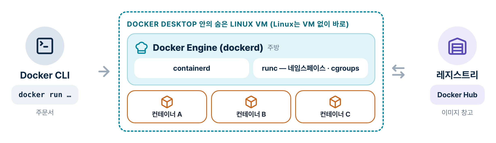

# 6교시 · Docker Desktop 설치

!!! goal "이번 시간에 할 일"
    - Docker가 어떤 부품으로 이루어져 있는지 그림으로 봅니다.
    - 운영체제에 맞게 Docker를 설치합니다 (Windows·Mac은 Docker Desktop, Linux는 Docker Engine).
    - Windows는 Docker Desktop과 WSL Ubuntu를 연결합니다.
    - `docker version`으로 클라이언트와 서버가 모두 응답하는지 확인합니다.

## Docker는 무엇으로 이루어져 있나

`docker` 명령 하나만 보이지만, 뒤에서는 여러 부품이 함께 일합니다.



| 부품 | 하는 일 | 비유 |
|---|---|---|
| **Docker CLI** (`docker` 명령) | 내 명령을 받아 엔진에 전달 | 식당의 **주문서** |
| **Docker Engine** (`dockerd`) | 이미지를 받고, 컨테이너를 만들고 실행 | **주방** |
| **containerd · runc** | 실제로 컨테이너 프로세스를 띄움 (네임스페이스·cgroups) | 주방의 **조리 도구** |
| **레지스트리** (Docker Hub) | 이미지를 저장하고 나눠 주는 곳 | **식자재 창고** |
| **Docker Desktop** | Windows·Mac에 Linux 가상 머신을 만들고 그 안에 엔진을 띄워 주는 앱 | **식당 건물** |

!!! key "왜 Windows와 Mac에는 'Desktop'이 필요할까?"
    1주차 2일차에 배운 것처럼 컨테이너는 **Linux 커널의 기능**(네임스페이스, cgroups)입니다. Windows와 Mac의 커널에는 이 기능이 없습니다. 그래서 Docker Desktop은 보이지 않는 곳에 **작은 Linux 가상 머신**을 띄우고, 그 안에서 Docker Engine을 실행합니다. 우리가 입력하는 `docker` 명령은 그 가상 머신 안의 엔진에게 전달됩니다. Linux 컴퓨터는 커널이 이미 Linux이므로 가상 머신 없이 **Docker Engine**만 설치하면 됩니다.

## 실습 11 · Windows — Docker Desktop 설치와 WSL 연결

!!! lab "실습 목표"
    Docker Desktop을 설치하고, WSL의 Ubuntu에서 `docker` 명령을 쓸 수 있게 연결합니다.

### 단계 1 — 설치 파일 받기

[docs.docker.com/desktop/setup/install/windows-install](https://docs.docker.com/desktop/setup/install/windows-install/)에서 **Docker Desktop for Windows - x86_64**를 받습니다. (ARM 노트북이라면 Arm 버전)

또는 **PowerShell**에서 winget으로 받아 설치할 수 있습니다(설치 마법사가 뜨면 단계 2와 같이 진행).

```powershell
winget install -e --id Docker.DockerDesktop
```

!!! warn "WSL 안에 Docker를 따로 설치하지 마세요"
    인터넷 글을 보고 WSL의 Ubuntu 안에 `apt install docker.io` 등으로 Docker를 **또** 설치하면, Docker Desktop과 충돌해 어느 쪽 엔진에 명령이 가는지 꼬입니다. Docker 공식 문서도 Docker Desktop을 설치하기 전에 WSL 안의 Docker Engine을 지우라고 안내합니다. Windows에서는 **Docker Desktop 하나만** 씁니다.

### 단계 2 — 설치

1. 받은 `Docker Desktop Installer.exe`를 실행합니다.
2. 설정 화면에서 **Use WSL 2 instead of Hyper-V (recommended)**가 체크되어 있는지 확인합니다.
3. 설치가 끝나면 **Close and log out** 또는 재시작을 합니다.

### 단계 3 — 첫 실행

1. 시작 메뉴에서 **Docker Desktop**을 실행합니다.
2. 서비스 약관(Docker Subscription Service Agreement)에 동의합니다. 1주차 5일차에 본 것처럼 **개인·교육 목적은 무료**입니다.
3. 로그인 화면은 **Skip**해도 됩니다. (Docker Hub 계정은 3일차에 만듭니다)
4. 왼쪽 아래 상태가 **Engine running**(초록)이 될 때까지 기다립니다.

### 단계 4 — WSL Ubuntu와 연결

1. Docker Desktop 오른쪽 위 **톱니바퀴(Settings)**를 누릅니다.
2. **Resources → WSL integration**으로 갑니다.
3. **Enable integration with my default WSL distro**를 켜고, 아래 목록에서 **Ubuntu-24.04**도 켭니다.
4. **Apply & restart**를 누릅니다.

### 단계 5 — Ubuntu에서 확인

**새** Ubuntu 터미널(또는 VS Code 터미널)을 열고:

```bash
docker version
```

!!! check "이렇게 나오면 성공"
    ```text
    Client:
     Version:           29.x.x
     ...
     OS/Arch:           linux/amd64
     Context:           default

    Server: Docker Desktop 4.x.x (…)
     Engine:
      Version:          29.x.x
      ...
    ```
    **Client와 Server가 둘 다** 나와야 합니다. Client는 주문서(CLI), Server는 주방(Engine)입니다. 버전 숫자는 달라도 됩니다.

## 실습 12 · Mac — Docker Desktop 설치

!!! lab "실습 목표"
    Mac에 Docker Desktop을 설치하고 `docker version`을 확인합니다.

### 단계 1 — 칩에 맞는 파일 받기

[docs.docker.com/desktop/setup/install/mac-install](https://docs.docker.com/desktop/setup/install/mac-install/)에서 **1교시에 확인한 칩**에 맞는 것을 받습니다.

| 1교시 `uname -m` 결과 | 받을 파일 |
|---|---|
| `arm64` | Docker Desktop for Mac with **Apple silicon** |
| `x86_64` | Docker Desktop for Mac with **Intel chip** |

또는 터미널에서 `brew install --cask docker-desktop`로 설치할 수 있습니다.

### 단계 2 — 설치와 첫 실행

1. `Docker.dmg`를 열고 Docker 아이콘을 **Applications** 폴더로 끌어 옮깁니다.
2. 응용 프로그램에서 **Docker**를 실행합니다. 권한을 묻는 창이 나오면 Mac 로그인 비밀번호를 입력해 허용합니다.
3. 약관 동의 → 로그인은 **Skip** → 메뉴 막대의 고래 아이콘이 **Docker Desktop is running**이 될 때까지 기다립니다.

### 단계 3 — 확인

```bash
docker version
```

!!! check "이렇게 나오면 성공"
    Windows와 마찬가지로 **Client와 Server**가 모두 보입니다. Apple Silicon이면 `OS/Arch: darwin/arm64`(Client)와 `linux/arm64`(Server)가 보입니다. 클라이언트는 Mac에서, 엔진은 그 안의 **Linux 가상 머신**에서 돈다는 증거입니다.

## Linux 사용자 — Docker Engine 설치 (참고)

!!! example "Ubuntu에 Docker Engine 설치하기"
    Linux 노트북을 쓰는 수강생만 해당합니다. 아래는 Docker 공식 문서의 Ubuntu 설치 절차입니다. 명령이 바뀔 수 있으니 [docs.docker.com/engine/install/ubuntu](https://docs.docker.com/engine/install/ubuntu/)를 함께 엽니다.

    ```bash
    # 1) 공식 저장소의 서명 키 등록
    sudo apt-get update
    sudo apt-get install -y ca-certificates curl
    sudo install -m 0755 -d /etc/apt/keyrings
    sudo curl -fsSL https://download.docker.com/linux/ubuntu/gpg -o /etc/apt/keyrings/docker.asc
    sudo chmod a+r /etc/apt/keyrings/docker.asc

    # 2) Docker 공식 저장소 추가
    echo "deb [arch=$(dpkg --print-architecture) signed-by=/etc/apt/keyrings/docker.asc] \
      https://download.docker.com/linux/ubuntu $(. /etc/os-release && echo "${UBUNTU_CODENAME:-$VERSION_CODENAME}") stable" \
      | sudo tee /etc/apt/sources.list.d/docker.list > /dev/null

    # 3) 설치
    sudo apt-get update
    sudo apt-get install -y docker-ce docker-ce-cli containerd.io docker-buildx-plugin docker-compose-plugin

    # 4) sudo 없이 docker를 쓰도록 docker 그룹에 나를 추가 → 로그아웃 후 다시 로그인
    sudo usermod -aG docker $USER
    ```

    4번의 `docker` 그룹은 **관리자(root)와 거의 같은 권한**입니다. 개인 실습 노트북에서는 편의를 위해 쓰지만, 공용 서버에서 아무에게나 주면 안 됩니다. 4주차 보안 시간에 이유를 다시 봅니다.

## 자원 설정 — 노트북이 너무 느려진다면

Docker는 노트북의 메모리를 나눠 씁니다. 이번 주 실습은 **메모리 4GB** 정도면 충분하지만, 3주차 Kubernetes부터는 더 필요합니다.

| 환경 | 설정하는 곳 |
|---|---|
| Mac | Docker Desktop → Settings → **Resources** → Memory |
| Windows (WSL2) | Windows 홈 폴더의 **`.wslconfig`** 파일 (WSL 전체 메모리 한도). 처음에는 기본값으로 두고, 느려지면 강사와 함께 조정 |

!!! trouble "막혔다면"
    | 증상 | 원인 | 해결 |
    |---|---|---|
    | `docker: command not found` 또는 `The command 'docker' could not be found in this WSL 2 distro` | WSL integration이 꺼져 있거나 Docker Desktop이 종료됨 | 단계 4에서 Ubuntu-24.04 켜고 Apply → **새 터미널** 열기 |
    | `failed to connect to the docker API` / `Cannot connect to the Docker daemon` | Docker Desktop이 꺼져 있거나 아직 시작 중 | Docker Desktop을 켜고 **Engine running**이 될 때까지 대기 |
    | Client만 나오고 Server에서 에러 | 위와 같음 | 위와 같음 |
    | `Docker Desktop - WSL update failed` | WSL이 오래됨 | PowerShell에서 `wsl --update` 후 Docker Desktop 재시작 |
    | `Virtualization support not detected` | BIOS 가상화 꺼짐 | 1교시 단계 1 — 강사에게 알림 |
    | (Linux) `permission denied … docker.sock` | docker 그룹 적용 전 | 로그아웃 후 다시 로그인, 또는 `newgrp docker` |

!!! academic "학술 노트 — 5분짜리 발표가 바꾼 것 (2013)과 OCI 표준 (2015)"
    컨테이너 기술 자체는 Docker보다 오래되었습니다(1주차 2일차: chroot 1979, LXC 2008). 하지만 쓰기가 너무 어려웠습니다. 2013년 3월, PaaS 회사 dotCloud의 솔로몬 하이크스(Solomon Hykes)는 PyCon 학회의 5분짜리 라이트닝 토크 「리눅스 컨테이너의 미래」에서 **Docker**를 처음 공개했습니다. 핵심은 새로운 격리 기술이 아니라, **이미지라는 포장 형식**과 **누구나 쓸 수 있는 간단한 명령**이었습니다. 회사는 이후 이름을 Docker로 바꿨습니다.

    Docker가 폭발적으로 퍼지자, "한 회사의 형식에 모두가 묶여도 되는가?"라는 우려가 생겼습니다. 그래서 2015년 Docker와 여러 회사가 리눅스 재단 아래 **OCI(Open Container Initiative)**를 만들어, 이미지 형식과 실행 방식을 **중립적인 표준**으로 정했습니다. 덕분에 오늘 우리가 Docker로 만든 이미지는 Podman, containerd, Kubernetes, AWS 어디서나 그대로 실행됩니다. 3주차에 Kubernetes가 Docker 없이 containerd로 우리 이미지를 실행하는 것도 이 표준 덕분입니다.

    - Hykes, S. (2013). *The future of Linux Containers*. PyCon US 2013 Lightning Talk.
    - Open Container Initiative. *OCI Image Format Specification*, *OCI Runtime Specification*. opencontainers.org

!!! trend "트렌드 — 컨테이너가 AI 에이전트의 '울타리'가 되다"
    Stack Overflow 2026 설문에서 Docker는 개발자가 **앞으로 가장 쓰고 싶은 도구** 1위(38.4%)에 올랐습니다. 최근 Docker가 특히 강조하는 쓰임새는 **AI 에이전트의 격리 공간(샌드박스)**입니다. AI 코딩 에이전트가 명령을 실행하고 파일을 고칠 때, 그것을 내 노트북 전체가 아니라 **컨테이너 안에서만** 하게 하면 실수나 악성 코드가 바깥으로 번지지 않습니다. 1주차 2일차에 배운 격리(네임스페이스)가 AI 시대에 새로운 이유로 중요해지고 있는 것입니다. Docker Desktop에 AI 모델을 로컬에서 실행하는 기능이 들어간 것도 같은 흐름입니다.

## 정리

- Docker는 **CLI(주문서) → Engine(주방) → containerd·runc(조리 도구)**, 이미지는 **레지스트리(창고)**에서 옵니다.
- Windows·Mac은 Linux 커널이 없어 **Docker Desktop**이 숨은 Linux VM을 띄웁니다.
- Windows는 **WSL integration**을 켜야 Ubuntu에서 `docker`를 쓸 수 있습니다.
- `docker version`에 **Client와 Server가 모두** 나와야 성공입니다.
- Linux의 `docker` 그룹은 **root와 거의 같은 권한**입니다.

!!! quiz "확인 문제"
    1. `docker version`에서 Server 정보가 나오지 않으면 가장 먼저 무엇을 확인하나요?
    2. Mac과 Windows에 Docker Desktop이 필요한 이유는?
    3. WSL Ubuntu에서 `docker: command not found`가 나오면?
    4. 이미지를 저장하고 나눠 주는 곳을 무엇이라고 하나요?
    5. Docker로 만든 이미지를 Kubernetes에서도 실행할 수 있게 해 주는 표준의 이름은?

    ??? answer "정답"
        1. Docker Desktop이 켜져 있고 Engine running 상태인지
        2. 컨테이너는 Linux 커널 기능인데, Windows·Mac 커널에는 없어서 숨은 Linux VM이 필요하기 때문
        3. Docker Desktop 설정의 WSL integration에서 Ubuntu를 켜고, 새 터미널을 연다
        4. 레지스트리 (예: Docker Hub)
        5. OCI (Open Container Initiative)

## 참고 문헌

- Docker. *Install Docker Desktop on Windows / Mac*, *Install Docker Engine on Ubuntu*. docs.docker.com
- Docker. *Docker Desktop WSL 2 backend on Windows*. docs.docker.com/desktop/features/wsl
- Open Container Initiative. *About the OCI*. opencontainers.org
- Merkel, D. (2014). Docker: Lightweight Linux containers for consistent development and deployment. *Linux Journal*, 2014(239).
- Stack Overflow (2026). *2026 Developer Survey — Technology*. survey.stackoverflow.co
