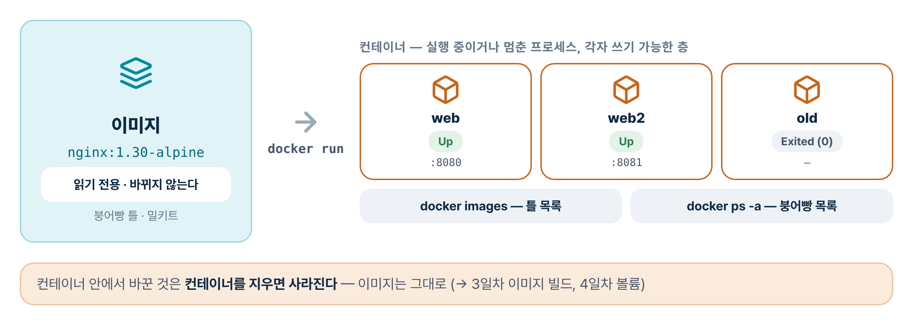

# 1교시 · 이미지와 컨테이너

!!! goal "이번 시간에 할 일"
    - 어제 설치한 환경을 10분 동안 점검합니다.
    - 이미지와 컨테이너의 차이를 비유와 그림으로 이해합니다.
    - 이미지 이름(레지스트리/저장소:태그)을 읽습니다.
    - `docker images`와 `docker ps -a`로 어제의 hello-world를 찾아봅니다.

## 어제 요약 — 작업대 점검

```bash
cd ~/devops-lab
bash tools/check-env.sh
```

**실패 0개**가 나오면 오늘 실습을 시작할 준비가 된 것입니다. Docker Desktop이 꺼져 있다면 먼저 켜고 **Engine running**을 기다립니다(어제 7교시 실패 1).

## 이미지와 컨테이너



| | 이미지 (Image) | 컨테이너 (Container) |
|---|---|---|
| 정체 | 실행에 필요한 파일들의 **읽기 전용 묶음** | 이미지를 바탕으로 **실행 중인(또는 멈춘) 프로세스** |
| 상태 | 바뀌지 않는다 | 실행 중에 파일을 쓰고 바꿀 수 있다 |
| 개수 | 하나 | 하나의 이미지로 **여러 개**를 만들 수 있다 |
| 비유 | **붕어빵 틀** | **틀로 찍어 낸 붕어빵** |
| 1주차와 연결 | 1주차 2일차의 "프로그램(디스크의 파일)" | 1주차 2일차의 "프로세스(실행 중인 프로그램)" |
| 확인 명령 | `docker images` | `docker ps -a` |

!!! analogy "비유 — 요리 레시피와 요리"
    이미지는 **재료가 다 손질되어 들어 있는 밀키트**, 컨테이너는 그 밀키트로 **지금 만들고 있는 요리**입니다. 같은 밀키트로 요리를 세 번 하면 요리가 세 개 생기지만 밀키트 상자는 그대로입니다. 요리에 소금을 더 넣어도(컨테이너 안에서 파일을 바꿔도) **밀키트(이미지)는 변하지 않습니다.** 그래서 컨테이너를 지우면 그 안에서 바꾼 것도 함께 사라집니다. 이 사실이 4일차 볼륨 수업의 출발점입니다.

!!! academic "학술 노트 — 불변 인프라 (Immutable Infrastructure)"
    전통적인 서버 운영은 서버를 한 번 설치한 뒤, 필요할 때마다 들어가서 고치는 방식이었습니다. 몇 년이 지나면 그 서버가 정확히 어떤 상태인지 아무도 모르게 됩니다. 마틴 파울러는 2012년 이런 서버를 **눈송이 서버(snowflake server)**라고 불렀습니다. 하나하나 모양이 달라 똑같이 다시 만들 수 없다는 뜻입니다.

    그 반대가 **불변 인프라**입니다. 서버(또는 컨테이너)를 고치지 않고, 바꿀 일이 생기면 **새 이미지를 만들어 통째로 교체**합니다. 채드 파울러(Chad Fowler)가 2013년 글 「Trash Your Servers and Burn Your Code」에서 이 생각을 널리 알렸습니다. 이미지가 읽기 전용인 이유, 그리고 1주차 4일차의 "서버를 가축처럼"이 가능한 이유가 여기 있습니다. 3일차에 우리가 앱을 고치면 컨테이너 안을 고치는 대신 **이미지를 다시 빌드**하는 것도 이 원칙을 따르는 것입니다.

    - Fowler, M. (2012). *SnowflakeServer*. martinfowler.com/bliki
    - Fowler, C. (2013). *Trash Your Servers and Burn Your Code: Immutable Infrastructure and Disposable Components*.

## 이미지 이름 읽기

```text
docker.io / library / nginx : 1.30-alpine
─────────   ───────   ─────   ───────────
레지스트리   계정       저장소    태그
```

| 부분 | 뜻 | 생략하면 |
|---|---|---|
| 레지스트리 | 이미지가 있는 창고 | `docker.io` (Docker Hub) |
| 계정 | 이미지를 올린 사람·조직 | `library` (Docker 공식 이미지) |
| 저장소 | 이미지 이름 | 생략 불가 |
| **태그** | 버전 표시 | **`latest`** |

그래서 `nginx`는 `docker.io/library/nginx:latest`의 줄임말입니다. 어제 `hello-world`를 실행했을 때 `hello-world:latest`를 받은 이유입니다.

!!! warn "`latest`는 '최신'이라는 약속이 아니다"
    `latest`는 단지 **태그를 안 적었을 때 붙는 기본 이름**일 뿐, 가장 최신 버전이라는 보장이 아닙니다. 또 오늘 받은 `nginx:latest`와 석 달 뒤 받은 `nginx:latest`는 **내용이 다를 수 있습니다.** "어제는 됐는데 오늘 안 돼요"의 흔한 원인입니다. 그래서 이 교재는 항상 `nginx:1.30-alpine`처럼 **버전을 적습니다.** 3일차에 더 정확한 방법(다이제스트)을 배웁니다.

## 실습 1 · 이미지와 컨테이너 목록 보기

!!! lab "실습 목표"
    어제 실행한 hello-world가 **이미지**와 **멈춘 컨테이너**로 남아 있는 것을 확인합니다.

### 단계 1 — 내 컴퓨터의 이미지

```bash
docker images
```

!!! check "이렇게 나오면 성공"
    ```text
    IMAGE                ID             DISK USAGE   CONTENT SIZE   EXTRA
    hello-world:latest   f7931603f70e       20.3kB         3.96kB    U
    ```
    밀키트(이미지)가 하나 있습니다. **EXTRA**의 `U`는 이 이미지를 쓰는(In Use) 컨테이너가 있다는 표시입니다. Docker 버전에 따라 `REPOSITORY  TAG  IMAGE ID  CREATED  SIZE` 형식으로 나올 수도 있습니다.

### 단계 2 — 실행 중인 컨테이너

```bash
docker ps
```

!!! check "이렇게 나오면 성공"
    ```text
    CONTAINER ID   IMAGE     COMMAND   CREATED   STATUS    PORTS     NAMES
    ```
    머리줄만 있고 비어 있습니다. hello-world는 메시지를 출력하고 **끝났기 때문에** 지금 실행 중인 것이 없습니다.

### 단계 3 — 멈춘 것까지 모두

```bash
docker ps -a
```

!!! check "이렇게 나오면 성공"
    ```text
    CONTAINER ID   IMAGE         COMMAND    CREATED        STATUS                    PORTS     NAMES
    a1b2c3d4e5f6   hello-world   "/hello"   18 hours ago   Exited (0) 18 hours ago             eager_turing
    9f8e7d6c5b4a   hello-world   "/hello"   18 hours ago   Exited (0) 18 hours ago             vibrant_hopper
    ```
    어제 두 번 실행했으니 컨테이너가 **두 개**입니다. 이미지는 하나인데 컨테이너는 둘 — 붕어빵 틀 하나로 두 개를 찍은 것입니다.

| 열 | 읽는 법 |
|---|---|
| CONTAINER ID | 컨테이너의 고유 번호 (앞 몇 글자만 써도 된다) |
| IMAGE | 어떤 틀로 찍었나 |
| COMMAND | 컨테이너 안에서 실행한 명령 |
| STATUS | `Up` = 실행 중, **`Exited (0)`** = 끝남, 괄호 안은 **종료 코드** (1주차 2일차) |
| NAMES | 이름. 안 정하면 Docker가 `형용사_과학자` 형식으로 지어 준다 |

### 단계 4 — 첫 정리

```bash
docker rm eager_turing vibrant_hopper
docker ps -a
```

이름은 **내 화면에 나온 이름**으로 바꿔 씁니다. CONTAINER ID 앞 3~4글자를 써도 됩니다(`docker rm a1b2 9f8e`).

!!! check "이렇게 나오면 성공"
    지운 이름이 한 줄씩 출력되고, `docker ps -a`가 머리줄만 남습니다. **이미지는 그대로** 있습니다(`docker images`로 확인).

!!! trend "트렌드 — '공식 이미지'와 '강화된 이미지'"
    Docker Hub에는 수백만 개의 이미지가 있지만, 그중 `library/`로 시작하는 **Docker 공식 이미지(Docker Official Images)**는 Docker와 각 프로젝트가 함께 관리하며 보안 업데이트를 꾸준히 반영합니다. 아무 계정의 이미지를 받아 쓰면 1주차 5일차에 배운 **공급망 공격**에 노출될 수 있으므로, 처음에는 공식 이미지를 기본으로 씁니다. 최근에는 여기서 더 나아가 불필요한 파일을 모두 걷어 내 취약점을 최소화한 **강화 이미지(hardened image)**를 Docker, Google, Chainguard 같은 회사들이 제공하고 있고, 기업들은 "허가된 이미지 목록"만 쓰도록 정책을 거는 경우가 늘고 있습니다. 4주차 Kyverno 정책 실습에서 이런 규칙을 직접 만들어 봅니다.

## 정리

- **이미지**는 읽기 전용 틀, **컨테이너**는 그 틀로 만든 실행 단위입니다. 하나의 이미지로 여러 컨테이너를 만듭니다.
- 컨테이너 안에서 바꾼 것은 **컨테이너를 지우면 사라집니다.** (→ 4일차 볼륨)
- 이미지 이름은 **레지스트리/계정/저장소:태그**, 태그를 안 쓰면 `latest`입니다. 버전을 적는 습관을 들입니다.
- `docker ps`는 실행 중인 것만, `docker ps -a`는 멈춘 것까지 보여 줍니다. STATUS의 괄호는 **종료 코드**입니다.

!!! quiz "확인 문제"
    1. 이미지와 컨테이너를 붕어빵에 비유하면?
    2. `nginx`라고만 쓰면 실제로 어떤 이미지 이름이 되나요?
    3. hello-world를 실행했는데 `docker ps`에 아무것도 없는 이유는?
    4. `Exited (0)`에서 0의 의미는?
    5. `latest` 태그를 피해야 하는 이유는?

    ??? answer "정답"
        1. 이미지 = 붕어빵 틀, 컨테이너 = 틀로 찍어 낸 붕어빵
        2. `docker.io/library/nginx:latest`
        3. 메시지를 출력하고 프로그램이 끝나서 컨테이너가 멈췄기 때문 (`docker ps -a`로는 보인다)
        4. 정상 종료 (종료 코드 0 = 성공)
        5. 받는 시점에 따라 내용이 달라질 수 있어 재현이 안 되기 때문

## 참고 문헌

- Docker Docs. *What is an image?*, *What is a container?* docs.docker.com/get-started
- Docker Docs. *docker container ls*, *docker image ls*. docs.docker.com/reference/cli
- Fowler, M. (2012). *SnowflakeServer*. martinfowler.com
- Morris, K. (2020). *Infrastructure as Code* (2nd ed.). O'Reilly.
- Docker. *Docker Official Images*. docs.docker.com/docker-hub/image-library/trusted-content
