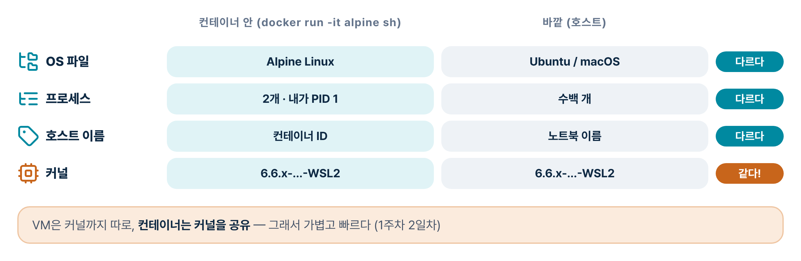

# 2교시 · 컨테이너 안에 들어가 보기

!!! goal "이번 시간에 할 일"
    - `docker run -it`으로 컨테이너 안에서 셸을 엽니다.
    - 컨테이너 안에서 프로세스, 호스트 이름, 파일을 보며 **격리**를 확인합니다.
    - 컨테이너와 호스트가 **커널을 공유**한다는 것을 확인합니다.
    - `--rm`으로 쓰고 버리는 컨테이너를 만듭니다.

## 1주차 2일차의 약속을 확인하는 시간

1주차 2일차 7교시에 "컨테이너는 **네임스페이스로 보이는 것을 제한**하고 **cgroups로 쓸 수 있는 양을 제한**한 **평범한 프로세스**"라고 배웠습니다. 오늘은 그 말이 사실인지 컨테이너 안에 들어가서 직접 확인합니다.

## 실습 2 · Alpine 컨테이너 안으로

!!! lab "실습 목표"
    작은 Linux인 Alpine 컨테이너 안에서 셸을 열고, 바깥과 무엇이 다르고 무엇이 같은지 확인합니다.

### 단계 1 — 들어가기

```bash
docker run -it --rm alpine:3.24 sh
```

| 부분 | 뜻 |
|---|---|
| `docker run` | 이미지로 컨테이너를 만들고 실행 |
| `-i` | 입력을 계속 받는다 (interactive) |
| `-t` | 터미널 화면을 붙여 준다 (tty) |
| `--rm` | 컨테이너가 끝나면 **자동으로 지운다** |
| `alpine:3.24` | 사용할 이미지 |
| `sh` | 컨테이너 안에서 실행할 명령 (셸) |

!!! check "이렇게 나오면 성공"
    ```text
    Unable to find image 'alpine:3.24' locally
    3.24: Pulling from library/alpine
    ...
    / #
    ```
    프롬프트가 `devops@…$`에서 **`/ #`**로 바뀌었습니다. 지금 여러분은 **컨테이너 안**에 있습니다. `#`은 관리자(root)라는 뜻입니다.

### 단계 2 — 나는 어느 OS 안에 있나

```sh
cat /etc/os-release
```

!!! check "이렇게 나오면 성공"
    ```text
    NAME="Alpine Linux"
    ID=alpine
    VERSION_ID=3.24.4
    PRETTY_NAME="Alpine Linux v3.24"
    ...
    ```
    바깥은 Ubuntu(또는 macOS)인데, 안은 **Alpine Linux**입니다. 이미지가 **파일 시스템 전체**를 가지고 왔기 때문입니다(마운트 네임스페이스).

### 단계 3 — 프로세스 보기

```sh
ps
```

!!! check "이렇게 나오면 성공"
    ```text
    PID   USER     TIME  COMMAND
        1 root      0:00 sh
        8 root      0:00 ps
    ```
    프로세스가 **두 개뿐**입니다. 그리고 우리가 실행한 `sh`가 **PID 1**입니다. 1주차 2일차에서 PID 1은 운영체제가 맨 처음 띄우는 특별한 프로세스라고 했지요. 컨테이너 안에서는 우리가 실행한 프로그램이 PID 1이 됩니다. 바깥의 수백 개 프로세스는 **보이지 않습니다** — 이것이 **PID 네임스페이스**입니다.

### 단계 4 — 내 이름은?

```sh
hostname
whoami
```

!!! check "이렇게 나오면 성공"
    ```text
    3c9a1f2e7b4d
    root
    ```
    호스트 이름이 노트북 이름이 아니라 **컨테이너 ID**입니다(UTS 네임스페이스). 그리고 안에서는 root입니다. 하지만 이 root는 **컨테이너 안에서만** 힘이 셉니다.

### 단계 5 — 커널은 누구 것?

```sh
uname -r
```

!!! check "이렇게 나오면 성공"
    ```text
    6.6.87.2-microsoft-standard-WSL2
    ```
    Windows라면 어제 1교시 Ubuntu에서 본 **커널 버전과 같습니다.** Mac이라면 `…-linuxkit`처럼 Docker Desktop의 Linux 가상 머신 커널 버전이 나옵니다. 어느 쪽이든 핵심은 같습니다. **OS 파일은 Alpine 것이지만, 커널은 바깥 Linux의 것을 함께 씁니다.** 1주차 2일차의 "VM은 커널까지 따로, 컨테이너는 커널을 공유"가 바로 이것입니다.

### 단계 6 — 파일을 만들고 나가기

```sh
echo "컨테이너 안에서 만든 파일" > /tmp/note.txt
cat /tmp/note.txt
exit
```

`exit`으로 셸(PID 1)이 끝나면 **컨테이너도 끝납니다.** 그리고 `--rm` 덕분에 자동으로 지워집니다.

### 단계 7 — 다시 들어가 보기

```bash
docker run -it --rm alpine:3.24 sh
```

```sh
cat /tmp/note.txt
exit
```

!!! check "이렇게 나오면 성공"
    ```text
    cat: can't open '/tmp/note.txt': No such file or directory
    ```
    파일이 없습니다. 이번 것은 **같은 이미지로 찍은 새 컨테이너**이기 때문입니다. 1교시의 "요리에 소금을 넣어도 밀키트는 그대로"를 확인했습니다. 그리고 이번에는 `Pulling` 줄이 없이 바로 들어갔습니다. 이미지가 이미 내 컴퓨터에 있기 때문입니다.



| 확인한 것 | 컨테이너 안 | 바깥(호스트) | 담당 기술 |
|---|---|---|---|
| OS 파일 | Alpine | Ubuntu / macOS | 마운트 네임스페이스 + 이미지 |
| 프로세스 | 2개, 내가 PID 1 | 수백 개 | PID 네임스페이스 |
| 호스트 이름 | 컨테이너 ID | 노트북 이름 | UTS 네임스페이스 |
| 커널 | **같다** | **같다** | (공유) |
| 만든 파일 | 컨테이너를 지우면 사라짐 | — | 이미지는 읽기 전용 |

!!! trouble "막혔다면"
    | 증상 | 원인 | 해결 |
    |---|---|---|
    | 프롬프트가 바뀌지 않고 바로 끝남 | `-it`를 빼먹음 | `docker run -it --rm alpine:3.24 sh` |
    | `bash: not found` | Alpine에는 bash가 없음 | `sh`를 쓴다 (Alpine은 아주 작아서 bash 대신 sh만 있다) |
    | 컨테이너 안에서 나가는 법을 모름 | — | `exit` 또는 `Ctrl` + `D` |
    | `the input device is not a TTY` | 일부 터미널·스크립트에서 `-t` 사용 | 일반 터미널(VS Code 터미널 포함)에서 실행 |

!!! academic "학술 노트 — 컨테이너는 얼마나 격리되어 있나"
    컨테이너는 커널을 공유하므로, 커널에 보안 취약점이 있으면 컨테이너 밖으로 빠져나갈(**컨테이너 탈출**) 위험이 있습니다. VM은 커널까지 따로 가지므로 격리 수준이 더 높습니다. 이 차이를 줄이기 위한 연구가 계속되어 왔습니다. 구글의 **gVisor**(2018)는 커널 기능의 상당 부분을 사용자 공간에서 대신 처리해 진짜 커널에 닿는 경로를 줄이고, 1주차 2일차에서 본 AWS의 **Firecracker**(2020)는 아주 가벼운 VM으로 "컨테이너의 속도 + VM의 격리"를 노립니다. 영오 등(Young et al., 2019)은 gVisor와 같은 방식이 격리를 높이는 대신 시스템 콜이 많은 작업에서 성능 비용이 생긴다는 것을 측정했습니다.

    결론은 1주차 4일차의 교훈과 같습니다. **트레이드오프**입니다. 그래서 실무에서는 컨테이너 안에서도 **root로 실행하지 않기**(3일차 Dockerfile의 `USER`), 권한 줄이기(4주차 보안) 같은 겹겹의 방어를 함께 씁니다.

    - Young, E. G., Zhu, P., Caraza-Harter, T., Arpaci-Dusseau, A. C., & Arpaci-Dusseau, R. H. (2019). The true cost of containing: A gVisor case study. *USENIX HotCloud '19*.
    - Agache, A. et al. (2020). Firecracker: Lightweight virtualization for serverless applications. *USENIX NSDI '20*.

## 정리

- `docker run -it --rm 이미지 sh`로 컨테이너 안에 들어가 셸을 쓸 수 있습니다.
- 컨테이너 안에서는 **OS 파일, 프로세스 목록, 호스트 이름**이 따로이고, 내가 실행한 프로그램이 **PID 1**입니다.
- **커널은 바깥과 같습니다.** VM과의 가장 큰 차이입니다.
- PID 1이 끝나면 컨테이너도 끝나고, 컨테이너를 지우면 안에서 만든 파일도 사라집니다.

!!! quiz "확인 문제"
    1. `-it`에서 `i`와 `t`는 각각 무엇인가요?
    2. 컨테이너 안에서 `ps`를 했을 때 PID 1은 누구였나요?
    3. 컨테이너 안의 `hostname`이 노트북 이름이 아닌 이유는?
    4. 컨테이너 안과 밖에서 `uname -r`이 같다는 것은 무엇을 뜻하나요?
    5. 두 번째로 들어간 컨테이너에서 `/tmp/note.txt`가 없었던 이유는?

    ??? answer "정답"
        1. `-i`는 입력을 계속 받기(interactive), `-t`는 터미널 붙이기(tty)
        2. 우리가 실행한 `sh`
        3. UTS 네임스페이스로 호스트 이름이 분리되어 있어서 (컨테이너 ID가 이름)
        4. 컨테이너는 커널을 호스트와 공유한다
        5. 같은 이미지로 만든 새 컨테이너였고, 이전 컨테이너는 `--rm`으로 지워졌기 때문

## 참고 문헌

- Docker Docs. *docker container run — interactive (-i, -t), --rm*. docs.docker.com/reference/cli/docker/container/run
- Linux man-pages. *namespaces(7)*, *pid_namespaces(7)*.
- Young, E. G. et al. (2019). The true cost of containing: A gVisor case study. *HotCloud '19*.
- Alpine Linux. *About*. alpinelinux.org
