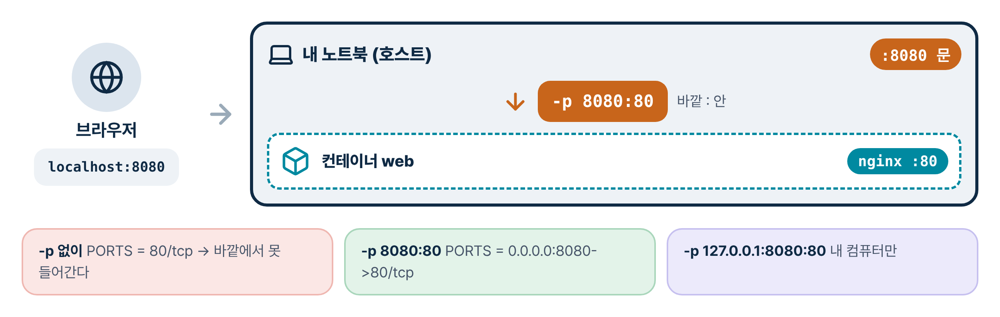

# 4교시 · 포트 연결

!!! goal "이번 시간에 할 일"
    - `-p 호스트포트:컨테이너포트`의 뜻을 이해합니다.
    - nginx를 포트 연결과 함께 실행하고 브라우저로 접속합니다.
    - 같은 이미지로 컨테이너 여러 개를 다른 포트에 띄웁니다.
    - 포트 충돌을 일부러 만들고, `127.0.0.1`로만 여는 방법도 봅니다.

## 두 건물 사이에 통로 뚫기



```text
-p 8080:80
   ────  ──
   │     └─ 컨테이너 안의 포트 (nginx가 기다리는 곳)
   └─────── 내 노트북(호스트)의 포트 (내가 접속할 곳)
```

**왼쪽이 바깥, 오른쪽이 안**입니다. "노트북의 8080번 문으로 들어온 손님을 컨테이너의 80번 방으로 안내하라"는 뜻입니다. 1주차 3일차에 배운 **NAT**와 같은 일을 Docker가 대신 해 주는 것입니다.

## 실습 6 · 포트를 연결해 실행

!!! lab "실습 목표"
    nginx를 `-p 8080:80`으로 실행하고, 터미널과 브라우저 양쪽에서 환영 페이지를 확인합니다.

### 단계 1 — 실행

```bash
docker run -d --name web -p 8080:80 nginx:1.30-alpine
docker ps
```

!!! check "이렇게 나오면 성공"
    ```text
    CONTAINER ID   IMAGE               …   STATUS         PORTS                                     NAMES
    7c1e3a9b2f4d   nginx:1.30-alpine   …   Up 3 seconds   0.0.0.0:8080->80/tcp, [::]:8080->80/tcp   web
    ```
    이번에는 PORTS에 **화살표**가 있습니다. `0.0.0.0:8080->80/tcp` = "모든 네트워크 카드의 8080 → 컨테이너 80". `[::]`는 같은 내용의 IPv6 표기입니다(1주차 3일차).

### 단계 2 — 터미널에서 접속

```bash
curl http://localhost:8080
```

!!! check "이렇게 나오면 성공"
    ```text
    <!DOCTYPE html>
    <html>
    <head>
    <title>Welcome to nginx!</title>
    ...
    ```

### 단계 3 — 브라우저에서 접속

Windows·Mac의 브라우저 주소창에 **`http://localhost:8080`**을 입력합니다.

!!! check "이렇게 나오면 성공"
    **Welcome to nginx!** 페이지가 보입니다. WSL 안에서 띄운 컨테이너를 Windows 브라우저로 볼 수 있는 것은 Docker Desktop이 포트를 Windows까지 이어 주기 때문입니다.

### 단계 4 — 연결 정보만 보기

```bash
docker port web
```

!!! check "이렇게 나오면 성공"
    ```text
    80/tcp -> 0.0.0.0:8080
    80/tcp -> [::]:8080
    ```

## 실습 7 · 같은 이미지로 여러 개

!!! lab "실습 목표"
    같은 nginx 이미지로 컨테이너 두 개를 더 띄워, 하나의 이미지 → 여러 컨테이너를 눈으로 확인합니다.

### 단계 1 — 두 개 더

```bash
docker run -d --name web2 -p 8081:80 nginx:1.30-alpine
docker run -d --name web3 -p 8082:80 nginx:1.30-alpine
docker ps --format "table {{.Names}}\t{{.Ports}}\t{{.Status}}"
```

- `--format` : 보고 싶은 열만 골라 표로 보여 줍니다. `\t`는 칸 띄우기입니다.

!!! check "이렇게 나오면 성공"
    ```text
    NAMES     PORTS                                     STATUS
    web3      0.0.0.0:8082->80/tcp, [::]:8082->80/tcp   Up 2 seconds
    web2      0.0.0.0:8081->80/tcp, [::]:8081->80/tcp   Up 3 seconds
    web       0.0.0.0:8080->80/tcp, [::]:8080->80/tcp   Up 2 minutes
    ```
    세 컨테이너 모두 **안에서는 똑같이 80번**을 쓰는데 충돌하지 않습니다. 각자 자기 건물(네트워크 네임스페이스) 안의 80호실이기 때문입니다. 바깥 문 번호(8080, 8081, 8082)만 다르면 됩니다. 1주차 5일차 8교시의 "PostgreSQL 두 버전을 5432와 5433으로"가 바로 이 원리였습니다.

### 단계 2 — 하나씩 접속

```bash
curl -s http://localhost:8081 | grep title
curl -s http://localhost:8082 | grep title
```

- `-s` : 진행 표시 없이 조용히(silent)
- `| grep title` : 결과 중 `title`이 들어간 줄만 (1주차 2일차의 파이프)

!!! check "이렇게 나오면 성공"
    ```text
    <title>Welcome to nginx!</title>
    <title>Welcome to nginx!</title>
    ```

## 실습 8 · 포트 충돌과 접근 범위

!!! lab "실습 목표"
    이미 쓰는 포트로 하나 더 띄워 충돌 에러를 보고, `127.0.0.1`로 접근 범위를 좁혀 봅니다.

### 단계 1 — 일부러 충돌

```bash
docker run -d --name web4 -p 8080:80 nginx:1.30-alpine
```

!!! check "예상되는 에러"
    ```text
    docker: Error response from daemon: failed to set up container networking: driver failed
    programming external connectivity on endpoint web4 (…): Bind for 0.0.0.0:8080 failed:
    port is already allocated
    ```
    1주차 1일차 "좋은 질문"의 그 에러, 1주차 3일차 "포트 충돌"의 실제 모습입니다. 끝부분 **`port is already allocated`**가 핵심입니다. 8080은 이미 `web`이 쓰고 있습니다.

### 단계 2 — 실패의 흔적 확인

```bash
docker ps -a --format "table {{.Names}}\t{{.Status}}"
```

!!! check "이렇게 나오면 성공"
    ```text
    NAMES     STATUS
    web4      Created
    web3      Up 3 minutes
    ...
    ```
    `web4`는 **만들어졌지만(Created) 시작하지 못한** 상태로 남아 있습니다. 이름 `web4`를 다시 쓰려면 지워야 합니다.

```bash
docker rm web4
```

### 단계 3 — 내 컴퓨터에서만 열기

```bash
docker run -d --name web-local -p 127.0.0.1:8083:80 nginx:1.30-alpine
docker port web-local
```

!!! check "이렇게 나오면 성공"
    ```text
    80/tcp -> 127.0.0.1:8083
    ```
    `0.0.0.0`(모든 네트워크 카드)이 아니라 **`127.0.0.1`(나 자신)**에만 문을 열었습니다. 같은 와이파이의 다른 사람은 내 노트북 IP의 8083으로 들어올 수 없습니다. 1주차 3일차 3교시의 `127.0.0.1` vs `0.0.0.0`이 **호스트 쪽에서도** 똑같이 적용됩니다. DB 관리 도구처럼 외부에 노출하면 위험한 것은 이렇게 엽니다.

| `-p` 형식 | 열리는 범위 | 쓰는 곳 |
|---|---|---|
| `-p 8080:80` | 모든 네트워크 카드 (`0.0.0.0`) | 다른 기기에서도 접속해야 하는 서비스 |
| `-p 127.0.0.1:8080:80` | 내 컴퓨터만 | 관리 도구, DB, 개인 실습 |
| `-p 80` (한쪽만) | 호스트의 **빈 포트를 Docker가 골라서** 연결 | 테스트용, `docker port`로 번호 확인 |

!!! cleanup "정리"
    ```bash
    docker rm -f web web2 web3 web-local
    docker ps -a
    ```
    `docker ps -a`가 머리줄만 남으면 깨끗합니다. 다음 시간에 `web`을 새로 만듭니다.

!!! trouble "막혔다면"
    | 증상 | 원인 | 해결 |
    |---|---|---|
    | `port is already allocated` | 그 호스트 포트를 다른 컨테이너가 사용 중 | `docker ps`로 누가 쓰는지 확인 → 그 컨테이너를 지우거나 다른 포트 |
    | `address already in use` | 컨테이너가 아니라 **노트북의 다른 프로그램**이 사용 중 | `sudo ss -tlnp \| grep 8080`(Linux) 또는 다른 포트로 |
    | 브라우저에서 안 열림, curl은 됨 | 주소 오타, `https://`로 입력 | `http://localhost:8080` 정확히 |
    | `Conflict. The container name "/web" is already in use` | 같은 이름의 컨테이너가 남아 있음 | `docker rm -f web` 후 다시 (7교시) |
    | `-p 80:8080`으로 썼더니 안 됨 | **순서를 거꾸로** 씀 | 바깥:안 — `-p 8080:80` |

!!! academic "학술 노트 — Docker는 포트를 어떻게 이을까"
    `-p 8080:80`을 쓰면 Docker는 호스트 커널의 **패킷 필터(iptables 또는 nftables)**에 규칙을 추가합니다. "8080으로 들어온 패킷의 목적지를 컨테이너 IP의 80으로 바꿔라"라는 **DNAT(Destination NAT)** 규칙입니다. 1주차 3일차의 공유기 NAT가 "나가는 패킷의 출발지를 바꾸는" 것이었다면, 이것은 "들어오는 패킷의 목적지를 바꾸는" 반대 방향입니다. 공유기 설정의 **포트 포워딩**과 같은 일입니다.

    이 방식은 빠르지만, 패킷 필터를 직접 고치기 때문에 방화벽 설정과 부딪히기도 합니다. 예를 들어 Linux 서버에서 Ubuntu의 방화벽(ufw)으로 8080을 막아도, Docker가 넣은 규칙이 먼저 적용되어 **컨테이너 포트가 여전히 열려 있는** 일이 생깁니다. 실제로 이 때문에 DB 컨테이너가 인터넷에 노출되는 사고가 반복되어 왔습니다. 그래서 운영 서버에서는 꼭 필요한 포트만 `-p`로 열고, 내부용은 `127.0.0.1:`을 붙이거나 4일차에 배울 **Docker 네트워크**로만 연결합니다.

    - Docker Docs. *Packet filtering and firewalls*, *Port publishing and mapping*. docs.docker.com/engine/network
    - Netfilter Project. *iptables / nftables documentation*. netfilter.org

!!! trend "트렌드 — 노트북도 '외부 노출'을 조심한다"
    공용 와이파이(카페, 학교)에서 `-p 5432:5432`처럼 DB를 모든 네트워크 카드에 열어 두면, 같은 네트워크의 누구나 접속을 시도할 수 있습니다. 그래서 최근 Docker Desktop과 보안 가이드는 **개발용 포트는 `127.0.0.1`에만 열기**를 기본 습관으로 권합니다. 회사에서는 노트북 보안 에이전트가 이런 노출을 감지해 경고하기도 합니다. 1주차 3일차 7교시의 **"0.0.0.0/0으로 SSH 열기 = 위험"**과 같은 감각을 내 노트북에도 적용하는 것입니다.

## 정리

- `-p 호스트:컨테이너` — **왼쪽이 바깥, 오른쪽이 안**입니다.
- 같은 이미지로 여러 컨테이너를 띄울 때, 안의 포트는 같아도 되고 **바깥 포트만 다르면** 됩니다.
- 이미 쓰는 호스트 포트를 또 쓰면 **`port is already allocated`**, 컨테이너는 `Created`로 남습니다.
- `-p 127.0.0.1:포트:포트`는 **내 컴퓨터에서만** 접속하게 합니다.

!!! quiz "확인 문제"
    1. `-p 9000:80`에서 브라우저로 접속할 주소는?
    2. 컨테이너 세 개가 모두 안에서 80번을 쓰는데 충돌하지 않는 이유는?
    3. `port is already allocated`가 나면 가장 먼저 확인할 명령은?
    4. 포트 충돌로 시작하지 못한 컨테이너의 STATUS는?
    5. DB 컨테이너를 내 노트북에서만 접속하게 열려면 `-p`를 어떻게 쓰나요?

    ??? answer "정답"
        1. `http://localhost:9000`
        2. 각 컨테이너가 자기만의 네트워크 네임스페이스를 가지므로, 바깥(호스트) 포트만 다르면 된다
        3. `docker ps` — 그 포트를 쓰는 컨테이너 찾기
        4. `Created`
        5. `-p 127.0.0.1:5432:5432`

## 참고 문헌

- Docker Docs. *Port publishing and mapping*. docs.docker.com/engine/network/port-publishing
- Docker Docs. *Packet filtering and firewalls*. docs.docker.com/engine/network/packet-filtering-firewalls
- Docker Docs. *docker container port*. docs.docker.com/reference/cli
- Netfilter Project. *Netfilter/iptables*. netfilter.org
