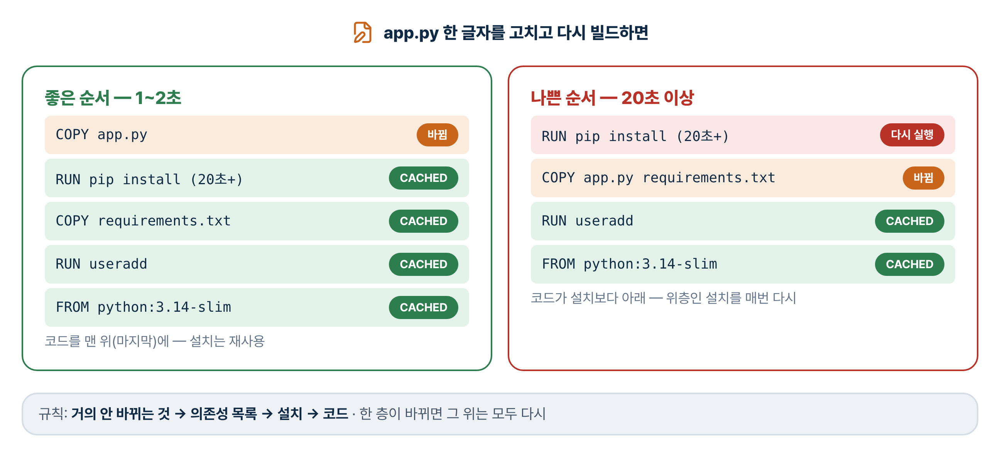

# 5교시 · 빌드 캐시와 명령 순서

!!! goal "이번 시간에 할 일"
    - 다시 빌드할 때 `CACHED`가 무엇을 뜻하는지 읽습니다.
    - 코드를 고치고 다시 빌드해 **바뀐 층부터만** 다시 만들어지는 것을 확인합니다.
    - 명령 순서를 잘못 쓰면 매번 라이브러리를 다시 설치하게 되는 것을 직접 비교합니다.
    - 캐시를 잘 쓰는 Dockerfile 작성 규칙을 정리합니다.

## 빌드 캐시의 규칙 — 한 층이 바뀌면 그 위는 모두 다시

Docker는 각 명령을 실행하기 전에 "**같은 명령을, 같은 재료로** 전에 만든 층이 있나?"를 확인합니다. 있으면 다시 만들지 않고 그 층을 **재사용**합니다(`CACHED`). 그런데 한 층이 바뀌면, 그 **위에 쌓인 층은 전부** 다시 만들어야 합니다. 아래층이 바뀌었으니 위층의 결과도 달라질 수 있기 때문입니다.



!!! analogy "비유 — 탑 쌓기 블록"
    블록 탑의 **가운데 블록**을 바꾸려면, 그 위의 블록을 모두 내렸다가 다시 올려야 합니다. 맨 위 블록만 바꾸는 것은 금방입니다. 그래서 **자주 바꿀 블록은 맨 위에** 둡니다. Dockerfile에서 가장 자주 바뀌는 것은 **내 코드(`app.py`)**, 가끔 바뀌는 것은 **라이브러리 목록**, 거의 안 바뀌는 것은 **베이스 이미지와 사용자 생성**입니다.

## 실습 9 · 캐시 관찰하기

!!! lab "실습 목표"
    아무것도 안 바꾸고 다시 빌드했을 때와, 코드만 고치고 빌드했을 때의 차이를 봅니다.

### 단계 1 — 그대로 다시 빌드

```bash
cd ~/devops-lab/devmart/catalog-api
docker build -t devmart/catalog-api:1.0.0 .
```

!!! check "이렇게 나오면 성공"
    ```text
    [+] Building 0.9s (11/11) FINISHED
     => [1/6] FROM docker.io/library/python:3.14-slim@sha256:…          0.0s
     => CACHED [2/6] WORKDIR /app                                       0.0s
     => CACHED [3/6] RUN useradd --create-home --uid 10001 appuser     0.0s
     => CACHED [4/6] COPY requirements.txt .                            0.0s
     => CACHED [5/6] RUN pip install --no-cache-dir -r requirements.txt 0.0s
     => CACHED [6/6] COPY app.py .                                      0.0s
    ```
    모든 단계가 **CACHED**, 1초도 안 걸립니다. 3교시 첫 빌드의 수십 초와 비교해 보세요.

### 단계 2 — 코드와 버전 고치기

VS Code에서 두 곳을 고칩니다.

1. `app.py`의 에코백 가격을 바꿉니다.

    ```python
        {"id": 3, "name": "에코백", "price": 9900},
    ```

2. `Dockerfile`의 버전을 올립니다.

    ```dockerfile
    ENV APP_VERSION=1.0.1
    ```

### 단계 3 — 새 태그로 빌드

```bash
docker build -t devmart/catalog-api:1.0.1 .
```

!!! check "이렇게 나오면 성공"
    ```text
    [+] Building 1.6s (11/11) FINISHED
     => CACHED [2/6] WORKDIR /app                                       0.0s
     => CACHED [3/6] RUN useradd --create-home --uid 10001 appuser     0.0s
     => CACHED [4/6] COPY requirements.txt .                            0.0s
     => CACHED [5/6] RUN pip install --no-cache-dir -r requirements.txt 0.0s
     => [6/6] COPY app.py .                                             0.1s
    ```
    **`[6/6] COPY app.py`만** 다시 만들었습니다. 오래 걸리는 `pip install`은 재사용했습니다. `ENV` 변경은 파일을 바꾸지 않으므로 목록에 나오지도 않습니다.

### 단계 4 — 새 버전 확인

```bash
docker run -d --name api -p 8000:8000 devmart/catalog-api:1.0.1
curl http://localhost:8000/api/info
curl http://localhost:8000/api/products
docker rm -f api
```

!!! check "이렇게 나오면 성공"
    ```text
    {…,"version":"1.0.1"}
    {"items":[…,{"id":3,"name":"에코백","price":9900}],"source":"sample"}
    ```
    `docker images devmart/catalog-api`를 보면 **1.0.0과 1.0.1 두 태그**가 모두 있습니다. 문제가 생기면 1.0.0으로 바로 되돌릴 수 있습니다(1주차 5일차 5교시의 "되돌리기").

## 실습 10 · 순서를 잘못 쓰면

!!! lab "실습 목표"
    코드를 라이브러리 설치보다 **먼저** 복사하는 Dockerfile을 만들어, 코드 한 줄만 고쳐도 `pip install`이 매번 다시 실행되는 것을 확인합니다.

### 단계 1 — 느린 Dockerfile

`Dockerfile.slow`를 만듭니다. 원래 Dockerfile과 **복사 순서만** 다릅니다.

```dockerfile
FROM python:3.14-slim
WORKDIR /app
RUN useradd --create-home --uid 10001 appuser
COPY app.py requirements.txt ./
RUN pip install --no-cache-dir -r requirements.txt
USER appuser
CMD ["gunicorn", "--bind", "0.0.0.0:8000", "app:app"]
```

### 단계 2 — 한 번 빌드해 캐시 만들기

```bash
docker build -f Dockerfile.slow -t devmart/catalog-api:slow .
```

### 단계 3 — 코드 한 글자 고치고 시간 재기

`app.py` 맨 위 설명 문장 끝에 공백 하나를 넣고 저장한 뒤:

```bash
time docker build -f Dockerfile.slow -t devmart/catalog-api:slow .
time docker build -t devmart/catalog-api:1.0.1 .
```

- `time 명령` : 그 명령에 걸린 시간을 잰다

!!! check "이렇게 나오면 성공"
    ```text
     => [4/5] COPY app.py requirements.txt ./                          0.0s
     => [5/5] RUN pip install --no-cache-dir -r requirements.txt     21.3s
    real    0m23.512s

     => CACHED [5/6] RUN pip install --no-cache-dir -r requirements.txt 0.0s
     => [6/6] COPY app.py .                                             0.1s
    real    0m1.402s
    ```
    공백 하나 때문에 느린 쪽은 **라이브러리를 처음부터 다시 설치**했습니다. `app.py`가 들어간 층이 바뀌었고, `pip install`이 그 **위에** 있었기 때문입니다. 원래 Dockerfile은 1~2초면 끝납니다. 숫자는 네트워크에 따라 다르지만, **10배 이상** 차이 나는 것이 보통입니다.

### 단계 4 — 정리

```bash
docker image rm devmart/catalog-api:slow
rm Dockerfile.slow
cd ~/devops-lab
git add devmart/catalog-api
git commit -m "3일차: catalog-api 1.0.1 — 에코백 가격 변경"
git push
```

## 캐시를 잘 쓰는 Dockerfile 규칙

| 규칙 | 이유 | 오늘의 예 |
|---|---|---|
| **거의 안 바뀌는 것을 위(앞)에** | 아래층 캐시가 오래 유지된다 | `FROM`, `useradd` |
| **의존성 목록을 코드보다 먼저** 복사·설치 | 코드만 고칠 때 설치를 건너뛴다 | `COPY requirements.txt` → `pip install` → `COPY app.py` |
| **필요한 파일만** 복사 | 관계없는 파일이 바뀌어도 캐시가 깨지지 않는다 | `COPY . .` 대신 `COPY app.py .` (+ `.dockerignore`) |
| 설치와 정리를 **한 `RUN`에** | 지운 파일이 아래층에 남지 않는다 | `RUN apt-get update && apt-get install -y … && rm -rf /var/lib/apt/lists/*` |
| 설치 캐시를 남기지 않기 | 이미지 크기 감소 | `pip install --no-cache-dir` |

이 규칙은 Python만이 아닙니다. Node.js는 `package.json`과 `package-lock.json`을 먼저 복사해 `npm ci`를 하고 코드를 나중에 복사하며, Java는 `pom.xml`을 먼저 복사해 의존성을 받습니다. **모양은 달라도 원리는 같습니다.**

!!! academic "학술 노트 — 바뀐 것만 다시 만든다 (Make, 1979)"
    "바뀐 부분만 다시 만든다"는 생각은 1976년 벨 연구소의 스튜어트 펠드먼(Stuart Feldman)이 만든 **Make**에서 시작되었습니다. 그는 1979년 논문 「Make — 컴퓨터 프로그램을 관리하는 프로그램」에서, 파일 사이의 **의존 관계**와 **수정 시각**을 비교해 꼭 필요한 부분만 다시 컴파일하는 방법을 제시했습니다. 펠드먼은 이 공로로 2003년 ACM 소프트웨어 시스템상을 받았습니다.

    Docker의 빌드 캐시는 같은 생각을 이미지에 적용한 것이고, 수정 시각 대신 **명령 문자열과 파일 내용의 해시**를 비교합니다(1일차 Git과 1교시 레이어의 **내용 주소 지정**). 마이크로소프트 연구진(Mokhov, Mitchell & Peyton Jones, 2018)은 「Build Systems à la Carte」에서 Make부터 Bazel까지 여러 빌드 시스템을 "무엇을 다시 만들지 어떻게 결정하는가"라는 하나의 틀로 정리했는데, Docker 빌드 캐시도 그 틀로 설명할 수 있습니다.

    - Feldman, S. I. (1979). Make — A program for maintaining computer programs. *Software: Practice and Experience*, 9(4).
    - Mokhov, A., Mitchell, N., & Peyton Jones, S. (2018). Build systems à la carte. *Proc. ACM Program. Lang.*, 2(ICFP).

!!! trend "트렌드 — 캐시를 팀이 함께 쓴다"
    빌드 캐시는 기본적으로 **내 노트북 안에만** 있습니다. 그래서 동료가 같은 이미지를 빌드하거나, 3주차에 배울 CI 서버가 빌드할 때는 처음부터 다시 만들어야 합니다. 이를 해결하려고 **캐시를 레지스트리나 원격 저장소에 올려 두고 함께 쓰는** 방식이 널리 쓰입니다(`--cache-to`, `--cache-from`, GitHub Actions 캐시, Docker Build Cloud 같은 원격 빌더). 빌드 시간은 곧 개발자가 기다리는 시간이고 CI 비용이므로, 큰 조직에서는 캐시 적중률을 **지표로 관리**하기도 합니다. 1주차 1일차의 FinOps가 빌드에도 적용되는 셈입니다.

## 정리

- 같은 명령, 같은 재료면 **CACHED**로 재사용한다. 한 층이 바뀌면 **그 위는 모두** 다시 만든다.
- **자주 바뀌는 것은 아래(뒤)에**: 베이스 → 사용자 → 의존성 목록 → 설치 → 코드.
- 순서 하나로 빌드 시간이 **10배 이상** 차이 난다.
- 새 버전은 **새 태그**(1.0.1)로 만들어 옛 태그(1.0.0)로 되돌릴 수 있게 한다.

!!! quiz "확인 문제"
    1. 빌드 출력의 `CACHED`는 무슨 뜻인가요?
    2. `app.py`만 고쳤을 때 원래 Dockerfile에서 다시 실행된 단계는?
    3. `Dockerfile.slow`에서 공백 하나만 고쳐도 `pip install`이 다시 실행된 이유는?
    4. Node.js 프로젝트에서 캐시를 잘 쓰려면 무엇을 먼저 복사해야 할까요?
    5. 새 버전을 기존 태그(1.0.0)에 덮어쓰지 않고 1.0.1로 만드는 이유는?

    ??? answer "정답"
        1. 전에 같은 명령·같은 재료로 만든 층이 있어 다시 만들지 않고 재사용했다
        2. `[6/6] COPY app.py .`
        3. `app.py`를 복사하는 층이 `pip install`보다 아래에 있어서, 그 층이 바뀌면 위층인 설치도 다시 해야 하기 때문
        4. `package.json`과 `package-lock.json` (의존성 목록)
        5. 문제가 생기면 옛 버전으로 바로 되돌릴 수 있도록

## 참고 문헌

- Docker Docs. *Docker build cache*, *Optimize cache usage in builds*. docs.docker.com/build/cache
- Docker Docs. *Building best practices*. docs.docker.com/build/building/best-practices
- Feldman, S. I. (1979). Make — A program for maintaining computer programs. *Software: Practice and Experience*, 9(4).
- Mokhov, A., Mitchell, N., & Peyton Jones, S. (2018). Build systems à la carte. *PACMPL*, 2(ICFP).
