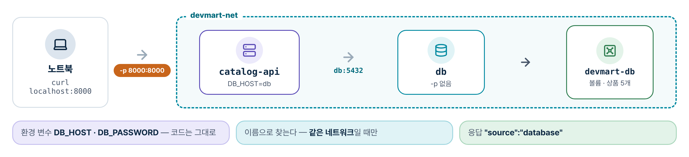
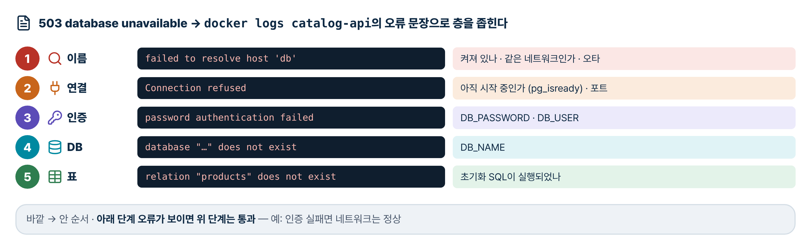

# 5교시 · API와 DB 연결하기

!!! goal "이번 시간에 할 일"
    - 상품 API를 `devmart-net`에 띄우고 `DB_HOST=db`로 DB에 연결합니다.
    - 응답이 `"source":"sample"`에서 **`"source":"database"`**로 바뀌는 것을 확인합니다.
    - 연결이 끊기는 **세 가지 고장**을 일부러 만들고, 로그로 원인을 찾습니다.
    - 연결 문제를 진단하는 순서를 익힙니다.

## API는 어떻게 DB를 찾나

어제 2교시에 본 `app.py`를 다시 떠올려 봅시다. API는 환경 변수를 읽어 DB에 접속합니다.

| 환경 변수 | 기본값 | 오늘 넣을 값 |
|---|---|---|
| `DB_HOST` | (없음 → 샘플 데이터) | **`db`** (컨테이너 이름) |
| `DB_PORT` | `5432` | 그대로 |
| `DB_NAME` | `devmart` | 그대로 |
| `DB_USER` | `devmart` | 그대로 |
| `DB_PASSWORD` | (없음) | `devmart-pw` (6교시에 더 안전한 방법으로) |

`DB_HOST`가 비어 있으면 샘플을 주고, 값이 있으면 그 주소의 PostgreSQL에서 상품을 읽습니다. **코드는 한 줄도 바꾸지 않고 환경 변수만 바꿔** 동작을 바꾸는 것, 어제 3교시의 "이미지는 한 번, 설정은 환경마다"입니다.



## 실습 8 · API를 DB에 연결

!!! lab "실습 목표"
    상품 API를 DB와 같은 네트워크에 띄워 진짜 DB의 상품 5개를 받아 옵니다.

### 단계 1 — DB가 살아 있는지 확인

```bash
docker ps --format 'table {{.Names}}\t{{.Status}}\t{{.Networks}}'
```

!!! check "이렇게 나오면 준비 완료"
    ```text
    NAMES     STATUS          NETWORKS
    db        Up 25 minutes   bridge,devmart-net
    ```
    `db`가 `devmart-net`에 들어 있어야 합니다. 없다면 4교시 실습 7의 단계 2(`docker network connect devmart-net db`)를 합니다.

### 단계 2 — API 실행

```bash
docker run -d --name catalog-api \
  --network devmart-net \
  -p 8000:8000 \
  -e APP_ENV=docker \
  -e DB_HOST=db \
  -e DB_PASSWORD=devmart-pw \
  devmart/catalog-api:1.0.1
```

- `--network devmart-net` : DB와 같은 네트워크 → 이름 `db`로 찾을 수 있다
- `-p 8000:8000` : 노트북에서 `curl`로 확인하려고 연다 (7교시에는 웹을 통해서만 들어오게 바꾼다)
- 컨테이너 이름 `catalog-api` : 7교시에 nginx가 이 이름으로 API를 찾는다

### 단계 3 — 확인

```bash
curl http://localhost:8000/api/info
curl http://localhost:8000/api/products
```

!!! check "이렇게 나오면 성공"
    ```text
    {"database":"configured","env":"docker","hostname":"b208ab1f4aaf","service":"catalog-api","version":"1.0.1"}
    {"items":[{"id":1,"name":"러닝화","price":59000},{"id":2,"name":"후드 집업","price":45000},{"id":3,"name":"에코백","price":12000},{"id":4,"name":"텀블러","price":18000},{"id":5,"name":"무선 이어폰","price":89000}],"source":"database"}
    ```
    **`"source":"database"`**, 상품이 **5개**입니다. 텀블러와 무선 이어폰은 코드에 없고 **DB에만** 있는 상품입니다. 에코백 가격도 코드의 9,900원이 아니라 DB의 12,000원입니다. 이제 API는 진짜 DB와 대화하고 있습니다.

### 단계 4 — DB를 고치면 API가 바로 따라온다

```bash
docker exec db psql -U devmart -d devmart -c "UPDATE products SET price=9900 WHERE name='에코백';"
curl -s http://localhost:8000/api/products
```

!!! check "이렇게 나오면 성공"
    에코백 가격이 `9900`으로 바뀌어 나옵니다. 어제는 가격 하나 바꾸려고 코드를 고치고 이미지를 다시 빌드(1.0.1)했지요. 이제 가격은 **데이터**이므로 DB만 고치면 됩니다. 코드와 데이터를 나누는 것도 좋은 설계의 기본입니다.

## 실습 9 · 일부러 고장 내고 진단하기

!!! lab "실습 목표"
    API ↔ DB 연결에서 가장 흔한 고장 세 가지를 만들고, **증상은 같아도 원인이 다르다**는 것을 로그로 구분합니다.

세 고장 모두 `curl` 결과는 똑같이 나옵니다.

```text
{"detail":"OperationalError","error":"database unavailable"}
```

HTTP 상태 코드는 **503**(서비스를 쓸 수 없음)입니다. 이 응답만으로는 원인을 알 수 없습니다. 답은 **API의 로그**에 있습니다.

### 고장 1 — DB가 꺼졌다

```bash
docker stop db
curl -s -w '  (HTTP %{http_code})\n' http://localhost:8000/api/products
docker logs catalog-api --tail 2
```

- `-w '(HTTP %{http_code})'` : 응답 뒤에 HTTP 상태 코드를 붙여 보여 달라는 `curl` 옵션

!!! check "보이는 것"
    ```text
    {"detail":"OperationalError","error":"database unavailable"}  (HTTP 503)
    [2026-11-26 …] ERROR in app: DB 조회 실패: failed to resolve host 'db': [Errno -2] Name or service not known
    ```
    `failed to resolve host 'db'` — **`db`라는 이름을 찾을 수 없다**는 뜻입니다. 꺼진 컨테이너는 네트워크에서 빠지므로 DNS에도 이름이 사라집니다.

DB를 다시 켜면 API는 **알아서 회복**합니다. API를 다시 시작할 필요가 없습니다.

```bash
docker start db
docker exec db pg_isready -U devmart
curl -s http://localhost:8000/api/products | head -c 60; echo
```

### 고장 2 — 비밀번호가 틀렸다

```bash
docker run -d --name api-wrongpw --network devmart-net -p 8002:8000 \
  -e DB_HOST=db -e DB_PASSWORD=wrong-password devmart/catalog-api:1.0.1
curl -s http://localhost:8002/api/products; echo
docker logs api-wrongpw 2>&1 | grep ERROR
```

!!! check "보이는 것"
    ```text
    {"detail":"OperationalError","error":"database unavailable"}
    … ERROR in app: DB 조회 실패: connection failed: connection to server at "172.18.0.2", port 5432 failed: FATAL:  password authentication failed for user "devmart"
    ```
    이번에는 `db`를 **찾았고**(IP `172.18.0.2`가 보임) **접속까지 했지만**, `password authentication failed` — 비밀번호가 틀려 DB가 거절했습니다.

### 고장 3 — 다른 네트워크에 띄웠다

`--network`를 빼먹는 것은 가장 흔한 실수입니다.

```bash
docker run -d --name api-nonet -p 8003:8000 \
  -e DB_HOST=db -e DB_PASSWORD=devmart-pw devmart/catalog-api:1.0.1
curl -s http://localhost:8003/api/products; echo
docker logs api-nonet 2>&1 | grep ERROR
```

!!! check "보이는 것"
    ```text
    … ERROR in app: DB 조회 실패: failed to resolve host 'db': [Errno -2] Name or service not known
    ```
    고장 1과 **같은 메시지**입니다. `api-nonet`은 기본 `bridge`에 있어서 `db`라는 이름을 모릅니다. 메시지가 같으므로 **"DB가 꺼졌나? 아니면 내가 다른 네트워크에 있나?"** 둘 다 확인해야 합니다.

!!! cleanup "정리"
    ```bash
    docker rm -f api-wrongpw api-nonet
    ```
    `catalog-api`와 `db`는 7교시까지 계속 씁니다. 지우지 마세요.

## 연결 문제 진단 순서



| 로그에 보이는 말 | 뜻 | 확인할 것 |
|---|---|---|
| `failed to resolve host 'db'` | 이름을 못 찾음 | ① DB가 켜져 있나 `docker ps` ② 같은 네트워크인가 `docker network inspect devmart-net` ③ 이름 오타 |
| `Connection refused` | 찾았지만 문이 닫힘 | DB가 아직 시작 중인가 `pg_isready` / 포트 번호가 맞나 |
| `password authentication failed` | 문은 열렸지만 거절 | `DB_PASSWORD`·`DB_USER` 값 |
| `database "…" does not exist` | 접속했지만 DB가 없음 | `DB_NAME` / 초기화가 되었나 |
| `relation "products" does not exist` | DB는 있지만 표가 없음 | 초기화 SQL이 실행되었나 (2교시) |

!!! tip "위에서 아래로 — 네트워크 층부터"
    표는 **바깥에서 안으로** 순서입니다. 이름 → 연결 → 인증 → DB → 표. 2일차 7교시의 "이미지 → 상태 → 로그 → 포트 → 안" 디버깅 순서처럼 바깥 층부터 좁혀 가는 생각입니다. 아래 단계의 오류가 보인다면 위 단계는 이미 통과했다는 뜻이니 범위가 확 줄어듭니다. 예를 들어 `password authentication failed`가 보이면 **네트워크는 문제가 아닙니다.**

!!! academic "학술 노트 — '네트워크는 믿을 수 있다'는 착각"
    1994년 썬 마이크로시스템즈의 피터 도이치(L. Peter Deutsch)는 분산 시스템을 처음 만드는 개발자들이 흔히 빠지는 잘못된 가정들을 목록으로 정리했습니다. 나중에 제임스 고슬링(James Gosling)이 하나를 더해 **「분산 컴퓨팅의 8가지 오류(Fallacies of Distributed Computing)」**로 알려졌습니다. 첫 번째가 **"네트워크는 믿을 수 있다"**, 그 밖에 "지연 시간은 0이다", "구성(topology)은 바뀌지 않는다" 등이 있습니다.

    오늘 실습은 이 오류들을 작게 체험한 것입니다. DB가 잠시 꺼지거나(고장 1) 다시 떠서 IP가 바뀌는 것(4교시)은 **예외가 아니라 일상**입니다. 그래서 잘 만든 서비스는 ① 연결이 안 될 때 **죽지 않고 의미 있는 오류(503)**를 돌려주고 ② 로그에 **원인을 남기며** ③ 상대가 돌아오면 **스스로 회복**합니다. 우리 API가 세 가지를 모두 했습니다. 하나의 앱을 여러 서비스로 나누는 MSA(4주차)에서는 이런 연결이 수십 개로 늘어나므로, 재시도·타임아웃·서킷 브레이커 같은 기법을 Istio와 함께 배웁니다.

    - Rotem-Gal-Oz, A. (2006). *Fallacies of Distributed Computing Explained* (Deutsch의 목록 해설).

!!! trend "트렌드 — '준비되었는가'를 묻는 헬스 체크"
    고장 1에서 DB를 켠 직후 바로 요청하면 잠깐 실패할 수 있습니다. 컨테이너가 **켜진 것(running)**과 **일할 준비가 된 것(ready)**은 다르기 때문입니다. 그래서 요즘 배포 도구들은 "준비되었나?"를 주기적으로 묻는 **헬스 체크**를 기본으로 씁니다. 오늘 손으로 친 `pg_isready`를 내일 Compose의 `healthcheck`가 자동으로 해 주고, 3주차 Kubernetes에서는 **readiness probe**가 우리 API의 `/health`를 두드려 준비된 컨테이너에만 손님을 보냅니다.

## 정리

- API에 `--network devmart-net` + `DB_HOST=db`를 주면 **`"source":"database"`**.
- 가격은 이제 **데이터** — 코드를 다시 빌드하지 않고 DB만 고친다.
- 503 응답만으로는 원인을 모른다 → **API 로그**를 본다.
- 오류 문장으로 층을 나눈다: 이름(resolve) → 연결(refused) → 인증(password) → DB → 표.
- 잘 만든 서비스는 의존 대상이 꺼져도 죽지 않고, 돌아오면 스스로 회복한다.

!!! quiz "확인 문제"
    1. API의 응답에서 DB에 연결되었는지 알 수 있는 부분은?
    2. 로그에 `failed to resolve host 'db'`가 보입니다. 가능한 원인 두 가지는?
    3. 로그에 `password authentication failed`가 보이면 네트워크 설정을 확인해야 하나요?
    4. DB를 껐다 켠 뒤 API 컨테이너를 다시 시작해야 하나요?

    ??? answer "정답"
        1. `"source":"database"` (그리고 상품이 5개)
        2. DB 컨테이너가 꺼져 있다 / API가 DB와 다른 네트워크에 있다 (또는 이름 오타)
        3. 아니다. 이름을 찾고 접속까지 했으므로 네트워크는 정상이다. 비밀번호·사용자 값을 확인한다
        4. 아니다. 우리 API는 요청마다 다시 접속하므로 DB가 돌아오면 스스로 회복한다

## 참고 문헌

- Docker Docs. *Networking — Container networking, Connect a container to a network*. docs.docker.com/engine/network
- PostgreSQL Docs. *pg_isready*. postgresql.org/docs/18/app-pg-isready.html
- Rotem-Gal-Oz, A. (2006). *Fallacies of Distributed Computing Explained*.
- Kubernetes Docs. *Configure Liveness, Readiness and Startup Probes*. kubernetes.io/docs/tasks/configure-pod-container
