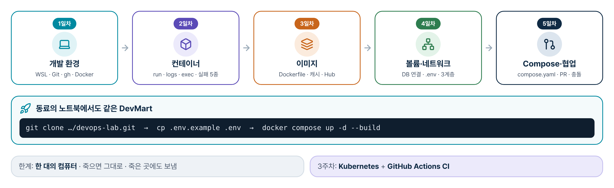

# 8교시 · 2주차 회고와 정리

!!! goal "이번 시간에 할 일"
    - 2주차 5일 동안 만든 것을 한 장으로 돌아봅니다.
    - 스스로 할 수 있는 것을 점검표로 확인합니다.
    - **KPT** 방식으로 2주차를 회고하고 저장소에 남깁니다.
    - 노트북의 Docker 디스크를 정리하고 3주차를 준비합니다.
    - 배움일기는 수업 뒤에 씁니다(맨 아래 질문).

## 2주차에 만든 것



| 일차 | 주제 | 남은 것 |
|---|---|---|
| 1일차 | 개발 환경 · Git · GitHub · Docker 설치 | `devops-lab` 저장소, `check-env.sh` |
| 2일차 | 컨테이너 실행과 관찰 · 자원 제한 | `troubleshooting.md` — 실패 5종, 안전한 실행 옵션 |
| 3일차 | 이미지와 Dockerfile · 취약점 스캔 | `catalog-api` 이미지, Docker Hub의 내 이미지, SBOM |
| 4일차 | 볼륨 · 네트워크 · 환경 변수 · 백업 | DB 연결, `.env`, 3계층 스크립트, 백업 스크립트 |
| 5일차 | Compose · 브랜치 · PR · 충돌 · 환경별 설정 | `compose.yaml` + 덧씌우기 파일, PR 기록 |

1주차 4일차의 문장을 다시 읽어 봅니다. **"Docker는 애플리케이션과 그 실행 조건을 이미지 하나로 포장해서, 어디서든 똑같이 실행되게 해 주는 도구"**. 2주차에 우리는 그 말을 손으로 확인했습니다. 내 노트북에 파이썬이 없어도 파이썬 API가 돌고, 동료는 `git clone` + `.env` + `docker compose up` 세 단계로 같은 DevMart를 띄울 수 있습니다.

## 실습 18 · 동료의 DevMart를 내 노트북에서

!!! lab "실습 목표"
    2주차의 결론을 확인합니다. 짝의 저장소를 받아서, **짝의 노트북과 똑같이** 실행되는지 봅니다.

```bash
cd ~
git clone https://github.com/짝아이디/devops-lab.git partner-lab
cd partner-lab/devmart
cp .env.example .env
code .env                               # DB_PASSWORD=아무-실습용-값
cd ~/devops-lab/devmart && docker compose down && cd ~/partner-lab/devmart
docker compose up -d --build
```

- 내 DevMart를 먼저 `down` 하는 이유: 둘 다 노트북의 8080번을 쓰려고 하기 때문 (2일차 포트 충돌)
- 짝의 `.env`는 저장소에 **없습니다**(`.gitignore`). 그래서 `.env.example`을 보고 내가 만듭니다. 비밀번호는 내 마음대로 정해도 됩니다. 새 볼륨이 그 값으로 초기화되기 때문입니다(어제 6교시).

!!! check "이렇게 보이면 성공"
    브라우저 http://localhost:8080 에 **짝의** DevMart가 뜹니다. 제목(`DevMart 🛒 — 겨울 세일`), 짝이 추가한 상품(목도리 등), `/api/info`의 `"owner":"짝아이디"`가 보입니다. 내 노트북에서 짝의 코드를 **설명서 없이** 실행했습니다.

!!! trouble "막혔다면"
    | 증상 | 확인 |
    |---|---|
    | `required variable DB_PASSWORD is missing a value` | `.env`를 `compose.yaml`과 같은 폴더에 만들었나 |
    | `Bind for 0.0.0.0:8080 failed: port is already allocated` | 내 DevMart가 아직 떠 있다 → 내 폴더에서 `docker compose down` |
    | 짝의 저장소에 `compose.yaml`이 없다 | 짝이 3교시 커밋을 push하지 않았다 → 짝에게 알려 주기 (이것도 협업!) |

```bash
docker compose down -v                  # 짝의 DevMart는 데이터까지 정리
cd ~ && rm -rf partner-lab
```

## 스스로 점검표

아래를 **설명서 없이** 할 수 있는지 체크해 봅니다. 안 되는 것은 해당 일차 자료로 돌아가 다시 해 봅니다.

| | 할 수 있다 | 자료 |
|---|---|---|
| ☐ | 새 폴더를 Git 저장소로 만들고 GitHub에 올린다 | 1일차 5교시 |
| ☐ | 컨테이너를 띄우고 `logs` · `exec` · `inspect`로 들여다본다 | 2일차 5교시 |
| ☐ | "포트 충돌", "이미지 이름 오타", "`127.0.0.1` 바인딩"을 에러만 보고 구분한다 | 2일차 7교시 |
| ☐ | Dockerfile을 캐시가 잘 되는 순서로 쓴다 | 3일차 5교시 |
| ☐ | `.dockerignore`와 `.gitignore`가 각각 무엇을 막는지 설명한다 | 3일차 4교시 |
| ☐ | DB를 볼륨에 두고, 지워도 데이터가 남는 것을 보여 준다 | 4일차 2교시 |
| ☐ | 컨테이너끼리 이름으로 찾게 만들고, `-p`와의 차이를 설명한다 | 4일차 4교시 |
| ☐ | 503 응답을 로그로 "이름 / 인증 / 표" 문제로 구분한다 | 4일차 5교시 |
| ☐ | `compose.yaml`을 읽고 서비스 하나를 추가하거나 고친다 | 5일차 1~3교시 |
| ☐ | 브랜치 → PR → 리뷰 → 병합을 한다 | 5일차 5교시 |
| ☐ | 충돌 표시를 읽고 해결한다 | 5일차 6교시 |

## 실습 19 · KPT 회고

!!! lab "실습 목표"
    2주차를 **KPT**로 돌아보고 저장소에 기록합니다. 1주차 5일차 5교시에 배운 **비난 없는 회고**를 직접 해 봅니다.

| | 질문 | 예 |
|---|---|---|
| **K**eep | 잘된 것, 계속할 것 | "에러가 나면 로그부터 보는 습관이 생겼다" |
| **P**roblem | 아쉬운 것, 막혔던 것 | "YAML 들여쓰기로 20분을 썼다" |
| **T**ry | 다음 주에 해 볼 것 (**구체적으로**) | "커밋 전에 `docker compose config --quiet`부터 돌린다" |

### 단계 1 — 혼자 쓰기 (10분)

```bash
cd ~/devops-lab
mkdir -p retro
code retro/week2.md
```

```markdown
# 2주차 회고 (KPT)

## Keep
-

## Problem
-

## Try
-
```

각 칸에 2~3개씩 씁니다. **Problem은 사람이 아니라 상황과 과정**으로 씁니다("짝이 늦게 리뷰했다" ✗ → "리뷰 요청을 언제 확인할지 정하지 않았다" ○).

### 단계 2 — 조별 공유 (15분)

조원끼리 돌아가며 읽고, 가장 많이 나온 Problem 하나를 골라 **함께 Try**를 정합니다. 강사는 조별 Try를 모아 3주차 진행에 반영합니다.

### 단계 3 — PR로 올리기

배운 것을 그대로 씁니다.

```bash
git switch -c retro/week2
git add retro/week2.md
git commit -m "2주차 KPT 회고"
git push -u origin retro/week2
gh pr create --title "2주차 회고" --body "KPT 회고입니다. 의견 환영합니다." --reviewer 짝아이디
```

짝이 코멘트를 하나 남기고 승인하면 병합합니다(`gh pr merge --squash --delete-branch`).

!!! academic "학술 노트 — 회고의 '최우선 지침' (Kerth, 2001)"
    노먼 커스(Norman L. Kerth)는 『프로젝트 회고(Project Retrospectives)』(2001)에서 회고를 시작할 때 모두가 함께 읽는 문장을 제안했습니다. 오늘날 **회고의 최우선 지침(Prime Directive)**으로 널리 쓰입니다. 요지는 이렇습니다. **"무엇을 발견하든, 우리는 모두가 그때 알고 있던 것, 가진 기술과 능력, 쓸 수 있던 자원, 처한 상황 안에서 최선을 다했다고 이해하고 진심으로 믿는다."**

    이 문장의 목적은 사람을 탓하는 대신 **과정과 환경**을 보게 하는 것입니다. 사람을 탓하면 다음부터 모두 문제를 숨기고, 숨긴 문제는 고칠 수 없습니다. 1주차 5일차의 구글 **아리스토텔레스 프로젝트**가 찾은 "심리적 안전감"이 회고에서 지켜져야 하는 이유입니다. 에스더 더비(Esther Derby)와 다이애나 라센(Diana Larsen)의 『애자일 회고』(2006)는 이를 실천하는 단계(분위기 만들기 → 자료 모으기 → 통찰 → 실행 결정 → 마무리)로 정리했고, KPT는 그중 가장 가벼운 형식입니다.

    - Kerth, N. L. (2001). *Project Retrospectives: A Handbook for Team Reviews*. Dorset House.
    - Derby, E., & Larsen, D. (2006). *Agile Retrospectives: Making Good Teams Great*. Pragmatic Bookshelf.

!!! trend "트렌드 — 느낌과 숫자를 함께 보는 회고"
    요즘 팀 회고에는 "어땠나요?"라는 느낌과 함께 **숫자**를 가져옵니다. 1주차 1일차에 본 DORA의 지표 — **배포 빈도, 변경 리드 타임, 변경 실패율, 장애 복구 시간** — 를 스프린트마다 보고, "이번에 리드 타임이 길어진 이유"를 회고에서 이야기하는 식입니다. 이 과정에서도 PR이 열린 시간부터 병합까지의 시간, 리뷰 대기 시간 같은 것을 GitHub 기록에서 바로 볼 수 있습니다. 3주차에 CI를 만들면 "빌드 실패율"이라는 숫자가 하나 더 생깁니다.

## 정리 — 노트북 비우기

2주차 동안 이미지와 볼륨이 꽤 쌓였습니다. 무엇이 디스크를 쓰는지 먼저 봅니다.

```bash
docker system df
```

!!! check "보이는 것 (예)"
    ```text
    TYPE            TOTAL     ACTIVE    SIZE      RECLAIMABLE
    Images          14        3         3.1GB     2.0GB (64%)
    Containers      3         3         1.2MB     0B (0%)
    Local Volumes   3         1         180MB     95MB (52%)
    Build Cache     41        0         820MB     820MB
    ```
    `RECLAIMABLE`(되찾을 수 있는 공간)이 지금 아무도 쓰지 않는 것입니다.

!!! cleanup "정리"
    ```bash
    cd ~/devops-lab/devmart
    docker compose down                    # 컨테이너·네트워크 (데이터는 남김)
    docker volume rm devmart-db            # 4일차에 손으로 만든 볼륨 (이제 안 씀)
    docker image rm hello-go:single        # 3일차 비교용 1GB 이미지
    docker image prune                     # 이름표 없는 이미지(<none>) 정리
    docker builder prune                   # 빌드 캐시 정리 (다음 빌드는 조금 느려진다)
    docker system df
    ```
    각 `prune`은 `[y/N]`으로 묻습니다. **남겨 둘 것**: `devmart/catalog-api` 이미지들, `postgres:18`, `nginx:1.30-alpine`, Compose의 `devmart_db-data` 볼륨. 3주차에 다시 씁니다.

!!! warn "`docker system prune -a --volumes`는 쓰지 않는다"
    인터넷에 "Docker 용량 한 번에 정리"로 자주 나오는 명령입니다. **쓰지 않는 모든 이미지와 모든 볼륨**을 지웁니다. 지금 멈춰 둔 DevMart의 DB 데이터도 함께 사라집니다. 무엇이 지워지는지 알고 쓰는 명령만 씁니다.

짝 실습이 끝났으면 **Settings → Collaborators**에서 짝을 빼도 됩니다. (3주차에 다시 짝 실습을 할 예정이면 그대로 둡니다.)

## 3주차 예고

2주차의 끝에서 Compose의 한계를 보았습니다. **한 대의 컴퓨터**, **죽으면 다시 띄워 주지 않음**, **살아 있는 것에만 보내지 못함**. 3주차는 이 문제를 푸는 **Kubernetes**와, PR마다 자동으로 테스트하고 이미지를 만드는 **GitHub Actions CI**를 배웁니다.

| 2주차 (Compose) | 3주차 (Kubernetes) |
|---|---|
| 서비스 `catalog-api` | **Deployment** + **Service** |
| `--scale catalog-api=3` | `replicas: 3` — 죽으면 자동으로 다시 |
| `environment:` / `.env` | **ConfigMap** / **Secret** |
| 볼륨 `db-data` | **PersistentVolumeClaim** |
| `healthcheck` | **readiness / liveness probe** |
| nginx 프록시 | **Ingress** |
| PR을 사람이 리뷰 | PR을 사람 + **CI**가 리뷰 |

오늘 만든 `catalog-api` 이미지와 `compose.yaml`의 구조가 그대로 출발점이 됩니다.

!!! diary "오늘의 배움일기 (그리고 2주차 배움일기)"
    - `compose.yaml`의 한 서비스를 골라, 그것이 어제의 어떤 `docker run` 옵션이었는지 줄마다 연결해 보기
    - 명령형과 선언형의 차이를 '택시 기사' 비유 말고 **내 비유**로 설명해 보기
    - 짝의 PR에 남긴 코멘트와 받은 코멘트 중 가장 기억에 남는 것
    - 충돌을 풀 때 "양쪽 의도"를 어떻게 확인했는지
    - 2주차 첫날의 나와 지금의 나 — 할 수 있게 된 것 세 가지
    - 3주차 Kubernetes에서 가장 궁금한 것

## 참고 문헌

- Docker Docs. *docker system df / prune*. docs.docker.com/reference/cli/docker/system
- Kerth, N. L. (2001). *Project Retrospectives*. Dorset House.
- Derby, E., & Larsen, D. (2006). *Agile Retrospectives*. Pragmatic Bookshelf.
- DORA. *DORA's software delivery performance metrics*. dora.dev/guides/dora-metrics
