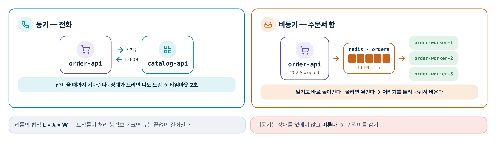

# 6교시 · 동기와 비동기 — 큐와 처리기

!!! goal "이번 시간에 할 일"
    - **동기 호출**과 **비동기(큐) 처리**의 차이를 그림과 실험으로 이해합니다.
    - 처리 시간을 늘려 큐에 일이 **쌓이는 것**을 봅니다.
    - 처리기(`order-worker`)를 **3개로 늘려** 쌓인 일을 빨리 비웁니다.
    - 각 방식이 언제 맞는지 정리합니다.

## 두 가지 대화 방식

DevMart의 주문 흐름에는 두 가지 대화 방식이 섞여 있습니다.



| | 동기(synchronous) | 비동기(asynchronous) |
|---|---|---|
| DevMart의 예 | `order-api` → `catalog-api` (가격 묻기) | `order-api` → 큐 → `order-worker` (주문 처리) |
| 방식 | 묻고, **답이 올 때까지 기다린다** | 일을 **맡기고 바로 돌아간다** |
| 상대가 느리면 | 나도 느려진다 | 나는 영향 없다. 일이 큐에 쌓일 뿐 |
| 상대가 죽으면 | 나도 실패한다 (503) | 일이 큐에서 기다린다. 상대가 돌아오면 처리 |
| 답이 바로 필요한가 | 예 — 가격을 알아야 금액을 계산 | 아니요 — 처리 결과는 나중에 봐도 된다 |
| HTTP 응답 | 200 OK (결과 포함) | **202 Accepted** (접수만 됨) |

!!! analogy "비유 — 전화와 주문서 함"
    **동기 호출은 전화**입니다. "에코백 얼마예요?" 하고 상대가 답할 때까지 수화기를 들고 기다립니다. 상대가 통화 중이면 나도 아무것도 못 합니다. **비동기 처리는 주방의 주문서 함**입니다. 홀 직원은 주문서를 함에 넣고 바로 다음 손님을 받습니다. 요리사는 함에서 주문서를 하나씩 꺼내 요리합니다. 손님이 몰리면 주문서가 **쌓이지만**, 홀은 계속 돌아가고, 요리사를 더 부르면 쌓인 주문서가 빨리 줄어듭니다.

## 실습 5 · 큐에 일이 쌓이는 것 보기

!!! lab "실습 목표"
    처리기가 주문 하나에 5초씩 걸리게 바꾸고, 주문 6개를 한꺼번에 넣어 큐가 쌓이는 모습을 봅니다.

### 단계 1 — 처리 시간을 5초로

`compose.yaml`의 `order-worker` → `environment`에서 한 줄을 바꿉니다.

```yaml
      WORK_SECONDS: "5"
```

```bash
docker compose up -d order-worker
```

2주차 5일차 3교시에서 배운 대로, 환경 변수만 바꿨으니 `--build` 없이 `up -d`면 그 서비스만 다시 만들어집니다.

### 단계 2 — 주문 6개를 한꺼번에

```bash
for i in 1 2 3 4 5 6; do
  curl -s -o /dev/null -w "주문 $i → %{http_code} (%{time_total}초)\n" \
    -X POST http://localhost:8080/api/orders \
    -H 'Content-Type: application/json' -d '{"product_id": 4}'
done
```

- `for i in 1 2 3 4 5 6; do … done` : 안쪽 명령을 여섯 번 반복
- `-w "… %{http_code} (%{time_total}초)"` : 상태 코드와 걸린 시간만 보여 준다

!!! check "보이는 것"
    ```text
    주문 1 → 202 (0.031초)
    주문 2 → 202 (0.024초)
    주문 3 → 202 (0.022초)
    주문 4 → 202 (0.023초)
    주문 5 → 202 (0.021초)
    주문 6 → 202 (0.022초)
    ```
    처리에 5초씩 걸리는데도 **응답은 0.02초**입니다. `order-api`는 큐에 넣고 바로 돌아가기 때문입니다.

### 단계 3 — 쌓인 일 보기

```bash
docker compose exec redis redis-cli LLEN orders
```

- `redis-cli` : Redis에 명령을 보내는 도구 (컨테이너 안에 들어 있다)
- `LLEN orders` : `orders`라는 목록(큐)의 **길이**

!!! check "보이는 것"
    ```text
    (integer) 5
    ```
    6개 중 1개는 처리기가 이미 꺼내 처리 중이고, **5개가 줄 서 있습니다.** 브라우저의 주문 표에서도 pending이 하나씩 completed로 바뀌는 데 5초씩 걸립니다. 다 비우려면 약 30초가 걸립니다.

## 실습 6 · 처리기를 3개로

```bash
for i in 1 2 3 4 5 6; do
  curl -s -o /dev/null -X POST http://localhost:8080/api/orders \
    -H 'Content-Type: application/json' -d '{"product_id": 4}'
done
docker compose up -d --scale order-worker=3
docker compose ps order-worker
```

!!! check "보이는 것"
    ```text
    NAME                         SERVICE        STATUS
    devmart-msa-order-worker-1   order-worker   Up 2 minutes
    devmart-msa-order-worker-2   order-worker   Up 3 seconds
    devmart-msa-order-worker-3   order-worker   Up 3 seconds
    ```

10초쯤 기다린 뒤 누가 처리했는지 봅니다.

```bash
docker compose exec redis redis-cli LLEN orders
docker compose exec db psql -U devmart -d orders \
  -c "SELECT id, status, processed_by FROM orders ORDER BY id DESC LIMIT 6;"
```

!!! check "이렇게 나오면 성공"
    ```text
    (integer) 0
     id |  status   | processed_by
    ----+-----------+--------------
     20 | completed | a17ede6a43f2
     19 | completed | d190f9334617
     18 | completed | ae83c2f545d3
     17 | completed | a17ede6a43f2
     16 | completed | d190f9334617
     15 | completed | ae83c2f545d3
    ```
    `processed_by`에 **세 가지** 컨테이너 이름이 보입니다. 세 처리기가 같은 큐에서 일을 **나눠 가졌습니다.** 같은 메시지를 둘이 동시에 처리하지 않는 것은 Redis의 `BRPOP`이 메시지 하나를 **한 명에게만** 꺼내 주기 때문입니다. 30초 걸리던 일이 약 10초로 줄었습니다.

2주차 5일차 3교시에서는 `catalog-api`를 3개로 늘리려면 nginx를 다시 시작해야 했습니다. 처리기는 그럴 필요가 없습니다. **처리기가 큐에 일을 가지러 오는(pull)** 구조라, 늘어난 처리기가 스스로 큐에 붙기 때문입니다.

### 단계 4 — 원래대로

```bash
docker compose up -d --scale order-worker=1
```

`compose.yaml`의 `WORK_SECONDS`도 `"1"`로 되돌리고 `docker compose up -d order-worker`를 합니다.

!!! warn "처리 중에 처리기를 줄이면?"
    처리기를 3 → 1로 줄일 때, 마침 처리 중이던 주문이 있다면 어떻게 될까요? Docker는 컨테이너를 멈출 때 먼저 "정리하고 끝내라"는 신호를 보내고 **10초**를 기다립니다(2주차 2일차 6교시의 SIGTERM). 오늘 처리 시간은 5초라 대부분 마무리되지만, 처리 시간이 더 길다면 **꺼낸 메시지가 처리되지 않은 채 사라질 수 있습니다.** 큐에서 이미 꺼냈기 때문입니다. 이것이 2일차에 다룰 "메시지 유실"입니다.

## 언제 무엇을 쓰나

| 상황 | 방식 | 이유 |
|---|---|---|
| 답이 있어야 다음 일을 할 수 있다 (가격 조회, 로그인 확인) | 동기 | 기다릴 수밖에 없다. 대신 **타임아웃**을 짧게 (`CATALOG_TIMEOUT=2`) |
| 오래 걸리는 일 (결제 승인, 이메일, 이미지 변환) | 비동기 | 사용자를 기다리게 하지 않는다 |
| 순간적으로 몰리는 일 (세일 시작, 티켓 오픈) | 비동기 | 큐가 **완충 장치**가 된다. 처리기는 자기 속도로 |
| 받는 쪽이 자주 멈춘다 | 비동기 | 큐가 기다려 준다 |
| 결과를 즉시 보여 줘야 한다 | 동기 (또는 비동기 + 상태 조회) | DevMart 화면은 2초마다 상태를 다시 묻는다 |

!!! myth "오해 — '비동기로 하면 장애가 사라진다'"
    비동기는 장애를 **없애지 않고 미룹니다.** 처리기가 계속 죽어 있으면 큐는 끝없이 길어지고, 사용자는 "주문은 됐다는데 처리가 안 돼요"라고 연락해 옵니다. 그래서 비동기 시스템에서는 **큐 길이**가 가장 중요한 감시 지표가 됩니다. 2일차에 큐 적체 장애를 일부러 만들고, 4주차 모니터링에서 큐 길이 경보를 겁니다.

!!! academic "학술 노트 — 리틀의 법칙 (Little, 1961)"
    큐에 쌓인 일의 양을 설명하는 아주 단순하고 강력한 공식이 있습니다. MIT의 존 리틀(John D. C. Little)이 1961년 *Operations Research*에 증명한 **리틀의 법칙**입니다.

    > **L = λ × W**
    > 시스템 안의 평균 일 개수(L) = 평균 도착률(λ) × 평균 머무는 시간(W)

    오늘 실험에 대입해 봅시다. 처리기 하나가 주문 하나에 5초가 걸리면, 1초에 0.2개를 처리할 수 있습니다. 주문이 1초에 1개씩 꾸준히 들어온다면 처리 능력(0.2개/초)보다 도착률(1개/초)이 커서 **큐는 끝없이 길어집니다.** 처리기를 5개로 늘려야 처리 능력이 1개/초가 되어 균형이 맞습니다. 리틀의 법칙은 도착 분포나 처리 순서와 상관없이 성립하기 때문에, 은행 창구부터 웹 서버, Kubernetes의 자동 확장 계산까지 두루 쓰입니다. 4주차에 처리기 수를 큐 길이에 맞춰 자동으로 늘리는 도구(KEDA)를 만나면 이 공식이 그 바탕입니다.

    - Little, J. D. C. (1961). A proof for the queuing formula: L = λW. *Operations Research, 9*(3), 383–387.

!!! trend "트렌드 — 메시지 큐에서 이벤트 스트림으로"
    오늘의 Redis 목록은 가장 단순한 큐입니다. 꺼내면 사라지고, 한 메시지는 한 처리기만 받습니다. 실제 서비스에서는 목적에 따라 다른 도구를 씁니다. **RabbitMQ**나 **Amazon SQS**는 처리 확인(ack)과 재시도를 갖춘 메시지 큐이고, **Apache Kafka**는 메시지를 지우지 않고 **기록(로그)으로 쌓아 두어** 여러 서비스가 각자 처음부터 다시 읽을 수 있게 하는 이벤트 스트림입니다. 1주차 4일차 5교시에서 본 Kafka 4.0의 ZooKeeper 제거도 이 흐름 위에 있습니다. "주문이 생겼다"는 사실을 이벤트로 흘려보내고 결제 · 재고 · 알림 서비스가 각자 받아 가는 **이벤트 기반 아키텍처**가 MSA와 짝을 이루어 널리 쓰입니다. 5주차 AWS에서 SQS를 잠깐 만납니다.

## 정리

- **동기** = 답이 올 때까지 기다린다 (가격 조회). 상대가 느리면 나도 느리다 → 짧은 타임아웃.
- **비동기** = 큐에 맡기고 바로 돌아간다 (주문 처리). **202 Accepted**.
- 처리가 느리면 큐가 **쌓인다** (`LLEN`). 처리기를 늘리면 **나눠서** 비운다 (`--scale`).
- 처리기는 큐에서 일을 **가져가는** 구조라 늘려도 다른 설정을 바꿀 필요가 없다.
- 비동기는 장애를 미룰 뿐이다. **큐 길이**를 감시해야 한다.

!!! quiz "확인 문제"
    1. 처리에 5초 걸리는데 주문 응답이 0.02초인 이유는?
    2. `redis-cli LLEN orders`가 5라는 것은 무슨 뜻인가요?
    3. 처리기를 3개로 늘렸을 때 같은 주문을 둘이 처리하지 않는 이유는?
    4. `catalog-api`를 늘릴 때와 달리 `order-worker`를 늘릴 때 nginx를 다시 시작하지 않아도 되는 이유는?
    5. 주문이 1초에 2개씩 들어오고 처리기 하나가 주문 하나에 1초 걸린다면, 큐가 쌓이지 않으려면 처리기가 최소 몇 개 필요한가요?

    ??? answer "정답"
        1. order-api는 큐에 넣고 바로 202로 답하고, 처리는 order-worker가 나중에 하기 때문
        2. 처리를 기다리는 주문 메시지가 5개 줄 서 있다
        3. BRPOP이 메시지 하나를 한 처리기에게만 꺼내 주기 때문
        4. 처리기가 큐에 일을 가지러 오는(pull) 구조라, 누가 처리기에게 보내 줄 필요가 없다
        5. 2개 (도착률 2개/초 = 처리 능력 1개/초 × 2)

## 참고 문헌

- Little, J. D. C. (1961). A proof for the queuing formula: L = λW. *Operations Research, 9*(3).
- Hohpe, G., & Woolf, B. (2003). *Enterprise Integration Patterns*. Addison-Wesley.
- Redis Docs. *BRPOP*, *LLEN*. redis.io/docs/latest/commands
- MDN Web Docs. *202 Accepted*. developer.mozilla.org
