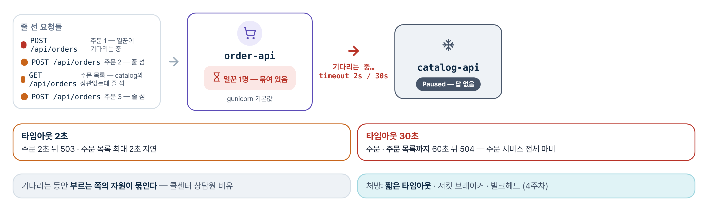

# 1교시 · 장애 전파

!!! goal "이번 시간에 할 일"
    - 어제 배운 것을 10분 안에 손으로 되짚습니다.
    - 상품 서비스를 **얼려서(pause)** "죽지는 않았는데 답이 없는" 상태를 만듭니다.
    - 상품 서비스의 문제가 **주문 서비스 전체**로 번지는 것을 시간으로 잽니다.
    - 장애 전파가 일어나는 원리 — **기다리는 동안 자원이 묶인다** — 를 이해합니다.

## 어제 요약 — 10분 손 복습

오늘은 서비스 코드가 조금 자랐습니다. order-api에 **재시도** 기능이, 두 API에 **테스트**가 추가되었습니다. 강의 저장소에서 새 버전을 받아 내 폴더에 덮어씁니다.

```bash
cd ~/course && git pull
cd ~/devops-lab/devmart-msa
cp -r ~/course/v3/labs/week3/devmart-msa/catalog-api ~/course/v3/labs/week3/devmart-msa/order-api .
git status --short .                    # 바뀐 파일 확인
docker compose up -d --build
docker compose ps --format 'table {{.Service}}\t{{.Status}}'
curl -s -X POST http://localhost:8080/api/orders \
  -H 'Content-Type: application/json' -d '{"product_id": 1}'; echo
cd ~/devops-lab && git add devmart-msa && git commit -m "3주차 2일차: 재시도와 테스트가 추가된 서비스" && git push
cd devmart-msa
```

!!! check "이렇게 나오면 성공"
    `git status`에 `order-api/app.py`(수정), `catalog-api/tests/`, `order-api/tests/`, `requirements-dev.txt`(새 파일)가 보이고, 주문이 202로 접수됩니다. 커밋해 두는 이유는 오늘도 `git restore`로 고장 낸 설정을 되돌리기 때문입니다.

| 어제 배운 것 | 한 줄 |
|---|---|
| MSA | 업무별 서비스가 자기 데이터를 갖고 네트워크로 대화 |
| 요청 ID | 입구에서 붙여 헤더 · 메시지로 이어 넘긴다 |
| 동기 / 비동기 | 가격 조회는 기다리고, 주문 처리는 큐에 맡긴다 |
| 장애 1~3 | 주소 오타, DB 이름 오타, 큐 이름 불일치(조용한 장애) |

어제 배움일기의 마지막 질문을 기억하나요? **"catalog-api가 느려지면 order-api는 어떻게 될까?"** 오늘 1교시가 그 답입니다.

## 죽은 것과 느린 것은 다르다

어제 장애들은 모두 **바로** 실패했습니다. 이름을 못 찾으면 즉시 "Name or service not known", DB가 없으면 즉시 "does not exist". 빨리 실패하면 오히려 다루기 쉽습니다.

더 무서운 것은 **답이 오지 않는** 상태입니다. 서버가 과부하로 허덕이거나, DB 잠금에 걸렸거나, 네트워크 장비가 패킷을 조용히 버릴 때입니다. 부르는 쪽은 "곧 오겠지" 하고 **기다립니다.** 그동안 부르는 쪽의 자원(일꾼, 연결, 메모리)이 **묶여 있습니다.**

!!! analogy "비유 — 콜센터의 전화 대기"
    콜센터 상담원이 5명이고, 상담원은 고객 문의를 받으면 물류팀에 전화해 배송 상태를 확인합니다. 어느 날 물류팀 전화가 **받지도 끊기지도 않고 신호만 갑니다.** 상담원 5명이 모두 수화기를 든 채 기다리느라, 배송과 상관없는 "비밀번호 변경" 문의까지 아무도 받지 못합니다. **물류팀 하나의 문제가 콜센터 전체를 멈췄습니다.** 장애 전파입니다.

## 실습 1 · 상품 서비스를 얼리기

!!! lab "실습 목표"
    `docker compose pause`로 catalog-api를 얼리고, 주문 서비스의 응답 시간이 어떻게 변하는지 잽니다.

`pause`는 컨테이너 안의 프로세스를 **일시 정지**시킵니다. 컨테이너는 떠 있고 네트워크도 살아 있어서 연결은 받아 주지만, 프로세스가 멈춰 **답을 하지 않습니다.** "죽지는 않았는데 응답이 없는" 상태를 흉내 내기에 딱 맞습니다.

### 단계 1 — 얼리기

```bash
docker compose pause catalog-api
docker compose ps catalog-api --format '{{.Service}} {{.Status}}'
```

!!! check "보이는 것"
    ```text
    catalog-api Up 13 minutes (Paused)
    ```

### 단계 2 — 주문하기

```bash
curl -s -w '  (HTTP %{http_code}, %{time_total}초)\n' -X POST http://localhost:8080/api/orders \
  -H 'Content-Type: application/json' -d '{"product_id": 1}'
```

!!! check "보이는 것"
    ```text
    {"error":"catalog unavailable","request_id":"055c88c5…"}  (HTTP 503, 2.004초)
    ```
    정확히 **2초** 뒤에 503이 왔습니다. `compose.yaml`의 `CATALOG_TIMEOUT: "2"` 때문입니다. order-api는 2초까지 기다리다 포기하고 "상품 서비스를 쓸 수 없다"고 답했습니다.

```bash
docker compose logs order-api --no-log-prefix | grep catalog_error | tail -1
```

```text
{"service": "order-api", "event": "catalog_error", "request_id": "055c88c5…", "attempt": 1, "error": "timed out"}
```

어제의 `Name or service not known`과 달리 **`timed out`**입니다. 이름도 찾았고 연결도 됐지만 **답이 오지 않았다**는 뜻입니다.

### 단계 3 — 상품 목록은?

```bash
curl -s -o /dev/null -w '상품 목록: HTTP %{http_code}, %{time_total}초\n' http://localhost:8080/api/products
```

!!! check "보이는 것 — 1분을 기다린다"
    ```text
    상품 목록: HTTP 504, 60.06초
    ```
    상품 목록은 nginx가 catalog-api를 **직접** 부르는데, nginx의 기본 기다림 시간은 **60초**입니다. 60초 뒤 nginx가 포기하고 **504 Gateway Timeout**을 돌려줍니다. 브라우저 화면도 1분 동안 빈 채로 있습니다.

| 상태 코드 | 뜻 | 누가 만드나 |
|---|---|---|
| 502 Bad Gateway | 뒤쪽 서버가 이상한 답을 했거나 연결이 끊겼다 | 게이트웨이(nginx) |
| 503 Service Unavailable | 지금은 서비스를 할 수 없다 | 서비스 자신 (우리 order-api) |
| 504 Gateway Timeout | 뒤쪽 서버가 제시간에 답하지 않았다 | 게이트웨이(nginx) |

## 실습 2 · 느림이 번진다

!!! lab "실습 목표"
    주문 요청이 catalog-api를 기다리는 동안, **catalog-api와 상관없는** 주문 목록 조회까지 느려지는지 확인합니다.

```bash
curl -s -o /dev/null -w '주문하기: %{http_code} %{time_total}초\n' -X POST http://localhost:8080/api/orders \
  -H 'Content-Type: application/json' -d '{"product_id": 1}' &
sleep 0.3
curl -s -o /dev/null -w '주문 목록: %{http_code} %{time_total}초\n' http://localhost:8080/api/orders
wait
```

- 맨 끝의 `&` : 명령을 **뒤에서** 돌리고 바로 다음 줄로 넘어간다 (두 요청을 거의 동시에 보내려고)
- `wait` : 뒤에서 돌던 명령이 끝날 때까지 기다린다

!!! check "보이는 것"
    ```text
    주문 목록: 200 1.71초
    주문하기: 503 2.00초
    ```
    주문 목록은 catalog-api를 **부르지도 않는데** 1.7초가 걸렸습니다. 평소엔 0.01초입니다. 왜일까요?

### 원인 — 일꾼이 하나뿐이다

order-api는 gunicorn으로 실행되는데, 우리 Dockerfile은 **일꾼(worker) 수**를 정하지 않았습니다. gunicorn의 기본값은 **일꾼 1명, 한 번에 요청 하나**입니다. 그 한 명이 catalog-api의 답을 기다리며 2초 동안 묶여 있으니, 뒤에 온 주문 목록 요청은 **줄을 서서** 기다렸습니다.



### 단계 4 — 타임아웃이 길었다면?

타임아웃을 30초로 늘리고 같은 실험을 합니다. `compose.yaml`의 `order-api` → `CATALOG_TIMEOUT: "30"`으로 바꾸고:

```bash
docker compose up -d order-api
sleep 3
for i in 1 2 3; do
  curl -s -o /dev/null -w "주문 $i: %{http_code} %{time_total}초\n" -m 100 -X POST \
    http://localhost:8080/api/orders -H 'Content-Type: application/json' -d '{"product_id": 1}' &
done
sleep 1
curl -s -o /dev/null -w '주문 목록: %{http_code} %{time_total}초\n' -m 100 http://localhost:8080/api/orders
wait
```

!!! check "보이는 것 — 주문 서비스 전체가 멈췄다"
    ```text
    주문 1: 503 30.05초
    주문 2: 504 60.03초
    주문 3: 504 60.06초
    주문 목록: 504 60.00초
    ```
    첫 주문은 30초를 기다려 503. 나머지 둘과 **주문 목록**은 그 뒤에 줄을 서다가 nginx의 60초가 먼저 끝나 **504**를 받았습니다. 주문 목록 화면도 1분 동안 멈췄습니다. **catalog-api 하나가 멈췄을 뿐인데, 주문 서비스 전체가 쓸 수 없게 됐습니다.**

| 타임아웃 | 주문하기 | 주문 목록 | 결과 |
|---|---|---|---|
| 2초 | 2초 뒤 503 | 최대 2초 지연 | 주문만 실패, 나머지는 조금 느림 |
| 30초 | 30초 뒤 503 또는 60초 뒤 504 | **60초 뒤 504** | 주문 서비스 전체 마비 |

**타임아웃이 길수록 장애가 더 멀리 번집니다.** "넉넉하게 기다려 주는 것"이 친절해 보이지만, 실제로는 자기 자원을 묶어 남까지 멈추게 합니다.

### 단계 5 — 원래대로

```bash
docker compose unpause catalog-api
git restore compose.yaml            # CATALOG_TIMEOUT 을 "2" 로
docker compose up -d order-api
```

!!! myth "오해 — '일꾼을 늘리면 해결된다'"
    gunicorn 일꾼을 4명으로 늘리면 (`--workers 4`) 이번 실험은 덜 아프겠지만, 주문이 4개 동시에 몰리면 똑같이 막힙니다. 일꾼 수는 **완충**일 뿐, 막혀 있는 시간을 줄이지 않습니다. 근본은 ① **기다리는 시간을 짧게**(타임아웃) ② **막힌 상대를 계속 부르지 않기**(서킷 브레이커, 4주차) ③ **기다리는 자원을 나눠 두기**(벌크헤드)입니다.

!!! academic "학술 노트 — 연쇄 장애와 '안정성 안티패턴' (Nygard, 2007)"
    마이클 나이가드의 『Release It!』(2판 2018)은 실제 장애 사례를 모아 **안정성 안티패턴**을 정리했습니다. 오늘 본 것이 그중 대표인 **연쇄 장애(cascading failure)**와 **막힌 스레드(blocked threads)**입니다. 책의 표현을 빌리면, 한 계층의 문제가 그 계층을 **부르는** 쪽의 자원을 고갈시키며 위로 번져 갑니다. 그리고 책은 이를 막는 **안정성 패턴**으로 타임아웃, 서킷 브레이커, 벌크헤드(배의 격벽처럼 자원을 칸으로 나누기), 빠른 실패를 제시했습니다.

    구글의 SRE 책(2016) 22장 「연쇄 장애 다루기」도 같은 결론입니다. 과부하는 재시도와 대기열을 타고 **양의 되먹임**처럼 커지기 때문에, 각 서비스가 **스스로를 지키는 장치**(마감 시간, 부하 제한, 재시도 예산)를 갖춰야 한다고 강조합니다. 2교시에서 그 장치들을 켭니다.

    - Nygard, M. T. (2018). *Release It!* (2nd ed.). Pragmatic Bookshelf.
    - Beyer, B. et al. (2016). *Site Reliability Engineering*, Ch. 22 "Addressing Cascading Failures". O'Reilly.

!!! trend "트렌드 — 장애를 일부러 일으키는 연습, 카오스 엔지니어링"
    오늘 `docker compose pause`로 일부러 장애를 만든 것처럼, 운영 중인 시스템에 **계획된 장애를 주입해** 약점을 미리 찾는 방법을 **카오스 엔지니어링**이라고 합니다. 넷플릭스가 2011년 무작위로 서버를 끄는 **Chaos Monkey**를 공개하면서 알려졌고, 지금은 Kubernetes용 Chaos Mesh, LitmusChaos(CNCF 프로젝트), AWS의 Fault Injection Service 같은 도구로 "특정 서비스에 2초 지연 주입" 같은 실험을 자동화합니다. 핵심은 도구가 아니라 **가설 → 실험 → 관찰 → 개선**의 습관입니다. 오늘 실습의 가설은 "catalog-api가 멈추면 주문만 실패할 것"이었고, 관찰 결과는 "주문 목록까지 멈췄다"였습니다.

## 정리

- 바로 실패하는 장애보다 **답이 오지 않는** 장애가 더 위험하다.
- 기다리는 동안 부르는 쪽의 자원(일꾼)이 묶이고, 상관없는 요청까지 줄을 선다 — **장애 전파**.
- **504** = 게이트웨이가 기다리다 포기, **503** = 서비스 스스로 "지금은 안 된다".
- **타임아웃이 길수록 장애가 멀리 번진다.**
- 일꾼 수는 완충일 뿐, 근본은 짧은 타임아웃 · 서킷 브레이커 · 벌크헤드.

!!! quiz "확인 문제"
    1. `docker compose pause`와 `docker compose stop`은 부르는 쪽에서 볼 때 어떻게 다른가요?
    2. 로그의 `timed out`과 `Name or service not known`의 차이는?
    3. catalog-api를 부르지 않는 주문 목록 조회가 느려진 이유는?
    4. 타임아웃을 2초에서 30초로 늘렸을 때 무슨 일이 생겼나요?
    5. 504와 503은 각각 누가 만드나요?

    ??? answer "정답"
        1. pause는 연결은 되지만 답이 없어 기다리게 되고(timed out), stop은 이름을 못 찾거나 연결이 거부되어 바로 실패한다
        2. timed out은 연결은 됐는데 답이 제시간에 오지 않음, Name or service not known은 이름 자체를 못 찾음
        3. order-api의 일꾼이 1명뿐이라, 주문 요청이 catalog-api를 기다리는 동안 뒤의 요청이 줄을 섰다
        4. 일꾼이 30초씩 묶여 뒤의 주문과 주문 목록까지 nginx의 60초 제한에 걸려 504 — 주문 서비스 전체가 멈췄다
        5. 504는 게이트웨이(nginx), 503은 서비스 자신(order-api)

## 참고 문헌

- Nygard, M. T. (2018). *Release It!* (2nd ed.). Pragmatic Bookshelf.
- Beyer, B. et al. (2016). *Site Reliability Engineering*, Ch. 22. sre.google/sre-book/addressing-cascading-failures
- Docker Docs. *docker compose pause*. docs.docker.com/reference/cli/docker/compose/pause
- Gunicorn Docs. *Settings — workers, timeout*. docs.gunicorn.org
- Basiri, A. et al. (2016). Chaos Engineering. *IEEE Software, 33*(3).
