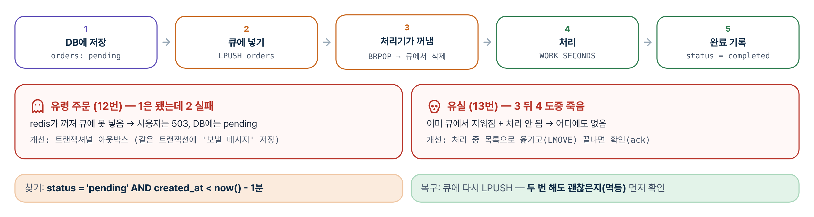

# 3교시 · 큐 적체와 메시지 유실

!!! goal "이번 시간에 할 일"
    - 처리기가 멈췄을 때 큐가 **쌓였다가 비워지는** 것을 봅니다.
    - 처리기가 **처리 도중에 죽으면** 주문이 영영 pending으로 남는 것을 봅니다.
    - 2교시에 생긴 **유령 주문**까지 합쳐, SQL로 "멈춘 주문"을 찾고 손으로 복구합니다.
    - nginx 로그에 요청 ID를 넣고, **장애 보고서**를 씁니다.

## 실습 7 · 처리기가 멈추면 큐가 쌓인다

```bash
docker compose stop order-worker
for i in 1 2 3 4 5; do
  curl -s -o /dev/null -w "주문 $i → %{http_code}\n" -X POST http://localhost:8080/api/orders \
    -H 'Content-Type: application/json' -d '{"product_id": 3}'
done
docker compose exec redis redis-cli LLEN orders
```

!!! check "보이는 것"
    ```text
    주문 1 → 202
    …
    주문 5 → 202
    (integer) 5
    ```
    사용자는 모두 **202 성공**을 받았습니다. 그런데 처리기가 없어서 큐에 5개가 쌓였습니다. 화면에는 pending 5개가 그대로 있습니다. 어제 7교시 장애 3처럼, **아무 에러 없이** 일이 멈춰 있습니다.

```bash
docker compose start order-worker
sleep 8
docker compose exec redis redis-cli LLEN orders
```

`0` — 처리기가 돌아오자 쌓인 5개를 차례로 처리했습니다. 큐가 **기다려 준** 덕분에 잃어버린 주문은 없습니다. 이것이 큐의 완충 효과입니다.

## 실습 8 · 처리 도중에 죽으면

!!! lab "실습 목표"
    처리기가 주문 하나를 **꺼낸 뒤, 끝내기 전에** 죽으면 어떻게 되는지 봅니다.

처리 시간을 10초로 늘려 "처리 도중"을 길게 만듭니다. `compose.yaml`의 `order-worker` → `WORK_SECONDS: "10"`으로 바꾸고:

```bash
docker compose up -d order-worker
sleep 2
curl -s -X POST http://localhost:8080/api/orders \
  -H 'Content-Type: application/json' -d '{"product_id": 5}'; echo
sleep 2
docker compose exec redis redis-cli LLEN orders        # 이미 꺼내 갔다
docker compose kill order-worker                        # 처리 도중에 강제 종료
git restore compose.yaml
docker compose up -d order-worker
sleep 12
```

- `docker compose kill` : 정리할 시간을 주지 않고 **즉시** 끝낸다 (전원이 나간 것처럼)

!!! check "보이는 것"
    ```text
    {"order_id":13,"request_id":"0f6b71b5…","status":"pending","total_price":89000}
    (integer) 0
     Container devmart-msa-order-worker-1  Killed
    ```
    큐는 `0`이었습니다. 처리기가 이미 메시지를 **꺼내 갔기** 때문입니다. 그 상태에서 처리기가 죽었으니, 메시지는 **큐에도 없고 처리도 되지 않았습니다.** 새 처리기가 떠도 할 일이 없습니다. 무선 이어폰 주문(13번)은 **영원히 pending**입니다.



## 실습 9 · 멈춘 주문 찾기

2교시 실습 5에서 redis가 꺼져 있을 때 들어온 주문(12번)도 기억하나요? 그 주문은 DB에 pending으로 **저장은 됐는데 큐에 들어가지 못했습니다.** 사용자는 503을 받아 "실패했구나" 생각했지만, DB에는 주문이 남아 있습니다. 이런 주문을 **유령 주문**이라고 부르겠습니다.

두 종류의 멈춘 주문을 SQL 한 줄로 찾습니다.

```bash
docker compose exec db psql -U devmart -d orders -c \
  "SELECT id, product_name, status, created_at
     FROM orders
    WHERE status = 'pending' AND created_at < now() - interval '1 minute'
    ORDER BY id;"
```

!!! check "보이는 것"
    ```text
     id | product_name | status  |          created_at
    ----+--------------+---------+-------------------------------
     12 | 후드 집업    | pending | 2026-11-26 10:35:33.148021+09
     13 | 무선 이어폰  | pending | 2026-11-26 10:35:57.780186+09
    (2 rows)
    ```
    "1분 넘게 pending" = 정상이라면 있을 수 없는 상태입니다(처리는 1초면 끝나니까). 4주차 모니터링에서 이 SQL의 결과 개수를 **지표**로 만들어 경보를 겁니다. 어제 7교시 학술 노트의 회색 장애를 잡는 **사용자 관점의 감시**입니다.

| 주문 | 어떻게 멈췄나 | 큐에 있나 | DB 상태 |
|---|---|---|---|
| 12 (유령 주문) | 저장 → **큐 넣기 실패** (redis 꺼짐) | 없음 | pending |
| 13 (유실) | 저장 → 큐 → 처리기가 꺼냄 → **처리 중 죽음** | 없음 | pending |

### 손으로 복구하기

두 주문 모두 **큐에 다시 넣어 주면** 처리기가 처리합니다.

```bash
for id in 12 13; do
  docker compose exec redis redis-cli LPUSH orders "{\"order_id\": $id, \"request_id\": \"manual-recovery\"}"
done
sleep 3
docker compose exec db psql -U devmart -d orders -c \
  "SELECT id, status, processed_by FROM orders WHERE id IN (12, 13);"
```

!!! check "이렇게 나오면 성공"
    ```text
     id |  status   | processed_by
    ----+-----------+--------------
     12 | completed | 09184fa59eda
     13 | completed | 09184fa59eda
    ```

!!! warn "다시 넣어도 되는지 먼저 따져 본다"
    우리 처리기는 "상태를 completed로 바꾼다"만 하므로 **두 번 처리해도 결과가 같습니다(멱등).** 그래서 의심스러우면 다시 넣어도 안전합니다. 만약 처리기가 "결제 승인 요청" 같은 일을 한다면, 13번이 **실제로는 결제까지 하고** 죽었을 수도 있습니다. 그때 다시 넣으면 **두 번 결제**됩니다. 복구 전에 "이 일이 두 번 일어나도 괜찮은가?"를 반드시 묻습니다.

## 왜 이런 일이 생기나 — 전달 보장

| 방식 | 뜻 | 오늘 DevMart | 위험 |
|---|---|---|---|
| **최대 한 번** (at-most-once) | 꺼내는 순간 큐에서 지운다 | `BRPOP` | 처리 중 죽으면 **유실** |
| **최소 한 번** (at-least-once) | 처리 **끝난 뒤** "다 했다(ack)"를 보내야 지운다 | (개선안) | 죽으면 다시 받으니 **중복** 가능 → 처리를 멱등하게 |
| **정확히 한 번** (exactly-once) | 유실도 중복도 없음 | — | 일반적인 분산 환경에서는 매우 어렵다. 보통 "최소 한 번 + 멱등"으로 흉내 낸다 |

개선 방향은 두 가지입니다.

- **유실(13번)** → 꺼낼 때 지우지 말고 "처리 중" 목록으로 **옮겨 두었다가**(Redis의 `LMOVE`), 끝나면 지운다. 처리기가 죽으면 "처리 중" 목록에 남은 것을 다시 큐로 돌린다. RabbitMQ · SQS는 이 확인(ack) 기능을 기본으로 제공합니다.
- **유령 주문(12번)** → "DB 저장"과 "큐 넣기"를 **한 번에** 할 수 없는 것이 원인입니다(어제 2교시의 '서비스를 넘는 트랜잭션'). 해결책은 주문과 함께 "보낼 메시지"를 **같은 DB의 표(outbox)에 같은 트랜잭션으로** 저장하고, 별도의 프로그램이 그 표를 읽어 큐로 보내는 **트랜잭셔널 아웃박스(transactional outbox)** 패턴입니다.

오늘은 고치지 않고, **찾는 법과 손으로 복구하는 법**까지만 익힙니다. 운영의 첫걸음은 완벽한 설계보다 "멈춘 것을 찾을 수 있는가"입니다.

## nginx 로그에 요청 ID 남기기

어제 5교시에 "nginx 기본 로그에는 요청 ID가 없다"고 했습니다. 오늘 고칩니다. 강의 저장소의 완성본을 비교해 봅니다.

```bash
diff nginx/default.conf ~/course/labs/week3/day2/nginx-default.conf
```

!!! check "보이는 것"
    ```text
    0a1,4
    > # 접근 로그에 요청 ID와 걸린 시간도 남긴다 (3주차 2일차)
    > log_format devmart '$remote_addr [$time_local] "$request" $status '
    >                    'rid=$request_id upstream=$upstream_addr rt=$request_time';
    >
    2a7
    >     access_log /var/log/nginx/access.log devmart;
    ```
    `log_format`으로 새 로그 형식 `devmart`를 정의하고, `access_log`에서 그 형식을 씁니다. `upstream`은 nginx가 **어느 서비스 컨테이너로** 보냈는지, `rt`는 **걸린 시간**입니다.

```bash
cp ~/course/labs/week3/day2/nginx-default.conf nginx/default.conf
docker compose restart web
curl -s -o /dev/null -X POST http://localhost:8080/api/orders \
  -H 'Content-Type: application/json' -d '{"product_id": 1}'
docker compose logs web --no-log-prefix --tail 1
```

!!! check "이렇게 나오면 성공"
    ```text
    172.18.0.1 [26/Nov/2026:10:40:12 +0900] "POST /api/orders HTTP/1.1" 202 rid=3a9f0c1e… upstream=172.18.0.6:8000 rt=0.027
    ```
    이제 `grep $RID`에 nginx 줄도 걸리고, 사용자가 실제로 기다린 시간(`rt`)까지 한 줄에 보입니다. 1교시 실험을 다시 하면 `rt=60.000`, `504`가 그대로 찍힙니다.

## 실습 10 · 장애 보고서 쓰기

오늘 1~3교시에 겪은 장애 하나를 골라 보고서를 씁니다. 1주차 5일차 5교시에서 배운 **비난 없는 포스트모템** 형식입니다.

```bash
cp ~/course/labs/week3/day2/incident-report-template.md ~/devops-lab/notes/incident-week3-day2.md
code ~/devops-lab/notes/incident-week3-day2.md
```

추천 주제: **"상품 서비스가 멈추자 주문 서비스 전체가 1분간 응답하지 않음"** (1교시, 타임아웃 30초 실험)

| 칸 | 채울 내용의 예 |
|---|---|
| 영향 범위 | 상품 보기 불가(504), 주문하기 불가(503/504), **주문 목록까지 불가** |
| 타임라인 | `docker compose logs -t`의 시각을 그대로 옮긴다 |
| 직접 원인 | catalog-api 응답 없음 |
| 왜 미리 막지 못했나 | 타임아웃이 30초로 길었고, order-api 일꾼이 1명이라 한 요청이 전체를 막았다 |
| 재발 방지 | 타임아웃 2초로 고정 · 재시도는 한 층에서만 · 4주차 서킷 브레이커 검토 |

!!! tip "증거가 없는 문장은 쓰지 않는다"
    "아마 ~ 때문인 것 같다"보다 "`docker compose logs order-api`에 `timed out`이 3건(10:30:56~10:31:56)"처럼 **명령과 로그 한 줄**을 근거로 붙입니다. 다음 사람이 같은 명령으로 확인할 수 있어야 좋은 보고서입니다.

```bash
cd ~/devops-lab
git add devmart-msa/nginx notes
git commit -m "3주차 2일차: nginx 요청 ID 로그, 장애 보고서"
git push
```

!!! academic "학술 노트 — 끝에서 확인하라 (Saltzer, Reed & Clark, 1984)"
    1주차 3일차에 인터넷 설계의 바탕으로 배운 **종단 간 원칙(end-to-end arguments)** 논문은 원래 이런 예로 시작합니다. 파일을 한 컴퓨터에서 다른 컴퓨터로 옮길 때, 중간의 네트워크가 아무리 신뢰성을 보장해도 디스크 오류, 메모리 오류, 프로그램 버그 같은 위험이 **양 끝에** 남아 있다. 그러므로 "제대로 옮겨졌나"는 결국 **받는 쪽 프로그램이 끝에서 확인**해야만 보장된다.

    오늘의 메시지 유실이 정확히 그 예입니다. Redis는 메시지를 처리기에게 **정확히 전달했습니다.** 그런데 처리기가 일을 끝내지 못하고 죽었습니다. 중간(큐)이 아무리 믿음직해도 "주문이 처리됐는가"는 **끝**(처리기가 DB를 바꾼 뒤 보내는 확인, 그리고 DB의 상태)에서만 확인할 수 있습니다. 1분 넘은 pending을 찾는 오늘의 SQL은 끝에서 확인하는 가장 단순한 방법입니다.

    - Saltzer, J. H., Reed, D. P., & Clark, D. D. (1984). End-to-end arguments in system design. *ACM TOCS, 2*(4).

!!! trend "트렌드 — 아웃박스와 변경 데이터 캡처(CDC)"
    유령 주문 문제를 푸는 트랜잭셔널 아웃박스 패턴은 MSA에서 매우 흔해졌고, 이를 돕는 도구도 표준화되었습니다. 대표적인 것이 **변경 데이터 캡처(CDC, Change Data Capture)**입니다. 데이터베이스가 원래 남기는 변경 기록(PostgreSQL의 WAL — 2주차 4일차 2교시)을 읽어, outbox 표에 새 줄이 생기면 그것을 Kafka 같은 메시지 시스템으로 흘려보냅니다. 오픈소스 Debezium이 대표적이고, 클라우드 업체들도 관리형 CDC 서비스를 제공합니다. 앱은 "DB에 한 번 쓰기"만 하면 되고, 메시지 전달은 DB의 기록을 따라가는 별도 계층이 책임집니다.

## 정리

- 처리기가 멈추면 **큐가 쌓이고**, 돌아오면 비워진다 — 큐의 완충 효과.
- `BRPOP`은 꺼내는 순간 지운다(최대 한 번) → 처리 중 죽으면 **유실**.
- DB 저장과 큐 넣기는 한 번에 안 된다 → 큐 넣기가 실패하면 **유령 주문**.
- "1분 넘은 pending"을 SQL로 찾고, **멱등한지 확인한 뒤** 큐에 다시 넣어 복구.
- 개선: 확인(ack) 기반 최소 한 번 + 멱등 처리, 트랜잭셔널 아웃박스.
- nginx `log_format`에 `$request_id` · `$request_time` — 입구에서부터 추적.

!!! quiz "확인 문제"
    1. 처리기가 멈춰 있는 동안 사용자는 어떤 응답을 받았나요? 이게 왜 위험한가요?
    2. 처리 도중 처리기를 kill 했을 때 큐 길이가 0이었던 이유는?
    3. 유령 주문(12번)과 유실(13번)은 각각 어느 단계에서 생겼나요?
    4. 멈춘 주문을 큐에 다시 넣기 전에 따져 봐야 할 것은?
    5. "최소 한 번" 전달을 쓸 때 처리를 멱등하게 만들어야 하는 이유는?

    ??? answer "정답"
        1. 202 성공. 사용자는 성공으로 알지만 실제 처리는 멈춰 있고, 에러도 없어 알아채기 어렵다
        2. 처리기가 BRPOP으로 이미 꺼내 갔고, 꺼내는 순간 큐에서 지워지기 때문
        3. 12번은 DB 저장 뒤 큐에 넣는 단계(redis 꺼짐), 13번은 처리기가 꺼낸 뒤 처리하는 단계(처리 중 죽음)
        4. 그 일이 두 번 일어나도 괜찮은지(멱등한지). 결제처럼 이미 일부 실행됐을 수 있는 일은 위험하다
        5. 처리기가 죽으면 같은 메시지를 다시 받아 같은 일을 두 번 할 수 있기 때문

## 참고 문헌

- Saltzer, J. H., Reed, D. P., & Clark, D. D. (1984). End-to-end arguments in system design. *ACM TOCS*.
- Redis Docs. *BRPOP*, *LMOVE — Pattern: Reliable queue*. redis.io/docs/latest/commands
- Richardson, C. *Pattern: Transactional outbox*. microservices.io
- Kleppmann, M. (2017). *Designing Data-Intensive Applications*, Ch. 11. O'Reilly.
- nginx Docs. *ngx_http_log_module — log_format*. nginx.org/en/docs
