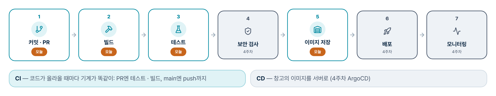
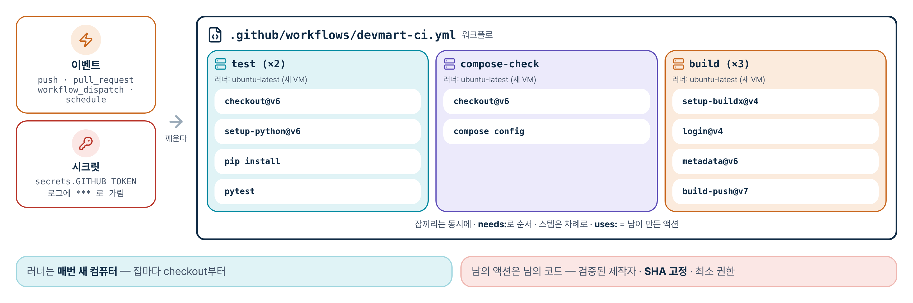

# 4교시 · GitHub Actions 개념과 첫 워크플로

!!! goal "이번 시간에 할 일"
    - MSA에서 **CI가 왜 필수**인지 이해합니다.
    - GitHub Actions의 구성 요소 — 워크플로 · 이벤트 · 잡 · 스텝 · 러너 · 액션 — 를 그림으로 익힙니다.
    - 첫 워크플로 `hello.yml`을 올려 실행하고, 결과를 화면과 `gh`로 읽습니다.
    - 남이 만든 액션을 쓸 때의 **공급망 위험**을 압니다.

## 서비스가 셋이면 할 일도 셋

오늘 오전까지 우리가 손으로 한 일을 세어 봅시다. 코드를 고칠 때마다:

1. 테스트를 돌린다 (서비스 2개)
2. 이미지를 빌드한다 (서비스 3개)
3. 태그를 붙여 레지스트리에 올린다 (서비스 3개)

한 사람이 하루 다섯 번 고치면 40번이 넘는 명령입니다. 그리고 사람은 **잊어버립니다.** 테스트를 건너뛰고 push 하거나, 이미지 하나만 새로 만들고 둘은 옛것으로 두기도 합니다. 1주차 5일차 2교시에서 그림으로 본 **CI(지속적 통합)**는 이 일을 **코드가 올라올 때마다 기계가 똑같이** 하게 만드는 것입니다.



## GitHub Actions의 구성 요소

**GitHub Actions**는 GitHub 저장소에 들어 있는 CI/CD 기능입니다. 저장소의 `.github/workflows/` 폴더에 YAML 파일을 두면, GitHub가 그 파일을 읽어 정해진 때에 정해진 일을 합니다.



| 구성 요소 | 뜻 | 비유 (식당) |
|---|---|---|
| **워크플로(workflow)** | `.github/workflows/*.yml` 파일 하나 | 하나의 작업 지시서 |
| **이벤트(event)** | 워크플로를 깨우는 사건: `push`, `pull_request`, 예약 시간, 버튼 | "주문이 들어오면" |
| **잡(job)** | 한 러너에서 실행되는 일 묶음. 잡끼리는 **동시에** 돈다 (순서를 정할 수도 있다) | 요리사 한 명의 담당 |
| **스텝(step)** | 잡 안에서 **차례로** 실행되는 명령 하나 | 레시피의 한 줄 |
| **러너(runner)** | 잡을 실행하는 **새 가상 머신**. 잡이 끝나면 버려진다 | 빌려 쓰는 주방 |
| **액션(action)** | 남이 만들어 둔 재사용 스텝 (`uses:`) | 미리 손질된 재료 |
| **시크릿(secret)** | 워크플로가 쓰는 비밀값. 로그에 `***`로 가려진다 | 금고 열쇠 |

!!! key "러너는 매번 새 컴퓨터다"
    잡마다 **깨끗한 새 가상 머신**이 뜹니다. 앞 잡에서 설치한 것, 만든 파일은 다음 잡에 **없습니다.** 그래서 잡마다 `actions/checkout`으로 코드를 다시 받습니다. 2주차 2일차의 "컨테이너는 지우면 사라진다"와 같은 원리입니다. 매번 같은 상태에서 시작하니 **"내 컴퓨터에서는 됐는데"**가 사라집니다.

## 실습 11 · 첫 워크플로

!!! lab "실습 목표"
    `hello.yml`을 저장소에 올려 GitHub의 러너에서 실행하고, 결과를 읽습니다.

### 단계 1 — 파일 만들기

워크플로 파일은 **저장소 최상위**의 `.github/workflows/`에 있어야 합니다. 우리 저장소의 최상위는 `~/devops-lab`입니다.

```bash
cd ~/devops-lab
mkdir -p .github/workflows
cp ~/course/labs/week3/day2/.github/workflows/hello.yml .github/workflows/
code .github/workflows/hello.yml
```

```yaml
# 첫 워크플로 — 3주차 2일차 4교시
name: hello

on:
  push:
  workflow_dispatch:                  # Actions 탭에서 손으로 실행하는 버튼

jobs:
  hello:
    runs-on: ubuntu-latest
    steps:
      - name: 인사
        run: echo "안녕하세요, ${{ github.actor }} 님! 커밋 ${{ github.sha }}"
      - name: 러너 둘러보기
        run: |
          uname -a
          docker --version
          python3 --version
          echo "작업 폴더: $PWD"
      - uses: actions/checkout@v6
      - name: 받은 파일 보기
        run: ls -la
```

| 줄 | 뜻 |
|---|---|
| `on: push` | 어느 브랜치든 push 되면 실행 |
| `workflow_dispatch` | 화면의 **Run workflow** 버튼으로도 실행 |
| `runs-on: ubuntu-latest` | GitHub가 빌려주는 Ubuntu 가상 머신에서 |
| `run:` | 셸 명령. `\|` 뒤는 여러 줄 |
| `${{ github.actor }}` | GitHub가 채워 주는 값 — push 한 사람의 아이디 |
| `uses: actions/checkout@v6` | 내 저장소 코드를 러너에 받아 오는 공식 액션, **6판** |

### 단계 2 — 올리기

```bash
git add .github/workflows/hello.yml
git commit -m "첫 GitHub Actions 워크플로"
git push
```

### 단계 3 — 결과 보기 (화면)

브라우저에서 `https://github.com/내아이디/devops-lab` → 위쪽 **Actions** 탭을 엽니다.

!!! check "이렇게 보이면 성공"
    - 왼쪽에 **hello** 워크플로, 가운데에 방금 커밋 메시지로 된 실행 기록
    - 노란 원(실행 중) → 몇 초 뒤 **초록 체크**
    - 클릭해 들어가 **hello** 잡 → 스텝마다 펼치면 출력이 보입니다

    ```text
    안녕하세요, 내아이디 님! 커밋 7f3c2e1…
    Linux fv-az1234-56 6.11.0-1015-azure … x86_64 GNU/Linux
    Docker version …
    Python 3.12.…
    작업 폴더: /home/runner/work/devops-lab/devops-lab
    ```
    러너는 이미 Docker와 Python이 설치된 Ubuntu입니다. 그런데 `checkout` **전의** `ls`라면 폴더가 비어 있었을 것입니다. 코드를 받아 오는 것도 스텝 하나입니다.

### 단계 4 — 결과 보기 (명령줄)

```bash
gh run list --limit 3
gh run view --log | head -20
```

!!! check "보이는 것"
    ```text
    STATUS  TITLE                       WORKFLOW  BRANCH  EVENT  ID          ELAPSED  AGE
    ✓       첫 GitHub Actions 워크플로  hello     main    push   1928374650  12s      1m
    ```
    `gh run view --log`는 방금 실행의 로그 전체를 보여 줍니다. 7교시에 실패한 CI의 로그를 읽을 때 씁니다.

### 단계 5 — 버튼으로 실행

```bash
gh workflow run hello
sleep 5
gh run watch
```

- `gh workflow run hello` : `workflow_dispatch` 이벤트를 보낸다 (화면의 **Run workflow** 버튼과 같다)
- `gh run watch` : 실행이 끝날 때까지 진행 상황을 실시간으로 보여 준다

!!! tip "hello는 금방 끄자"
    `on: push`에 브랜치 조건이 없어서, 앞으로 **모든 push마다** hello가 돕니다. 확인이 끝나면 지우거나 `on:`을 `workflow_dispatch`만 남깁니다. CI는 **필요할 때만** 돌게 하는 것이 시간과 비용을 아끼는 기본입니다(5교시의 `paths:`).

## 비용과 한도

| 저장소 | GitHub 호스트 러너 사용 |
|---|---|
| **공개(public)** 저장소 | 표준 러너는 **무료** |
| 비공개(private) 저장소 | 계정 요금제마다 **월 무료 분량**이 있고, 넘으면 분 단위 과금 |

우리 `devops-lab`은 공개 저장소라 실습 비용이 들지 않습니다. 회사의 비공개 저장소에서는 CI 시간이 곧 돈이므로, 캐시를 쓰고(6교시) 필요할 때만 돌게(5교시) 하는 습관이 중요합니다. 요금과 무료 분량은 자주 바뀌므로 GitHub 공식 문서의 **Billing for GitHub Actions**를 확인합니다.

!!! warn "남의 액션은 남의 코드다"
    `uses: 누군가/무언가@v1`은 **남이 만든 코드를 내 저장소 권한으로 실행**하는 것입니다. 그 액션이 내 시크릿을 읽을 수도 있습니다. 2025년 3월에는 수많은 저장소가 쓰던 인기 액션(`tj-actions/changed-files`)이 해킹당해, 그 액션을 쓰는 저장소들의 CI 로그에 **시크릿이 출력되는** 사고가 있었습니다. 원칙은 세 가지입니다.

    - `actions/`, `docker/`처럼 **공식 · 검증된 제작자**의 액션을 우선 쓴다.
    - 중요한 저장소에서는 `@v6` 같은 이름표 대신 **커밋 SHA로 고정**한다 (태그는 옮겨 붙일 수 있다 — 2주차 3일차 6교시의 태그 vs 다이제스트와 같은 이야기).
    - 워크플로의 **권한을 최소로** 준다 (`permissions:`, 5 · 6교시).

!!! academic "학술 노트 — CI는 정말 도움이 되는가 (Hilton et al., 2016)"
    '지속적 통합'이라는 말은 켄트 벡(Kent Beck)의 익스트림 프로그래밍(1999)에서 실천법으로 제시되었고, 마틴 파울러의 2006년 글 「Continuous Integration」이 원칙을 정리했습니다. "모두가 적어도 하루 한 번 주 줄기에 통합하고, 통합할 때마다 자동 빌드와 테스트로 확인하라."

    그렇다면 실제로 효과가 있을까요? 일리노이 대학의 마이클 힐튼(Michael Hilton) 등은 ASE 2016 학회 논문에서 GitHub의 오픈소스 프로젝트 수만 개와 개발자 설문을 분석했습니다. CI를 쓰는 프로젝트는 쓰지 않는 프로젝트보다 **더 자주 릴리스했고**, PR을 **더 빨리 받아들였으며**, 개발자들은 CI 덕분에 **버그를 일찍 잡고 리뷰에 집중할 수 있다**고 답했습니다. 반대로 CI를 쓰지 않는 이유로는 "설정이 어렵다", "테스트가 없다"가 많았습니다. 오늘 5교시에 테스트부터 만드는 이유입니다.

    - Fowler, M. (2006). *Continuous Integration*. martinfowler.com/articles/continuousIntegration.html
    - Hilton, M., Tunnell, T., Huang, K., Marinov, D., & Dig, D. (2016). Usage, costs, and benefits of continuous integration in open-source projects. *ASE '16*.

!!! trend "트렌드 — CI 자체가 공격 대상이 되었다"
    CI 러너는 저장소 쓰기 권한, 레지스트리 비밀번호, 클라우드 열쇠를 모두 들고 있어서 공격자가 가장 탐내는 곳이 되었습니다. 그래서 2025~2026년 사이 GitHub는 조직 관리자가 **"커밋 SHA로 고정한 액션만 허용"** 같은 정책을 강제할 수 있게 했고, 업계에서는 워크플로 파일을 검사하는 도구(actionlint, zizmor 같은 것)를 CI 안에서 돌리는 것이 흔해졌습니다. 5주차에는 AWS 열쇠를 저장소에 넣지 않고 **OIDC**로 그때그때 짧게 받아 쓰는 방법(2주차 4일차 6교시 트렌드)을 직접 설정합니다.

## 정리

- CI = 코드가 올라올 때마다 **기계가 똑같이** 테스트 · 빌드 · 저장. 서비스가 많을수록 필수.
- 워크플로(파일) ← 이벤트(깨우기) · 잡(동시에) · 스텝(차례로) · 러너(매번 새 VM) · 액션(재사용) · 시크릿.
- 파일 위치는 **저장소 최상위** `.github/workflows/`.
- `gh run list`, `gh run view --log`, `gh workflow run`, `gh run watch`.
- 남의 액션은 남의 코드 — 검증된 제작자, SHA 고정, 최소 권한.

!!! quiz "확인 문제"
    1. 같은 워크플로의 두 잡이 파일을 주고받을 수 없는 이유는?
    2. `on:`에 `push`와 `workflow_dispatch`가 있으면 언제 실행되나요?
    3. `checkout` 스텝 전에 `ls`를 하면 무엇이 보이나요?
    4. 공개 저장소와 비공개 저장소의 Actions 비용 차이는?
    5. 중요한 저장소에서 액션을 `@v6` 대신 커밋 SHA로 고정하는 이유는?

    ??? answer "정답"
        1. 잡마다 새 가상 머신(러너)에서 실행되고 끝나면 버려지기 때문 (주고받으려면 artifact 등을 따로 써야 한다)
        2. 어느 브랜치든 push 될 때, 그리고 Actions 탭 버튼이나 `gh workflow run`으로 손으로 실행할 때
        3. 빈 작업 폴더 — 코드를 받아 오는 것도 스텝이다
        4. 공개 저장소는 표준 러너가 무료, 비공개는 월 무료 분량을 넘으면 과금
        5. 태그는 다른 커밋으로 옮겨 붙일 수 있어서, 액션이 해킹되면 내 CI에서 다른 코드가 돌 수 있기 때문

## 참고 문헌

- GitHub Docs. *Understanding GitHub Actions*, *Workflow syntax*. docs.github.com/actions
- GitHub Docs. *Security hardening for GitHub Actions*, *About billing for GitHub Actions*. docs.github.com
- Fowler, M. (2006). *Continuous Integration*. martinfowler.com
- Hilton, M. et al. (2016). Usage, costs, and benefits of continuous integration in open-source projects. *ASE '16*.
- GitHub CLI Manual. *gh run*, *gh workflow*. cli.github.com/manual
