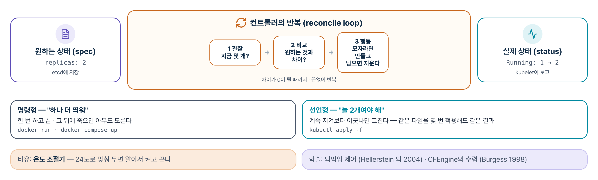

# 4교시 · 선언형과 reconcile

!!! goal "이번 시간에 할 일"
    - **명령형**(무엇을 하라)과 **선언형**(어떤 상태여야 한다)의 차이를 이해합니다.
    - 컨트롤러의 **reconcile(조정) 반복** — 관찰 → 비교 → 행동 — 을 몸으로 익힙니다.
    - Kubernetes 매니페스트(YAML)의 네 칸 — `apiVersion` · `kind` · `metadata` · `spec` — 과 `status`를 읽습니다.

## 명령형과 선언형

2주차까지 우리는 주로 **명령형**으로 일했습니다.

```bash
docker run -d --name web nginx:1.30-alpine     # 띄워라
docker stop web                                # 멈춰라
docker compose up -d --scale order-worker=3    # 3개로 늘려라
```

명령형은 **"무엇을 하라"**를 말합니다. 명령은 한 번 실행되고 끝납니다. 명령 뒤에 컨테이너가 죽으면? 아무도 모릅니다. 내가 다시 명령해야 합니다.

**선언형**은 **"어떤 상태여야 한다"**를 적어 둡니다.

```yaml
# "order-worker는 늘 3개여야 한다"
spec:
  replicas: 3
```

이것을 클러스터에 맡기면(`kubectl apply -f`), Kubernetes가 **지금 상태를 계속 지켜보다가** 원하는 상태와 어긋나면 스스로 고칩니다. 하나가 죽으면 하나를 새로 만들고, 누가 실수로 하나를 더 띄우면 하나를 지웁니다.

!!! analogy "비유 — 택시 기사에게 길 알려 주기 vs 목적지 말하기"
    **명령형**: "다음 사거리에서 좌회전, 300m 직진, 우회전…" — 중간에 공사로 길이 막히면 나는 다시 처음부터 설명해야 합니다.
    **선언형**: "서울역으로 가 주세요." — 길이 막히면 기사(컨트롤러)가 알아서 돌아갑니다. 나는 목적지만 말하고, 도착했는지만 확인합니다.

| | 명령형 | 선언형 |
|---|---|---|
| 말하는 것 | 동작 (만들어, 지워, 늘려) | 결과 (3개여야 해) |
| 한 번 실행 뒤 | 끝 | 계속 지킴 |
| 같은 것을 두 번 실행하면 | 두 번 일어남 (컨테이너 2개, 또는 "이미 있다" 오류) | 결과가 같음 — **멱등** |
| 지금 상태를 알려면 | 내가 기억하거나 확인해야 | 파일이 곧 상태 |
| 예 | `docker run`, `kubectl create`, `kubectl scale` | `compose.yaml` + `up`, `kubectl apply -f` |

!!! key "멱등 — 어제 배운 그 단어"
    어제 3교시에 "큐에 다시 넣기 전에, **두 번 해도 괜찮은가**(멱등)?"를 물었습니다. 선언형의 가장 큰 장점이 이것입니다. `kubectl apply -f catalog.yaml`을 한 번 하든 열 번 하든 결과는 **"catalog-api 2개"** 하나입니다. 그래서 스크립트 · CI · GitOps 도구가 마음 놓고 같은 파일을 반복해서 적용할 수 있습니다.

!!! myth "오해 — Compose도 YAML이니 선언형 아닌가?"
    반은 맞습니다. `compose.yaml`은 원하는 상태를 **적는** 형식이고, `docker compose up`은 그 상태로 **맞춥니다.** 하지만 `up`이 끝난 뒤에는 **아무도 지켜보지 않습니다.** 누가 `docker rm -f`로 컨테이너를 지우면, 내가 다시 `up`할 때까지 그대로입니다(`restart:` 정책은 '죽은 것을 다시 켜기'만 하고, 지워진 것은 되살리지 않습니다). Kubernetes는 `apply` 뒤에도 **컨트롤러가 끝없이 지켜봅니다.** 이 "계속"이 차이입니다.

## reconcile — 컨트롤러의 반복



2교시에 본 컨트롤러 하나하나가 이 반복을 돕니다.

1. **관찰** — 지금 실제로 몇 개가 떠 있나? (apiserver에서 읽는다)
2. **비교** — 원하는 것(`spec`)과 차이가 있나?
3. **행동** — 모자라면 만들고, 남으면 지운다. (apiserver에 쓴다)
4. 다시 1로.

이 반복을 **reconcile loop**(조정 반복) 또는 **control loop**(제어 반복)라고 부릅니다. 차이가 0이면 아무것도 하지 않습니다. 차이가 생기면 — 원인이 무엇이든 — 같은 방법으로 메웁니다.

!!! analogy "비유 — 에어컨의 온도 조절기"
    설정 온도를 24도로 맞춰 둡니다(원하는 상태). 온도 조절기는 계속 실내 온도를 재고(관찰), 24도보다 높으면(비교) 냉방을 켭니다(행동). 창문을 열어 더운 바람이 들어와도, 사람이 많이 들어와도, 원인은 묻지 않고 **차이만 보고** 움직입니다. 우리는 "냉방을 켜라"가 아니라 "24도"만 말합니다.

!!! example "예시 — 같은 반복이 다른 사고를 모두 막는다"
    "catalog-api 2개"라고 선언해 둔 상태에서:

    | 무슨 일이 | 실제 상태 | 컨트롤러의 행동 |
    |---|---|---|
    | 앱이 메모리 부족으로 죽음 | 1개 | 하나 새로 만듦 |
    | 누가 실수로 Pod를 지움 | 1개 | 하나 새로 만듦 |
    | 노드 하나가 꺼짐 (그 위에 1개) | 1개 | 다른 노드에 하나 새로 만듦 |
    | 누가 같은 라벨로 Pod를 하나 더 띄움 | 3개 | 하나 지움 |
    | 내가 `replicas: 5`로 바꿔 apply | 2개 (원하는 것 5) | 셋 더 만듦 |

    다섯 가지 사고에 다섯 가지 대응 코드가 있는 것이 아닙니다. **"차이를 메운다"는 반복 하나**가 전부 처리합니다. 7교시에 시스템 Pod를 일부러 지워 직접 봅니다.

## 매니페스트 읽기 — 네 칸과 status

Kubernetes에 "원하는 상태"를 적는 파일을 **매니페스트**(manifest)라고 합니다. 형식은 YAML입니다(2주차 Compose에서 익힌 바로 그 형식). 내일 만들 `catalog-api`의 매니페스트를 미리 **읽기만** 해 봅니다.

```yaml
apiVersion: apps/v1              # 1 어느 API 묶음의 몇 번째 버전인가
kind: Deployment                 # 2 무엇을 만드는가 (종류)
metadata:                        # 3 이름표 — 이름, 네임스페이스, 라벨
  name: catalog-api
  labels:
    app: catalog-api
spec:                            # 4 원하는 상태 — 내가 쓰는 부분
  replicas: 2
  selector:
    matchLabels:
      app: catalog-api
  template:                      #    이 틀로 Pod를 찍어 낸다
    metadata:
      labels:
        app: catalog-api
    spec:
      containers:
        - name: catalog-api
          image: ghcr.io/내아이디/devmart-catalog-api:sha-7f3c2e1
          ports:
            - containerPort: 8000
```

| 칸 | 뜻 | Compose에서 비슷한 것 |
|---|---|---|
| `apiVersion` | API 버전. 종류마다 정해져 있다 (`v1`, `apps/v1`, …) | 없음 |
| `kind` | 리소스 종류. Pod, Deployment, Service, ConfigMap, … | 없음 (Compose는 '서비스' 한 종류) |
| `metadata` | 이름 · 라벨 · 네임스페이스 | `services:` 아래의 이름 |
| `spec` | **원하는 상태** — 내가 쓴다 | 서비스 정의 내용 (`image`, `ports`, …) |
| `status` | **실제 상태** — Kubernetes가 채운다. 파일에는 쓰지 않는다 | `docker compose ps` 결과 |

!!! key "spec은 내가, status는 Kubernetes가"
    파일에는 `spec`까지만 씁니다. `kubectl get … -o yaml`로 클러스터에서 꺼내 보면 Kubernetes가 채운 `status:`가 아래에 붙어 나옵니다. **spec과 status의 차이 = 컨트롤러가 할 일**입니다. 7교시에 노드의 status를 직접 꺼내 봅니다.

!!! term "용어 — 라벨과 셀렉터"
    **라벨**(label)은 리소스에 붙이는 `키: 값` 꼬리표입니다(`app: catalog-api`). **셀렉터**(selector)는 "이 꼬리표가 붙은 것들"을 고르는 조건입니다. 위 Deployment는 `app: catalog-api` 라벨이 붙은 Pod를 **자기 것**으로 세어 2개를 맞춥니다. Kubernetes의 리소스끼리는 이름이 아니라 **라벨로 서로를 찾습니다** — 1교시 학술 노트의 Borg 교훈입니다. 내일 이 연결을 직접 끊어 봅니다.

!!! academic "학술 노트 — 되먹임 제어와 '수렴'"
    - **Hellerstein, J. L., Diao, Y., Parekh, S., & Tilbury, D. M. (2004). *Feedback Control of Computing Systems*. Wiley.** — 공학의 **되먹임 제어**(feedback control: 목표값과 측정값의 차이를 줄이는 방향으로 계속 조정)를 컴퓨터 시스템 운영에 적용한 교과서입니다. 온도 조절기와 reconcile 반복은 같은 수학의 아주 단순한 형태입니다.
    - **Burgess, M. (1998). "Computer Immunology." USENIX LISA.** — 설정 관리 도구 CFEngine을 만든 Burgess는 "서버를 정해진 상태로 **수렴**(converge)시키는 작은 반복들"로 대규모 운영을 하자고 제안했습니다. 몇 번을 돌려도 같은 결과가 나오는(멱등) 수렴 작업이라는 생각은 Puppet · Ansible을 거쳐 Kubernetes 컨트롤러와 5주차 Terraform까지 이어집니다.

!!! trend "트렌드 2026 — 선언형의 끝: Git이 곧 원하는 상태"
    매니페스트가 "원하는 상태"라면, 그 파일을 **Git에 두고** Git의 내용과 클러스터를 계속 맞추면 어떨까요? 이것이 **GitOps**이고, 4주차 3일차에 Argo CD로 직접 합니다. reconcile 반복을 클러스터 **밖**(Git ↔ 클러스터)까지 한 겹 더 두르는 셈입니다. 같은 생각이 클라우드 자원에도 번져, Kubernetes 매니페스트로 AWS 자원까지 만드는 도구(Crossplane, AWS Controllers for Kubernetes)도 쓰입니다. 5주차에는 같은 '선언형'을 Terraform으로 경험합니다.

## 실습 4 · 사람 컨트롤러 놀이

!!! lab "실습 목표"
    reconcile 반복을 몸으로 해 봅니다. 4~5명이 한 조, 칠판이나 화이트보드 하나, 포스트잇.

1. **etcd 역할** 한 명이 칠판에 원하는 상태를 적습니다: `catalog-api: 3`, `order-worker: 2`
2. **노드 역할** 두 명이 책상을 노드 삼아 포스트잇(=Pod)을 붙입니다. 처음엔 0장.
3. **컨트롤러 역할** 한 명은 10초마다 **칠판(spec)과 책상들(status)을 비교**하고, 모자라면 "catalog-api 하나 만들어"라고 **칠판에 적기만** 합니다(직접 붙이지 않는다!).
4. **스케줄러 역할** 한 명은 칠판의 새 요청을 보고 어느 책상에 놓을지 정해 적습니다.
5. 노드 역할은 자기 책상 몫을 보고 포스트잇을 붙인 뒤 "붙였음"을 보고합니다.
6. 강사가 중간에 **포스트잇을 몰래 떼거나**, **노드 한 명을 자리에서 일어나게(노드 장애)** 합니다.

!!! check "관찰할 것"
    - 컨트롤러는 "**왜** 사라졌는지" 알아야 했나요? (아니다 — 차이만 봤다)
    - 노드가 사라졌을 때 그 위의 Pod를 누가, 어떻게 다른 책상으로 옮겼나요?
    - 모두가 **칠판(apiserver)을 통해서만** 말했나요? 서로 직접 말하면 무엇이 꼬이나요?

!!! quiz "확인 문제"
    1. `kubectl apply -f catalog.yaml`을 세 번 연속 실행하면 Pod는 몇 개인가요? (`replicas: 2`)
    2. Compose의 `restart: always`와 Kubernetes의 reconcile이 다른 점 하나는?
    3. 매니페스트에서 내가 쓰는 칸과 Kubernetes가 채우는 칸은?
    4. Deployment는 어떤 Pod가 '자기 것'인지 무엇으로 알아보나요?

    ??? answer "정답"
        1. 2개 — 선언형은 멱등이다
        2. restart는 같은 컴퓨터에서 '죽은 컨테이너를 다시 켜기'만 한다. reconcile은 지워진 것도, 다른 노드로 옮겨야 하는 것도, 남는 것도 모두 원하는 상태로 맞춘다
        3. `spec`은 내가, `status`는 Kubernetes가
        4. 라벨 셀렉터 (`app: catalog-api` 라벨)

## 참고 문헌

- Kubernetes Docs. *Objects In Kubernetes* · *Controllers* · *Declarative Management of Kubernetes Objects Using Configuration Files*. kubernetes.io/docs
- Hellerstein, J. L., Diao, Y., Parekh, S., & Tilbury, D. M. (2004). *Feedback Control of Computing Systems*. Wiley-IEEE Press.
- Burgess, M. (1998). Computer Immunology. *Proceedings of the 12th USENIX LISA Conference*.
- OpenGitOps (CNCF). *GitOps Principles v1.0.0*. opengitops.dev
