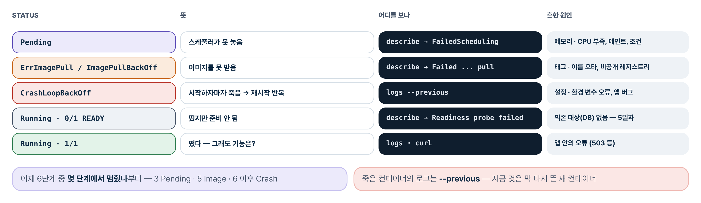

# 3교시 · Pod 장애 읽기

!!! goal "이번 시간에 할 일"
    - 일부러 망가뜨린 Pod 세 개를 만들고, 상태 이름만 보고 **몇 단계에서 멈췄는지** 짐작합니다.
    - `describe`의 Events와 `logs --previous`로 원인을 찾습니다.
    - 상태 → 볼 곳 → 흔한 원인으로 이어지는 **Pod 장애 지도**를 내 것으로 만듭니다.



!!! key "진단의 첫 질문 — 몇 단계에서 멈췄나"
    어제 3교시의 6단계를 다시 떠올립니다. **3에서 멈추면 Pending, 5에서 멈추면 이미지 오류, 6 이후에 죽으면 CrashLoopBackOff.** 상태 이름이 곧 "어디를 볼지"를 알려 줍니다.

## 실습 5 · 세 Pod를 한꺼번에 망가뜨리기

```bash
cd ~/devops-lab/k8s/day4
kubectl apply -f broken-image.yaml -f worker-crash.yaml -f too-big.yaml
sleep 30
kubectl get pods
```

!!! check "30초 뒤"
    ```text
    NAME           READY   STATUS             RESTARTS      AGE
    broken-image   0/1     ImagePullBackOff   0             30s
    too-big        0/1     Pending            0             30s
    worker-crash   0/1     CrashLoopBackOff   2 (12s ago)   30s
    ```
    상태 이름은 보는 순간에 따라 `ErrImagePull` ↔ `ImagePullBackOff`, `Error` ↔ `CrashLoopBackOff`로 바뀌어 보입니다. 아래에서 하나씩 읽습니다.

## 장애 1 · ImagePullBackOff — 이미지를 못 받는다

```bash
kubectl describe pod broken-image | tail -8
```

!!! check "Events"
    ```text
      Normal   Scheduled  45s                default-scheduler  Successfully assigned default/broken-image to devmart-worker
      Normal   Pulling    20s (x2 over 45s)  kubelet            Pulling image "ghcr.io/niceguy61/devmart-catalog-api:sha-0000000"
      Warning  Failed     19s (x2 over 44s)  kubelet            Failed to pull image "ghcr.io/niceguy61/devmart-catalog-api:sha-0000000": rpc error: code = NotFound desc = failed to pull and unpack image "…": … not found
      Warning  Failed     19s (x2 over 44s)  kubelet            Error: ErrImagePull
      Normal   BackOff    5s (x2 over 43s)   kubelet            Back-off pulling image "ghcr.io/niceguy61/devmart-catalog-api:sha-0000000"
      Warning  Failed     5s (x2 over 43s)   kubelet            Error: ImagePullBackOff
    ```

읽는 법:

1. `Scheduled`는 성공했다 → **3단계는 통과.** 노드는 정해졌다.
2. `Failed to pull image … not found` → **5단계에서 멈춤.** 레지스트리가 "그런 태그 없다"고 답했다.
3. `ErrImagePull` → `BackOff` → `ImagePullBackOff` — 실패하면 kubelet이 **기다렸다가 다시** 받는다. 기다리는 시간이 점점 길어진다(최대 5분).

!!! term "용어 — BackOff (물러서기)"
    실패한 일을 곧바로 반복하지 않고, **기다리는 시간을 점점 늘려 가며** 다시 하는 것. 2일차 2교시의 **지수 백오프**와 같은 생각입니다. 레지스트리나 앱이 잠깐 아픈 거라면 다시 해서 살아나고, 계속 아프면 괴롭히지 않습니다.

!!! example "예시 — 같은 ImagePullBackOff, 다른 원인"
    | 메시지의 핵심 | 원인 | 2일차 기억 |
    |---|---|---|
    | `not found` | 태그 · 이미지 이름 오타 | |
    | `401 Unauthorized` · `denied` | 비공개 이미지인데 노드가 로그인 정보가 없다 | 패키지를 Public으로 바꾼 이유 |
    | `no match for platform in manifest` | 이미지가 노드 CPU(amd64/arm64)용으로 안 만들어짐 | Apple Silicon에서 amd64만 빌드 |
    | `dial tcp … i/o timeout` | 노드가 레지스트리에 못 닿음 (네트워크 · 프록시) | |

    상태 이름은 같아도 **메시지 끝부분**이 원인을 알려 줍니다. 2일차 7교시에 배운 "로그는 마지막 에러 줄부터"가 여기서도 통합니다.

## 장애 2 · CrashLoopBackOff — 뜨자마자 죽는다

```bash
kubectl get pod worker-crash
kubectl logs worker-crash
kubectl logs worker-crash --previous | tail -4
```

!!! check "보이는 것"
    ```text
    NAME           READY   STATUS             RESTARTS      AGE
    worker-crash   0/1     CrashLoopBackOff   4 (30s ago)   2m
    ```
    ```text
    (아무것도 없거나, 막 다시 뜬 컨테이너의 몇 줄)
    ```
    ```text
      File "/app/worker.py", line 16, in <module>
        WORK_SECONDS = float(os.getenv("WORK_SECONDS", "1"))
                       ~~~~~^^^^^^^^^^^^^^^^^^^^^^^^^^^^^^^^
    ValueError: could not convert string to float: 'abc'
    ```

- **RESTARTS가 계속 오른다** → 6단계까지 갔다가(컨테이너 시작) 죽고, kubelet이 다시 띄우고, 또 죽는다.
- `kubectl logs`는 **지금** 컨테이너의 로그다. 막 다시 뜬 컨테이너는 아직 할 말이 없다.
- **`--previous`** 가 방금 죽은 컨테이너의 유언이다. 원인은 여기 있다.

2일차 2교시에 Compose로 만든 크래시 루프와 **같은 원인, 같은 오류**입니다. 이름만 `Restarting` → `CrashLoopBackOff`로 바뀌었습니다. 교훈도 같습니다. **틀린 설정은 재시작으로 고쳐지지 않습니다.** 고치는 길은 매니페스트를 고쳐 다시 `apply`하는 것입니다.

```bash
kubectl describe pod worker-crash | grep -A3 'Last State'
```

!!! check "보이는 것"
    ```text
        Last State:     Terminated
          Reason:       Error
          Exit Code:    1
          Started:      Thu, 26 Nov 2026 10:21:40 +0900
    ```
    **Exit Code**도 단서입니다. `1`은 앱이 스스로 오류로 끝난 것, **`137`은 밖에서 강제로 죽인 것**(대부분 메모리 초과로 OOMKilled — 내일 requests/limits에서 만납니다).

## 장애 3 · Pending — 놓을 곳이 없다

```bash
kubectl describe pod too-big | tail -4
```

!!! check "Events"
    ```text
    Events:
      Type     Reason            Age   From               Message
      ----     ------            ----  ----               -------
      Warning  FailedScheduling  2m    default-scheduler  0/3 nodes are available: 1 node(s) had untolerated taint {node-role.kubernetes.io/control-plane: }, 2 Insufficient memory. preemption: 0/3 nodes are available: 1 Preemption is not helpful for scheduling, 2 No preemption victims found for incoming pod.
    ```

이 한 줄을 어제 2교시의 **스케줄러 '거르기'**로 읽습니다.

| 메시지 조각 | 뜻 |
|---|---|
| `0/3 nodes are available` | 노드 3대 중 놓을 수 있는 곳 0 |
| `1 node(s) had untolerated taint {…control-plane…}` | 1대(컨트롤 플레인)는 테인트 때문에 탈락 |
| `2 Insufficient memory` | 2대(워커)는 메모리 부족으로 탈락 — 100Gi를 달라고 했으니 |
| `preemption: …` | 우선순위가 낮은 Pod를 밀어내고라도 놓을 수 있나 봤지만 안 된다 |

`too-big.yaml`에는 `resources.requests.memory: 100Gi`가 적혀 있습니다. "이 Pod는 메모리 100Gi를 **예약**해야 한다"는 뜻이고, 그런 노드는 없습니다. **Events가 하나뿐이고 From이 스케줄러**라는 것 자체가 단서입니다 — kubelet까지 가지도 못했습니다. requests는 내일 5교시에 제대로 배웁니다.

!!! myth "오해 — Pending이면 기다리면 된다"
    이미지를 받는 중인 `ContainerCreating`은 기다리면 됩니다. 하지만 **Pending**이 1분 넘게 이어지면 대부분 기다려도 안 풀립니다. 스케줄러는 조건이 바뀌기 전까지 계속 같은 이유로 거절합니다. Events의 `FailedScheduling`부터 봅니다. (예외: 노드를 자동으로 늘리는 클러스터 오토스케일러가 있으면 새 노드가 생길 때까지 Pending이 정상입니다 — 5주차 EKS.)

## 정리 — 세 Pod 지우기

```bash
kubectl delete -f broken-image.yaml -f worker-crash.yaml -f too-big.yaml
kubectl get pods
```

!!! check "보이는 것"
    ```text
    pod "broken-image" deleted
    pod "worker-crash" deleted
    pod "too-big" deleted
    No resources found in default namespace.
    ```

## 실습 6 · 장애 진단 기록

!!! lab "실습 목표"
    2일차 3교시의 장애 보고서처럼, **증거가 있는 문장**만으로 세 장애를 기록합니다.

배움 노트에 장애마다 다음 다섯 줄을 씁니다.

```text
[장애 ?: Pod 이름]
- 보인 상태 (get):
- 멈춘 단계 (6단계 중):
- 근거가 된 한 줄 (describe 또는 logs --previous에서 복사):
- 원인:
- 고치는 법 (매니페스트의 어느 줄을 어떻게):
```

!!! check "스스로 점검"
    - '근거가 된 한 줄'이 **From: kubelet**의 줄인가, **From: default-scheduler**의 줄인가, **앱의 로그**인가? 세 장애가 하나씩 다를 것입니다.
    - '고치는 법'에 "재시작한다"가 들어가 있다면 다시 생각해 보세요.

!!! academic "학술 노트 — 장애는 '어느 층'의 문제인가"
    오늘 본 세 장애는 서로 다른 층에서 일어났습니다. **스케줄링 층**(Pending), **배포 · 공급 층**(이미지), **앱 층**(크래시). 구글의 대규모 장애 분석 연구들은 원인의 상당 부분이 코드 버그보다 **설정 변경과 배포**에서 온다고 보고합니다. 예를 들어 Barroso, Hölzle & Ranganathan의 *The Datacenter as a Computer*(3판, 2018)는 구글 서비스 장애 원인 중 소프트웨어 · 설정 문제가 하드웨어보다 큰 비중을 차지한다고 정리합니다. 오늘의 세 장애가 모두 **매니페스트 한 줄**에서 왔다는 것이 우연이 아닙니다.

!!! trend "트렌드 2026 — 배포 전에 막기"
    오늘 장애 셋은 `apply`한 뒤에야 드러났습니다. 요즘은 **매니페스트를 CI에서 먼저 검사**합니다. 문법은 `kubeconform`, 정책("requests가 없으면 거절", "latest 태그 금지")은 Kyverno · OPA Gatekeeper로 PR 단계에서 걸러 냅니다. 2일차의 compose-check 잡과 같은 생각이고, 4주차 5일차에 Kyverno로 직접 해 봅니다.

!!! quiz "확인 문제"
    1. `CrashLoopBackOff`에서 `kubectl logs`가 비어 있을 때 쓰는 옵션은?
    2. `FailedScheduling` 이벤트를 남긴 것은 누구인가요? 그 Pod의 이미지는 받아졌을까요?
    3. `ImagePullBackOff`의 메시지가 `401 Unauthorized`라면 무엇을 확인하나요?
    4. Exit Code 137은 무슨 뜻인가요?

    ??? answer "정답"
        1. `--previous` (방금 죽은 컨테이너의 로그)
        2. default-scheduler. 노드가 정해지지 않았으니 kubelet까지 가지 못했고, 이미지는 받지 않았다
        3. 이미지가 비공개인지 (GHCR 패키지 공개 설정), 비공개라면 노드가 쓸 로그인 정보(이미지 풀 Secret)가 있는지
        4. 밖에서 강제로 죽임(SIGKILL) — 대부분 메모리 한도 초과(OOMKilled)

## 참고 문헌

- Kubernetes Docs. *Debug Pods* · *Debug Running Pods*. kubernetes.io/docs/tasks/debug
- Kubernetes Docs. *Images — Image pull backoff*. kubernetes.io/docs/concepts/containers/images
- Kubernetes Docs. *Pod Lifecycle — Container restart policy (CrashLoopBackOff)*. kubernetes.io/docs/concepts/workloads/pods
- Barroso, L. A., Hölzle, U., & Ranganathan, P. (2018). *The Datacenter as a Computer* (3rd ed.). Morgan & Claypool.
