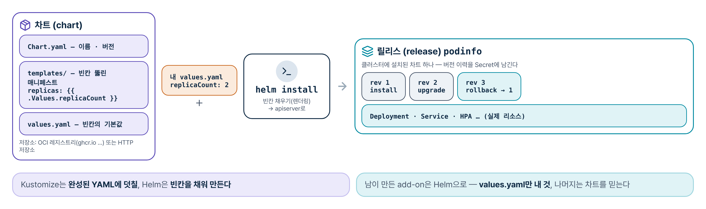

# 1교시 · 3주차 요약 + Helm 개념

!!! goal "이번 시간에 할 일"
    - 주말 사이 클러스터를 되살리고, 3주차의 큰 줄기를 다시 짚습니다.
    - 남이 만든 도구를 설치할 때 왜 **패키지 관리자**가 필요한지 이해합니다.
    - Helm의 네 낱말 — **차트 · values · 릴리스 · 저장소** — 를 구분합니다.
    - **Helm 4**를 설치합니다.

## 3주차 요약 — 손으로 다시 확인

```bash
docker start devmart-control-plane devmart-worker devmart-worker2 2>/dev/null; sleep 40
kubectl get nodes
kubectl get pods -n devmart
curl -s -o /dev/null -w '%{http_code}\n' localhost:30080/api/products
```

!!! check "이렇게 나오면 준비 완료"
    ```text
    NAME                    STATUS   ROLES           AGE   VERSION
    devmart-control-plane   Ready    control-plane   6d    v1.37.0
    devmart-worker          Ready    <none>          6d    v1.37.0
    devmart-worker2         Ready    <none>          6d    v1.37.0
    NAME                            READY   STATUS    RESTARTS      AGE
    catalog-api-5c9b7d8f6e-4tq2k    1/1     Running   1 (40s ago)   3d
    ...
    200
    ```
    RESTARTS가 1씩 올라 있는 것은 노드가 꺼졌다 켜지며 컨테이너가 다시 시작됐기 때문입니다. 정상입니다.

!!! trouble "Pod 몇 개가 0/1이거나 web이 CrashLoopBackOff"
    노드가 켜지는 순서에 따라 order-api가 DB보다 먼저 떠서 잠시 준비되지 않을 수 있습니다(3주차 5일차 5교시). 1분 기다려 봅니다. web이 `host not found in upstream`으로 죽어 있으면 `kubectl rollout restart deployment/web -n devmart`. 클러스터 자체가 망가졌다면 3주차 5일차 8교시의 '5분 복구' 순서대로 다시 만듭니다.

3주차를 한 줄씩 짚습니다.

| 3주차 | 오늘 이어지는 곳 |
|---|---|
| Kustomize로 매니페스트 여덟 개를 묶었다 | 남이 만든 수백 개짜리는? → **Helm** |
| values가 바뀌면 `apply`로 맞춘다 (선언형) | Helm도 values 파일이 원하는 상태 |
| `rollout undo` — 옛 ReplicaSet으로 되돌리기 | `helm rollback` — 릴리스 전체를 되돌리기 |
| nginx가 경로로 나눠 보내는 API 게이트웨이 (1일차) | 그 일을 **Gateway API**로 (5~6교시) |
| Service 종류: ClusterIP · NodePort · LoadBalancer (4일차) | 그 위의 **L7 입구** — Ingress와 Gateway API (3교시) |

## 남이 만든 것을 설치하는 문제

오늘 5교시에 설치할 Envoy Gateway의 설치용 매니페스트에는 Deployment · Service · ServiceAccount · Role · RoleBinding · ConfigMap, 그리고 수십 개의 **CRD**(새 리소스 종류 정의)가 들어 있습니다. 이것을 손으로 쓸 수는 없고, 받아서 그대로 쓰면 이런 문제가 생깁니다.

!!! example "생각 실험 — 설치용 YAML 파일 하나를 받았다"
    1. 메모리 requests를 바꾸고 싶다 → 3000줄 파일에서 해당 줄을 찾아 **직접 고친다.**
    2. 다음 달 새 버전이 나왔다 → 새 3000줄 파일을 받는다. **내가 고친 줄은?** 다시 찾아 고친다.
    3. 새 버전이 문제가 있다 → **이전 버전으로 되돌리려면?** 이전 파일을 어디 뒀더라.
    4. 이 클러스터에 **무엇이, 어느 버전이** 설치되어 있는지 한눈에 보려면?

이 네 문제를 푸는 것이 **패키지 관리자**입니다. 리눅스의 `apt`, 파이썬의 `pip`, 맥의 `brew`처럼, Kubernetes에는 **Helm**이 있습니다.

## Helm의 네 낱말



| 낱말 | 뜻 | `apt`로 치면 |
|---|---|---|
| **차트** (chart) | 빈칸이 뚫린 매니페스트 묶음(`templates/`) + 빈칸의 기본값(`values.yaml`) + 이름 · 버전(`Chart.yaml`) | `.deb` 패키지 |
| **values** | 빈칸에 넣을 값. 차트의 기본값 위에 **내 values 파일**을 덮어쓴다 | 설정 파일 |
| **릴리스** (release) | 클러스터에 **설치된** 차트 하나. 이름이 있고 **버전 이력(revision)**을 남긴다 | 설치된 패키지 |
| **저장소** (repository) | 차트를 올려 두는 곳. 요즘은 컨테이너 이미지처럼 **OCI 레지스트리**(ghcr.io, docker.io)를 많이 쓴다 | apt 저장소 |

템플릿은 이렇게 생겼습니다(podinfo 차트의 일부를 줄인 것).

```yaml
# templates/deployment.yaml
apiVersion: apps/v1
kind: Deployment
metadata:
  name: {{ template "podinfo.fullname" . }}
spec:
  replicas: {{ .Values.replicaCount }}
  template:
    spec:
      containers:
        - name: {{ .Chart.Name }}
          image: "{{ .Values.image.repository }}:{{ .Values.image.tag }}"
```

`{{ … }}` 자리가 빈칸입니다. `helm install`은 values를 넣어 빈칸을 채운 **완성된 YAML**을 만들어(렌더링) apiserver에 보냅니다. 클러스터 입장에서는 3주차에 우리가 손으로 쓴 YAML과 다를 것이 없습니다.

!!! analogy "비유 — 서식 문서와 우편 합치기"
    차트는 **"{{이름}} 님께, 주문하신 {{상품}}이 …"**처럼 빈칸이 뚫린 **서식 문서**입니다. values는 **주소록**입니다. Helm은 둘을 합쳐 완성된 편지(매니페스트)를 찍어 냅니다. 서식이 새 버전으로 바뀌어도 주소록(내 values)은 그대로 다시 씁니다 — 생각 실험의 2번 문제가 풀립니다.

### Kustomize와 무엇이 다른가

| | Kustomize (3주차 5일차) | Helm |
|---|---|---|
| 방식 | 완성된 YAML 위에 **덧칠**(patch) | 빈칸 뚫린 템플릿을 **채움** |
| 설치 기록 | 없음 — 클러스터에 남는 것은 리소스뿐 | **릴리스**와 버전 이력을 클러스터에 남김 |
| 되돌리기 | 파일(Git)을 되돌려 다시 apply | `helm rollback` |
| 주로 쓰는 곳 | **내가 만든 앱**의 환경별 변형 | **남이 만든 도구**를 설치 · 업그레이드 |
| 별도 설치 | 필요 없음 (kubectl에 내장) | `helm` 실행 파일 |

둘은 경쟁이 아니라 쓰임새가 다릅니다. 이 과정의 원칙도 그렇습니다 — **Kubernetes 추가 도구(add-on)는 Helm으로, values 파일을 기준으로** 설치합니다. DevMart 같은 우리 앱은 계속 Kustomize로 둡니다.

!!! myth "오해 — Helm을 쓰면 YAML을 몰라도 된다"
    반대입니다. 차트가 만들어 낸 리소스는 결국 3주차의 Deployment · Service · ConfigMap입니다. 설치가 잘못되면 `kubectl get pods` · `describe` · `logs`로 3주차와 똑같이 진단합니다. 그리고 values 파일의 어느 값을 바꿔야 하는지 알려면, 그 값이 **어떤 리소스의 어느 칸**이 되는지 읽을 줄 알아야 합니다(2교시 `helm template`).

## 실습 1 · Helm 4 설치

### Linux · WSL2 Ubuntu (bash)

```bash
cd /tmp
curl -fsSL -o get_helm.sh https://raw.githubusercontent.com/helm/helm/main/scripts/get-helm-4
less get_helm.sh            # 무엇을 하는지 훑어본다 (q로 나가기)
chmod 700 get_helm.sh
./get_helm.sh
rm get_helm.sh
```

- 공식 설치 스크립트를 **받아서, 읽고, 실행**한다. `curl … | bash`로 바로 실행하지 않는 이유는 2주차 2일차의 "남의 코드는 남의 코드"와 같다

### Mac (터미널 · Homebrew)

```bash
brew install helm
```

!!! tip "다른 설치 방법 — winget · 직접 다운로드"
    | 방법 | 어디서 | 명령 · 주소 |
    |---|---|---|
    | winget | Windows PowerShell | `winget install -e --id Helm.Helm` |
    | 직접 다운로드 | 브라우저 | [github.com/helm/helm/releases](https://github.com/helm/helm/releases) — 압축을 풀어 `helm`을 PATH에 |

    winget은 **Windows 쪽**에 설치하므로 PowerShell에서만 보입니다. 수업 명령은 WSL Ubuntu(bash)에서 치므로, Windows 사용자도 위의 **WSL 방법**으로 설치합니다. 전체 목록은 **부록 A · 도구 설치 가이드**.

### 확인 (공통)

```bash
helm version
```

!!! check "이렇게 나오면 성공"
    ```text
    version.BuildInfo{Version:"v4.x.y", GitCommit:"…", GitTreeState:"clean", GoVersion:"go1.2x.x", KubeClientVersion:"v1.3x"}
    ```
    **v4**로 시작해야 합니다. 받는 시점의 최신 패치 번호가 `x.y` 자리에 들어갑니다.

!!! trouble "v3.x가 나온다"
    예전에 설치한 Helm 3이 PATH에서 먼저 잡힌 것입니다. `which -a helm`으로 위치를 보고, 오래된 것을 지우거나 Mac이라면 `brew upgrade helm`. Helm 3은 2026년 9월의 마지막 기능 릴리스 뒤 2027년 2월까지 보안 패치만 받습니다. 새로 시작하는 사람은 Helm 4를 씁니다.

!!! academic "학술 노트 — 패키지 관리와 '의존성 지옥'"
    패키지 관리자는 오래된 문제를 풉니다. 소프트웨어가 서로의 특정 버전에 기대며 얽히면, 하나를 올릴 때 다른 것이 깨지는 **의존성 지옥**이 생깁니다. Mancinelli, Di Cosmo 외(2006)의 연구는 리눅스 배포판 패키지 설치 문제를 수학적으로 분석해, 의존성 · 충돌을 모두 만족하는 설치 조합을 찾는 일이 일반적으로 **NP-완전**임을 보였습니다. Helm은 이 문제를 크게 줄이는 쪽을 택했습니다 — 차트 의존성(subchart)은 차트 안에 **함께 묶여** 배포되고, 클러스터에 설치된 릴리스끼리는 서로 버전을 따지지 않습니다. 대신 CRD처럼 **클러스터 전체가 하나만 가지는 것**은 여전히 충돌의 원천입니다(5교시).

!!! trend "트렌드 2026 — Helm 4"
    Helm은 2025년 11월 KubeCon에서 **6년 만의 메이저 버전 v4**를 내놓았습니다. 새로 설치하는 릴리스는 기본으로 **server-side apply**를 씁니다 — 3주차 5일차 6교시 장애 3에서 본 "apply가 남의 칸을 모른다" 문제를, 칸마다 **주인(field manager)**을 기록하는 방식으로 다룹니다. 그 밖에 `--atomic`이 `--rollback-on-failure`로, `--force`가 `--force-replace`로 이름이 바뀌었고(옛 이름도 경고와 함께 동작), 플러그인에 WebAssembly 실행 환경이 생겼습니다. 인터넷의 옛 글에 나오는 플래그가 경고를 내면 이 변화 때문입니다.

!!! quiz "확인 문제"
    1. 차트와 릴리스의 차이는?
    2. 새 버전 차트로 올릴 때, 내가 바꾼 설정이 사라지지 않는 이유는?
    3. 이 과정에서 DevMart는 Kustomize, Envoy Gateway는 Helm으로 다루는 이유는?
    4. Helm으로 설치한 도구가 안 뜰 때, 진단에 쓰는 명령은 무엇인가요?

    ??? answer "정답"
        1. 차트는 설치용 묶음(템플릿 + 기본값), 릴리스는 그 차트가 클러스터에 **설치된 한 벌**(이름과 버전 이력이 있다)
        2. 내 설정은 차트가 아니라 **내 values 파일**에 있고, 새 차트에 같은 values 파일을 다시 덮어쓰기 때문
        3. DevMart는 우리가 만든 앱이라 매니페스트를 직접 쓰고 고친다(Kustomize). Envoy Gateway는 남이 만든 큰 도구라 차트를 받아 values만 관리한다(Helm)
        4. 3주차와 같다 — `kubectl get pods` · `describe` · `logs` (Helm은 매니페스트를 만들어 보낼 뿐)

## 참고 문헌

- Helm Docs. *Using Helm* · *Charts* · *Chart Template Guide*. helm.sh/docs
- Helm Blog (2025-11). *Helm 4 Released*. helm.sh/blog
- Helm Blog (2026). *Helm 3 End of Life*. helm.sh/blog
- Helm Docs. *Helm 4 Overview*. helm.sh/docs/overview
- Mancinelli, F., Boender, J., Di Cosmo, R., Vouillon, J., Durak, B., Leroy, X., & Treinen, R. (2006). Managing the Complexity of Large Free and Open Source Package-Based Software Distributions. *ASE 2006*.
