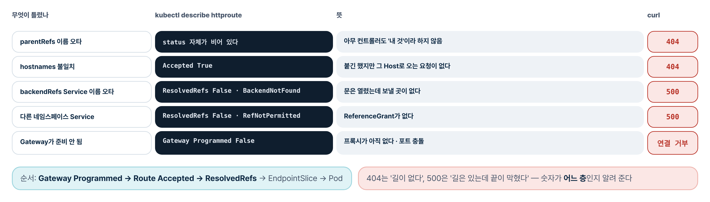

# 7교시 · 장애 분석

!!! goal "이번 시간에 할 일"
    - 라우트를 일부러 네 가지로 망가뜨리고, **curl 응답 코드**와 **status.conditions**로 원인을 찾습니다.
    - **404**(길이 없다)와 **500**(길 끝이 막혔다)이 어느 층의 문제인지 구분합니다.
    - 엉뚱한 곳이 **200으로** 대답하는 장애가 있음을 압니다.
    - **ReferenceGrant**로 다른 네임스페이스 허락을 직접 만들어 봅니다.

## 진단의 순서 — 문에서 Pod까지



3주차 5일차 6교시의 '바깥에서 안으로'에 Gateway 층이 하나 더 생겼습니다.

| 단계 | 묻는 것 | 명령 |
|---|---|---|
| 1 | 응답 코드는? 응답이 아예 없나? | `curl -s -o /dev/null -w '%{http_code}' …` |
| 2 | **Gateway**가 준비됐나? | `kubectl get gateway -n devmart` → PROGRAMMED |
| 3 | **라우트**가 붙었나? 보낼 곳을 찾았나? | `kubectl describe httproute …` → Accepted · ResolvedRefs |
| 4 | Service 뒤에 Pod가 있나? | `kubectl get endpointslices -n …` (3주차 4일차) |
| 5 | Pod는? 앱은? | `get pods` · `describe` · `logs` (3주차) |

!!! key "응답 코드가 층을 알려 준다"
    | 코드 | 누가 답했나 | 뜻 |
    |---|---|---|
    | 응답 없음 · 연결 거부 | 아무도 | 문(Gateway)이 없다 — 포트 · Service · Envoy Pod |
    | **404** (빈 본문) | Envoy | 문은 열렸는데 **맞는 길(라우트 · Host · 경로)이 없다** |
    | **500** (빈 본문) | Envoy | 길은 있는데 **보낼 곳이 잘못됐다** (Service 없음 · 허락 없음) |
    | 503 | Envoy | 보낼 곳은 맞는데 **준비된 Pod가 없다** (EndpointSlice 비었음) |
    | 앱의 JSON 오류 (503 `database unavailable` 등) | 앱 | Gateway는 할 일을 다 했다 — 3주차의 진단으로 |

## 실습 14 · 장애 넷

장애마다 **망가뜨리기 → 증상 → 진단 → 되돌리기** 순서로 합니다. 각자 진단한 뒤 아래 해설을 엽니다.

```bash
cd ~/devops-lab/k8s/w4d1
```

### 장애 1 — 라우트가 엉뚱한 문을 가리킨다

```bash
kubectl patch httproute web -n devmart --type=json \
  -p '[{"op":"replace","path":"/spec/parentRefs/0/name","value":"devmrt"}]'
sleep 3; curl -s -o /dev/null -w '%{http_code}\n' localhost:30080/
```

??? answer "해설 — 장애 1"
    **증상** — `/`가 **404**. `/api/products`는 여전히 200(다른 라우트는 멀쩡).

    **진단**
    ```bash
    kubectl describe httproute web -n devmart | sed -n '/^Spec:/,/^Events/p' | grep -A2 -E 'Parent Refs|Parent Ref:'
    ```
    - Spec의 parentRefs는 `devmrt`인데, Status에는 **`devmrt`에 대한 기록이 없다.** 그런 Gateway가 없으니 어떤 컨트롤러도 이 라우트를 "내 것"이라 하지 않는다.
    - Status에 예전 `devmart`의 `Accepted True`가 **남아 보일 수도** 있다. 그래서 status를 읽을 때는 Conditions만 보지 말고 **어느 Parent Ref에 대한 것인지**를 꼭 확인한다.

    **되돌리기** — `kubectl apply -f gateway/devmart-routes.yaml`

    **배운 것** — **status가 비어 있는 것 자체가 단서다.** 3주차 3일차에 "CRD만 있고 컨트롤러가 없으면 아무 일도 안 일어난다"고 했다. 아무도 맡지 않은 리소스는 조용하다.

### 장애 2 — 보낼 Service 이름이 틀렸다

```bash
kubectl patch httproute catalog -n devmart --type=json \
  -p '[{"op":"replace","path":"/spec/rules/0/backendRefs/0/name","value":"catalog-ap"}]'
sleep 3; curl -s -o /dev/null -w '%{http_code}\n' localhost:30080/api/products
```

??? answer "해설 — 장애 2"
    **증상** — `/api/products`가 **500**. 상품 목록이 안 뜬다. 주문하기도 실패할까? → 아니다. 주문은 `orders` 라우트로 가서 order-api가 **클러스터 안에서** catalog-api Service를 직접 부르므로(3주차 1일차) 멀쩡하다. 입구의 고장과 안쪽의 연결은 별개다.

    **진단**
    ```bash
    kubectl describe httproute catalog -n devmart | grep -B2 -A3 'ResolvedRefs'
    ```
    ```text
        Message:  Failed to process route rule 0 backendRef 0: service devmart/catalog-ap not found.
        Reason:   BackendNotFound
        Status:   False
        Type:     ResolvedRefs
    ```
    `Accepted`는 True(문에는 붙었다), `ResolvedRefs`가 False(끝이 막혔다).

    **되돌리기** — `kubectl apply -f gateway/devmart-routes.yaml`

    **배운 것** — Gateway API 명세는 "잘못된 backend로 갈 요청은 **500**을 받아야 한다"고 정해 두었다. 3주차 4일차의 Service 셀렉터 오타(`Connection refused`)와 비교하면, 같은 '이름 오타'라도 **어느 층에서 틀렸나**에 따라 증상이 다르다.

### 장애 3 — Host 오타

```bash
kubectl patch httproute podinfo -n default --type=json \
  -p '[{"op":"replace","path":"/spec/hostnames/0","value":"podinfo.local"}]'
sleep 3; curl -s -H 'Host: podinfo.localhost' localhost:30080 | head -c 120; echo
```

??? answer "해설 — 장애 3"
    **증상** — 에러가 아니다. **DevMart의 HTML(200)**이 돌아온다. podinfo를 불렀는데 엉뚱한 앱이 정상인 척 대답했다.

    **진단**
    ```bash
    kubectl get httproute -A
    kubectl describe httproute podinfo -n default | grep -A3 'Type:     Accepted'
    ```
    - HOSTNAMES 칸이 `["podinfo.local"]` — `localhost`가 아니다.
    - 라우트 상태는 `Accepted True`, `ResolvedRefs True` — **라우트 자체는 아무 문제가 없다.** 단지 아무도 `podinfo.local`로 요청하지 않을 뿐이다.
    - `podinfo.localhost` 요청은 Host가 맞는 라우트가 없으니, Host를 정하지 않은 DevMart 라우트(`/` → web)가 받았다.

    **되돌리기** — `kubectl apply -f gateway/podinfo-split.yaml`

    **배운 것** — 3주차 5일차 장애 3처럼 **모든 status가 초록인데 틀린** 장애다. "무엇이 대답했나"를 내용으로 확인해야 한다(응답 코드만 보면 놓친다). 이런 일을 막으려고 실무에서는 Host를 정하지 않은 **잡동사니 라우트를 두지 않거나**, 기본 라우트를 '알 수 없는 Host입니다' 페이지로 둔다.

### 장애 4 — 허락 없이 다른 네임스페이스로

```bash
sed -n '/spec:/,$p' drills/cross-ns-route.yaml
kubectl apply -f drills/cross-ns-route.yaml
sleep 3; curl -s -o /dev/null -w '%{http_code}\n' -H 'Host: mirror.localhost' localhost:30080
```

??? answer "해설 — 장애 4"
    **증상** — **500**.

    **진단**
    ```bash
    kubectl describe httproute podinfo-mirror -n devmart | grep -B2 -A3 'ResolvedRefs'
    ```
    ```text
        Message:  Failed to process route rule 0 backendRef 0: spec.rules[0].backendRefs[0].namespace: Forbidden: …
        Reason:   RefNotPermitted
        Status:   False
        Type:     ResolvedRefs
    ```
    devmart의 라우트가 **default**의 Service를 가리켰는데, default 쪽의 **허락(ReferenceGrant)**이 없다.

    **고치기 — 허락 만들기**
    ```bash
    cat drills/referencegrant.yaml
    kubectl apply -f drills/referencegrant.yaml
    sleep 3; curl -s -H 'Host: mirror.localhost' localhost:30080 | grep -o '"hostname": "[^"]*"'
    ```
    ```text
      "hostname": "podinfo-7b9c8d6f5-k2x8p"
    ```
    허락은 **Service가 있는 쪽(default)**에 만든다. 남의 사무실에 들어가려면 **그 회사**의 허락이 필요하다(4교시 비유).

    **정리** — `kubectl delete -f drills/cross-ns-route.yaml -f drills/referencegrant.yaml`

    **배운 것** — 6교시 podinfo 라우트는 default에 있었고 Service도 default라 허락이 필요 없었다. **라우트와 Service가 다른 칸**일 때만 ReferenceGrant가 필요하다. 이 허락이 없으면 아무 팀이나 남의 Service로 문을 열 수 있게 된다 — 4주차 5일차 보안에서 다시 본다.

## 정리 — 원래대로

```bash
kubectl apply -f gateway/devmart-routes.yaml -f gateway/podinfo-split.yaml
kubectl get httproute -A
for p in / /api/products /api/orders; do printf '%-15s ' $p; curl -s -o /dev/null -w '%{http_code}\n' localhost:30080$p; done
```

!!! check "보이는 것"
    ```text
    NAMESPACE   NAME      HOSTNAMES               AGE
    default     podinfo   ["podinfo.localhost"]   1h
    devmart     catalog                           1h
    devmart     orders                            1h
    devmart     web                               1h
    /               200
    /api/products   200
    /api/orders     200
    ```

!!! warn "오늘 만든 것은 지우지 않는다"
    Envoy Gateway · Gateway · 라우트 · podinfo 두 릴리스는 **내일 그대로** 씁니다. 내일(Observability)은 이 Gateway를 지나는 요청을 숫자와 그래프로 봅니다. 클러스터 '5분 복구' 순서(3주차 5일차 7교시)에 오늘 것을 덧붙여 적어 두세요 — `helm install eg …` → `kubectl apply -f gateway/…` 순서입니다.

!!! academic "학술 노트 — 조용한 실패와 '관찰 가능한 실패'"
    오늘 장애 넷 중 둘(1 · 3)은 **에러 메시지 없이** 틀렸습니다. Huang 외의 *Gray Failure: The Achilles' Heel of Cloud-Scale Systems*(HotOS 2017)는 클라우드 장애 중 상당수가 시스템 스스로는 "정상"이라고 보고하는데 **사용자 쪽에서만 이상이 보이는** 회색 실패(gray failure)라고 분석했습니다. 해결 방향은 "다르게 보는 관점을 늘리는 것" — 오늘처럼 status(시스템의 자기 보고)와 curl의 응답 **내용**(사용자 관점)을 함께 보는 것입니다. 내일의 Observability가 이 관점들을 체계적으로 만드는 일입니다.

!!! trend "트렌드 2026 — 설정 검사를 배포 전에"
    오늘 장애는 모두 `kubectl apply`는 성공했습니다. 요즘은 Gateway API 리소스도 배포 **전에** 검사합니다 — Envoy Gateway의 `egctl x translate`는 라우트를 Envoy 설정으로 미리 번역해 보여 주고, Gateway API v1.5부터는 CRD에 **검증 규칙(CEL)**이 많이 들어가 잘못된 값을 apiserver가 바로 거절합니다. 그래도 "Host 오타"처럼 **문법상 올바른 실수**는 검사기가 잡지 못합니다. 그래서 배포 뒤에 실제 요청으로 확인하는 **스모크 테스트**를 CI · CD에 둡니다(4주차 3일차).

!!! quiz "확인 문제"
    1. 404와 500은 각각 어떤 문제를 가리키나요?
    2. 라우트의 status에 아무 기록이 없다면 무엇을 의심하나요?
    3. 장애 3에서 에러 대신 200이 돌아온 이유는?
    4. ReferenceGrant는 어느 네임스페이스에 만드나요?
    5. 오늘 Gateway 층의 진단 순서를 세 단계로 쓰면?

    ??? answer "정답"
        1. 404 — 맞는 길(라우트 · Host · 경로)이 없다. 500 — 길은 있는데 보낼 곳이 잘못됐다(Service 없음 · 허락 없음)
        2. parentRefs가 가리키는 Gateway가 없거나 이름이 틀려, 어떤 컨트롤러도 이 라우트를 맡지 않았다
        3. 맞는 Host의 라우트가 없어, Host를 정하지 않은 DevMart 라우트(`/` → web)가 대신 받았다
        4. 허락하는 쪽 — 가리킴을 받는 Service가 있는 네임스페이스
        5. Gateway PROGRAMMED → 라우트 Accepted → 라우트 ResolvedRefs (그다음 EndpointSlice · Pod)

!!! diary "오늘의 배움일기"
    - Helm을 친구에게 `apt`나 앱 스토어에 빗대어 한 문단으로
    - `helm rollback`과 `kubectl rollout undo`의 차이를 오늘 실제 상황으로
    - ingress-nginx 은퇴에서 가장 인상적이었던 점 — 기술 때문인가, 사람(유지보수) 때문인가
    - GatewayClass · Gateway · HTTPRoute를 회사의 세 사람에게 나눠 준다면 누구에게 무엇을
    - 오늘 장애 넷 중 응답 코드만 봤다면 놓쳤을 것과 그 이유
    - 내일 전에 궁금한 것: 오늘 50번 요청 중 카나리가 9번이었다. 하루 100만 번이라면 누가 세고, 오류가 늘었는지는 어떻게 알까?

## 참고 문헌

- Gateway API. *HTTPRoute — Status* · *ReferenceGrant* · *Troubleshooting*. gateway-api.sigs.k8s.io
- Gateway API Spec. *HTTPBackendRef — "Invalid backends receive 500"*. gateway-api.sigs.k8s.io/reference/spec
- Envoy Gateway Docs. *egctl* · *Gateway API Support*. gateway.envoyproxy.io/docs
- Huang, P., Guo, C., Zhou, L., Lorch, J. R., Dang, Y., Chintalapati, M., & Yao, R. (2017). Gray Failure: The Achilles' Heel of Cloud-Scale Systems. *HotOS XVI*.
