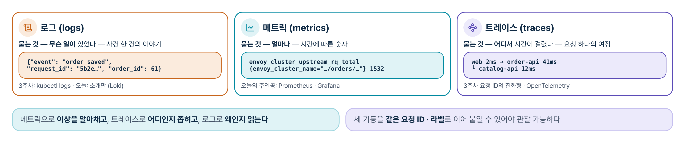
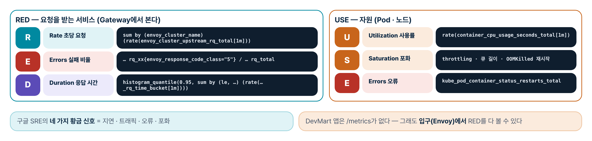

# 1교시 · 1일차 요약 + 관찰 가능성

!!! goal "이번 시간에 할 일"
    - 어제 만든 Gateway를 손으로 다시 확인합니다.
    - **모니터링**과 **관찰 가능성**의 차이를 이해합니다.
    - **로그 · 메트릭 · 트레이스**가 각각 어떤 질문에 답하는지 구분합니다.
    - **RED · USE · 황금 신호**로 "무엇을 재야 하나"의 기준을 세웁니다.

## 1일차 요약 — 손으로 다시 확인

```bash
kubectl get gateway -n devmart
kubectl get httproute -A
helm list -A
for p in / /api/products /api/orders; do printf '%-15s ' $p; curl -s -o /dev/null -w '%{http_code}\n' localhost:30080$p; done
```

!!! check "이렇게 나오면 준비 완료"
    ```text
    NAME      CLASS   ADDRESS   PROGRAMMED   AGE
    devmart   eg      …         True         1d
    NAMESPACE   NAME      HOSTNAMES               AGE
    default     podinfo   ["podinfo.localhost"]   1d
    devmart     catalog                           1d
    ...
    NAME             NAMESPACE              REVISION  STATUS    CHART
    eg               envoy-gateway-system   1         deployed  gateway-helm-v1.10.0
    podinfo          default                4         deployed  podinfo-6.14.0
    podinfo-canary   default                1         deployed  podinfo-6.14.0
    /               200
    /api/products   200
    /api/orders     200
    ```

| 1일차 | 오늘 이어지는 곳 |
|---|---|
| Helm 설치 루프 | 오늘의 큰 도구(kube-prometheus-stack)도 같은 루프 |
| Envoy가 모든 요청의 입구 | 입구에서 **모든 요청을 셀 수 있다** — 오늘의 RED |
| 카나리 50번 중 9번을 손으로 셌다 | 기계가 계속 세고, 그래프로 보여 주고, 이상하면 알린다 |
| status가 초록인데 틀린 장애(Host 오타) | 사용자 쪽 숫자(오류율)를 보는 이유 |

## 모니터링과 관찰 가능성

| | 모니터링 (monitoring) | 관찰 가능성 (observability) |
|---|---|---|
| 묻는 것 | 미리 정한 질문 — "CPU가 90%를 넘었나?" | **미리 예상 못 한 질문**에도 답할 수 있나 — "왜 화요일 3시에만 주문이 느리지?" |
| 비유 | 자동차 계기판의 경고등 | 정비사가 진단기를 꽂아 무엇이든 읽어 보는 것 |
| 필요한 것 | 정해진 지표 + 임계값 | 충분히 자세하고 **서로 이어 붙일 수 있는** 데이터 |

관찰 가능성은 원래 제어 이론의 말입니다(4주차 1일차 2교시 학술 노트의 Kalman). 시스템의 **겉으로 나온 출력만으로 속 상태를 알아낼 수 있는 정도**를 뜻합니다. 모니터링은 관찰 가능성을 **쓰는 방법 중 하나**입니다 — 둘은 대립이 아닙니다.

## 세 기둥 — 로그 · 메트릭 · 트레이스



| | 로그 | 메트릭 | 트레이스 |
|---|---|---|---|
| 모양 | 사건마다 한 줄 (텍스트 · JSON) | **시간 · 숫자 쌍**의 연속 (시계열) | 요청 하나가 지나간 구간(span)들의 나무 |
| DevMart의 예 | `{"event": "order_saved", "request_id": …}` | "orders 라우트 초당 요청 12.4" | "주문 41ms 중 catalog 호출이 12ms" |
| 잘하는 것 | **왜** — 오류 메시지, 사건의 맥락 | **얼마나 · 언제부터** — 추세, 알림, 싸다 | **어디서** — 서비스 여럿 중 느린 구간 |
| 약점 | 많고 비싸다. 집계가 어렵다 | 맥락이 없다 (숫자뿐) | 앱에 심어야 한다(계측) |
| 우리가 해 본 것 | 3주차 `kubectl logs | grep $RID` | **오늘** | 3주차 요청 ID가 그 씨앗 |

!!! key "셋은 이어져야 한다"
    메트릭 그래프에서 "3시 5분에 오류율이 튀었다" → 그 시간 그 라우트의 **트레이스**로 "catalog 호출에서 막혔다" → 그 요청의 **로그**로 "DB 비밀번호 오류". 이 연결이 되려면 셋이 **같은 요청 ID · 같은 라벨(서비스 이름, 네임스페이스)**을 써야 합니다. 3주차 1일차에 요청 ID를 모든 서비스에 넘기게 한 것이 그 준비였습니다.

!!! myth "오해 — 로그만 잘 남기면 된다"
    로그로도 "초당 요청 수"를 셀 수는 있습니다 — 매번 로그 수백만 줄을 읽어서. 그래서 비싸고 느립니다. 반대로 메트릭은 "지금까지 몇 번"이라는 **숫자 하나**만 들고 있어서 아주 싸고, 15초마다 저장해도 부담이 없습니다. **알아채기는 메트릭으로, 원인 읽기는 로그로** — 이것이 실무의 분업입니다.

## 무엇을 재야 하나

재려면 기준이 필요합니다. 널리 쓰이는 세 틀입니다.



| 틀 | 대상 | 재는 것 | 만든 사람 |
|---|---|---|---|
| **황금 신호** (golden signals) | 사용자를 상대하는 시스템 | 지연(latency) · 트래픽(traffic) · 오류(errors) · 포화(saturation) | 구글 SRE 책 6장 (2016) |
| **RED** | 요청을 받는 **서비스** | Rate(초당 요청) · Errors(실패) · Duration(시간) | Tom Wilkie (2015) |
| **USE** | **자원** (CPU · 메모리 · 디스크 · 네트워크) | Utilization(사용률) · Saturation(포화) · Errors(오류) | Brendan Gregg (2012) |

오늘 DevMart에서는 **RED를 Gateway(Envoy)에서**, **USE를 Pod 자원에서** 봅니다. DevMart 앱 자체는 지표(/metrics)를 내놓지 않지만, 모든 요청이 Envoy를 지나므로 입구에서 서비스마다의 RED를 다 셀 수 있습니다 — 어제 입구를 Gateway로 바꾼 덕분입니다.

## 실습 1 · DevMart에 던질 질문

!!! lab "실습 목표"
    오늘 만들 대시보드와 알림의 **요구 사항**을 먼저 씁니다. 도구를 설치하기 전에 "무엇을 알고 싶은가"를 정하는 것이 순서입니다.

짝과 함께, DevMart 운영자가 매일 궁금할 질문을 다섯 개 적고, 각 질문을 RED · USE 중 어디에 넣을지 표시합니다.

| 질문 | RED / USE | 어느 기둥으로 답하나 |
|---|---|---|
| 예: 지금 주문이 초당 몇 건 들어오나? | R | 메트릭 |
| 예: 상품 목록이 평소보다 느린가? | D | 메트릭 → 트레이스 |
| | | |
| | | |
| | | |

!!! check "이런 질문이 나오면 좋다"
    주문 실패율 · catalog-api 응답 시간 · 처리 안 된(pending) 주문 수 · DB Pod 메모리 · 최근 재시작한 Pod · 카나리와 기존 버전의 오류율 비교

!!! academic "학술 노트 — 대규모 시스템을 보는 법"
    - **Sigelman 외 (2010). "Dapper, a Large-Scale Distributed Systems Tracing Infrastructure." Google Technical Report.** — 구글이 수천 개 서비스에 걸친 요청을 추적한 경험을 공개한 논문입니다. 모든 요청을 다 기록하지 않고 **일부만 표본으로**(sampling) 기록해도 충분히 원인을 찾을 수 있음을 보였고, Zipkin · Jaeger · OpenTelemetry 트레이싱의 원형이 되었습니다.
    - **Beyer 외 (2016). *Site Reliability Engineering*, 6장 "Monitoring Distributed Systems."** — 황금 신호와 함께 "알림은 사람이 **긴급하게 행동해야 할 때만**"이라는 원칙을 세웠습니다. 6교시의 바탕입니다.

!!! trend "트렌드 2026 — OpenTelemetry가 표준이 되다"
    3주차 3일차의 CNCF 연례 조사에서 **OpenTelemetry**는 Kubernetes 다음으로 활발한 CNCF 프로젝트이자, 운영 사용률 약 절반에 이르는 프로젝트로 꼽혔습니다. 로그 · 메트릭 · 트레이스를 **하나의 표준 형식과 수집기**로 다루려는 것이라, "도구마다 다른 계측"을 없앱니다. Grafana 13(2026년 4월)도 OpenTelemetry 설정을 쉽게 하는 기능을 내세웠습니다. 오늘은 그 바탕인 **메트릭 + Prometheus**를 손으로 익힙니다.

!!! quiz "확인 문제"
    1. 모니터링과 관찰 가능성의 차이를 한 문장으로?
    2. "주문이 지금 초당 몇 건?", "왜 이 주문이 실패했지?", "주문 처리 중 어디가 느리지?"에 가장 잘 맞는 기둥은 각각?
    3. RED와 USE는 각각 무엇을 대상으로 하나요?
    4. DevMart 앱에 /metrics가 없는데도 RED를 볼 수 있는 이유는?

    ??? answer "정답"
        1. 모니터링은 미리 정한 질문에 답하고, 관찰 가능성은 미리 예상 못 한 질문에도 답할 수 있는 능력이다
        2. 메트릭 · 로그 · 트레이스
        3. RED — 요청을 받는 서비스, USE — 자원(CPU · 메모리 등)
        4. 모든 요청이 Gateway(Envoy)를 지나고, Envoy가 라우트마다 요청 수 · 응답 코드 · 시간을 지표로 내놓기 때문

## 참고 문헌

- Beyer, B. 외 (2016). *Site Reliability Engineering*, Ch. 6 "Monitoring Distributed Systems". O'Reilly.
- Sigelman, B. H. 외 (2010). Dapper, a Large-Scale Distributed Systems Tracing Infrastructure. *Google Technical Report dapper-2010-1*.
- Gregg, B. (2012). Thinking Methodically about Performance. *ACM Queue*, 10(12). (USE 방법)
- Wilkie, T. (2018). *The RED Method: How to Instrument Your Services*. Grafana Labs Blog.
- Majors, C., Fong-Jones, L., & Miranda, G. (2022). *Observability Engineering*. O'Reilly.
