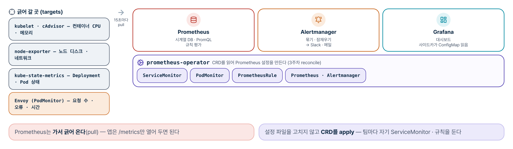

# 2교시 · kube-prometheus-stack 설치

!!! goal "이번 시간에 할 일"
    - kube-prometheus-stack이 **무엇의 묶음**인지 이해합니다.
    - values 파일에서 **kind 때문에 끈 것**과 **우리가 바꾼 것**을 읽습니다.
    - Grafana 관리자 비밀번호를 **Secret으로** 먼저 만들고 설치합니다.
    - 설치된 Pod와 **CRD**를 확인합니다.

## 무엇의 묶음인가



| 부품 | 하는 일 |
|---|---|
| **Prometheus** | 정해진 주기로 대상(target)에 가서 지표를 **긁어 와**(scrape) 시계열 DB에 저장. PromQL로 계산 · 알림 규칙 평가 |
| **Alertmanager** | Prometheus가 보낸 알림을 **묶고 · 잠재우고 · 막아서** Slack · 메일 등으로 보낸다 |
| **Grafana** | 대시보드 — 그래프로 보여 준다 |
| **node-exporter** | 노드마다 하나(DaemonSet) — 노드의 CPU · 메모리 · 디스크 · 네트워크 |
| **kube-state-metrics** | apiserver를 읽어 Deployment · Pod의 **상태**를 지표로 — "원하는 개수 3, 준비된 개수 2" |
| **prometheus-operator** | ServiceMonitor · PodMonitor · PrometheusRule 같은 **CRD를 읽어** Prometheus 설정을 만든다 |

!!! key "operator — 3주차 reconcile의 응용"
    Prometheus는 원래 설정 파일 하나에 "어디를 긁어라"를 모두 적습니다. 팀이 열 개면 그 파일 하나를 열 팀이 고쳐야 합니다(어제 nginx 설정과 같은 문제). **prometheus-operator**는 "어디를 긁어라"를 **CRD(ServiceMonitor 등)**로 받아, 그것들을 모아 설정 파일을 **대신** 만들고 Prometheus에 반영합니다. 각 팀은 자기 네임스페이스에 자기 ServiceMonitor만 두면 됩니다. 이렇게 **특정 소프트웨어의 운영 지식을 컨트롤러로 만든 것**을 **오퍼레이터 패턴**이라고 부릅니다(아래 학술 노트).

## values 파일 읽기

```bash
mkdir -p ~/devops-lab/k8s/w4d2
cp -r ~/course/labs/week4/day2/* ~/devops-lab/k8s/w4d2/
cd ~/devops-lab/k8s/w4d2
cat monitoring/kps-values.yaml
```

세 덩어리로 읽습니다.

### 1 — kind 때문에 끈 것

```yaml
kubeControllerManager: { enabled: false }
kubeScheduler: { enabled: false }
kubeEtcd: { enabled: false }
kubeProxy: { enabled: false }
```

3주차 3일차에 본 컨트롤 플레인 부품들은 kind에서 **127.0.0.1(자기 자신)에서만** 지표를 내놓습니다. 밖의 Prometheus가 긁으러 가면 실패하고, 차트에 들어 있는 기본 알림(`KubeSchedulerDown` 등)이 **설치하자마자 울립니다.** 끄지 않으면 첫 화면부터 '가짜 장애'를 보게 됩니다. EKS에서는 컨트롤 플레인을 AWS가 운영하므로 역시 이 부분을 끕니다.

!!! tip "기본 알림이 울리면 먼저 의심할 것"
    처음 설치한 모니터링 도구가 빨간불을 잔뜩 띄우면, 실제 장애보다 **"이 환경에 맞지 않는 기본 설정"**인 경우가 많습니다. 알림 하나하나를 "이 환경에서 의미가 있나"로 따져 끄거나 고치는 것까지가 설치입니다.

### 2 — 모든 팀의 CRD를 읽게

```yaml
prometheus:
  prometheusSpec:
    serviceMonitorSelectorNilUsesHelmValues: false
    podMonitorSelectorNilUsesHelmValues: false
    ruleSelectorNilUsesHelmValues: false
```

기본값이면 Prometheus는 **이 차트가 만든** ServiceMonitor · 규칙만 읽습니다(라벨로 고른다). 우리는 3교시에 envoy-gateway-system에, 6교시에 devmart에 직접 만들 것이므로 **모두 읽게** 풉니다. 4주차 1일차 Gateway의 `allowedRoutes: All`과 같은 종류의 결정입니다.

### 3 — 비밀번호는 values 밖으로

```yaml
grafana:
  admin:
    existingSecret: grafana-admin
```

이 차트의 Grafana 기본 관리자 비밀번호는 **차트 문서에 공개된 값**입니다. values에 새 비밀번호를 적으면 그 파일이 Git에 올라갑니다. 그래서 3주차 5일차처럼 **Secret을 먼저 만들고 이름만** values에 적습니다.

## 실습 2 · 설치

### 단계 1 — 네임스페이스와 Secret

```bash
kubectl create namespace monitoring
kubectl create secret generic grafana-admin -n monitoring \
  --from-literal=admin-user=admin \
  --from-literal=admin-password="$(openssl rand -hex 8)"
kubectl get secret grafana-admin -n monitoring -o jsonpath='{.data.admin-password}' | base64 -d; echo
```

!!! check "보이는 것"
    ```text
    namespace/monitoring created
    secret/grafana-admin created
    3f9a1c7e5b2d8046
    ```
    마지막 줄(16자리)이 Grafana 비밀번호입니다. 4교시에 씁니다. 화면에 띄우는 것은 지금 한 번만입니다.

### 단계 2 — 차트 확인과 설치

```bash
KPS=oci://ghcr.io/prometheus-community/charts/kube-prometheus-stack
helm show chart $KPS --version 86.2.3 | grep -E '^(name|version|appVersion)'
helm install kps $KPS --version 86.2.3 -n monitoring -f monitoring/kps-values.yaml
```

!!! check "보이는 것"
    ```text
    appVersion: v0.8x.x
    name: kube-prometheus-stack
    version: 86.2.3
    NAME: kps
    NAMESPACE: monitoring
    STATUS: deployed
    REVISION: 1
    NOTES:
    kube-prometheus-stack has been installed. Check its status by running:
      kubectl --namespace monitoring get pods -l "release=kps"
    ...
    ```
    `appVersion`은 이 차트의 중심인 **prometheus-operator**의 버전입니다. 차트 버전(86.x)과 앱 버전이 전혀 다른 대표적인 예입니다(어제 2교시).

!!! tip "차트 버전"
    교재는 작성 시점의 86.2.3으로 고정했습니다. 더 새 버전이 있어도 이 실습은 대부분 그대로 됩니다. 다만 kube-prometheus-stack은 **주 버전(86 → 87)이 바뀔 때 CRD 갱신 같은 손작업**을 요구하는 경우가 많으니, 회사에서 올릴 때는 차트 README의 'Upgrading' 절을 꼭 읽습니다.

### 단계 3 — 뜨기를 기다리며

```bash
kubectl get pods -n monitoring -w
```

!!! check "1~3분 뒤 (Ctrl+C로 멈춘다)"
    ```text
    NAME                                        READY   STATUS    RESTARTS   AGE
    alertmanager-kps-alertmanager-0             2/2     Running   0          90s
    kps-grafana-6c9d8b7f5-q2m4x                 3/3     Running   0          2m
    kps-kube-state-metrics-7b8f9c6d5-k8v2n      1/1     Running   0          2m
    kps-operator-5d7c8b9f6-x4t9w                1/1     Running   0          2m
    kps-prometheus-node-exporter-4tq2k          1/1     Running   0          2m
    kps-prometheus-node-exporter-9xkzp          1/1     Running   0          2m
    kps-prometheus-node-exporter-m7v3r          1/1     Running   0          2m
    prometheus-kps-prometheus-0                 2/2     Running   0          90s
    ```

| 보이는 것 | 읽는 법 |
|---|---|
| `node-exporter` × 3 | **DaemonSet** — 노드마다 하나 (3주차 3일차 7교시의 kube-proxy와 같은 방식) |
| `prometheus-…-0`, `alertmanager-…-0` | 이름이 `-0`으로 끝난다 — **StatefulSet** (3주차 4일차 학술 노트). 데이터를 가진 것들 |
| `kps-grafana` 3/3 | Grafana + **사이드카** 둘 (대시보드 · 데이터 소스를 ConfigMap에서 읽어 오는 보조 컨테이너, 4교시) |
| 나머지 1/1 | Deployment |

### 단계 4 — 새로 생긴 CRD

```bash
kubectl api-resources --api-group=monitoring.coreos.com
```

!!! check "보이는 것"
    ```text
    NAME                  SHORTNAMES   APIVERSION                       NAMESPACED   KIND
    alertmanagerconfigs   amcfg        monitoring.coreos.com/v1alpha1   true         AlertmanagerConfig
    alertmanagers         am           monitoring.coreos.com/v1         true         Alertmanager
    podmonitors           pmon         monitoring.coreos.com/v1         true         PodMonitor
    probes                prb          monitoring.coreos.com/v1         true         Probe
    prometheusagents      promagent    monitoring.coreos.com/v1alpha1   true         PrometheusAgent
    prometheuses          prom         monitoring.coreos.com/v1         true         Prometheus
    prometheusrules       promrule     monitoring.coreos.com/v1         true         PrometheusRule
    scrapeconfigs         scfg         monitoring.coreos.com/v1alpha1   true         ScrapeConfig
    servicemonitors       smon         monitoring.coreos.com/v1         true         ServiceMonitor
    thanosrulers          ruler        monitoring.coreos.com/v1         true         ThanosRuler
    ```
    **Prometheus 자체도 리소스**(`kind: Prometheus`)입니다. 운영자가 이것을 보고 StatefulSet을 만들었습니다. `kubectl get prometheus -n monitoring`으로 보이는 한 줄이 방금 뜬 `prometheus-kps-prometheus-0`의 '원하는 상태'입니다.

!!! academic "학술 노트 — 오퍼레이터 패턴"
    2016년 CoreOS의 Brandon Philips는 블로그 글 *Introducing Operators*에서 "사람 운영자가 가진 **특정 소프트웨어의 운영 지식**(설치, 설정 변경, 백업, 장애 복구)을 Kubernetes 컨트롤러 코드로 옮기자"고 제안했고, 그 첫 예가 etcd와 **Prometheus** 오퍼레이터였습니다. 3주차 3일차의 reconcile 반복을 Kubernetes 내장 리소스가 아니라 **CRD로 정의한 새 리소스**에 적용한 것입니다. 오늘 설치한 prometheus-operator가 바로 그 계보이고, 4주차의 Argo CD · Istio · Kyverno도 모두 같은 구조입니다. Dobies & Wood의 *Kubernetes Operators*(O'Reilly, 2020)가 이를 체계적으로 정리했습니다.

!!! trend "트렌드 2026 — Prometheus 3과 원격 저장"
    Prometheus는 2024년 말 **3.0**으로 큰 판을 바꾸며 새 UI, OpenTelemetry 지표의 기본 수신, UTF-8 지표 이름을 들여왔습니다. 한 대의 Prometheus는 오래 · 많이 저장하기에 한계가 있어, 운영 환경에서는 지표를 **원격 저장소**(Thanos · Mimir · 관리형 서비스: Amazon Managed Service for Prometheus 등)로 보내고 클러스터 안의 Prometheus는 **수집기(agent)**로만 쓰는 구성이 흔합니다. 위 CRD 목록의 `PrometheusAgent`가 그 용도입니다.

!!! quiz "확인 문제"
    1. kube-state-metrics와 node-exporter는 각각 무엇을 지표로 만드나요?
    2. kind에서 컨트롤러 매니저 · 스케줄러 · etcd 수집을 끈 이유는?
    3. Grafana 비밀번호를 values가 아니라 Secret으로 준 이유는?
    4. prometheus-…-0처럼 `-0`으로 끝나는 Pod는 어떤 컨트롤러가 만들었나요?
    5. ServiceMonitor를 만들면 누가 그것을 읽어 Prometheus 설정에 반영하나요?

    ??? answer "정답"
        1. kube-state-metrics — Kubernetes 리소스의 상태(원하는 개수, 준비된 개수 등), node-exporter — 노드 자원(CPU · 메모리 · 디스크 · 네트워크)
        2. kind에서는 그 부품들이 127.0.0.1에서만 지표를 내놓아 밖에서 긁을 수 없고, 그대로 두면 기본 알림이 가짜로 울린다
        3. values 파일은 Git에 올라가니까 — 비밀은 Secret으로, values에는 이름만 (3주차 5일차)
        4. StatefulSet (이름이 고정되고 자기 디스크를 가진다)
        5. prometheus-operator

## 참고 문헌

- Prometheus Community. *kube-prometheus-stack Helm chart — README, Upgrading Chart*. github.com/prometheus-community/helm-charts
- Prometheus Operator. *Design* · *API reference*. prometheus-operator.dev
- Philips, B. (2016). *Introducing Operators: Putting Operational Knowledge into Software*. CoreOS Blog.
- Dobies, J., & Wood, J. (2020). *Kubernetes Operators*. O'Reilly.
- Prometheus Blog (2024-11). *Announcing Prometheus 3.0*. prometheus.io/blog
