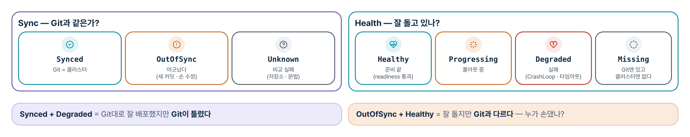

# 4교시 · Application과 Sync

!!! goal "이번 시간에 할 일"
    - **Application** 리소스의 네 칸(project · source · destination · syncPolicy)을 읽습니다.
    - DevMart를 Argo CD에 맡기고, 처음 상태가 왜 **OutOfSync**인지 이해합니다.
    - 손으로 **Sync**하고, 웹 UI의 리소스 나무를 읽습니다.
    - **Sync 상태**와 **Health 상태**를 구분합니다.

## Application 읽기

```bash
cd ~/devops-lab/k8s/w4d3
cat argocd/devmart-app.yaml
```

```yaml
apiVersion: argoproj.io/v1alpha1
kind: Application
metadata:
  name: devmart
  namespace: argocd                 # Application은 argocd 네임스페이스에 둔다
spec:
  project: default                  # 권한 묶음 (AppProject) — 오늘은 기본값
  source:                           # 어디서
    repoURL: https://github.com/YOUR_ID/devmart-deploy.git
    targetRevision: main            # 브랜치 · 태그 · 커밋
    path: devmart                   # 이 폴더를 (kustomization.yaml이 있으니 kustomize로 펼친다)
  destination:                      # 어디로
    server: https://kubernetes.default.svc   # in-cluster
    namespace: devmart
  # syncPolicy가 없다 → 손으로 Sync (6교시에 자동으로)
```

| 칸 | 뜻 | DevMart |
|---|---|---|
| `project` | 이 Application이 **어느 저장소에서 어느 클러스터 · 네임스페이스로** 배포할 수 있는지 제한하는 묶음 | `default` = 제한 없음. 팀이 여럿이면 팀마다 만든다 |
| `source` | Git 주소 · 브랜치 · 폴더 | `devmart-deploy`의 `main`, `devmart/` |
| `destination` | 클러스터 · 네임스페이스 | 자기 자신, `devmart` |
| `syncPolicy` | 언제 맞추나 | 없음 = 사람이 버튼을 눌러야 |

!!! key "Argo CD는 폴더를 보고 도구를 고른다"
    `path` 폴더에 `kustomization.yaml`이 있으면 kustomize, `Chart.yaml`이 있으면 Helm, 둘 다 없으면 YAML 파일을 그대로 씁니다. 그래서 1일차의 Helm 차트도, 3주차의 kustomize 묶음도 **같은 Application 모양**으로 관리할 수 있습니다.

## 실습 8 · Application 만들기

```bash
ID=$(gh api user -q .login)
sed -i "s/YOUR_ID/$ID/" argocd/devmart-app.yaml argocd/devmart-app-auto.yaml   # Mac: sed -i ''
grep repoURL argocd/devmart-app.yaml
kubectl apply -f argocd/devmart-app.yaml
sleep 15
argocd app list
```

!!! check "확인"
    ```text
        repoURL: https://github.com/niceguy61/devmart-deploy.git   # 배포 저장소 (2교시에 만든다)
    application.argoproj.io/devmart created
    NAME            CLUSTER                         NAMESPACE  PROJECT  STATUS     HEALTH   SYNCPOLICY  CONDITIONS  REPO                                              PATH     TARGET
    argocd/devmart  https://kubernetes.default.svc  devmart    default  OutOfSync  Healthy  Manual      <none>      https://github.com/niceguy61/devmart-deploy.git  devmart  main
    ```

`kubectl apply`로 Application을 만들었습니다. Argo CD에 무엇을 맡기는 일조차 **YAML 한 장**입니다 — 이 파일도 Git에 둘 수 있습니다(7교시 끝).

### 왜 처음부터 OutOfSync인가

2교시 실습 3에서 `kubectl diff`는 "차이 없음"이었습니다. 그런데 Argo CD는 OutOfSync라고 합니다.

```bash
argocd app diff devmart | head -20
```

!!! check "확인"
    ```text
    ===== apps/Deployment devmart/catalog-api ======
    5a6,7
    >   annotations:
    >     argocd.argoproj.io/tracking-id: devmart:apps/Deployment:devmart/catalog-api
    …
    ```

Argo CD는 자기가 관리하는 리소스에 **추적 표시(tracking annotation)**를 붙입니다. 지금 클러스터의 리소스는 3주차에 `kubectl`로 만든 것이라 그 표시가 없습니다. Sync하면 표시가 붙고, 그때부터 "이건 devmart Application의 것"이 됩니다. 이미 있는 리소스를 **지우고 다시 만들지 않고 그대로 넘겨받습니다(adopt).**

!!! tip "추적 표시가 왜 중요한가"
    Argo CD가 "Git에서 사라졌으니 지운다"(6교시 prune)를 할 때, **자기 표시가 붙은 것만** 지웁니다. 그래서 같은 네임스페이스에 있어도 표시가 없는 것 — `devmart-db` Secret, 1일차의 Gateway — 은 건드리지 않습니다.

## 실습 9 · 손으로 Sync

웹 UI(<http://localhost:8080>)에서 **devmart** 카드를 눌러 둔 채로, 터미널에서:

```bash
argocd app sync devmart
argocd app get devmart
```

!!! check "확인"
    ```text
    …
    Operation:          Sync
    Sync Revision:      4f2a9c1…
    Phase:              Succeeded
    Message:            successfully synced (all tasks run)

    GROUP                     KIND                   NAMESPACE  NAME               STATUS  HEALTH   HOOK  MESSAGE
                              Namespace                         devmart            Synced                 namespace/devmart configured
                              ConfigMap              devmart    devmart-config     Synced                 configmap/devmart-config configured
                              PersistentVolumeClaim  devmart    db-data            Synced  Healthy        persistentvolumeclaim/db-data configured
                              Service                devmart    catalog-api        Synced  Healthy        service/catalog-api configured
    apps                      Deployment             devmart    catalog-api        Synced  Healthy        deployment.apps/catalog-api configured
    …
    gateway.networking.k8s.io HTTPRoute              devmart    orders             Synced                 httproute…/orders configured
    monitoring.coreos.com     PrometheusRule         devmart    devmart            Synced                 prometheusrule…/devmart configured
    ```
    모든 줄이 `configured`(이미 있는 것을 고쳤다)이고 `created`가 없어야 합니다. 앱은 **끊기지 않았습니다** — 표시만 붙었기 때문입니다. `curl -s -o /dev/null -w '%{http_code}\n' localhost:30080/api/products` → `200`.


### 웹 UI의 나무 읽기

devmart 카드를 열면 리소스가 **나무**로 보입니다.

| 보이는 것 | 뜻 |
|---|---|
| 왼쪽 맨 앞의 `devmart` (앱 아이콘) | Application |
| Deployment → ReplicaSet → Pod | 3주차 4일차의 **소유 관계**(ownerReferences)를 그대로 그린 것 |
| 하트 아이콘(초록) | Health — Healthy |
| 동그라미 화살표(초록) | Sync — Synced |
| 오른쪽 위 **APP DIFF** · **HISTORY AND ROLLBACK** | 5교시 · 6교시에 씁니다 |

Pod 하나를 누르면 **LOGS** 탭이 있습니다. `kubectl logs`와 같은 내용입니다.

## Sync와 Health — 두 질문



| 조합 | 뜻 | 할 일 |
|---|---|---|
| Synced + Healthy | Git대로, 잘 돈다 | 없음 |
| OutOfSync + Healthy | 잘 돌지만 **Git과 다르다** | 누가 손댔나? 새 커밋이 아직 안 들어왔나? (5교시) |
| Synced + Progressing | Git대로 바꾸는 중 (롤아웃) | 기다린다 |
| Synced + Degraded | Git대로 했는데 **Git이 틀렸다** | Git을 되돌린다 (5교시 실습 12) |

!!! key "Health는 어떻게 아나"
    Argo CD는 리소스 종류마다 **건강 판정 규칙**을 갖고 있습니다. Deployment라면 3주차의 `kubectl rollout status`와 같은 기준 — 원하는 개수만큼 새 버전 Pod가 **준비(Ready)** 되었나 — 입니다. 준비는 **readiness probe**가 결정합니다. 3주차 5일차에 probe를 정성껏 만든 것이 여기서 다시 쓰입니다. probe가 없으면 "떠 있기만 하면 Healthy"가 됩니다.

!!! warn "Application을 지울 때 조심"
    `argocd app delete devmart`는 기본으로 **Application이 관리하던 리소스까지 모두** 지웁니다(cascade). 그 목록에 **Namespace**가 들어 있으므로, 네임스페이스 안의 Secret · PVC 데이터까지 함께 사라집니다. 관리만 그만두려면 `argocd app delete devmart --cascade=false`. 오늘 실습에서는 지우지 않습니다.

!!! academic "학술 노트 — 원하는 상태의 두 단계"
    Kubernetes의 원하는 상태(Deployment의 spec)는 "**선언**"이고, Git의 원하는 상태는 "**선언의 선언**"입니다. Argo CD는 위 단계를, Kubernetes 컨트롤러는 아래 단계를 맞춥니다. 이렇게 **제어 루프를 겹쳐 쌓는 구조**는 Google Borg · Omega의 경험을 정리한 Burns 외의 논문 *Borg, Omega, and Kubernetes*(ACM Queue, 2016)에서 "작고 독립적인 컨트롤러들의 협력"으로 설명됩니다 — 하나의 거대한 오케스트레이터보다 고장에 강하고 확장하기 쉽다는 것입니다.

!!! trend "트렌드 2026 — 한 화면에서 여러 앱 보기"
    Application이 수십 개가 되면 "지금 OutOfSync인 Deployment가 어디 어디 있나"를 찾기 어렵습니다. Argo CD 3.6의 **Resources Explorer**는 모든 Application의 리소스를 한 표에서 검색 · 필터하고, Sync · Health 분포를 요약합니다. 또 Argo CD 3.x는 기본 추적 방식을 라벨에서 **주석(annotation)** 으로 바꿨습니다 — 실습에서 본 `tracking-id`입니다. 라벨 길이 제한(63자)과 다른 도구와의 충돌을 피하기 위해서입니다.

!!! quiz "확인 문제"
    1. Application의 `source`와 `destination`은 각각 무엇을 정하나요?
    2. `kubectl diff`는 차이가 없는데 Argo CD가 OutOfSync라고 한 이유는?
    3. Synced + Degraded는 어떤 상황인가요?
    4. `argocd app delete`를 그냥 실행하면 왜 위험한가요?

    ??? answer "정답"
        1. source — 어느 Git 저장소 · 브랜치 · 폴더, destination — 어느 클러스터 · 네임스페이스
        2. 기존 리소스에 Argo CD의 추적 표시(tracking annotation)가 없어서
        3. Git대로 배포했지만 Git의 내용이 틀려 앱이 제대로 돌지 않는 상황
        4. 관리하던 리소스(Namespace 포함)를 모두 지워 Secret · 데이터까지 사라질 수 있다

## 참고 문헌

- Argo CD Docs. *Declarative Setup — Applications*, *Tool Detection*. argo-cd.readthedocs.io
- Argo CD Docs. *Resource Tracking*, *Resource Health*. argo-cd.readthedocs.io
- Burns, B., Grant, B., Oppenheimer, D., Brewer, E. & Wilkes, J. (2016). *Borg, Omega, and Kubernetes*. ACM Queue 14(1).
