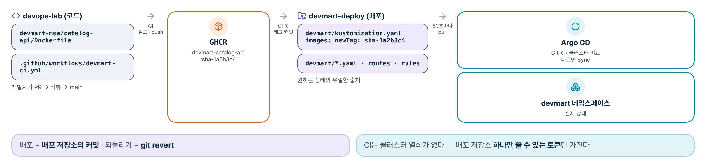

# 7교시 · Actions → Argo CD 전체 파이프라인

!!! goal "이번 시간에 할 일"
    - CI에 **배포 저장소 하나만 쓸 수 있는 토큰**을 줍니다.
    - CI 워크플로에 **"배포 저장소에 새 태그 적기"** job을 더합니다.
    - Dockerfile 한 줄을 바꾸는 **PR 하나**로 v2.1.0이 클러스터까지 가는 것을 처음부터 끝까지 봅니다.
    - 배포 저장소의 `git revert`로 v2.0.0으로 되돌립니다.
    - 비밀 값을 GitOps로 다루는 방법들을 소개받습니다.

## 오늘 완성하는 흐름



| 단계 | 누가 | 어디서 보나 |
|---|---|---|
| 1. Dockerfile 수정 · PR | 나 | `devops-lab`의 Pull requests |
| 2. 테스트 | CI (`test` · `compose-check`) | PR의 Checks |
| 3. 합치기(merge) | 나 (리뷰 후) | |
| 4. 빌드 · GHCR push | CI (`build`) | Actions, GHCR Packages |
| 5. 배포 저장소에 태그 커밋 | CI 봇 (`update-manifest`) | `devmart-deploy`의 커밋 이력 |
| 6. 클러스터 반영 | Argo CD (자동 동기화) | Argo CD 화면, `kubectl` |
| 7. 확인 | 나 · 어제의 대시보드 | `localhost:30080`, Grafana |

## 실습 16 · 배포 저장소 전용 토큰

CI 봇이 `devmart-deploy`에 push하려면 그 저장소에 **쓰기 권한**이 있는 토큰이 필요합니다. 기본 `GITHUB_TOKEN`은 **자기 저장소**(`devops-lab`)에서만 쓸 수 있습니다. 그래서 **세분화된 개인 토큰**(fine-grained personal access token)을 하나 만듭니다.

GitHub 오른쪽 위 프로필 → **Settings** → 왼쪽 맨 아래 **Developer settings** → **Personal access tokens** → **Fine-grained tokens** → **Generate new token**

| 칸 | 값 | 이유 |
|---|---|---|
| Token name | `devmart-deploy-ci` | 무엇에 쓰는지 이름으로 |
| Expiration | **30 days** | 새면 피해가 기간으로 제한된다. 끝나면 다시 만든다 |
| Repository access | **Only select repositories** → `devmart-deploy` **하나만** | 코드 저장소 · 다른 저장소는 못 건드린다 |
| Permissions → Repository permissions → **Contents** | **Read and write** | 커밋 · push에 필요한 것 |
| 그 밖의 권한 | 건드리지 않는다 (Metadata: Read-only는 자동) | 최소 권한 (3주차 2일차) |

**Generate token** → 나온 값(`github_pat_…`)을 **바로** 복사합니다. 이 화면을 벗어나면 다시 볼 수 없습니다.

```bash
cd ~/devops-lab
gh secret set DEPLOY_REPO_TOKEN          # 프롬프트에 붙여 넣고 Enter (화면에 보이지 않는다)
gh secret list
```

!!! check "확인"
    ```text
    ? Paste your secret ********************************************
    ✓ Set Actions secret DEPLOY_REPO_TOKEN for niceguy61/devops-lab
    NAME               UPDATED
    DEPLOY_REPO_TOKEN  less than a minute ago
    ```
    토큰 값은 셸 기록에도, 파일에도 남지 않았습니다. 3주차 5일차의 "비밀 값은 명령 줄에 쓰지 않는다"와 같은 원칙입니다.

!!! warn "토큰은 열쇠다"
    이 토큰을 가진 사람은 `devmart-deploy`에 무엇이든 커밋할 수 있고, Argo CD는 그것을 **그대로 배포합니다.** 즉 이 토큰 = 운영 배포 권한입니다. 그래서 저장소 하나 · 권한 하나 · 30일로 좁혔습니다. 회사에서는 개인 토큰 대신 **GitHub App**을 만들어 쓰는 것이 권장됩니다 — 사람이 퇴사해도 끊기지 않고, 짧게 사는 토큰을 그때그때 발급받기 때문입니다.

## 실습 17 · 워크플로에 job 더하기

```bash
cd ~/devops-lab
git switch -c ci/update-deploy-repo
diff .github/workflows/devmart-ci.yml ~/devops-lab/k8s/w4d3/workflows/devmart-ci.yml
```

`build` job 뒤에 job 하나가 늘었습니다.

```yaml
  update-manifest:
    name: 배포 저장소에 새 태그 적기
    needs: build                      # 세 이미지가 모두 올라간 뒤
    if: github.event_name == 'push'   # main일 때만
    runs-on: ubuntu-latest
    steps:
      # 코드 저장소가 아니라 '배포 저장소'(devmart-deploy)를 받는다
      - uses: actions/checkout@v6
        with:
          repository: ${{ github.repository_owner }}/devmart-deploy
          token: ${{ secrets.DEPLOY_REPO_TOKEN }}
      - name: kustomize로 이미지 태그 바꾸기
        working-directory: devmart
        run: |
          OWNER=${GITHUB_REPOSITORY_OWNER,,}          # 이미지 주소는 소문자
          TAG=sha-${GITHUB_SHA::7}                     # metadata-action의 type=sha와 같은 모양
          for s in catalog-api order-api order-worker; do
            kustomize edit set image ghcr.io/$OWNER/devmart-$s=ghcr.io/$OWNER/devmart-$s:$TAG
          done
          git diff
      - name: 커밋하고 올리기
        run: |
          git config user.name "github-actions[bot]"
          git config user.email "41898282+github-actions[bot]@users.noreply.github.com"
          git add devmart/kustomization.yaml
          git commit -m "deploy: devmart 이미지 → sha-${GITHUB_SHA::7}" \
                     -m "코드 커밋: ${{ github.server_url }}/${{ github.repository }}/commit/${{ github.sha }}" \
            || { echo "바뀐 것 없음"; exit 0; }
          git push
```

한 줄씩 짚습니다.

| 줄 | 뜻 |
|---|---|
| `needs: build` | 세 이미지가 **모두 GHCR에 올라간 뒤에만** — 없는 태그를 커밋하는 일(5교시 실습 12)을 구조로 막는다 |
| `if: github.event_name == 'push'` | PR 단계에서는 이미지도 안 올리므로 배포도 하지 않는다 |
| `repository:` · `token:` | 코드 저장소가 아니라 **배포 저장소**를 받고, 그 저장소 전용 토큰으로 인증한다 |
| `kustomize edit set image` | 2교시의 `images:` 목록을 고치는 공식 명령. GitHub 러너에 kustomize가 깔려 있다 |
| `${GITHUB_REPOSITORY_OWNER,,}` | bash에서 소문자로 바꾸기 — 이미지 주소는 대문자를 허용하지 않는다 |
| `sha-${GITHUB_SHA::7}` | 빌드 job의 `type=sha` 태그와 **같은 규칙** — 둘이 다르면 없는 태그를 커밋하게 된다 |
| 커밋 메시지 둘째 줄 | **어느 코드 커밋**이 배포되었는지 링크로 남긴다 — 장애 보고서의 근거 |
| `|| { …; exit 0; }` | 같은 태그로 다시 돌면 바뀐 것이 없어 commit이 실패한다. 그것을 실패로 치지 않는다 |

!!! tip "무한 반복이 없는 이유"
    CI 봇의 커밋은 **다른 저장소**(`devmart-deploy`)에 들어가므로 `devops-lab`의 CI를 다시 깨우지 않습니다. 2교시에 저장소를 나눈 이유 중 하나가 여기서 확인됩니다.

```bash
cp ~/devops-lab/k8s/w4d3/workflows/devmart-ci.yml .github/workflows/devmart-ci.yml
git add .github/workflows/devmart-ci.yml
git commit -m "CI: 빌드 뒤 배포 저장소에 이미지 태그 커밋"
git push -u origin ci/update-deploy-repo
gh pr create --fill
gh pr checks --watch
```

!!! check "확인"
    ```text
    ✓  compose-check
    ✓  test (catalog-api)
    ✓  test (order-api)
    ✓  build (catalog-api)       (PR에서는 빌드만, push 안 함 — 3주차 2일차)
    …
    ```
    `update-manifest`는 PR에서는 **보이지 않거나 건너뜀**입니다(`if:` 조건). 3주차 2일차의 규칙(ruleset)대로 체크가 초록이면 합칠 수 있습니다.

```bash
gh pr merge --squash --delete-branch
gh run watch
```

!!! check "확인 (3~5분)"
    `main`에 합쳐지자 워크플로가 다시 돌고, 이번에는 `build` 셋 → `update-manifest`까지 초록이 됩니다. 마지막 job의 로그에 `git diff` 결과로 세 이미지의 `newTag`가 새 `sha-`로 바뀐 것이 보입니다.

```bash
cd ~/devmart-deploy
git pull
git log --oneline -2
argocd app get devmart | grep -E "Sync Status|Health"
```

!!! check "확인"
    ```text
    5a7c9e2 (HEAD -> main, origin/main) deploy: devmart 이미지 → sha-3f8b2d1
    1d4e6a0 디버깅용 curl 제거
    Sync Status:        Synced to main (5a7c9e2)
    Health Status:      Healthy
    ```
    **배포 저장소의 맨 위 커밋을 사람이 아닌 봇이 썼고, Argo CD가 이미 그것으로 Synced입니다.** 코드는 바뀌지 않았지만(워크플로만 바뀜) 새 태그로 다시 배포되었습니다 — 파이프라인이 끝까지 이어졌다는 확인입니다.

!!! trouble "update-manifest가 빨갛다면"
    | 로그의 말 | 원인 | 해결 |
    |---|---|---|
    | `Repository not found` (checkout) | 토큰이 그 저장소를 볼 수 없다 · 시크릿 이름 오타 | 토큰의 Repository access에 `devmart-deploy`가 있나, `gh secret list` |
    | `Permission … denied to github-actions[bot]` / `403` (push) | 토큰의 Contents 권한이 Read-only | 토큰 설정에서 Contents → Read and write |
    | `kustomize: command not found` | 러너 이미지가 바뀌었다 | 그 단계 앞에 `uses: imranismail/setup-kustomize@v2`를 더한다 |
    | Argo CD가 `ImagePullBackOff` | 새 이미지 패키지가 **비공개** | GHCR 패키지 설정에서 Public (3주차 2일차) |

## 실습 18 · PR 하나로 v2.1.0 배포

이제 진짜 변경입니다. 화면 세 개를 띄워 둡니다 — Argo CD(8080), Grafana의 DevMart 대시보드(3000), 그리고 터미널.

```bash
# 터미널 A — 손님 흉내 (1초마다 버전을 묻는다)
while true; do printf '%s ' "$(date +%T)"; curl -s -m 1 localhost:30080/api/info | grep -o '"version":"[^"]*"' || echo FAIL; sleep 1; done
```

```bash
# 터미널 B — 코드 바꾸기
cd ~/devops-lab
git switch main && git pull
git switch -c feat/catalog-2.1.0
grep -n APP_VERSION devmart-msa/catalog-api/Dockerfile
sed -i 's/APP_VERSION=2.0.0/APP_VERSION=2.1.0/' devmart-msa/catalog-api/Dockerfile   # Mac: sed -i ''
git diff
git commit -am "catalog-api 2.1.0"
git push -u origin feat/catalog-2.1.0
gh pr create --fill
gh pr checks --watch && gh pr merge --squash --delete-branch
gh run watch
```

!!! check "확인 — 터미널 A"
    ```text
    14:02:11 "version":"2.0.0"
    14:02:12 "version":"2.0.0"
    …
    14:07:40 "version":"2.0.0"
    14:07:41 "version":"2.1.0"
    14:07:42 "version":"2.0.0"
    14:07:43 "version":"2.1.0"
    14:07:45 "version":"2.1.0"
    …
    ```
    **FAIL이 한 줄도 없어야** 합니다. 잠깐 두 버전이 섞이는 것은 3주차 4일차의 롤링 업데이트 그대로입니다. 바뀐 것은 **누가 그 롤링 업데이트를 시작했나** — 사람이 아니라 PR 합치기입니다.

!!! check "확인 — Argo CD 화면"
    devmart 앱의 **HISTORY AND ROLLBACK**에 봇의 커밋 `deploy: devmart 이미지 → sha-…`가 새로 있고, 나무에서 catalog-api의 ReplicaSet이 **둘**(옛 것 0개, 새 것 2개)로 보입니다. Grafana 대시보드의 오류율 패널은 **평평**해야 합니다.

!!! key "PR에서 운영까지 사람 손이 닿은 곳"
    `sed` 한 줄과 PR **합치기 버튼**뿐입니다. 이미지 이름 · 태그 · 클러스터 접속을 사람이 다루지 않았습니다. 3주차 5일차에 회고 Try로 적었던 "배포를 손으로 하지 않기"가 여기서 이루어집니다.

## 실습 19 · 되돌리기 — 배포 저장소에서 revert

"2.1.0에 문제가 있다"는 보고가 왔다고 합시다. **원인을 찾기 전에 되돌립니다**(어제 런북의 원칙).

```bash
cd ~/devmart-deploy
git pull
git log --oneline -3
git revert --no-edit HEAD
git push
```

!!! check "확인 — 터미널 A (1분 안에)"
    ```text
    14:15:02 "version":"2.1.0"
    14:15:03 "version":"2.0.0"
    14:15:04 "version":"2.1.0"
    14:15:05 "version":"2.0.0"
    …
    ```

!!! warn "코드 저장소는 아직 2.1.0이다"
    배포 저장소만 되돌렸으므로, `devops-lab`의 `main`에는 여전히 `APP_VERSION=2.1.0`이 있습니다. **다음에 누가 아무 코드나 합치면 2.1.0이 다시 배포됩니다.** 되돌리기는 "시간을 버는 것"이고, 그 시간 안에 코드 저장소도 고쳐야 합니다(revert PR 또는 수정 PR). 이것을 장애 보고서의 "후속 조치"에 적습니다.

```bash
cd ~/devops-lab && git switch main && git pull
git revert --no-edit HEAD && git push        # 실습에서는 PR 대신 직접 — ruleset 때문에 막히면 PR로
```

!!! tip "ruleset이 직접 push를 막는다면"
    2주차 5일차에 `main`에 "PR 필수"를 걸었다면 위 push는 거절됩니다. 그것이 정상입니다. `git switch -c revert/catalog-2.1.0` → push → `gh pr create --fill` → 합치기로 갑니다. 그러면 CI가 다시 돌아 2.0.0 이미지가 **새 sha 태그로** 배포됩니다 — 배포 저장소의 revert와 같은 결과에, 코드와 배포가 다시 한 줄로 맞춰집니다.

## 비밀 값은 어떻게? — 소개

오늘 Secret은 Git 밖에 두었습니다. 클러스터를 새로 만들면 Secret만 손으로 다시 만들어야 하므로 GitOps가 "**거의**" 완성입니다. 그 빈칸을 채우는 방법들입니다.

| 방법 | Git에 들어가는 것 | 진짜 값이 있는 곳 |
|---|---|---|
| **Sealed Secrets** | 클러스터의 공개키로 **암호화된** SealedSecret | 클러스터 안의 컨트롤러만 풀 수 있다 |
| **SOPS** (+ age · KMS) | 값만 암호화된 YAML | 풀 열쇠가 KMS 등에 |
| **External Secrets Operator** | "어느 금고의 어느 값"이라는 **참조**만 | AWS Secrets Manager · Vault 등 외부 금고 |

5주차에 AWS를 쓰면 **External Secrets + AWS Secrets Manager**가 자연스러운 선택입니다.

## 그 다음 단계 — Argo CD 설정도 Git에

오늘 `devmart-app.yaml`은 `kubectl apply`로 넣었습니다. 이 Application 파일조차 Git에 두고, "**Application들을 관리하는 Application**"(app of apps) 하나만 손으로 넣는 방식이 있습니다. 그러면 새 클러스터에서 Argo CD 설치 + Application 하나로 **모든 것이 Git대로** 섭니다. 여러 클러스터 · 여러 환경(dev · prod)으로 찍어 낼 때는 ApplicationSet을 씁니다.

## 오늘 정리

!!! warn "오늘 설치한 것은 지우지 않는다"
    Argo CD와 자동 동기화는 **4 · 5일차에도 켜 둡니다.** 내일 Istio를 설치할 때 DevMart에 바꿀 것이 생기면 **배포 저장소에 커밋**합니다(kubectl로 직접 고치면 selfHeal이 되돌린다!). 메모리가 빠듯하면 `podinfo` 쪽만 지웁니다. '5분 복구' 순서에 오늘 것을 더합니다 — Secret → kps · Argo CD `helm install` → `kubectl apply -f devmart-app-auto.yaml` (나머지는 Argo CD가 Git에서).

!!! academic "학술 노트 — 배포 빈도와 안정성은 함께 간다"
    "자주 배포하면 불안정해진다"는 직관과 달리, DORA 연구(Forsgren 외, *Accelerate*, 2018; DORA *State of DevOps* 연례 보고서)는 **배포 빈도 · 변경 리드 타임**이 높은 팀이 **변경 실패율 · 복구 시간**에서도 앞선다는 것을 반복해 보였습니다. 열쇠는 배포를 **작게, 자동으로, 되돌리기 쉽게** 만드는 것입니다. 오늘의 파이프라인에서 변경 리드 타임은 "PR 합치기 → 운영 반영" 약 5분, 복구 시간은 "revert → 반영" 약 1분이었습니다 — 직접 잰 숫자를 배움일기에 적어 둡니다.

!!! trend "트렌드 2026 — 이미지 갱신의 자동화"
    오늘은 CI가 배포 저장소에 태그를 커밋했습니다. 반대 방향 — **Argo CD Image Updater**가 레지스트리를 지켜보다 새 태그를 찾으면 배포 저장소에 커밋하는 — 방식도 있고, Renovate가 이미지 · 차트 버전 올리기 PR을 자동으로 여는 방식도 널리 쓰입니다. 또 여러 환경(dev → staging → prod)으로 **같은 변경을 단계적으로 승격**하는 일을 다루는 **Kargo**(Akuity) 같은 도구가 GitOps의 다음 층으로 자리 잡고 있습니다.

!!! quiz "확인 문제"
    1. CI가 배포 저장소에 push하려고 기본 `GITHUB_TOKEN` 대신 다른 토큰을 쓴 이유는?
    2. `update-manifest`에 `needs: build`가 꼭 필요한 이유는?
    3. 배포 저장소에서 revert한 뒤 코드 저장소도 고쳐야 하는 이유는?
    4. 오늘 Secret이 GitOps의 빈칸인 이유와 그것을 채우는 방법 하나는?

    ??? answer "정답"
        1. `GITHUB_TOKEN`은 자기 저장소(devops-lab)에만 쓸 수 있어서. 그래서 devmart-deploy 하나만 쓸 수 있는 토큰을 따로 만들었다
        2. 이미지가 GHCR에 올라가기 전에 태그를 커밋하면 클러스터가 없는 이미지를 받으려다 실패하기 때문
        3. 코드 저장소에 2.1.0이 남아 있어 다음 합치기 때 다시 배포되기 때문
        4. 클러스터를 새로 만들면 손으로 다시 만들어야 하기 때문. Sealed Secrets · SOPS · External Secrets Operator

!!! diary "오늘의 배움일기"
    - push 배포와 pull 배포를 한 문장씩, 3주차에 내가 한 배포를 예로
    - 5교시에 본 어긋남 세 방향(A · B · C)을 각각 Sync · Health 두 단어로
    - selfHeal이 되돌린 손 수정 중 가장 인상 깊었던 것, 그리고 selfHeal이 **방해가 될** 상황 하나
    - 오늘 잰 숫자: PR 합치기 → 운영 반영까지 몇 분? revert → 반영까지 몇 분?
    - CI가 가진 권한과 Argo CD가 가진 권한을 각각 적고, 어느 쪽이 털리면 더 위험한지
    - 내일 전에 궁금한 것: 오늘까지 서비스 사이의 호출(order-api → catalog-api)은 **아무 검사 없이** 오갔다. 누가 누구를 부를 수 있는지, 그 통신이 암호화되는지는 어떻게 정할까?

## 참고 문헌

- GitHub Docs. *Managing your personal access tokens — fine-grained personal access tokens*. docs.github.com
- GitHub Docs. *actions/checkout — Checkout multiple repos*. github.com/actions/checkout
- Kubernetes SIG CLI. *kustomize edit set image*. kubectl.docs.kubernetes.io
- Argo CD Docs. *Cluster Bootstrapping — App Of Apps Pattern*, *Secret Management*. argo-cd.readthedocs.io
- Forsgren, N., Humble, J. & Kim, G. (2018). *Accelerate*. IT Revolution.
- DORA (2025). *State of AI-assisted Software Development*. dora.dev
