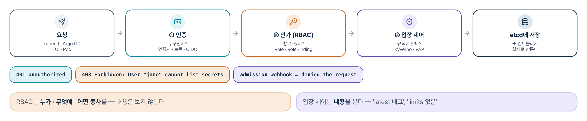

# 1교시 · 4일차 요약 + 세 관문

!!! goal "이번 시간에 할 일"
    - 어제의 메시 정책이 살아 있는지 손으로 확인합니다.
    - 4주차에 쌓은 층을 **보안의 눈**으로 다시 봅니다.
    - apiserver 요청이 지나는 **인증 · 인가 · 입장 제어**를 이해합니다.
    - 지금 내가 클러스터에서 **무엇이든 할 수 있는 이유**를 확인합니다.

## 4일차 요약 — 손으로 다시 확인

```bash
kubectl get peerauthentication,authorizationpolicy -n devmart
kubectl apply -f ~/devops-lab/k8s/w4d4/test/outsider.yaml
kubectl wait -n outsider --for=condition=Ready pod/client
kubectl exec -n outsider client -- curl -s -m 3 -o /dev/null -w '%{http_code}\n' catalog-api.devmart:8000/api/info
```

!!! check "이렇게 나오면 준비 완료"
    ```text
    NAME                                         MODE     AGE
    peerauthentication.security.istio.io/strict   STRICT   1d
    NAME                                                     ACTION   AGE
    authorizationpolicy.security.istio.io/catalog-api-allow   ALLOW    1d
    …
    403
    ```
    outsider는 4교시까지 다시 씁니다.

| 4일차 | 오늘 이어지는 곳 |
|---|---|
| 신원 = 네임스페이스 + **ServiceAccount** | 서비스마다 SA를 나눠 신원을 다르게 (3교시) |
| 허가를 네임스페이스 단위로 | **서비스 단위**로 좁힌다 (4교시) |
| Pod IP 우회로가 남았다 | ztunnel의 L4 규칙으로 막는다 (4교시) |
| 정책을 Git으로 | 클러스터 **입장 규칙**도 정책으로 (5교시) |

## 4주차를 보안의 눈으로

| 층 | 4주차에 만든 것 | 지켜 주는 것 | 아직 빈 곳 |
|---|---|---|---|
| 입구 | Gateway (1일차) | 외부 요청이 들어오는 길을 하나로 | TLS · 인증 없음 |
| 배포 | 배포 저장소 + Argo CD (3일차) | CI에 클러스터 열쇠가 없다, 변경 기록 | **사람은 아직 kubectl로 무엇이든** |
| 서비스 사이 | Istio mTLS · 허가 (4일차) | 평문 차단, 다른 네임스페이스 차단 | **모두 같은 신원**, Pod IP 우회 |
| 클러스터 입장 | (없음) | | **latest · root · limits 없는 것도 들어온다** |

오늘은 굵은 글씨의 세 곳을 채웁니다.

## 실습 1 · 나는 누구인가

```bash
kubectl auth whoami
kubectl auth can-i '*' '*' --all-namespaces
kubectl config view --minify -o jsonpath='{.users[0].user.client-certificate-data}' | base64 -d | openssl x509 -noout -subject
```

!!! check "확인"
    ```text
    ATTRIBUTE                                           VALUE
    Username                                            kubernetes-admin
    Groups                                              [kubeadm:cluster-admins system:authenticated]
    yes
    subject=O = kubeadm:cluster-admins, CN = kubernetes-admin
    ```
    kind가 만들어 준 kubeconfig는 **인증서**로 나를 `kubernetes-admin`이라고 증명하고, 그 사용자는 `kubeadm:cluster-admins` 그룹이라 **모든 것**을 할 수 있습니다(`yes`). 3주차부터 지금까지 무엇이든 되었던 이유입니다. 인증서의 `CN`이 사용자 이름, `O`가 그룹이 됩니다.

## 세 관문



| 관문 | 묻는 것 | Kubernetes에서 | 거절하면 |
|---|---|---|---|
| ① 인증 (authentication) | **누구인가?** | 클라이언트 인증서, ServiceAccount 토큰, OIDC(회사 계정) | `401 Unauthorized` |
| ② 인가 (authorization) | **이것을 할 수 있나?** | **RBAC** — Role · RoleBinding | `403 Forbidden` |
| ③ 입장 제어 (admission) | **내용이 규칙에 맞나?** | Pod Security Admission, ValidatingAdmissionPolicy, **Kyverno** | `denied the request` |

!!! key "Kubernetes에는 '사용자' 리소스가 없다"
    `kubectl get users`는 없습니다. 사람은 **클러스터 밖**(인증서를 발급한 CA, 회사의 계정 시스템)에서 오고, Kubernetes는 요청에 붙은 증명에서 이름과 그룹만 읽습니다. 반대로 **ServiceAccount는 Kubernetes 안의 리소스**입니다 — Pod 안의 프로그램을 위한 신원이기 때문입니다(3교시).

!!! analogy "비유 — 회사 건물"
    ① 출입증을 찍는다(인증) → ② 그 출입증으로 이 층에 갈 수 있나(인가) → ③ 들고 온 짐이 반입 규칙에 맞나 — 위험물 · 허가 없는 장비(입장 제어). RBAC는 **짐을 열어 보지 않습니다.** "deployments를 만들 수 있는 사람"은 latest 태그든 root든 아무 Deployment나 만들 수 있습니다. 그래서 ③이 따로 필요합니다.

!!! academic "학술 노트 — 접근 제어 모델의 계보"
    RBAC(역할 기반 접근 제어)는 Ferraiolo와 Kuhn의 *Role-Based Access Controls*(NIST, 1992)에서 정식화되고 Sandhu 외(IEEE Computer, 1996)의 RBAC96 모델로 체계화되어, 2004년 ANSI 표준(INCITS 359)이 되었습니다. 핵심은 권한을 사람에게 **직접** 주지 않고 **역할**에 주고, 사람은 역할을 갖게 하는 것입니다 — 사람이 바뀌어도 역할 정의는 그대로입니다. 더 세밀한 조건(시간 · 장소 · 속성)이 필요하면 **ABAC**(NIST SP 800-162, 2014)로 가는데, Kubernetes의 입장 제어 정책(CEL)이 그 역할을 일부 나눠 맡습니다.

!!! trend "트렌드 2026 — 쿠버네티스 안의 정책 언어 CEL"
    Kubernetes는 1.30에서 **ValidatingAdmissionPolicy**(웹훅 없이 apiserver 안에서 CEL로 검사)를 GA로, 1.36 무렵 **MutatingAdmissionPolicy**까지 안정화했습니다. Kyverno도 1.17(2026년 2월)에 CEL 기반 정책(ValidatingPolicy)을 v1으로 올리고 옛 ClusterPolicy를 폐기 예정으로 바꿨습니다. "정책은 CEL로"가 공통 언어가 되어 가고 있습니다 — 5교시에서 직접 씁니다.

!!! quiz "확인 문제"
    1. 세 관문의 이름과 각각 묻는 것은?
    2. 지금 내 kubectl이 무엇이든 할 수 있는 이유는?
    3. RBAC로 'latest 태그 금지'를 할 수 없는 이유는?
    4. Kubernetes에 User 리소스가 없는데 사람은 어떻게 구분되나요?

    ??? answer "정답"
        1. 인증(누구인가) · 인가(할 수 있나, RBAC) · 입장 제어(내용이 규칙에 맞나)
        2. kind의 kubeconfig 인증서가 kubeadm:cluster-admins 그룹이라 cluster-admin 권한을 받기 때문
        3. RBAC는 누가 · 어떤 리소스에 · 어떤 동사를 하는지만 보고 내용(이미지 태그)은 보지 않는다
        4. 요청에 붙은 증명(인증서의 CN · O, OIDC 토큰의 클레임)에서 이름과 그룹을 읽는다

## 참고 문헌

- Kubernetes Docs. *Controlling Access to the Kubernetes API*, *Authenticating*. kubernetes.io/docs
- Ferraiolo, D. & Kuhn, R. (1992). *Role-Based Access Controls*. 15th NIST-NCSC National Computer Security Conference.
- Sandhu, R. 외 (1996). *Role-Based Access Control Models*. IEEE Computer 29(2).
- Kyverno (2026-02-02). *Announcing Kyverno 1.17*. kyverno.io/blog
