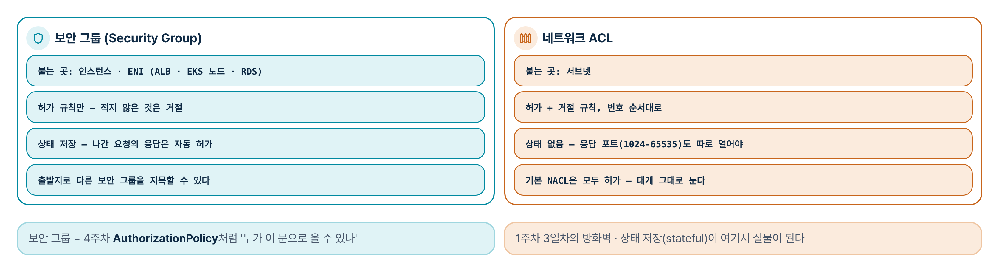

# 7교시 · 보안 그룹 · NACL + 비용 점검

!!! goal "이번 시간에 할 일"
    - **보안 그룹**과 **네트워크 ACL**의 차이를 이해합니다.
    - 내일 쓸 보안 그룹 둘을 만들고, **보안 그룹이 다른 보안 그룹을 출발지로** 지목하는 방법을 익힙니다.
    - 오늘 만든 것과 **돈이 나가는 것**을 확인합니다.

## 두 겹의 방화벽



| | 보안 그룹 | 네트워크 ACL |
|---|---|---|
| 붙는 곳 | 인스턴스 · 로드 밸런서 · DB의 **네트워크 카드** | **서브넷** |
| 규칙 | **허가만** (기본은 거절) | 허가 · 거절, 번호 순서 |
| 상태 | **상태 저장** — 들어온 요청의 응답은 자동으로 나간다 | **상태 없음** — 응답 방향도 따로 열어야 |
| 출발지 | IP 대역 **또는 다른 보안 그룹** | IP 대역만 |
| 실무 | **주로 이것으로** 통제 | 기본(모두 허가) 그대로, 특정 대역 차단에만 |

!!! key "보안 그룹을 출발지로"
    "app 서버의 8000 포트는 **web 보안 그룹이 붙은 것**에서만" — 이렇게 쓰면 web 서버가 몇 대든, IP가 바뀌든 규칙이 그대로입니다. 4주차 5일차에 IP가 아니라 **신원**(SPIFFE)으로 허가한 것과 같은 생각을 네트워크 수준에서 하는 것입니다.

## 실습 14 · 보안 그룹 둘

내일 EC2 실습에서 쓸 것을 미리 만듭니다.

**VPC → 보안 그룹 → 보안 그룹 생성**

**① devmart-web-sg** — 인터넷에서 웹 요청을 받는 곳 (내일 ALB)

| 칸 | 값 |
|---|---|
| 이름 · 설명 | `devmart-web-sg` · `HTTP from internet` |
| VPC | `devmart-vpc` |
| 인바운드 | 유형 **HTTP**, 소스 **Anywhere-IPv4** (0.0.0.0/0) |
| 아웃바운드 | 기본값(모두 허가) |
| 태그 | `Project` = `devmart` |

**② devmart-app-sg** — 앱 서버 (내일 EC2)

| 칸 | 값 |
|---|---|
| 이름 · 설명 | `devmart-app-sg` · `app port from web-sg only` |
| VPC | `devmart-vpc` |
| 인바운드 | 유형 **사용자 지정 TCP**, 포트 `9898`, 소스 **사용자 지정** → 검색창에 `devmart-web-sg` 선택 |
| 태그 | `Project` = `devmart` |

9898은 4주차 1일차에 만난 **podinfo**의 포트입니다. 내일 EC2에서 podinfo를 띄웁니다.

```bash
VPC=$(aws ec2 describe-vpcs --filters Name=tag:Name,Values=devmart-vpc --query 'Vpcs[0].VpcId' --output text)
aws ec2 describe-security-groups --filters Name=vpc-id,Values=$VPC Name=group-name,Values='devmart-*' \
  --query 'SecurityGroups[].{name:GroupName,in:IpPermissions[].{port:FromPort,cidr:IpRanges[0].CidrIp,sg:UserIdGroupPairs[0].GroupId}}' --output yaml
```

!!! check "확인"
    ```yaml
    - in:
      - cidr: 0.0.0.0/0
        port: 80
        sg: null
      name: devmart-web-sg
    - in:
      - cidr: null
        port: 9898
        sg: sg-0a1b2c3d4e5f60718
      name: devmart-app-sg
    ```
    app-sg의 출발지가 **IP가 아니라 보안 그룹 ID**입니다.

!!! warn "SSH(22)를 0.0.0.0/0에 열지 않는다"
    예전 교재는 EC2에 SSH 22번을 전 세계에 열고 키 파일로 접속합니다. 그 포트는 몇 분 안에 전 세계 스캐너가 두드립니다. 내일은 **Session Manager**(SSM)로 포트 없이 접속합니다 — 보안 그룹에 22가 아예 없습니다.

## 실습 15 · 오늘의 비용 점검

```bash
~/devops-lab/aws/w5d1/check-account.sh
```

!!! check "확인"
    ```text
    == 나는 누구인가
    …  arn:aws:iam::123456789012:user/devops-admin …
    == 기본 리전
    ap-northeast-2
    == 루트 MFA (1이면 켜짐)
    1
    == IAM 사용자
    devops-admin
    == 예산
    zero-spend      0.0
    monthly-20      20.0
    == VPC
    | vpc-0f1e2d3c4b5a69788 | 10.0.0.0/16   | devmart-vpc | False |
    | vpc-0a1b2c3d4e5f6a7b8 | 172.31.0.0/16 | None        | True  |
    == 돈이 나가는 것 (NAT · EIP · LB)
    (세 줄 모두 비어 있어야 한다)
    ```
    마지막 칸이 **비어 있으면** 오늘 시간당 요금이 나가는 것은 없습니다. VPC · 서브넷 · 보안 그룹 · S3 게이트웨이 엔드포인트는 무료이므로 내일까지 둡니다.

**결제 및 비용 관리 → 홈**에서 이번 달 비용이 `$0.00`인지도 봅니다(몇 시간 늦게 반영).

## 태그 — 비용의 이름표

오늘 만든 것에 `Name` · `Project` 태그가 붙었습니다. 태그는 ① 콘솔 · CLI에서 **찾기**, ② 결제 화면에서 **프로젝트별 비용 보기**(비용 할당 태그), ③ 마지막 날 **남은 것 찾기**(Resource Explorer · 태그 편집기)에 쓰입니다. 4주차의 Kubernetes 라벨과 같은 역할입니다. 3일차부터는 Terraform이 모든 자원에 태그를 **자동으로** 붙입니다.

!!! myth "오해 — 보안 그룹에서 '거절' 규칙을 만들면 된다"
    보안 그룹에는 거절 규칙이 **없습니다.** 허가에 없으면 거절입니다(RBAC · IAM과 같다). 특정 IP 대역을 **명시적으로 막아야** 할 때만 NACL의 거절 규칙을 씁니다. NACL은 상태가 없어서 응답 포트까지 계산해야 하므로, 꼭 필요할 때만 건드립니다.

!!! academic "학술 노트 — 상태 저장 방화벽"
    패킷을 하나씩 보는 **상태 없는**(stateless) 필터는 응답 패킷을 따로 허가해야 해서 규칙이 커지고 실수가 잦았습니다. Check Point의 FireWall-1(1994)이 상용화한 **상태 저장 검사**(stateful inspection)는 연결 상태를 기억해 "나간 요청의 응답"을 자동으로 받아들입니다. Cheswick · Bellovin의 *Firewalls and Internet Security*(1994)가 이 시기의 고전입니다. 보안 그룹(상태 저장)과 NACL(상태 없음)은 이 두 세대를 한 VPC 안에 나란히 둔 것입니다.

!!! trend "트렌드 2026 — 보안 그룹도 코드와 분석으로"
    보안 그룹이 수백 개가 되면 "이 DB에 인터넷에서 닿는 경로가 있나"를 사람이 추적하기 어렵습니다. AWS의 **VPC Reachability Analyzer** · **Network Access Analyzer**는 3교시의 Zelkova처럼 **경로를 수학적으로 분석**해 답합니다. 그리고 보안 그룹 변경은 Terraform PR로 리뷰하고, 정책 검사(Checkov · tfsec류)가 "0.0.0.0/0에 22번"을 PR 단계에서 막는 구성이 표준입니다(3일차).

!!! quiz "확인 문제"
    1. 보안 그룹과 NACL의 차이 셋은?
    2. app-sg의 출발지를 IP가 아니라 web-sg로 한 장점은?
    3. 오늘 지우지 않고 내일까지 둔 것과 그 이유는?
    4. 태그의 쓰임 셋은?

    ??? answer "정답"
        1. 붙는 곳(인스턴스 vs 서브넷), 규칙(허가만 vs 허가 · 거절), 상태(저장 vs 없음)
        2. web 서버 대수 · IP가 바뀌어도 규칙이 그대로다
        3. VPC · 서브넷 · 보안 그룹 · S3 게이트웨이 엔드포인트 — 무료이기 때문
        4. 찾기, 프로젝트별 비용 보기, 남은 것 찾기

## 참고 문헌

- AWS Docs. *Control traffic to your AWS resources using security groups*, *Network ACLs*. docs.aws.amazon.com/vpc
- AWS Docs. *Tagging best practices*, *VPC Reachability Analyzer*. docs.aws.amazon.com
- Cheswick, W. R. & Bellovin, S. M. (1994). *Firewalls and Internet Security: Repelling the Wily Hacker*. Addison-Wesley.
