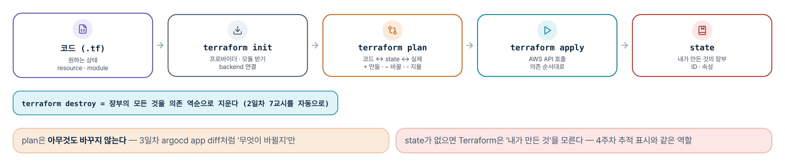

# 1교시 · 2일차 요약 + 코드로 인프라

!!! goal "이번 시간에 할 일"
    - 어제 깨끗이 지웠는지 확인하고, 어제의 '클릭'을 숫자로 돌아봅니다.
    - **IaC**(Infrastructure as Code)가 무엇이고 무엇을 해결하는지 압니다.
    - 콘솔 · CLI 스크립트 · Terraform을 비교합니다.
    - Terraform의 작업 흐름과 **state**의 역할을 그림으로 봅니다.

## 2일차 요약 — 손으로 다시 확인

```bash
~/devops-lab/aws/w5d1/check-account.sh | tail -5
aws ec2 describe-instances --filters Name=instance-state-name,Values=running --query 'length(Reservations)'
```

!!! check "이렇게 나오면 준비 완료"
    "돈이 나가는 것" 세 줄이 비어 있고, 실행 중인 인스턴스가 `0`.

| 2일차 | 오늘 이어지는 곳 |
|---|---|
| 클릭 백 번, 지우는 순서를 사람이 기억 | 코드 몇십 줄, `destroy` 한 줄 (2교시) |
| user data로 서버 설정을 굳혔다 | 인프라 전체를 코드로 굳힌다 |
| CloudTrail에서 '누가 만들었나' 찾기 | Git 커밋이 곧 기록 (7교시) |
| 역할 — 키 없는 신원 | GitHub Actions가 역할을 맡는다 (7교시) |

## 세 가지 방법

| | 콘솔 | CLI 스크립트 (`aws …` 나열) | **Terraform** |
|---|---|---|---|
| 적는 것 | 없음 (기억) | **어떻게** — 명령 순서 | **무엇을** — 원하는 상태 |
| 두 번 실행하면 | — | 대개 오류(이미 있음) 또는 중복 | **아무것도 안 바뀐다** (멱등) |
| 일부만 바뀌면 | 사람이 찾아서 | 스크립트를 새로 | 차이만 바꾼다 (plan) |
| 지우기 | 순서대로 클릭 | 지우기 스크립트를 따로 | `terraform destroy` |
| 어긋남 | 모른다 | 모른다 | **plan이 보여 준다** |
| 리뷰 | 불가능 | 가능하지만 결과를 상상해야 | 코드 + **plan 결과**를 PR에서 |

3주차 3일차의 "명령형 vs 선언형"이 그대로입니다. Kubernetes YAML이 **클러스터 안의 것**을 선언했다면, Terraform은 **클러스터를 포함한 인프라 전체**를 선언합니다.

## Terraform의 작업 흐름



| 단계 | 하는 일 | 4주차에서 닮은 것 |
|---|---|---|
| 코드 `.tf` | 원하는 상태 — `resource "aws_s3_bucket" "x" { … }` | 배포 저장소의 YAML |
| `init` | **프로바이더**(AWS와 말하는 플러그인) · 모듈 내려받기, state 위치 연결 | `helm repo add` |
| `plan` | 코드 ↔ state ↔ 실제 AWS를 비교해 **할 일 목록** | `argocd app diff` |
| `apply` | 목록대로 AWS API를 **의존 순서대로** 호출, state 갱신 | `argocd app sync` |
| state | 내가 만든 것의 **장부** — 코드의 이름 ↔ AWS의 ID | Argo CD의 추적 표시 |

!!! key "Terraform은 pull이 아니라 push다"
    4주차 3일차에 GitOps는 **pull**(에이전트가 계속 맞춘다)이라고 했습니다. Terraform은 사람이나 CI가 `apply`를 **실행할 때만** 맞춥니다 — push입니다. 그래서 콘솔에서 누가 손대면 **다음 plan까지** 모릅니다(4교시). 계속 맞추고 싶다면 Terraform을 주기적으로 plan하거나, Kubernetes 안에서 AWS 자원을 관리하는 도구(ACK · Crossplane)를 씁니다(아래 트렌드).

!!! myth "오해 — IaC는 큰 회사에나 필요하다"
    오늘처럼 **혼자 실습하는 계정**에서도 IaC는 바로 이득입니다. 내일 EKS 클러스터를 **만들었다 지웠다** 하는 일은 콘솔로는 하루에 한 번도 힘들지만, 코드로는 명령 하나입니다. 그리고 "다 지웠나?"에 Terraform은 장부로 답합니다.

## Terraform과 OpenTofu

Terraform은 HashiCorp가 만들었고, 2023년에 라이선스를 오픈소스(MPL)에서 **BUSL**로 바꿨습니다. 그 직전 버전에서 갈라져 나온 커뮤니티 판이 **OpenTofu**(Linux Foundation)입니다. 둘의 문법 · 프로바이더 · 사용법은 거의 같아서, 오늘 배우는 것은 둘 다에 통합니다. 과정에서는 Terraform을 쓰고, 명령의 `terraform`을 `tofu`로 바꾸면 OpenTofu로도 대부분 그대로 동작합니다.

!!! academic "학술 노트 — 수렴 · 멱등 · 선언"
    IaC의 이론적 뿌리는 4주차 3일차의 Burgess(CFEngine, 수렴)와, 같은 작업을 여러 번 해도 결과가 같은 **멱등성**(idempotence)입니다. Rahman 외의 체계적 문헌 조사 *A systematic mapping study of infrastructure as code research*(IST, 2019)는 IaC 연구를 프레임워크 · 도입 · 품질(결함 · 보안 냄새)로 나눴고, 이어진 연구 *The Seven Sins: Security Smells in Infrastructure as Code Scripts*(ICSE 2019)는 코드에 박힌 비밀번호 · 너무 넓은 권한 같은 **보안 냄새**가 IaC에도 흔하다는 것을 보였습니다. 오늘 `.gitignore`와 7교시의 좁은 역할이 그 처방입니다.

!!! trend "트렌드 2026 — IaC의 갈래"
    Terraform 1.15(2026년 4월)는 모듈 주소에 변수를 쓰는 **동적 소스**와 변수 폐기 표시를 더했고, 8월의 1.16이 최신 안정판입니다. 한편 AWS CDK · Pulumi처럼 **일반 프로그래밍 언어**로 인프라를 쓰는 갈래, ACK · Crossplane처럼 **Kubernetes 안에서** AWS 자원을 선언해 GitOps로 계속 맞추는 갈래가 자리 잡았습니다. 그리고 AI 도구가 Terraform 코드를 쓰는 일이 흔해지면서, **plan 결과를 사람이 리뷰하는 능력**의 가치가 오히려 커졌습니다.

!!! quiz "확인 문제"
    1. CLI 스크립트와 Terraform의 결정적인 차이는?
    2. state는 무엇이고 없으면 어떤 문제가 생기나요?
    3. Terraform이 GitOps(pull)와 다른 점은?

    ??? answer "정답"
        1. 스크립트는 '어떻게'(명령 순서), Terraform은 '무엇을'(원하는 상태) 적는다 — 그래서 멱등이고 차이만 바꾼다
        2. 코드의 이름과 실제 AWS 자원 ID를 잇는 장부. 없으면 무엇을 만들었는지 몰라 중복으로 만들거나 지우지 못한다
        3. 사람이나 CI가 apply할 때만 맞추는 push 방식이라, 그 사이의 어긋남은 다음 plan까지 모른다

## 참고 문헌

- HashiCorp. *Terraform — Core workflow*, *Purpose of Terraform State*. developer.hashicorp.com/terraform
- Rahman, A., Mahdavi-Hezaveh, R. & Williams, L. (2019). *A systematic mapping study of infrastructure as code research*. Information and Software Technology 108.
- Rahman, A., Parnin, C. & Williams, L. (2019). *The Seven Sins: Security Smells in Infrastructure as Code Scripts*. ICSE 2019.
- OpenTofu. *Migrating to OpenTofu*. opentofu.org/docs
