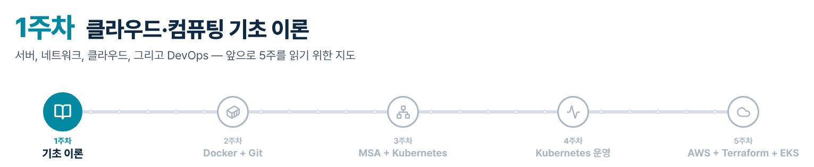

[🏠 과정 목차](../README.md)

# 1주차 · 클라우드·컴퓨팅 기초 이론

📕 1주차 이북 PDF: [보기](../downloads/pdf/week1.pdf) · [내려받기](https://github.com/niceguy61/kdt_devops_lecture_2026_rev2/raw/main/downloads/pdf/week1.pdf)

   

| 일차 | 주제 | 교시 | 슬라이드 |
|:--|:--|:--|:--|
| [**1일차**](day1/README.md) | OT와 클라우드의 큰 그림 과정 안내 · 5주 로드맵 · AI 시대의 DevOps · 데이터센터에서 클라우드까지 | [1](day1/lesson-01.md) [2](day1/lesson-02.md) [3](day1/lesson-03.md) [4](day1/lesson-04.md) [5](day1/lesson-05.md) | [📊 PPTX](https://github.com/niceguy61/kdt_devops_lecture_2026_rev2/raw/main/downloads/pptx/week1-day1.pptx) |
| [**2일차**](day2/README.md) | 컴퓨터와 운영체제, 가상화 하드웨어 · 운영체제 · 프로세스 · 파일 · Linux 맛보기 · 하이퍼바이저 · 컨테이너 예고 | [1](day2/lesson-01.md) [2](day2/lesson-02.md) [3](day2/lesson-03.md) [4](day2/lesson-04.md) [5](day2/lesson-05.md) [6](day2/lesson-06.md) [7](day2/lesson-07.md) | [📊 PPTX](https://github.com/niceguy61/kdt_devops_lecture_2026_rev2/raw/main/downloads/pptx/week1-day2.pptx) |
| [**3일차**](day3/README.md) | 네트워크 기초 계층 모델 · IP와 서브넷 · 포트와 TCP/UDP · DNS · HTTP/HTTPS · 요청의 여정 · 네트워크 장비 | [1](day3/lesson-01.md) [2](day3/lesson-02.md) [3](day3/lesson-03.md) [4](day3/lesson-04.md) [5](day3/lesson-05.md) [6](day3/lesson-06.md) [7](day3/lesson-07.md) | [📊 PPTX](https://github.com/niceguy61/kdt_devops_lecture_2026_rev2/raw/main/downloads/pptx/week1-day3.pptx) |
| [**4일차**](day4/README.md) | 현대 애플리케이션 구조 구성요소 지도 · 프론트엔드와 백엔드 · 확장성과 가용성 · 데이터베이스 · 캐시와 큐 · 폭주 트래픽 · 모놀리식과 MSA | [1](day4/lesson-01.md) [2](day4/lesson-02.md) [3](day4/lesson-03.md) [4](day4/lesson-04.md) [5](day4/lesson-05.md) [6](day4/lesson-06.md) [7](day4/lesson-07.md) | [📊 PPTX](https://github.com/niceguy61/kdt_devops_lecture_2026_rev2/raw/main/downloads/pptx/week1-day4.pptx) |
| [**5일차**](day5/README.md) | DevOps 문화와 협업 DevOps의 탄생 · 소프트웨어 개발 흐름과 CI/CD · Git과 GitHub · 타 부서 협업 · 장애 커뮤니케이션 · 문서로 일하기 · 2주차 준비 | [1](day5/lesson-01.md) [2](day5/lesson-02.md) [3](day5/lesson-03.md) [4](day5/lesson-04.md) [5](day5/lesson-05.md) [6](day5/lesson-06.md) [7](day5/lesson-07.md) | [📊 PPTX](https://github.com/niceguy61/kdt_devops_lecture_2026_rev2/raw/main/downloads/pptx/week1-day5.pptx) |

교시 칸의 숫자는 교시 번호입니다. 처음이라면 1일차 목차부터 열고, 각 페이지 맨 아래의 <b>다음 ➡️</b>를 따라가세요.
