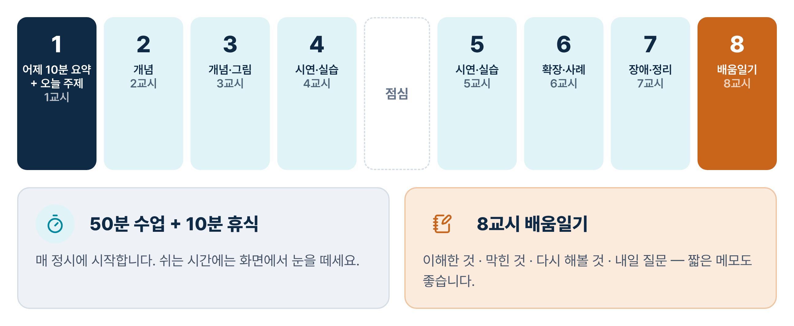
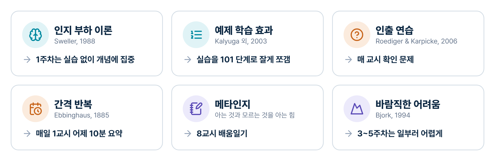
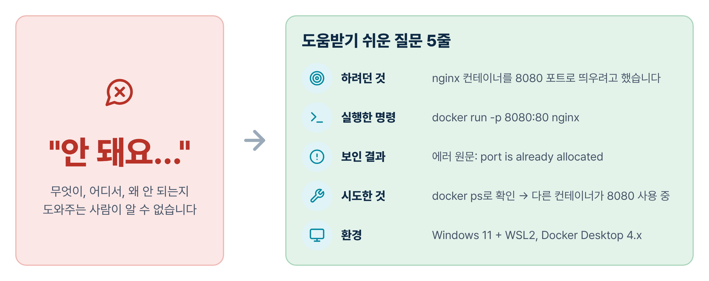

[🏠 과정 목차](../../README.md) › [1주차](../README.md) › [1일차](README.md)

# 1교시 · 과정 OT — 수업 방식과 약속

> [!NOTE]
> **이번 시간에 할 일**
>
> - 5주 동안 무엇을 배우고, 끝나면 무엇을 할 수 있게 되는지 압니다.
> - 하루 수업이 어떤 리듬으로 진행되는지 압니다.
> - 막혔을 때 **도움받기 쉬운 질문**을 쓰는 방법을 익힙니다.
> - 계정과 비밀값을 지키는 기본 약속을 확인합니다.

## 5주 뒤 여러분이 할 수 있게 되는 것

이 과정은 "클라우드 위에서 서비스를 만들고, 배포하고, 지키는 사람"이 되기 위한 기초 과정입니다. 5주가 끝나면 다음 일을 직접 해 본 상태가 됩니다.

| 할 수 있게 되는 일 | 배우는 주차 |
|---|---|
| 서버·네트워크·클라우드 용어를 듣고 그림으로 설명하기 | 1주차 |
| 내 애플리케이션을 Docker 이미지로 포장하고 실행하기 | 2주차 |
| Git과 GitHub로 코드를 관리하고 동료와 협업하기 | 2~3주차 |
| 여러 개로 나뉜 서비스(MSA)를 띄우고 장애 원인 찾기 | 3주차 |
| Kubernetes에 앱을 배포하고 상태를 관찰하기 | 3~4주차 |
| Git에 올리기만 하면 자동으로 배포되는 GitOps 만들기 | 4주차 |
| AWS에 네트워크·서버를 만들고, Terraform 코드로 다시 만들기 | 5주차 |
| AWS의 Kubernetes(EKS)에 앱을 올리고 안전하게 정리하기 | 5주차 |

표의 마지막 줄이 이 과정의 **도착점**입니다. 처음에는 낯선 단어가 많지만, 매주 앞 주에서 배운 것 위에 한 층씩 쌓아 올라가도록 설계되어 있습니다.

## 5주의 구조와 난이도

| 주차 | 주제 | 난이도 | 수업 방식 |
|---|---|---|---|
| 1주차 | 클라우드·컴퓨팅 기초 이론 | ★☆☆☆☆ | 개념과 그림, 강사 시연. **직접 실습 없음** |
| 2주차 | Docker + Git | ★★☆☆☆ | 첫 실습. 한 단계씩 따라 하기 |
| 3주차 | MSA + Kubernetes 입문 | ★★★☆☆ | 개념 → 실습 → 장애 확인 |
| 4주차 | Kubernetes 운영 도구 | ★★★★☆ | 하루 한 도구에 집중 |
| 5주차 | AWS + Terraform + EKS | ★★★★★ | 내 AWS 계정에서 직접 만들고 당일 삭제 |

> [!TIP]
> **어려워지는 게 정상입니다**
>
> 1~2주차는 일부러 쉽게 만들었습니다. 3주차부터는 처음 듣는 개념이 하루에 여러 개 나옵니다. **"나만 모르는 것 같다"는 느낌은 거의 모든 수강생이 똑같이 겪습니다.** 그날 다 이해하지 못해도 괜찮습니다. 배움일기에 "모르는 것"을 적어 두고 다음 날 다시 보면, 대부분은 두세 번 보면서 자연스럽게 연결됩니다.

## 하루 수업의 리듬

- **50분 수업 + 10분 휴식**, 매 정시에 시작합니다.
- **1교시** 처음 10분은 어제 내용을 요약하고 오늘 주제로 넘어갑니다. 어제 결석했거나 놓친 부분이 있다면 이때 따라잡으세요.
- **2~7교시**는 개념 → 시연 또는 실습 → 확인의 순서로 진행합니다.
- **8교시**는 배움일기 시간입니다. 오늘은 OT 날이라 5교시까지만 진행하고, 배움일기는 집에서 짧게 써 옵니다.

### 배움일기는 이렇게 씁니다

배움일기는 숙제가 아니라 **내일의 나를 위한 메모**입니다. 길 필요가 없습니다. 아래 네 칸만 채우면 충분합니다.

| 칸 | 예시 |
|---|---|
| 오늘 이해한 것 | 클라우드는 서버가 없는 게 아니라, 서버를 빌려 쓰는 방식이다 |
| 막힌 것 | IaaS와 PaaS의 경계가 헷갈린다 |
| 다시 해볼 것 | 피자 비유 그림을 다시 보면서 내 말로 설명해 보기 |
| 내일 물어볼 것 | EC2는 IaaS인데, 그럼 EKS는 무엇인가? |

## 이 과정은 왜 이렇게 설계되었나 — 학습 과학 이야기

"1주차엔 왜 실습이 없나요?", "매 교시 퀴즈는 왜 보나요?", "배움일기는 왜 쓰나요?" 첫날 자주 받는 질문입니다. 이 과정의 구조는 취향이 아니라 **교육심리학과 인지과학 연구 결과**를 바탕으로 짰습니다. 원리를 알면 공부 방법도 스스로 고를 수 있으니, 수업 설계의 근거를 먼저 공개합니다.

### 인지 부하 이론 — 1주차에 실습이 없는 이유

교육심리학자 존 스웰러(John Sweller)는 1988년 **인지 부하 이론(Cognitive Load Theory)**을 발표했습니다. 사람의 **작업 기억(working memory)**은 한 번에 다룰 수 있는 정보가 매우 적어서, 새로운 내용을 배울 때 쉽게 넘칩니다. 스웰러는 학습 중 머리가 쓰는 부담을 세 가지로 나눴습니다.

| 부하 종류 | 뜻 | 이 과정에서의 예 |
|---|---|---|
| 내재적 부하 | 내용 자체가 어려워서 생기는 부담 | "가상화", "공유 책임 모델" 같은 개념 그 자체 |
| 외재적 부하 | 내용과 상관없는 방해 요소 때문에 생기는 부담 | 설치 오류, 낯선 터미널, 오타 찾기 |
| 본유적 부하 | 개념을 서로 연결하며 이해를 쌓는 데 쓰는 부담 (좋은 부담) | "Docker가 왜 필요한지"를 앞서 배운 문제와 연결하기 |

처음 보는 개념이 쏟아지는 1주차에 설치와 오타까지 겹치면 작업 기억이 바로 넘칩니다. 그래서 1주차는 **외재적 부하를 0에 가깝게** 만들기 위해 실습을 빼고 개념과 그림에만 집중합니다.

### 예제 학습 효과 — 실습을 101 단계로 쪼개는 이유

초보자는 문제를 스스로 풀게 하는 것보다 **풀이가 완성된 예제를 따라가게 할 때** 더 잘 배운다는 연구가 많습니다. 이를 **예제 학습 효과(worked example effect)**라고 합니다. 흥미롭게도 이 효과는 학습자가 숙련될수록 사라지고 오히려 방해가 되기도 하는데, 이를 **전문성 역전 효과(expertise reversal effect)**라고 부릅니다(Kalyuga 외, 2003). 2주차 실습이 한 단계에 명령 1~2개씩 아주 잘게 쪼개져 있고, 4~5주차로 갈수록 스스로 판단할 부분이 늘어나는 이유가 여기에 있습니다.

### 인출 연습 — 매 교시 확인 문제를 푸는 이유

로디거(Roediger)와 카피크(Karpicke)는 2006년 실험에서, 같은 시간을 들이더라도 **다시 읽기보다 기억을 꺼내는 시험을 본 집단이 일주일 뒤 훨씬 많이 기억한다**는 것을 보였습니다. 이것을 **인출 연습 효과(testing effect)**라고 합니다. 교시마다 있는 확인 문제는 점수를 매기려는 것이 아니라, 기억을 꺼내는 연습 자체가 기억을 강하게 만들기 때문에 넣었습니다.

### 간격 반복 — 매일 1교시에 어제를 복습하는 이유

1885년 독일 심리학자 헤르만 에빙하우스(Hermann Ebbinghaus)는 **망각 곡선**을 발표했습니다. 새로 배운 내용은 복습하지 않으면 처음 하루 이틀 사이에 빠르게 잊힙니다. 대신 **시간 간격을 두고 다시 보면** 잊히는 속도가 크게 느려집니다. 매일 1교시의 10분 요약과 금요일의 주간 정리는 이 **간격 효과(spacing effect)**를 수업 구조에 넣은 것입니다.

### 메타인지 — 배움일기를 쓰는 이유

**메타인지(metacognition)**는 "내가 무엇을 알고 무엇을 모르는지 아는 능력"입니다. 학습을 잘하는 사람일수록 이 능력이 높다는 연구가 많습니다. 배움일기의 "막힌 것" 칸은 내가 모르는 것을 **말로 꺼내 보는 훈련**이고, 이것이 다음 날 질문의 재료가 됩니다.

### 바람직한 어려움 — 3주차부터 어려워도 괜찮은 이유

UCLA의 로버트 비요크(Robert Bjork)는 **바람직한 어려움(desirable difficulties)**이라는 개념을 제안했습니다. 배우는 순간에는 쉽고 매끄러운 방법보다, 적당히 힘들게 머리를 써야 하는 방법이 **장기 기억에는 더 오래 남는다**는 뜻입니다. 3~5주차가 어렵게 느껴진다면, 그것은 대부분 배움이 일어나고 있다는 신호입니다.

> **🎓 학술 노트 — 이 절의 원전**
>
> - Sweller, J. (1988). Cognitive load during problem solving: Effects on learning. *Cognitive Science*, 12(2).
> - Kalyuga, S., Ayres, P., Chandler, P., & Sweller, J. (2003). The expertise reversal effect. *Educational Psychologist*, 38(1).
> - Roediger, H. L., & Karpicke, J. D. (2006). Test-enhanced learning. *Psychological Science*, 17(3).
> - Ebbinghaus, H. (1885). *Über das Gedächtnis* (기억에 관하여).
> - Bjork, R. A. (1994). Memory and metamemory considerations in the training of human beings. In *Metacognition: Knowing about Knowing*. MIT Press.

## 막혔을 때 — 15분 규칙과 좋은 질문

실습을 하다 보면 반드시 막힙니다. 막히는 것 자체는 실력 부족이 아닙니다. 현업 엔지니어도 하루의 상당 시간을 "왜 안 되지?"를 푸는 데 씁니다. 중요한 것은 **막힌 뒤에 어떻게 움직이느냐**입니다.

> [!IMPORTANT]
> **15분 규칙**
>
> 혼자서 **15분** 동안 에러 메시지를 읽고, 검색하고, 다시 시도해 봅니다. 15분이 지나도 진전이 없으면 **반드시** 질문합니다. 혼자 한 시간을 붙잡고 있는 것은 성실함이 아니라 시간 낭비입니다.

질문할 때는 "안 돼요"라고만 쓰지 않습니다. 도와주는 사람이 **내 화면을 보지 않고도** 상황을 알 수 있게 다섯 줄로 적습니다.

| 항목 | 적는 내용 |
|---|---|
| 하려던 것 | 무엇을 하려고 했는지 한 문장 |
| 실행한 명령 | 실제로 입력한 명령을 그대로 복사 |
| 보인 결과 | 에러 메시지 **원문** (요약하지 말고 복사) |
| 시도한 것 | 검색해 본 것, 바꿔 본 설정 |
| 환경 | 운영체제, 프로그램 버전 |

> **📘 질문 비교**
>
> **나쁜 예:** "도커가 안 돼요."
>
> **좋은 예:** "nginx 컨테이너를 8080 포트로 실행하려고 `docker run -p 8080:80 nginx`를 입력했더니 `port is already allocated` 에러가 납니다. `docker ps`로 보니 다른 컨테이너가 8080을 쓰고 있었습니다. 이 컨테이너를 지워도 되는지 모르겠습니다. (Windows 11, WSL2, Docker Desktop)"
>
> 좋은 예에는 이미 답의 절반이 들어 있습니다. 이렇게 정리하다 보면 질문하기 전에 스스로 해결되는 경우도 많습니다.

> **📈 2026 트렌드 — AI가 있어도 결국 사람에게 묻는다**
>
> Stack Overflow가 2026년 여름 169개국 약 3만 명을 조사해 10월에 발표한 개발자 설문에서, 업무에 AI 도구를 **전혀 쓰지 않는다는 응답은 17.2%**뿐이었습니다. 그런데 일하다 막혔을 때 답을 얻는 곳으로는 여전히 **동료(72%)**가 가장 많이 꼽혔고, 중요한 결정을 AI에 맡기겠다는 응답은 **6.6%**에 그쳤습니다. AI가 아무리 좋아져도 "동료에게 잘 묻는 능력"은 사라지지 않는다는 뜻입니다. 다섯 줄 질문은 사람에게도, AI에게도 똑같이 통하는 질문 형식입니다.

### 러버덕 디버깅 — 설명하다 보면 풀린다

프로그래머들 사이에는 **러버덕 디버깅(rubber duck debugging)**이라는 오래된 방법이 있습니다. 책상 위 고무 오리 인형에게 문제를 한 줄씩 소리 내어 설명하다 보면, 설명하는 도중에 스스로 실수를 발견하게 된다는 것입니다. 『실용주의 프로그래머(The Pragmatic Programmer)』(1999)가 소개하면서 널리 알려졌습니다. 다섯 줄 질문을 쓰다가 혼자 해결되는 것도 같은 원리입니다. 머릿속에서 뭉쳐 있던 상황을 **순서대로 글로 풀어내는 순간** 빠진 고리가 보입니다.

## 계정과 비밀값을 지키는 약속

이 과정에서는 GitHub, Docker Hub, AWS 계정을 사용합니다. 특히 AWS 계정은 **신용카드가 연결된 계정**입니다. 한 번의 실수가 실제 비용이나 정보 유출로 이어질 수 있으므로, 첫날 약속을 분명히 합니다.

| 약속 | 이유 |
|---|---|
| 비밀번호·토큰·Access Key·MFA 코드는 **화면 공유, 채팅, 스크린샷에 절대 노출하지 않습니다** | 노출된 키로 남이 내 계정을 쓸 수 있습니다 |
| 질문용 스크린샷은 키·계정 번호 부분을 가린 뒤 올립니다 | 화면 한 장으로도 충분히 유출됩니다 |
| 비밀값을 코드나 GitHub에 올리지 않습니다 | 공개 저장소는 자동 수집 봇이 실시간으로 훑습니다 |
| AWS 실습은 강의에서 안내하는 범위만 만들고, 끝나면 반드시 삭제합니다 | 켜 둔 리소스는 쓰지 않아도 계속 과금됩니다 |
| 공용 PC에서는 반드시 로그아웃합니다 | 브라우저에 남은 로그인 세션도 비밀값입니다 |

> [!WARNING]
> **깃허브에 키를 올리면**
>
> AWS Access Key가 공개 저장소에 올라가면 몇 분 안에 자동 수집 봇이 찾아내 암호화폐 채굴 서버를 띄우는 사례가 반복해서 보고됩니다. "잠깐 올렸다가 바로 지웠다"도 안전하지 않습니다. Git은 **지운 기록까지 보관**하기 때문입니다. 이 내용은 2주차 Git 수업에서 다시 다룹니다.

## 준비물

1주차에는 아무것도 설치하지 않습니다. 설치는 **2주차 1일차에 함께** 진행합니다. 대신 지금 내 노트북이 아래 기준을 만족하는지 확인해 두세요.

| 항목 | 권장 | 최소 |
|---|---|---|
| 운영체제 | Windows 11 또는 최신 macOS | Windows 10 (WSL2 사용 가능 버전) |
| 메모리(RAM) | 16GB 이상 | 8GB (3~4주차 Kubernetes 실습이 느릴 수 있음) |
| 저장 공간 | 여유 50GB 이상 | 여유 30GB |
| 계정 | GitHub 계정 | — |

AWS 계정은 5주차 직전에 만드는 방법을 따로 안내합니다. 미리 만들어 두지 않아도 됩니다.

## 정리

- 이 과정의 구조는 **인지 부하, 예제 학습, 인출 연습, 간격 반복, 메타인지** 연구를 바탕으로 설계했습니다.
- 5주의 도착점은 **"AWS의 Kubernetes(EKS)에 내 앱을 GitOps로 배포하고 안전하게 정리하기"**입니다.
- 1~2주차는 쉽게, 3~5주차는 어렵게 설계되어 있습니다. 어려워지는 것은 정상입니다.
- 막히면 **15분** 혼자 시도한 뒤 **다섯 줄 질문**으로 도움을 요청합니다.
- 비밀값은 어디에도 노출하지 않습니다.

> **✅ 확인 문제**
>
> 1. 실습 중 에러가 났습니다. 몇 분 동안 혼자 시도한 뒤 질문하기로 약속했나요?
> 2. 좋은 질문의 다섯 줄 항목을 모두 말해 보세요.
> 3. AWS Access Key를 GitHub에 올렸다가 1분 만에 지웠습니다. 안전할까요? 이유는?
> 4. 매 교시 확인 문제를 푸는 이유와 관련된 학습 과학 효과의 이름은 무엇인가요?
>
> 

정답

>
> 1. 15분
> 2. 하려던 것, 실행한 명령, 보인 결과(에러 원문), 시도한 것, 환경
> 3. 안전하지 않습니다. 자동 수집 봇은 몇 분 안에 키를 찾아내며, Git은 지운 기록까지 보관합니다. 키를 즉시 비활성화하고 새로 발급해야 합니다.
> 4. 인출 연습 효과(testing effect) — 기억을 꺼내는 연습이 다시 읽기보다 장기 기억에 효과적입니다.
>
> 

## 참고 문헌

- Sweller, J. (1988). Cognitive load during problem solving. *Cognitive Science*, 12(2), 257–285.
- Roediger, H. L., & Karpicke, J. D. (2006). Test-enhanced learning. *Psychological Science*, 17(3), 249–255.
- Kalyuga, S. et al. (2003). The expertise reversal effect. *Educational Psychologist*, 38(1), 23–31.
- Bjork, R. A. (1994). Memory and metamemory considerations in the training of human beings.
- Hunt, A., & Thomas, D. (1999). *The Pragmatic Programmer*. Addison-Wesley.
- Stack Overflow (2026). *2026 Developer Survey*. survey.stackoverflow.co/2026 (발표 2026-10-06)

---

⬅️ 이전: [1주차 1일차 목차](README.md) &nbsp;|&nbsp; [⬆️ 1일차 목차](README.md) &nbsp;|&nbsp; 다음: [2교시 · 5주 로드맵과 DevOps 직무](lesson-02.md) ➡️
