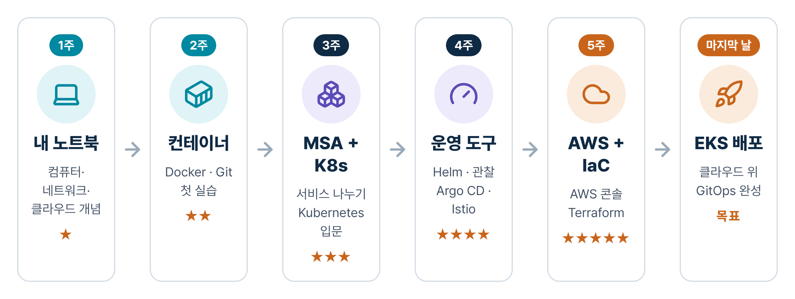
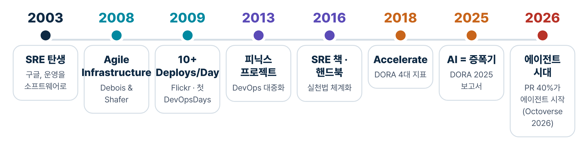
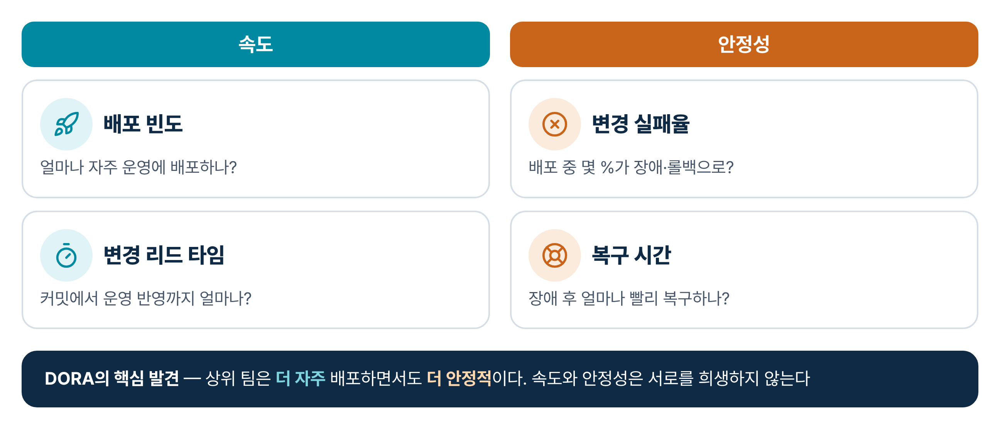
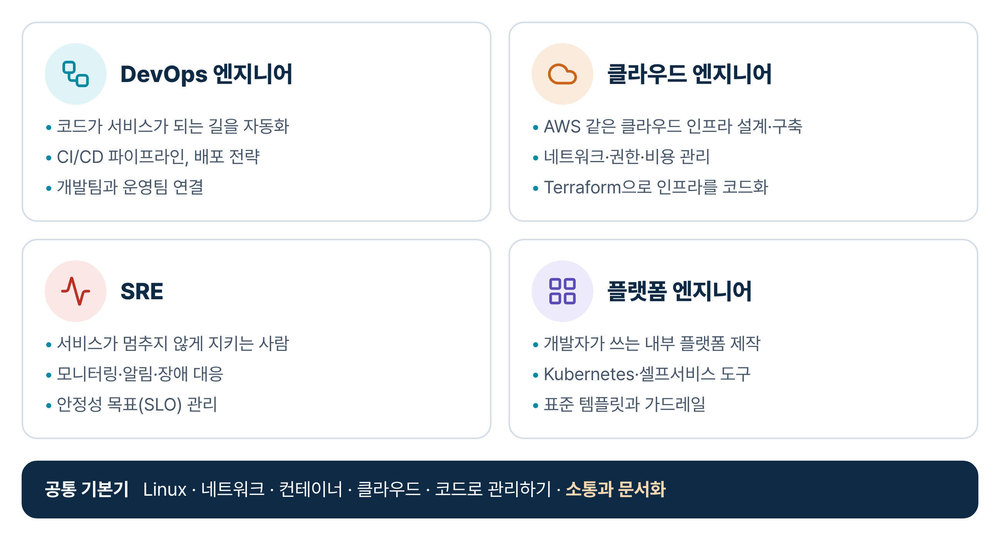

[🏠 과정 목차](../../README.md) › [1주차](../README.md) › [1일차](README.md) › 2/5교시

# 2교시 · 5주 로드맵과 DevOps 직무

> [!NOTE]
> **이번 시간에 할 일**
>
> - 5주 동안 하나의 앱이 어떤 길을 따라 이동하는지 그림으로 이해합니다.
> - 각 기술이 **어떤 문제를 풀기 위해** 등장했는지 연결합니다.
> - DevOps·클라우드·SRE·플랫폼 엔지니어가 하는 일을 구분합니다.

## 앱 하나의 여행

이 과정은 기술을 하나씩 따로 배우지 않습니다. **같은 애플리케이션 하나**를 들고 5주 동안 점점 더 큰 무대로 옮겨 가면서, 그때마다 필요한 기술을 배웁니다.

여행 경로를 정리하면 이렇습니다.

1. **1주차 — 내 노트북.** 앱이 실행되려면 무엇이 필요한지(CPU, 메모리, 네트워크, 설정) 이해합니다.
2. **2주차 — 컨테이너.** 앱과 실행 환경을 한 상자(Docker 이미지)에 담아 어디서나 똑같이 실행합니다.
3. **3주차 — MSA와 Kubernetes.** 앱을 여러 서비스로 나누고, 수많은 컨테이너를 Kubernetes에게 맡깁니다.
4. **4주차 — 운영 도구.** 설치(Helm), 관찰(Prometheus/Grafana), 자동 배포(Argo CD), 서비스 간 통신 관리(Istio)를 붙입니다.
5. **5주차 — AWS와 Terraform.** 진짜 클라우드에 네트워크와 서버를 만들고, 그것을 코드로 다시 만듭니다.
6. **마지막 날 — EKS 배포.** AWS 위의 Kubernetes에 앱을 GitOps 방식으로 배포하고, 깨끗하게 정리합니다.

## 모든 기술은 "문제"에서 나왔다

새 기술 이름이 쏟아지면 외워야 할 것처럼 느껴집니다. 그런데 각 기술은 앞 단계에서 생긴 **불편함**을 해결하려고 등장했습니다. 이 연결 고리를 알면 외울 필요가 크게 줄어듭니다.

| 이런 문제가 생기면 | 이 기술이 등장합니다 | 배우는 주차 |
|---|---|---|
| "내 PC에선 되는데 서버에선 안 돼요" | Docker (컨테이너) | 2주차 |
| 코드를 누가 언제 바꿨는지 모르겠다 | Git / GitHub | 2주차 |
| 앱 하나가 너무 커서 고치기 무섭다 | MSA (서비스 나누기) | 3주차 |
| 컨테이너가 수십 개라 사람이 관리할 수 없다 | Kubernetes | 3주차 |
| 빌드·테스트를 사람이 매번 손으로 한다 | GitHub Actions (CI) | 3주차 |
| 설치할 도구가 많고 설정이 제각각이다 | Helm | 4주차 |
| 서비스가 느린데 어디가 문제인지 모른다 | Prometheus / Grafana | 4주차 |
| 운영 서버 설정이 Git과 달라져 있다 | Argo CD (GitOps) | 4주차 |
| 서비스끼리의 통신을 통제하기 어렵다 | Istio (서비스 메시) | 4주차 |
| 서버실이 없다, 장비 살 돈도 시간도 없다 | AWS (클라우드) | 5주차 |
| 콘솔에서 클릭한 설정을 아무도 기억 못 한다 | Terraform (IaC) | 5주차 |

> **🧩 비유 — 이삿짐 센터**
>
> 앱을 새 집으로 옮긴다고 생각해 보세요. 짐을 아무렇게나 트럭에 실으면 깨지고 빠집니다. 그래서 **규격 상자**(Docker)에 담습니다. 상자가 수백 개가 되면 **물류 센터**(Kubernetes)가 어느 트럭에 실을지 정해 줍니다. 어떤 상자를 어디로 보낼지는 **배송 주문서**(Git)에 적고, 주문서가 바뀌면 자동으로 배송되게 합니다(Argo CD). 그리고 물류 센터 건물 자체는 **임대**합니다(AWS). 임대 계약서를 문서로 남겨 두면 언제든 똑같은 건물을 다시 빌릴 수 있습니다(Terraform).

## DevOps란 한 문장으로

DevOps는 **개발(Development)과 운영(Operations)이 따로 일하던 벽을 허물고, 변경을 빠르고 안전하게 사용자에게 전달하는 방식**입니다. 특정 도구 이름이 아니라 일하는 방식과 문화를 가리킵니다. 자세한 내용은 1주차 5일차에 다룹니다. 오늘은 "개발한 것이 서비스가 되기까지의 길을 책임지는 일"이라고만 기억해 두세요.

## DevOps는 어떻게 탄생했나

DevOps라는 말이 생기기 전, 대부분의 회사에서 개발팀과 운영팀은 **목표가 서로 반대**였습니다. 개발팀은 새 기능을 빨리 내보내야 평가를 받고, 운영팀은 서비스가 멈추지 않아야 평가를 받습니다. 변경은 장애의 가장 큰 원인이므로, 운영팀은 자연스럽게 변경을 막으려 합니다. 이 갈등을 흔히 **"혼돈의 벽(wall of confusion)"**이라고 부릅니다. 개발팀이 결과물을 벽 너머로 던지면 운영팀이 받아서 어떻게든 돌리는 구조였습니다.

| 연도 | 사건 | 의미 |
|---|---|---|
| 2003 | 구글에서 벤 트레이너 슬로스(Ben Treynor Sloss)가 SRE 팀 시작 | "운영을 소프트웨어 엔지니어링 문제로 다룬다" |
| 2008 | 패트릭 드부아(Patrick Debois)와 앤드루 셰이퍼(Andrew Shafer), Agile 콘퍼런스에서 "Agile Infrastructure" 논의 | 애자일을 개발뿐 아니라 인프라에도 적용하자는 생각 |
| 2009 | 존 올스파우(John Allspaw)와 폴 해먼드(Paul Hammond), Velocity 콘퍼런스 발표 "10+ Deploys per Day: Dev and Ops Cooperation at Flickr" | 하루 10번 이상 배포해도 안정적일 수 있다는 실증 |
| 2009 | 벨기에 겐트에서 첫 DevOpsDays 개최 | "DevOps"라는 이름이 퍼지기 시작 |
| 2013 | 소설 『피닉스 프로젝트(The Phoenix Project)』 출간 | 개발·운영·보안 갈등을 이야기로 풀어 대중화 |
| 2016 | 『DevOps 핸드북』, 『Site Reliability Engineering』(구글 SRE 책) 출간 | 실천 방법이 체계화됨 |
| 2018 | 『Accelerate』 출간 (Forsgren, Humble, Kim) | 수년간의 설문 데이터로 "무엇이 성과를 만드는지" 통계로 증명 |
| 2025 | DORA 보고서, AI가 팀의 장단점을 "증폭"한다고 발표 | AI 시대에도 문화와 프로세스가 핵심 |
| 2026 | GitHub Octoverse — 9월 한 달 PR의 40% 이상을 AI 에이전트가 시작. DORA는 연례 설문을 멈추고 AI 투자 수익(ROI) 연구로 전환 | 코드를 만드는 속도보다 **검토·배포·운영**이 병목이 된다 |

### CALMS — DevOps를 구성하는 다섯 기둥

DevOps가 도구가 아니라 문화라는 말이 막연하게 들린다면, 업계에서 널리 쓰는 **CALMS** 틀로 보면 구체적입니다. 존 윌리스(John Willis)와 데이먼 에드워즈(Damon Edwards)가 만든 CAMS에 제즈 험블(Jez Humble)이 Lean을 더해 완성했습니다.

| 기둥 | 뜻 | 이 과정에서 만나는 곳 |
|---|---|---|
| **C**ulture (문화) | 비난하지 않고, 함께 책임지는 문화 | 5일차 장애 회고(포스트모템) |
| **A**utomation (자동화) | 반복 작업은 사람이 아니라 기계가 | GitHub Actions, Argo CD, Terraform |
| **L**ean (린) | 작게 만들고 빨리 확인해서 낭비를 줄인다 | 작은 PR, 작은 배포 단위 |
| **M**easurement (측정) | 느낌이 아니라 숫자로 판단한다 | Prometheus/Grafana, DORA 지표 |
| **S**haring (공유) | 지식과 도구를 팀 사이에 나눈다 | README, runbook, 배움일기 |

### DORA 4대 지표 — DevOps를 숫자로 재는 법

"우리 팀은 DevOps를 잘하고 있나?"를 어떻게 알 수 있을까요? 니콜 포스그렌(Nicole Forsgren) 박사가 이끈 **DORA(DevOps Research and Assessment)** 연구팀은 수년 동안 전 세계 수만 명을 설문해, 소프트웨어 전달 성과를 설명하는 네 가지 지표를 찾아냈습니다. 이 연구는 2018년 『Accelerate』로 출간됐고, DORA는 2018년 구글 클라우드에 인수되어 2025년까지 매년 보고서를 냈고, 2026년부터는 연례 설문 대신 AI 도입 효과처럼 주제별 연구 보고서를 내고 있습니다.

| 지표 | 묻는 질문 | 종류 |
|---|---|---|
| 배포 빈도 (Deployment Frequency) | 얼마나 자주 운영 환경에 배포하나? | 속도 |
| 변경 리드 타임 (Lead Time for Changes) | 코드를 커밋한 뒤 운영에 반영되기까지 얼마나 걸리나? | 속도 |
| 변경 실패율 (Change Failure Rate) | 배포 중 몇 %가 장애나 롤백으로 이어지나? | 안정성 |
| 복구 시간 (Time to Restore / Failed Deployment Recovery Time) | 장애가 나면 얼마나 빨리 복구하나? | 안정성 |

DORA 연구의 가장 중요한 발견은 **"속도와 안정성은 서로를 희생하지 않는다"**는 것입니다. 상위 성과 팀은 배포를 더 자주 하면서도 실패율은 더 낮고 복구도 더 빨랐습니다. 작은 변경을 자주 내보내면 문제가 생겨도 원인을 찾기 쉽고 되돌리기도 쉽기 때문입니다. 이 과정에서 배우는 CI/CD, GitOps, 모니터링은 모두 이 네 지표를 좋게 만드는 도구입니다.

> **🎓 학술 노트 — 콘웨이의 법칙**
>
> 1968년 멜빈 콘웨이(Melvin Conway)는 "시스템을 설계하는 조직은 그 조직의 **소통 구조를 닮은 설계**를 만들어 낸다"고 썼습니다. 개발팀과 운영팀이 벽을 두고 있으면, 시스템에도 "던지고 받는" 경계가 생깁니다. 3주차에 배울 MSA도 결국 "팀을 어떻게 나눌 것인가"와 같은 질문입니다. 그래서 DevOps는 기술 이야기이면서 동시에 **조직과 소통**의 이야기이고, 이 과정이 1주차 5일차에 커뮤니케이션을 따로 다루는 이유이기도 합니다.
>
> - Conway, M. E. (1968). How do committees invent? *Datamation*, 14(4).

> **🎓 학술 노트 — SRE의 정의**
>
> 구글은 SRE를 "운영 업무를 소프트웨어 엔지니어에게 설계하게 하면 생기는 것"이라고 설명합니다. SRE는 **오류 예산(error budget)**이라는 개념으로 개발과 운영의 갈등을 숫자로 풉니다. 예를 들어 가용성 목표가 99.9%라면 한 달에 약 43분은 멈춰도 됩니다. 이 43분을 다 쓰기 전까지는 새 기능을 마음껏 배포하고, 다 쓰면 안정화에 집중합니다. "배포할까 말까"를 감정이 아니라 합의된 숫자로 정하는 방식입니다.
>
> - Beyer, B., Jones, C., Petoff, J., & Murphy, N. R. (Eds.). (2016). *Site Reliability Engineering*. O'Reilly.

## 이 과정이 향하는 직무

DevOps와 가까운 직무는 이름이 여러 가지입니다. 회사마다 부르는 이름과 범위가 조금씩 다르지만, 핵심 관심사로 구분하면 다음과 같습니다.

| 직무 | 한 문장 | 주로 다루는 것 |
|---|---|---|
| DevOps 엔지니어 | 코드가 서비스가 되는 길을 자동화한다 | CI/CD, 컨테이너, 배포 전략 |
| 클라우드 엔지니어 | 클라우드 인프라를 설계·구축·관리한다 | AWS, 네트워크, IAM, Terraform, 비용 |
| SRE | 서비스가 멈추지 않게 지킨다 | 모니터링, 알림, 장애 대응, SLO |
| 플랫폼 엔지니어 | 개발자가 쓰는 내부 플랫폼을 만든다 | Kubernetes, 셀프서비스 도구, 표준화 |

주니어 채용 공고를 보면 이 네 직무의 요구 사항이 크게 겹칩니다. **Linux, 네트워크, 컨테이너, Kubernetes, 클라우드, IaC, CI/CD** — 바로 이 과정의 5주 커리큘럼입니다.

> **📘 DevOps 엔지니어의 어느 하루 (예시)**
>
> | 시간 | 하는 일 |
> |---|---|
> | 09:30 | 밤사이 알림 확인 — 새벽 3시에 결제 API 응답이 느려진 기록 발견 |
> | 10:00 | 팀 스탠드업 — 개발팀이 오늘 오후 신규 기능 배포 예정이라고 공유 |
> | 10:30 | Grafana 대시보드로 새벽 지연 원인 추적 → DB 연결 수 부족으로 판단 |
> | 13:30 | 배포 파이프라인에서 테스트 단계가 실패 — 개발자와 함께 원인 확인 |
> | 15:00 | Terraform 코드 리뷰 — 동료가 만든 보안 그룹 변경이 너무 넓게 열려 있어 수정 요청 |
> | 16:30 | 신규 기능 배포, Argo CD로 상태 확인, 에러율 지켜보기 |
> | 17:30 | 오늘 장애 원인과 조치를 문서로 정리해 팀 채널에 공유 |
>
> 하루 일과를 보면 **명령어를 치는 시간보다 확인하고, 판단하고, 소통하는 시간**이 훨씬 깁니다. 이 과정에서 커뮤니케이션과 문서화를 따로 다루는 이유입니다.

## 2026년 현장은 지금 — 이 과정의 기술이 표준이 되었다

이 과정에서 배우는 기술이 정말 현업에서 쓰일까요? 클라우드 네이티브 생태계를 관리하는 비영리 재단 **CNCF(Cloud Native Computing Foundation)**가 2026년 1월에 발표한 연례 조사가 답을 줍니다.

| 지표 | 수치 | 의미 |
|---|---|---|
| 컨테이너 사용자 중 Kubernetes를 운영 환경에서 쓰는 비율 | **82%** (2023년 66%) | 3~4주차 Kubernetes는 선택이 아니라 기본기 |
| 클라우드 네이티브 기술을 도입한 조직 | **98%** | 사실상 업계 표준 |
| 운영 환경에서 OpenTelemetry를 쓰는 비율 | **약 50%** | 4주차 관찰 가능성(Observability)이 빠르게 표준화 중 |
| 클라우드 네이티브를 가장 앞서 쓰는 조직의 GitOps 도입률 | **58%** | 4주차 Argo CD로 배울 방식 |

조사는 또 하나의 흐름을 강조합니다. 이제 클라우드 네이티브 도입의 가장 큰 걸림돌은 기술이 아니라 **조직과 문화**라는 것입니다. 기술 도입이 거의 끝난 지금, 차이를 만드는 것은 그 기술을 다루는 사람과 팀의 일하는 방식입니다.

> **📈 트렌드 — Kubernetes는 AI의 운영체제가 되고 있다**
>
> CNCF는 같은 보고서에서 Kubernetes를 **"AI를 위한 사실상의 운영체제"**라고 표현했습니다. AI 모델을 서비스하는 추론(inference) 서버도 결국 컨테이너로 포장되어 Kubernetes 위에서 돌아갑니다. AI를 만드는 사람이 늘수록, AI가 돌아갈 **인프라를 다룰 사람**의 수요도 함께 늘어납니다.

> **📈 트렌드 — 플랫폼 엔지니어링**
>
> DORA의 마지막 연례 보고서(2025)는 **플랫폼 엔지니어링**에 별도 장을 두었고, CNCF와 SlashData의 2026년 1분기 조사도 플랫폼 엔지니어링과 내부 개발자 플랫폼이 개발자가 인프라를 다루는 방식을 바꾸고 있다고 정리했습니다. 개발자 한 명 한 명이 Kubernetes, 모니터링, 보안 설정을 모두 알 수는 없으니, 플랫폼 팀이 이것들을 **"버튼 하나로 쓸 수 있는 내부 서비스"**로 만들어 제공하는 흐름입니다. 이 과정의 4주차(Helm, Argo CD, 정책 도구)는 플랫폼 엔지니어가 쓰는 도구 상자와 거의 같습니다.

## 5주 동안 쌓이는 포트폴리오

매주 끝나면 GitHub에 결과물이 하나씩 쌓입니다. 과정이 끝나면 그대로 포트폴리오가 됩니다.

| 주차 | GitHub에 남는 것 |
|---|---|
| 1주차 | 배움일기, 용어 정리 노트 |
| 2주차 | Dockerfile, compose.yaml, 첫 저장소와 README |
| 3주차 | MSA 앱, GitHub Actions 워크플로, Kubernetes 매니페스트 |
| 4주차 | Helm values, 대시보드 캡처, Argo CD 설정, 장애 분석 기록 |
| 5주차 | Terraform 코드, EKS 배포 기록, 아키텍처 다이어그램, 정리 체크리스트 |

## 정리

- 5주 과정은 **하나의 앱이 노트북에서 EKS까지 이동하는 여행**입니다.
- 각 기술은 앞 단계에서 생긴 **문제를 풀기 위해** 등장했습니다. 문제와 함께 기억하세요.
- DevOps는 도구가 아니라 **변경을 빠르고 안전하게 전달하는 방식**입니다.
- DevOps는 2008~2009년 개발과 운영의 갈등을 풀려는 움직임에서 시작됐고, **CALMS**로 구성을 설명하며, **DORA 4대 지표**로 성과를 잽니다.
- 2025년 조사에서 컨테이너 사용자의 82%가 Kubernetes를 운영 환경에서 씁니다. 이 과정의 기술은 이미 업계 표준입니다.

> **✅ 확인 문제**
>
> 1. "컨테이너가 수십 개라 사람이 관리할 수 없다"는 문제를 푸는 기술은 무엇인가요?
> 2. 콘솔에서 클릭으로 만든 AWS 설정을 코드로 남기는 도구는 무엇인가요?
> 3. "서비스가 멈추지 않게 지키는 사람"에 가장 가까운 직무는 무엇인가요?
> 4. DORA 4대 지표 중 "안정성"을 나타내는 두 가지는 무엇인가요?
> 5. 가용성 목표가 99.9%일 때 한 달(30일)에 허용되는 중단 시간은 대략 몇 분인가요?
>
> 

정답

>
> 1. Kubernetes
> 2. Terraform
> 3. SRE (Site Reliability Engineer)
> 4. 변경 실패율, 복구 시간
> 5. 약 43분 (30일 × 24시간 × 60분 × 0.1% = 43.2분)
>
> 

## 참고 문헌

- Allspaw, J., & Hammond, P. (2009). *10+ Deploys per Day: Dev and Ops Cooperation at Flickr*. O'Reilly Velocity Conference.
- Kim, G., Behr, K., & Spafford, G. (2013). *The Phoenix Project*. IT Revolution.
- Kim, G., Humble, J., Debois, P., & Willis, J. (2016). *The DevOps Handbook*. IT Revolution.
- Forsgren, N., Humble, J., & Kim, G. (2018). *Accelerate: The Science of Lean Software and DevOps*. IT Revolution.
- Beyer, B. et al. (2016). *Site Reliability Engineering*. O'Reilly. (sre.google/books)
- Conway, M. E. (1968). How do committees invent? *Datamation*, 14(4).
- CNCF (2026). *The CNCF Annual Cloud Native Survey: The Infrastructure of AI's Future*. cncf.io/reports
- DORA (2025). *State of AI-assisted Software Development*. dora.dev

---

| 이전 | 목차 | 다음 |
|:--|:--:|--:|
| ⬅️ [1교시 · 과정 OT — 수업 방식과 약속](lesson-01.md) | [⬆️ 1일차 목차](README.md) | [3교시 · AI 시대의 DevOps 마인드셋](lesson-03.md) ➡️ |
