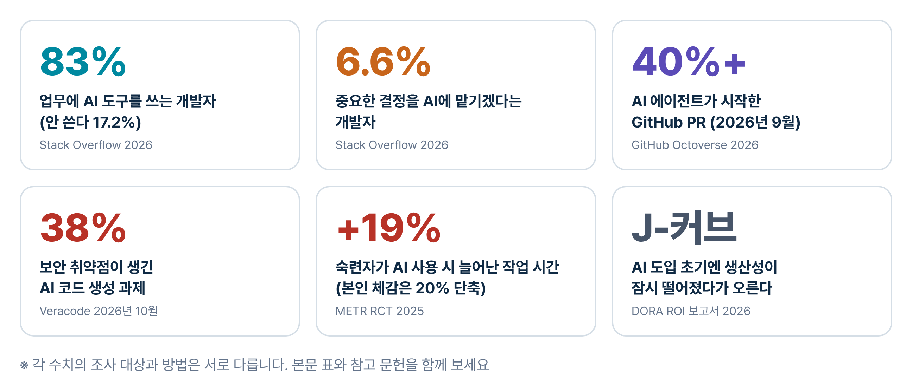
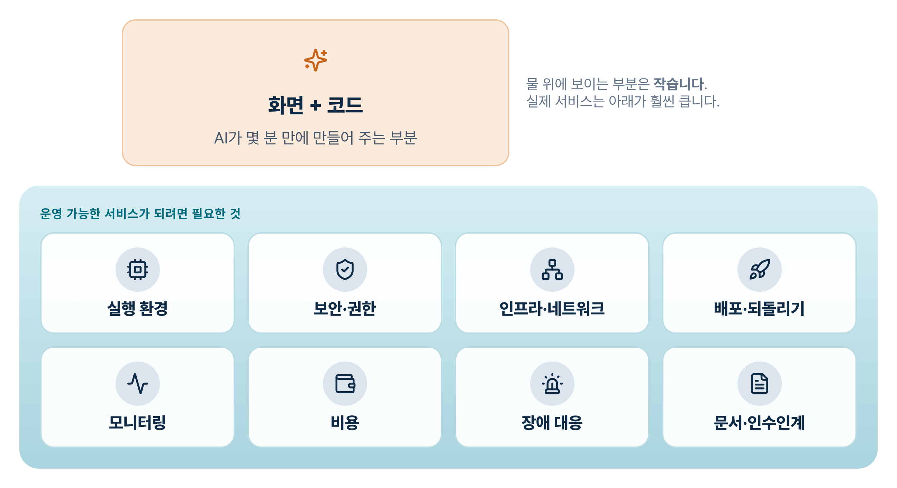
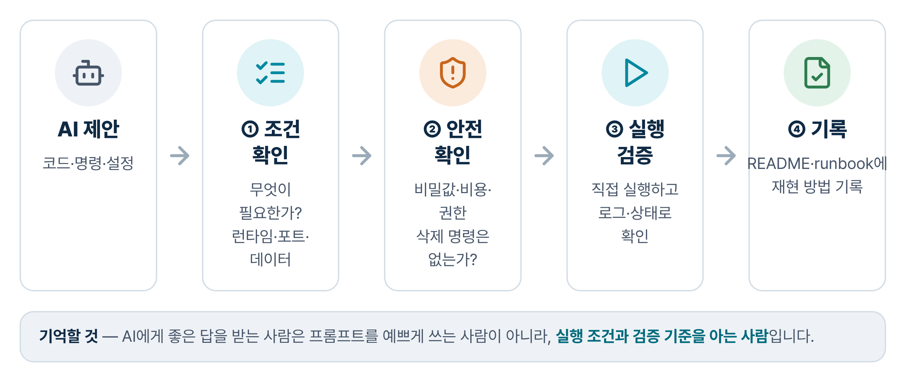

[🏠 과정 목차](../../README.md) › [1주차](../README.md) › [1일차](README.md)

# 3교시 · AI 시대의 DevOps 마인드셋

> [!NOTE]
> **이번 시간에 할 일**
>
> - AI 코딩 도구가 바꾼 것과 바꾸지 못한 것을 구분합니다.
> - "작은 앱"이 "운영 가능한 서비스"가 되려면 무엇이 필요한지 8가지로 정리합니다.
> - AI가 준 답을 그대로 실행하지 않고 **검증하는 습관**을 익힙니다.

## 무엇이 바뀌었나

Claude Code, OpenAI Codex 같은 AI 코딩 에이전트가 등장하면서 작은 앱을 만드는 일은 놀랄 만큼 쉬워졌습니다. "할 일 목록 웹앱을 만들어 줘"라고 말하면 몇 분 만에 화면과 코드가 나옵니다. 프로그래밍을 처음 배우는 사람도 동작하는 화면을 볼 수 있습니다.

그렇다면 인프라와 운영을 배울 필요가 줄어든 걸까요? 결론부터 말하면 **반대입니다.** 코드를 만드는 속도가 빨라질수록, 그 코드를 **안전하게 실행하고, 배포하고, 지키는 일**의 비중이 더 커집니다.

2025년 2월, OpenAI 공동 창업자 안드레이 카르파시(Andrej Karpathy)는 코드를 거의 읽지 않고 AI에게 말로 시키며 프로그램을 만드는 방식을 **"바이브 코딩(vibe coding)"**이라고 불렀습니다. 이 말은 순식간에 유행어가 됐습니다. 프로토타입을 빠르게 만들기에는 훌륭하지만, 그대로 운영 서비스에 올리면 어떤 일이 생기는지는 아래 숫자들이 보여 줍니다.

## 숫자로 보는 2026년의 AI 코딩

| 조사 | 결과 | 시사점 |
|---|---|---|
| Stack Overflow 2026 (169개국 약 3만 명, 2026년 10월 발표) | 업무에 AI 도구를 **전혀 쓰지 않는 개발자는 17.2%**. 코딩 어시스턴트·에이전트 사용 **66%** | AI는 이미 기본 도구 |
| Stack Overflow 2026 | 약 절반은 AI 결과를 **"쉽게 검증할 수 있을 때만"** 믿고, 중요한 결정을 AI에 맡기겠다는 응답은 **6.6%** | 쓰지만, 검증한 만큼만 믿는다 |
| GitHub Octoverse 2026 | 2026년 9월 한 달 동안 만들어진 PR의 **40% 이상을 AI 에이전트가 시작** (3월에는 17%) | 코드보다 **리뷰·테스트·배포**가 병목 |
| DORA 2025 (구글, 약 5,000명 — 마지막 연례 설문) | 개발 직군의 **90%**가 AI 사용. AI는 팀을 고쳐 주지 않고 **이미 있는 것을 증폭**한다 | 프로세스와 기본기가 먼저 |
| DORA 『AI 지원 개발의 ROI』 (2026) | 도입 초기에는 학습과 **검증 부담** 때문에 생산성이 잠시 떨어졌다가 오르는 **J-커브** | 효과는 저절로 오지 않는다 |
| METR 무작위 대조 실험 (2025) → 후속 (2026) | 2025년 실험: 숙련자가 AI를 쓰면 작업이 **19% 더 오래** 걸렸는데 본인들은 20% 빨라졌다고 느낌. 2026년 후속 실험은 "AI 없이 일하기"를 거부하는 참가자가 많아 설계를 다시 하는 중 | 체감과 실제는 다를 수 있다 |
| Veracode 2026년 10월 (LLM 보안 시험) | AI 코드 생성 과제의 **38%**에서 보안 취약점 (2026년 여름 44%에서 개선) | 나아지는 중이지만 여전히 10개 중 4개 |

> [!IMPORTANT]
> **이 숫자들이 말하는 것**
>
> AI는 **이미 모두가 쓰는 도구**가 됐습니다. 그런데 결과물을 **믿을 수 있게 만드는 일**, 즉 검증·보안·배포·관찰은 여전히 사람의 몫이고, 그 일이 바로 DevOps 엔지니어의 일입니다. METR 실험이 보여 주듯 "빨라진 느낌"과 "실제로 빨라진 것"은 다를 수 있습니다. 느낌이 아니라 **측정**으로 판단하는 습관(2교시의 CALMS 중 Measurement)이 AI 시대에 더 중요해졌습니다.

## 빙산 — 보이는 부분과 보이지 않는 부분

AI가 만들어 주는 것은 빙산의 **물 위 부분**(화면과 코드)입니다. 실제 사용자가 돈을 내고 쓰는 서비스가 되려면 물 아래의 큰 덩어리가 필요합니다.

> **📘 할 일 목록 앱으로 생각해 보기**
>
> AI가 만들어 준 할 일 목록 앱을 회사 서비스로 공개한다고 해 봅시다. 다음 질문에 답할 수 있어야 합니다.
>
> | 영역 | 답해야 할 질문 |
> |---|---|
> | 실행 환경 | 어떤 언어 버전, 어떤 포트, 어떤 설정 파일이 필요한가? |
> | 보안·권한 | 비밀번호는 어디에 저장하나? 남의 할 일 목록을 볼 수는 없나? |
> | 인프라·네트워크 | 어떤 서버에서, 어떤 주소로 접속하게 할 것인가? |
> | 배포·되돌리기 | 새 버전을 어떻게 올리나? 문제가 생기면 이전 버전으로 어떻게 돌아가나? |
> | 모니터링 | 지금 정상인지 무엇을 보고 판단하나? 느려지면 누가 알게 되나? |
> | 비용 | 한 달에 얼마가 드나? 사용자가 10배 늘면? |
> | 장애 대응 | 새벽 3시에 멈추면 누가, 무엇을 보고, 어떻게 복구하나? |
> | 문서·인수인계 | 내가 휴가 가면 다른 사람이 이 앱을 운영할 수 있나? |
>
> 이 질문들에 답하는 일이 바로 DevOps·클라우드 엔지니어의 일이고, 이 과정 5주 동안 배우는 내용입니다.

## AI가 준 답은 "후보"다

AI는 매우 그럴듯한 답을 줍니다. 대부분 맞지만, 가끔 **오래된 정보**나 **내 환경과 맞지 않는 명령**, 심지어 **위험한 명령**을 자신 있게 제시합니다. 그래서 AI의 답은 바로 실행할 "정답"이 아니라 검증해야 할 "후보"로 다룹니다.

| 단계 | 하는 일 | 스스로 묻는 질문 |
|---|---|---|
| ① 조건 확인 | 실행에 필요한 것을 확인 | 이 명령은 어떤 버전, 어떤 OS 기준인가? 내 환경과 같은가? |
| ② 안전 확인 | 위험 요소 확인 | 비밀값이 코드에 들어가나? 비용이 생기나? 무언가를 지우나? |
| ③ 실행 검증 | 직접 실행하고 결과 확인 | 정말 동작하나? 로그와 상태가 정상인가? |
| ④ 기록 | 재현 방법을 남김 | 다음 사람이 이 문서만 보고 똑같이 할 수 있나? |

### 실행 전에 반드시 멈춰야 하는 명령들

아래 명령은 앞으로 이 과정에서 실제로 만나게 됩니다. 뜻을 모르면 **절대 그대로 실행하지 않습니다.**

| 명령 예시 | 무엇이 위험한가 | 실행 전에 확인할 것 |
|---|---|---|
| `rm -rf <경로>` | 확인 없이 파일과 폴더를 영구 삭제 | 경로가 정확한가? 변수가 비어 있지 않은가? |
| `chmod 777 <파일>` | 누구나 읽고, 쓰고, 실행할 수 있게 됨 | 정말 모든 사용자에게 권한이 필요한가? |
| 보안 그룹 `0.0.0.0/0` 허용 | 전 세계 인터넷에서 접근 가능 | 이 포트를 정말 모두에게 열어야 하나? |
| 코드에 Access Key 직접 입력 | Git에 올라가면 계정 탈취 | 환경 변수나 비밀 관리 도구를 쓸 수 있나? |
| `kubectl delete namespace <이름>` | 그 안의 모든 리소스가 함께 삭제 | 지금 어느 클러스터에 연결되어 있나? |
| `terraform destroy` | 코드로 관리하던 인프라 전체 삭제 | 실습용 환경이 맞나? 운영 환경이 아닌가? |

> [!WARNING]
> **특히 조심할 것**
>
> AI에게 질문할 때 **비밀번호, Access Key, 회사 내부 정보를 붙여 넣지 않습니다.** 에러 메시지를 공유할 때도 키나 계정 번호가 섞여 있지 않은지 먼저 확인합니다.

### 새로운 위험 — 존재하지 않는 패키지를 설치하라는 AI

AI는 가끔 **세상에 없는 라이브러리 이름**을 그럴듯하게 지어내서 `pip install`이나 `npm install` 명령으로 알려 줍니다. 공격자는 이 점을 노려, AI가 자주 지어내는 이름으로 **악성 패키지를 미리 등록**해 둡니다. 그러면 AI의 말을 믿고 설치한 사람의 컴퓨터가 감염됩니다. 이 공격을 **슬롭스쿼팅(slopsquatting)**이라고 부릅니다.

2025년 보안 학회 USENIX Security에 발표된 연구는 16개 코드 생성 모델로 57만 6천 개의 코드를 만들어 분석했습니다. 추천된 패키지 중 실제로 존재하지 않는 것의 비율이 **상용 모델 평균 5.2%, 오픈소스 모델 평균 21.7%**였고, 지어낸 패키지 이름은 **20만 5천여 개**에 달했습니다.

> [!TIP]
> **패키지를 설치하기 전에**
>
> - 공식 저장소(PyPI, npm)에서 그 패키지가 **실제로 있는지**, 다운로드 수와 관리자, 최근 업데이트를 확인합니다.
> - 공식 문서에 나오는 패키지인지 대조합니다.
> - 처음 보는 패키지는 이름 철자를 한 번 더 봅니다.

### AI 에이전트 시대 — "명령을 직접 실행하는 AI"

2024~2025년부터 AI는 답을 알려 주는 데서 그치지 않고, **직접 터미널 명령을 실행하고 파일을 고치고 클라우드 API를 호출하는 에이전트**로 발전했습니다. 2024년 말 Anthropic이 공개한 **MCP(Model Context Protocol)** 같은 표준 덕분에 AI가 GitHub, 데이터베이스, 클라우드 콘솔 같은 외부 도구에 연결되는 일도 쉬워졌습니다.

이것은 큰 편리함이지만, 운영 관점에서는 **"권한을 가진 새로운 사용자"**가 하나 늘어난 것과 같습니다. 그래서 사람에게 적용하던 원칙을 AI 에이전트에게도 똑같이 적용해야 합니다.

| 원칙 | 사람에게 | AI 에이전트에게 |
|---|---|---|
| 최소 권한 | 필요한 권한만 준다 | 읽기 전용으로 시작, 삭제·결제 권한은 주지 않는다 |
| 승인 | 위험한 변경은 리뷰를 받는다 | 삭제·배포 명령은 사람이 확인 후 실행 |
| 기록 | 누가 무엇을 바꿨는지 남긴다 | 에이전트가 실행한 명령을 로그로 남긴다 |
| 격리 | 운영과 개발 환경을 나눈다 | 에이전트는 실습·개발 환경에서만 |

이 원칙들은 4주차 RBAC(권한 관리)와 5주차 AWS IAM에서 기술로 직접 구현해 봅니다.

> **🎓 학술 노트 — 자동화 편향과 자동화의 아이러니**
>
> **자동화 편향(automation bias)**은 사람이 자동화된 시스템의 제안을 지나치게 믿어서, 틀린 제안도 확인 없이 따르거나 시스템이 놓친 문제를 알아채지 못하는 경향입니다. 항공 조종실과 의료 분야에서 오래 연구된 현상이며(Parasuraman & Manzey, 2010), 그럴듯한 AI 답변에도 똑같이 나타납니다.
>
> 영국의 인지심리학자 리산 베인브리지(Lisanne Bainbridge)는 1983년 논문 「자동화의 아이러니(Ironies of Automation)」에서 역설을 지적했습니다. **자동화가 잘될수록 사람은 직접 할 기회가 줄어 실력이 떨어지는데, 정작 자동화가 실패하는 순간에는 그 사람이 가장 어려운 상황을 해결해야 한다**는 것입니다. AI가 평소 일을 다 해 줄수록, 장애 상황에서 원리를 아는 사람의 가치는 더 커집니다. 이 과정이 AI 시대에도 원리부터 가르치는 이유입니다.
>
> - Bainbridge, L. (1983). Ironies of automation. *Automatica*, 19(6), 775–779.
> - Parasuraman, R., & Manzey, D. H. (2010). Complacency and bias in human use of automation. *Human Factors*, 52(3), 381–410.

## 이 과정에서 AI를 쓰는 5가지 원칙

AI 사용을 막지 않습니다. 오히려 잘 쓰는 법을 배웁니다. 다만 다음 원칙을 지킵니다.

1. **공식 문서와 대조합니다.** 버전이나 설치 방법은 공식 문서가 최종 기준입니다.
2. **한 번에 한 단계씩 실행합니다.** 긴 명령 묶음을 통째로 붙여 넣지 않습니다.
3. **이해하지 못한 명령은 실행하지 않습니다.** "이 명령의 각 부분이 무슨 뜻이야?"라고 다시 물어봅니다.
4. **비밀값은 넣지 않습니다.** 질문에도, 코드에도.
5. **결과를 기록합니다.** 무엇을 물었고, 무엇을 실행했고, 결과가 어땠는지 배움일기에 남깁니다.

> **📘 질문 비교**
>
> **아쉬운 질문:** "쿠버네티스 설치하는 법 알려 줘."
>
> **좋은 질문:** "Windows 11의 WSL2(Ubuntu 24.04)에서 Docker Desktop을 쓰고 있어. kind로 학습용 Kubernetes 클러스터를 만들려고 하는데, 설치 순서와 각 명령이 무엇을 하는지, 설치가 잘 됐는지 확인하는 명령도 같이 알려 줘. 공식 문서 링크도 붙여 줘."
>
> 좋은 질문에는 **환경, 목적, 원하는 검증 방법**이 들어 있습니다. AI도 사람처럼 맥락이 많을수록 정확하게 답합니다.

> **❓ 오해 바로잡기**
>
> | 오해 | 사실 |
> |---|---|
> | AI가 코드를 짜 주니 인프라 지식은 덜 중요해진다 | 코드가 빨리 나올수록 그 코드를 안전하게 운영하는 지식이 더 중요해진다 |
> | AI가 알려 준 명령은 그대로 실행해도 된다 | 삭제·권한·비용·비밀값과 관련된 명령은 반드시 뜻을 확인한 뒤 실행한다 |
> | 에러를 많이 만나면 실력이 부족한 것이다 | 에러를 증거로 정리하고 재현할 수 있게 설명하는 능력이 현업 실력이다 |

## 정리

- AI 덕분에 **물 위의 빙산**(화면·코드)을 만드는 일은 쉬워졌습니다.
- **물 아래**(실행 환경, 보안, 인프라, 배포, 모니터링, 비용, 장애 대응, 문서)는 여전히 사람이 판단해야 합니다.
- AI의 답은 **조건 확인 → 안전 확인 → 실행 검증 → 기록**을 거친 뒤에야 쓸 수 있습니다.
- 2026년 조사에서 개발자 대다수가 AI를 쓰고 PR의 40% 이상을 에이전트가 시작하지만, 검증한 만큼만 믿고, AI 코드의 상당수에서 여전히 보안 취약점이 발견됩니다. **검증하는 사람**의 가치가 커졌습니다.
- AI 에이전트에게도 **최소 권한, 승인, 기록, 격리** 원칙을 똑같이 적용합니다.

> **✅ 확인 문제**
>
> 1. 빙산 그림에서 물 아래에 있는 8가지 중 4가지를 말해 보세요.
> 2. AI가 `chmod 777 app.sh`를 실행하라고 했습니다. 실행하기 전에 무엇을 확인해야 하나요?
> 3. AI 결과 검증 4단계를 순서대로 말해 보세요.
> 4. AI가 지어낸 패키지 이름으로 악성 패키지를 등록해 두는 공격을 무엇이라고 하나요?
> 5. "자동화가 잘될수록 사람의 실력이 떨어지는데, 실패 순간엔 사람이 가장 어려운 문제를 맡는다"는 역설을 지적한 논문의 제목은?
>
> 

정답

>
> 1. 실행 환경, 보안·권한, 인프라·네트워크, 배포·되돌리기, 모니터링, 비용, 장애 대응, 문서·인수인계 중 4가지
> 2. 모든 사용자에게 읽기·쓰기·실행 권한이 정말 필요한지 확인합니다. 보통은 실행 권한만 주는 `chmod +x` 또는 `chmod 755`면 충분합니다.
> 3. 조건 확인 → 안전 확인 → 실행 검증 → 기록
> 4. 슬롭스쿼팅(slopsquatting)
> 5. 「자동화의 아이러니(Ironies of Automation)」, Bainbridge (1983)
>
> 

## 참고 문헌

- DORA (2025). *State of AI-assisted Software Development*. Google Cloud.
- DORA (2026). *The ROI of AI-assisted Software Development*. dora.dev/ai
- Stack Overflow (2026). *2026 Developer Survey*. survey.stackoverflow.co/2026 (발표 2026-10-06)
- GitHub (2026). *Octoverse 2026*. github.blog (발표 2026-10-28)
- Becker, J., Rush, N., Barnes, E., & Rein, D. (2025). Measuring the Impact of Early-2025 AI on Experienced Open-Source Developer Productivity. METR. arXiv:2507.09089
- Veracode (2026). *2026 GenAI Code Security Report* (2026-07) 및 October 2026 update.
- METR (2026). *We are changing our developer productivity experiment design* (2026-02-24). metr.org/blog
- Spracklen, J. et al. (2025). We Have a Package for You! A Comprehensive Analysis of Package Hallucinations by Code Generating LLMs. *USENIX Security Symposium 2025*.
- Bainbridge, L. (1983). Ironies of automation. *Automatica*, 19(6).
- Parasuraman, R., & Manzey, D. H. (2010). Complacency and bias in human use of automation. *Human Factors*, 52(3).

---

⬅️ 이전: [2교시 · 5주 로드맵과 DevOps 직무](lesson-02.md) &nbsp;|&nbsp; [⬆️ 1일차 목차](README.md) &nbsp;|&nbsp; 다음: [4교시 · 데이터센터에서 클라우드까지](lesson-04.md) ➡️
