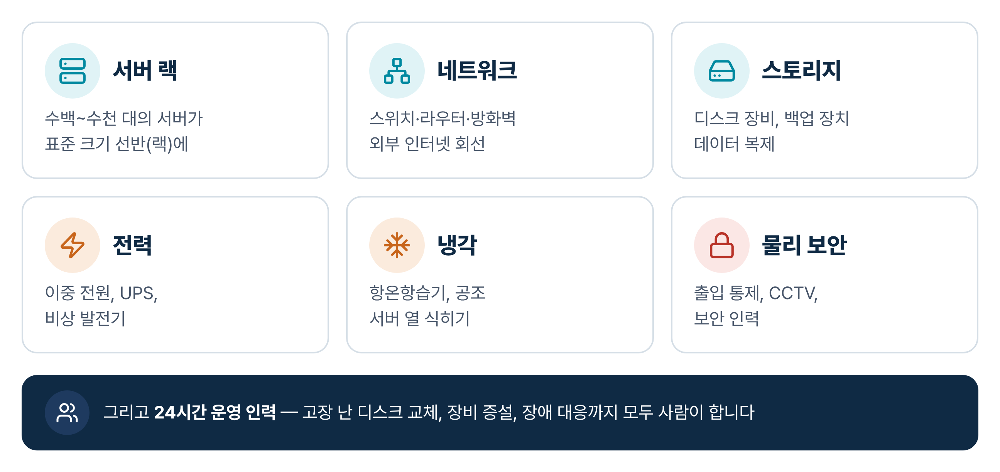
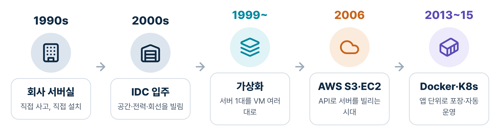
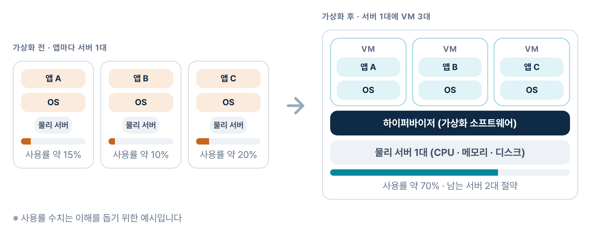
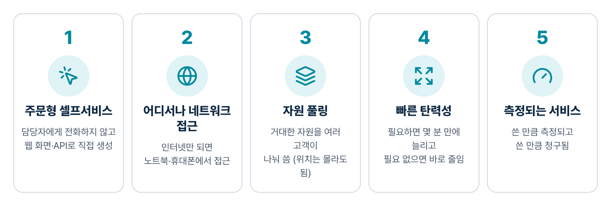
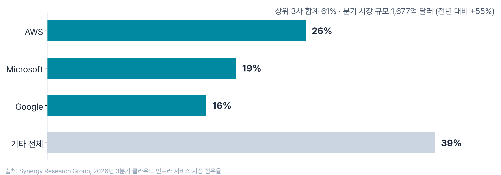

[🏠 과정 목차](../../README.md) › [1주차](../README.md) › [1일차](README.md)

# 4교시 · 데이터센터에서 클라우드까지

> [!NOTE]
> **이번 시간에 할 일**
>
> - 서버를 직접 운영하면 어떤 일을 해야 하는지 이해합니다.
> - 가상화가 무엇이고, 왜 클라우드의 바탕이 되었는지 설명합니다.
> - 클라우드의 5가지 특징(NIST 정의)으로 "무엇이 클라우드인가"를 판단합니다.

## 서버란 무엇인가

**서버**는 다른 컴퓨터의 요청을 받아 응답해 주는 컴퓨터입니다. 우리가 쇼핑 앱에서 상품 목록을 볼 때, 휴대폰(클라이언트)이 "상품 목록 주세요"라고 요청하면 어딘가의 서버가 목록을 찾아 돌려줍니다.

> **🧩 비유 — 식당의 주방**
>
> 손님(클라이언트)은 주문서(요청)를 내고, 주방(서버)은 요리(응답)를 내보냅니다. 손님은 주방이 어떻게 생겼는지 몰라도 됩니다. 하지만 식당 주인은 주방 설비, 가스, 냉장고, 위생, 요리사 근무표까지 모두 챙겨야 합니다. 서버를 운영한다는 것은 **이 주방을 책임지는 것**입니다.

서버도 결국 컴퓨터라서 CPU, 메모리, 디스크, 네트워크 카드가 들어 있습니다. 다만 24시간 365일 켜져 있어야 하고, 많은 요청을 동시에 처리해야 하므로 개인 PC보다 튼튼하고 비싼 부품을 씁니다.

## 서버를 직접 운영한다는 것

작은 쇼핑몰을 운영하는데, 연말 할인 행사로 방문자가 평소의 10배가 될 예정이라고 해 봅시다. 서버를 직접 운영한다면 다음 일을 모두 해야 합니다.

1. 필요한 서버 대수를 **미리 예측**합니다. (적게 사면 사이트가 멈추고, 많이 사면 돈이 남습니다.)
2. 서버를 **주문**하고 배송을 기다립니다. 보통 몇 주가 걸립니다.
3. 서버를 놓을 **공간, 전력, 냉각, 네트워크 회선**을 확보합니다.
4. 서버를 랙에 설치하고, 운영체제를 깔고, 네트워크를 연결합니다.
5. 행사가 끝나면… **늘어난 서버는 그대로 남습니다.** 이미 샀으니까요.

이 많은 일을 대신해 주는 곳이 **데이터센터**이고, 이 일을 아예 서비스로 바꾼 것이 **클라우드**입니다.

## 데이터센터 안에는 무엇이 있나

데이터센터는 수많은 서버를 안정적으로 돌리기 위한 **전용 건물**입니다. 서버만 있는 것이 아니라, 서버가 멈추지 않도록 받쳐 주는 시설이 대부분을 차지합니다.

| 구성요소 | 하는 일 | 문제가 생기면 |
|---|---|---|
| 서버 랙 | 서버를 규격화된 선반에 촘촘히 배치 | 공간 부족으로 증설 불가 |
| 네트워크 | 서버끼리, 그리고 인터넷과 연결 | 서비스 접속 불가 |
| 스토리지 | 데이터를 저장하고 백업 | 데이터 유실 |
| 전력 | 이중 전원, UPS, 비상 발전기 | 정전 시 전체 중단 |
| 냉각 | 서버가 내는 열을 식힘 | 과열로 장비 고장 |
| 물리 보안 | 출입 통제, CCTV | 장비 도난, 내부자 사고 |

## 서버를 다루는 방식의 변화

| 시기 | 방식 | 특징 |
|---|---|---|
| 1990년대 | 회사 서버실 | 사무실 한쪽에 서버를 두고 직접 관리 |
| 2000년대 | IDC 입주 | 전문 데이터센터의 공간·전력·회선을 빌리고, 서버는 내 것 |
| 1999년~ | 가상화 확산 | 물리 서버 한 대를 여러 대의 가상 서버로 나눠 씀 |
| 2006년 | 퍼블릭 클라우드 등장 | AWS가 S3(3월)와 EC2(8월)를 출시 — API로 서버를 빌리는 시대 |
| 2013~2015년 | 컨테이너와 오케스트레이션 | Docker 공개(2013), Kubernetes 발표(2014)·1.0 출시(2015) |

흐름을 한 줄로 요약하면, 서버는 점점 **"사야 하는 물건"에서 "필요할 때 요청하는 서비스"**로 바뀌어 왔습니다.

## 가상화 — 클라우드를 가능하게 한 기술

예전에는 앱 하나에 물리 서버 한 대를 쓰는 경우가 많았습니다. 그런데 대부분의 서버는 평소 CPU를 10~20% 정도만 씁니다. 나머지는 놀고 있는 셈입니다.

**가상화**는 물리 서버 한 대를 여러 대의 독립된 **가상 머신(VM)**처럼 나눠 쓰는 기술입니다. 이 나누기를 담당하는 소프트웨어를 **하이퍼바이저**라고 합니다.

- 각 VM은 **자기만의 운영체제**를 가지고, 다른 VM과 격리되어 실행됩니다.
- 하이퍼바이저가 CPU, 메모리, 디스크를 VM들에게 **나눠 줍니다.**
- 물리 서버를 덜 사도 되고, 새 서버가 필요하면 장비 구매 없이 **VM을 하나 더 만들면** 됩니다.

> **🎓 학술 노트 — 가상화의 세 가지 조건 (Popek & Goldberg, 1974)**
>
> 가상화는 1960년대 IBM이 메인프레임에서 먼저 실현했습니다. IBM의 CP-40과 CP-67은 비싼 메인프레임 한 대를 여러 사용자가 각자 자기 컴퓨터처럼 쓰게 해 주는 시스템이었습니다. 1974년 제럴드 포펙(Gerald Popek)과 로버트 골드버그(Robert Goldberg)는 "어떤 컴퓨터 구조가 가상화될 수 있는가"를 수학적으로 정리한 논문을 발표했고, 진짜 가상 머신이라면 다음 세 조건을 만족해야 한다고 했습니다.
>
> | 조건 | 뜻 | 쉬운 말로 |
> |---|---|---|
> | 동등성 (Equivalence) | VM 안의 프로그램은 실제 기계에서와 똑같이 동작한다 | "VM인지 모르고 돌아가야 한다" |
> | 자원 통제 (Resource control) | 하이퍼바이저가 모든 자원을 완전히 통제한다 | "VM이 남의 메모리를 넘볼 수 없다" |
> | 효율성 (Efficiency) | 대부분의 명령은 하이퍼바이저 개입 없이 CPU에서 바로 실행된다 | "느려지면 안 된다" |
>
> 재미있게도 오랫동안 PC에 쓰인 x86 CPU는 이 조건을 완전히 만족하지 못했습니다. 그래서 1999년 VMware는 명령을 실시간으로 바꿔치기하는 기법으로 이 한계를 우회했고, 2005~2006년 무렵 인텔과 AMD가 CPU 자체에 가상화 기능(Intel VT-x, AMD-V)을 넣으면서 비로소 x86 가상화가 빠르고 쉬워졌습니다. 이것이 클라우드 폭발의 기술적 전제였습니다.
>
> - Popek, G. J., & Goldberg, R. P. (1974). Formal requirements for virtualizable third generation architectures. *Communications of the ACM*, 17(7), 412–421.

> **📈 트렌드 — 하이퍼바이저도 하드웨어로 (AWS Nitro)**
>
> AWS는 2017년부터 **Nitro 시스템**을 도입했습니다. 네트워크, 스토리지, 보안 같은 가상화 작업을 전용 하드웨어 카드로 떼어 내고, 하이퍼바이저는 아주 가볍게 만든 구조입니다. 덕분에 고객이 쓰는 VM은 물리 서버 성능을 거의 그대로 쓸 수 있게 됐습니다. 오늘날 새로 나오는 EC2 인스턴스는 모두 Nitro 기반입니다. 가상화는 "소프트웨어 기술"에서 "하드웨어와 소프트웨어를 함께 설계하는 기술"로 발전하고 있습니다.

> [!IMPORTANT]
> **클라우드와 가상화의 관계**
>
> AWS에서 "서버(EC2 인스턴스)를 하나 만든다"는 것은, AWS 데이터센터의 거대한 물리 서버 위에서 **하이퍼바이저가 VM 하나를 잘라 내 주는 것**과 같습니다. 클라우드는 가상화된 자원을 인터넷으로, 셀프서비스로, 쓴 만큼 빌려주는 사업입니다. 가상화는 1주차 2일차에 더 자세히 다룹니다.

## "컴퓨팅을 수도처럼" — 클라우드라는 생각의 역사

클라우드는 2006년에 갑자기 나타난 아이디어가 아닙니다. 60년 넘게 이어진 생각이 기술과 만나 현실이 된 것입니다.

| 연도 | 사건 | 핵심 생각 |
|---|---|---|
| 1961 | 존 매카시(John McCarthy), MIT 100주년 강연 | "컴퓨팅도 언젠가 전화나 수도처럼 **공공 유틸리티**가 될 수 있다" |
| 1960년대 | IBM CP-40 / CP-67 | 메인프레임 한 대를 여러 사용자가 나눠 쓰는 **시분할과 가상 머신** |
| 1974 | 포펙과 골드버그 논문 | 가상화가 가능한 조건을 이론으로 정리 |
| 1999 | VMware Workstation 출시 | x86 PC에서 가상화 대중화 |
| 2006 | AWS S3·EC2 출시 | API로 서버와 저장소를 빌리는 **퍼블릭 클라우드** 시작 |
| 2009 | UC 버클리 보고서 「Above the Clouds」 | 클라우드가 왜 새로운지 학문적으로 정리 |
| 2011 | NIST SP 800-145 | 클라우드의 **표준 정의** (5가지 특징, 3가지 서비스 모델, 4가지 배포 모델) |

> **🎓 학술 노트 — 버클리 보고서가 꼽은 클라우드의 세 가지 새로움 (2009)**
>
> UC 버클리의 마이클 암브러스트(Michael Armbrust) 등은 2009년 보고서 「Above the Clouds: A Berkeley View of Cloud Computing」에서, 하드웨어 관점에서 클라우드가 이전과 달라진 점을 세 가지로 정리했습니다. 이 논문은 클라우드 분야에서 가장 많이 인용되는 문헌 중 하나입니다.
>
> 1. **무한한 자원이라는 착각** — 필요할 때 얼마든지 쓸 수 있는 것처럼 보이므로, 사용량을 미리 예측해 장비를 살 필요가 없다.
> 2. **선투자의 제거** — 작게 시작해서, 필요해질 때만 늘릴 수 있다.
> 3. **단기 사용에 대한 종량제** — 서버를 한 시간만 쓰고 반납할 수 있다. 자원을 놓아주는 것 자체가 비용 절감이 된다.
>
> 이 세 가지는 5교시에서 배울 CAPEX·OPEX 이야기와 정확히 연결됩니다. 보고서는 또 "1,000대를 1시간 쓰는 비용 = 1대를 1,000시간 쓰는 비용"이라는 **비용 연관성(cost associativity)**을 강조했습니다. 같은 돈으로 결과를 1,000배 빨리 얻을 수 있다는 뜻입니다.
>
> - Armbrust, M. et al. (2009). *Above the Clouds: A Berkeley View of Cloud Computing*. UC Berkeley Technical Report UCB/EECS-2009-28. (요약판: *Communications of the ACM*, 53(4), 2010)

## 클라우드란 무엇인가 — 5가지 특징

"클라우드"라는 말은 너무 넓게 쓰여서, 그냥 "인터넷 어딘가"라는 뜻으로 오해하기 쉽습니다. 미국 표준기술연구소(NIST)는 클라우드를 **다섯 가지 특징을 모두 갖춘 컴퓨팅 방식**으로 정의합니다. 이 정의는 업계에서 가장 널리 인용됩니다.

| 특징 | 쉬운 말로 | 예시 |
|---|---|---|
| 주문형 셀프서비스 | 사람에게 요청하지 않고 내가 직접 만든다 | AWS 콘솔에서 버튼 몇 번으로 서버 생성 |
| 광범위한 네트워크 접근 | 인터넷만 되면 어디서든 쓴다 | 집 노트북으로 서울 리전 서버에 접속 |
| 자원 풀링 | 거대한 자원 창고를 여러 고객이 나눠 쓴다 | 내 서버가 어느 물리 장비에 있는지 몰라도 됨 |
| 빠른 탄력성 | 필요하면 금방 늘리고, 필요 없으면 줄인다 | 행사 기간에만 서버 10대로 늘렸다가 다시 2대로 |
| 측정되는 서비스 | 쓴 만큼 측정되고, 쓴 만큼 낸다 | 서버를 3시간 켜면 3시간 요금만 청구 |

> **📘 이것도 클라우드일까?**
>
> 회사가 직원용 서버를 IDC에 두고, 서버가 필요한 팀은 **신청서를 내면 담당자가 일주일 뒤에 만들어 준다**고 합시다. 인터넷으로 접속도 되고 가상화도 되어 있습니다. 이것은 클라우드일까요?
>
> 엄밀히 말하면 아닙니다. **셀프서비스**가 아니고(사람이 만들어 줌), **빠른 탄력성**도 없습니다(일주일). 같은 가상화 기술을 써도 **운영 방식**이 클라우드의 특징을 갖추지 못하면 클라우드라고 부르기 어렵습니다.

## 클라우드의 종류 — 누가 쓰는가

| 배포 모델 | 설명 | 예시 |
|---|---|---|
| 퍼블릭 클라우드 | 누구나 가입해서 쓰는 클라우드 | AWS, Microsoft Azure, Google Cloud, 네이버 클라우드 |
| 프라이빗 클라우드 | 한 조직만 쓰도록 자체 구축한 클라우드 | 은행·공공기관의 내부 클라우드 |
| 하이브리드 클라우드 | 자체 데이터센터와 퍼블릭 클라우드를 연결해 함께 사용 | 고객 데이터는 사내에, 웹 서비스는 AWS에 |
| 멀티 클라우드 | 여러 퍼블릭 클라우드를 함께 사용 | 메인은 AWS, 데이터 분석은 Google Cloud |

이 과정에서는 퍼블릭 클라우드 가운데 국내외 채용 공고에서 가장 많이 요구되는 **AWS**를 사용합니다. 개념은 다른 클라우드에도 거의 그대로 적용됩니다.

## 2026년 클라우드 시장과 AI 데이터센터

### 시장 점유율 — 세 회사가 약 60%

시장조사기관 Synergy Research Group에 따르면 2026년 3분기 전 세계 클라우드 인프라 서비스 시장은 **한 분기에 약 1,677억 달러** 규모로, 1년 전보다 **55%** 커졌습니다. 성장률이 12분기 연속 높아졌고, 시장이 2년 만에 두 배가 됐습니다. 점유율은 **AWS 26%, Microsoft 19%, Google 16%**입니다. AWS는 여전히 1위지만 점유율은 조금씩 줄고 있고, Microsoft와 Google이 더 빠르게 성장하고 있습니다. 같은 조사에서 **AI 전용 클라우드 서비스가 전체 시장의 약 3분의 1**을 차지했고, **CoreWeave**, Nebius 같은 GPU 전문 클라우드, 이른바 **네오클라우드(neocloud)**와 Oracle이 가장 빠르게 크는 2군 사업자로 꼽혔습니다.

한 회사 시장이 아니라는 점에서, 특정 회사의 버튼 위치를 외우기보다 **어느 클라우드에서나 통하는 원리**(가상화, 네트워크, 공유 책임, 비용 구조)를 이해하는 것이 중요합니다. 이 과정이 1주차를 원리에 쓰는 이유입니다.

### AI가 데이터센터를 다시 짓고 있다

국제에너지기구(IEA)가 2025년 4월 발표한 「에너지와 AI」 보고서와, 2026년 4월의 후속 보고서 「에너지와 AI의 핵심 질문」, 11월의 「세계 에너지 전망 2026」은 데이터센터가 다시 "물리적인 문제"가 되고 있음을 보여 줍니다.

| 지표 | 수치 |
|---|---|
| 2025년 데이터센터 전력 수요 증가율 | **17%** (전 세계 전력 수요 증가율 3%의 약 6배). AI 중심 데이터센터는 **50%** 증가 |
| 2030년 전망 | 데이터센터 전력 사용이 **두 배(약 1,000 TWh)**, AI 중심 데이터센터는 **세 배** |
| 대형 IT 기업의 투자 | 5대 기업 설비 투자가 2025년 **4,000억 달러** 이상, 2026년 다시 **75%** 증가 예상 |
| AI 중심 데이터센터 한 곳의 전력 | 일반 가정 약 **10만 가구** 수준 |
| 냉각이 차지하는 전력 비중 | 효율 좋은 대형(하이퍼스케일) 센터 약 **7%** vs 일반 기업 센터 **30% 이상** |

마지막 줄을 눈여겨보세요. 같은 서버를 돌려도 **거대한 클라우드 데이터센터가 냉각에 훨씬 적은 전력을 씁니다.** 이것이 5교시에서 다룰 **규모의 경제**의 구체적인 예입니다. 클라우드 회사는 엄청난 규모로 전력과 냉각 효율을 최적화할 수 있고, 개별 회사가 서버실에서 따라가기 어렵습니다.

> **📈 트렌드 — 공랭에서 수랭으로**
>
> AI용 GPU 서버는 일반 서버보다 훨씬 많은 열을 냅니다. 그래서 최신 AI 데이터센터는 바람으로 식히는 **공랭** 대신, 칩 가까이에 냉각수를 흘려 식히는 **수랭(액체 냉각)** 방식을 빠르게 도입하고 있습니다. 데이터센터의 입지도 전력을 얼마나 확보할 수 있는지가 가장 큰 조건이 되었습니다. "클라우드"라는 이름과 달리, 클라우드는 결국 **전기와 땅과 물**의 문제이기도 합니다.

> **❓ 오해 바로잡기**
>
> | 오해 | 사실 |
> |---|---|
> | 클라우드에는 서버가 없다 | 서버는 분명히 있습니다. 내가 직접 만지지 않을 뿐입니다 |
> | 가상화가 곧 클라우드다 | 가상화는 바탕 기술이고, 셀프서비스·탄력성·종량제 같은 운영 방식까지 갖춰야 클라우드입니다 |
> | 데이터센터 방식은 낡았다 | 규제가 강하거나 사용량이 일정하고 큰 기업은 직접 운영이 더 합리적일 수 있습니다 |

## 정리

- 서버 운영은 서버뿐 아니라 **공간, 전력, 냉각, 네트워크, 보안, 사람**까지 책임지는 일입니다.
- **가상화**는 물리 서버 한 대를 여러 VM으로 나눠 쓰는 기술이며, 클라우드의 바탕입니다.
- 클라우드는 **셀프서비스, 네트워크 접근, 자원 풀링, 빠른 탄력성, 측정되는 서비스**를 모두 갖춘 방식입니다.
- 클라우드의 아이디어는 1961년 "컴퓨팅을 유틸리티로"에서 시작해, 1974년 가상화 이론, 2006년 AWS, 2011년 NIST 정의로 이어졌습니다.
- 2026년 3분기 클라우드 시장은 AWS·Microsoft·Google이 약 61%를 차지하고, AI 전용 서비스가 시장의 3분의 1에 이르며, AI가 데이터센터의 전력·냉각 문제를 다시 키우고 있습니다.

> **✅ 확인 문제**
>
> 1. 물리 서버 위에서 VM을 만들고 자원을 나눠 주는 소프트웨어를 무엇이라고 하나요?
> 2. "행사 기간에만 서버를 늘렸다가 끝나면 줄인다"는 클라우드의 어떤 특징인가요?
> 3. AWS가 EC2를 처음 출시한 해는 언제인가요?
> 4. 포펙과 골드버그가 제시한 가상화의 세 조건은 무엇인가요?
> 5. 버클리 보고서가 말한 "비용 연관성"을 예를 들어 설명해 보세요.
>
> 

정답

>
> 1. 하이퍼바이저
> 2. 빠른 탄력성 (Rapid Elasticity)
> 3. 2006년
> 4. 동등성, 자원 통제, 효율성
> 5. 서버 1,000대를 1시간 쓰는 비용과 1대를 1,000시간 쓰는 비용이 같다. 그러므로 같은 비용으로 작업을 훨씬 빨리 끝낼 수 있다.
>
> 

## 참고 문헌

- Popek, G. J., & Goldberg, R. P. (1974). Formal requirements for virtualizable third generation architectures. *Communications of the ACM*, 17(7).
- Armbrust, M. et al. (2009). *Above the Clouds: A Berkeley View of Cloud Computing*. UCB/EECS-2009-28.
- Mell, P., & Grance, T. (2011). *The NIST Definition of Cloud Computing* (SP 800-145). NIST.
- Synergy Research Group (2026). Global Cloud Market Reaches $167.7 Billion in Q3 2026 (2026-10-30). techinsights.com
- International Energy Agency (2025). *Energy and AI*. iea.org/reports/energy-and-ai
- International Energy Agency (2026). *Key Questions on Energy and AI* (2026-04); *World Energy Outlook 2026* (2026-11-19).
- AWS. *The AWS Nitro System*. aws.amazon.com/ec2/nitro

---

⬅️ 이전: [3교시 · AI 시대의 DevOps 마인드셋](lesson-03.md) &nbsp;|&nbsp; [⬆️ 1일차 목차](README.md) &nbsp;|&nbsp; 다음: [5교시 · 서비스 모델·공유 책임·비용](lesson-05.md) ➡️
