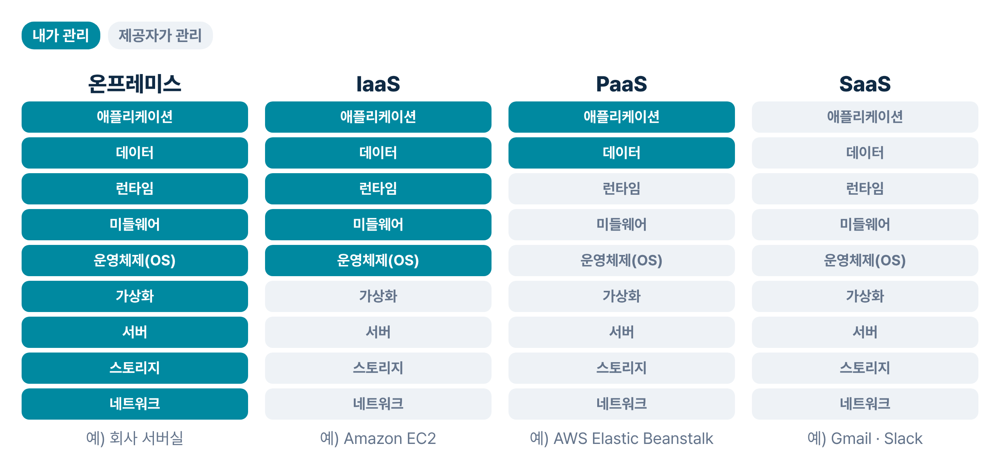
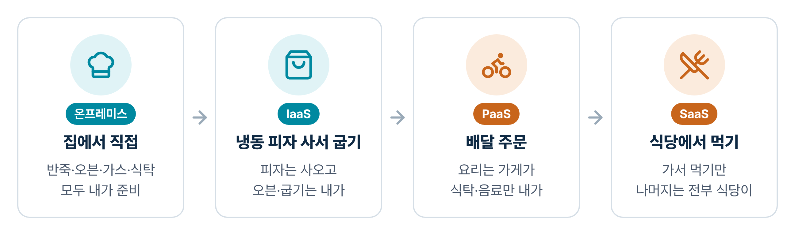
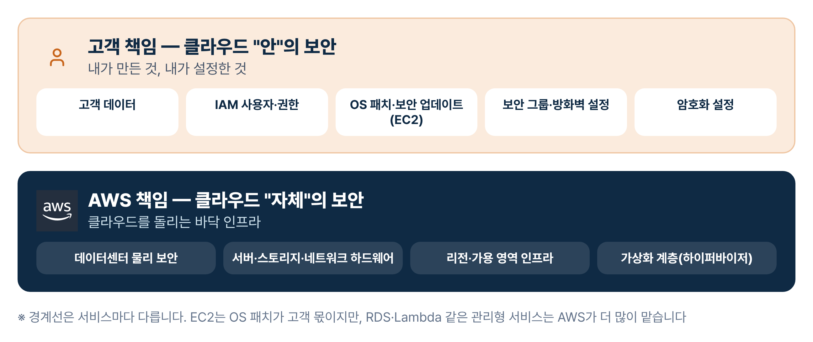
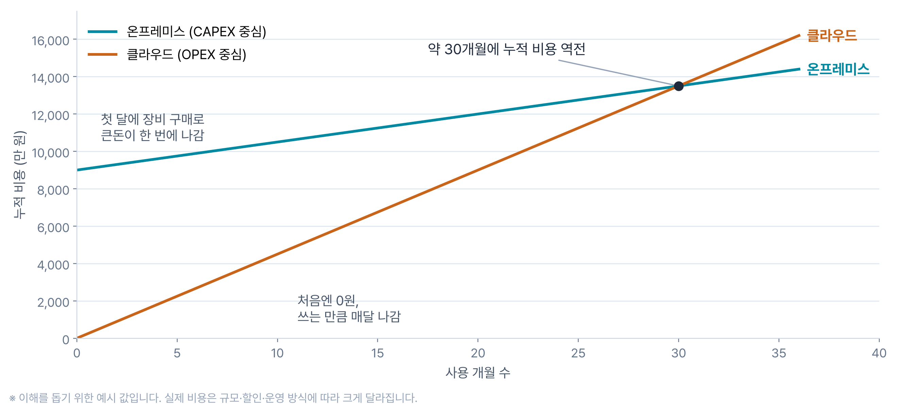
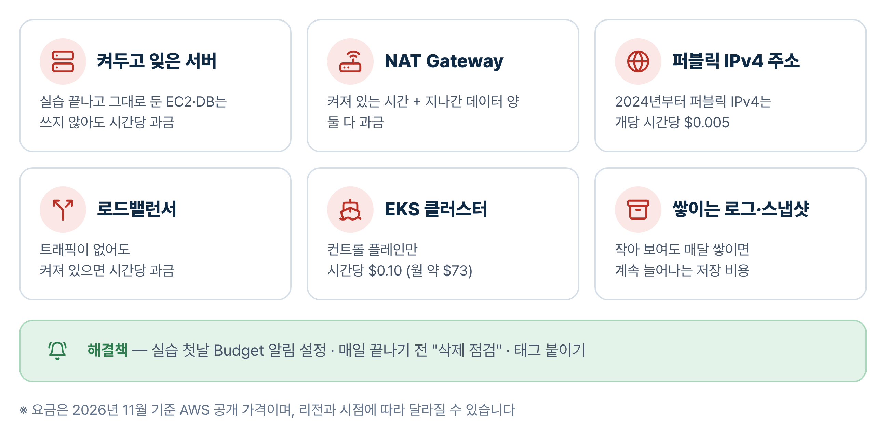
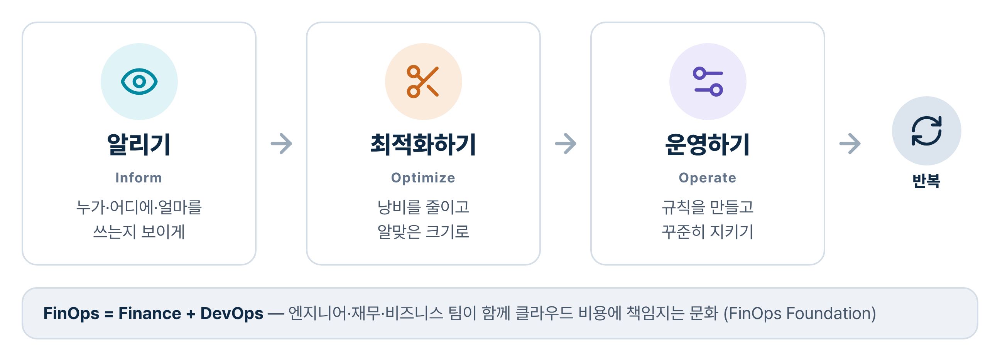
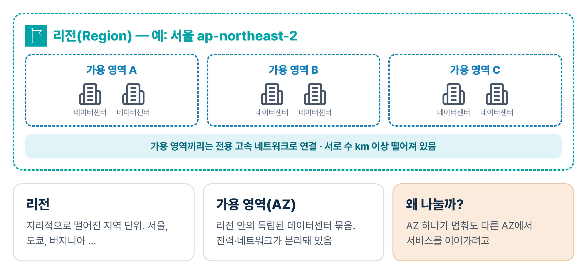

[🏠 과정 목차](../../README.md) › [1주차](../README.md) › [1일차](README.md)

# 5교시 · 서비스 모델·공유 책임·비용

> [!NOTE]
> **이번 시간에 할 일**
>
> - IaaS·PaaS·SaaS를 "누가 어디까지 관리하는가"로 구분합니다.
> - 공유 책임 모델에서 **내 책임**이 무엇인지 말할 수 있습니다.
> - CAPEX·OPEX·TCO의 차이를 이해하고, 클라우드 비용이 새는 지점을 압니다.
> - 리전과 가용 영역(AZ)이 무엇인지 미리 봅니다.

## 서비스 모델 — 어디까지 빌릴 것인가

클라우드는 "얼마나 많은 부분을 제공자에게 맡기느냐"에 따라 크게 세 가지로 나뉩니다. 아래 그림은 서비스를 이루는 9개 층을 누가 관리하는지 보여 줍니다.

| 모델 | 이름 | 내가 관리하는 것 | AWS 예시 |
|---|---|---|---|
| 온프레미스 | On-Premises | 전부 | (클라우드 아님) |
| IaaS | Infrastructure as a Service | OS부터 위쪽 전부 | Amazon EC2 |
| PaaS | Platform as a Service | 내 코드와 데이터 | AWS Elastic Beanstalk |
| SaaS | Software as a Service | 사용과 설정만 | Gmail, Slack, Notion |

> **📖 용어**
>
> - **온프레미스(On-Premises)**: 자기 건물(premises) 안에 장비를 두고 직접 운영하는 방식. 줄여서 "온프렘"이라고도 합니다.
> - **런타임**: 프로그램을 실행하는 데 필요한 환경. 예: Java, Python, Node.js
> - **미들웨어**: 앱과 OS 사이에서 공통 기능을 제공하는 소프트웨어. 예: 웹 서버, 메시지 큐

### 피자로 이해하기

오른쪽으로 갈수록 내가 할 일이 줄어듭니다. 대신 **고를 수 있는 것도 줄어듭니다.** 집에서 만들면 토핑을 마음대로 고르지만, 식당에서는 메뉴판에 있는 것만 먹을 수 있습니다. 클라우드도 같습니다. EC2(IaaS)는 OS부터 마음대로 설정할 수 있지만 관리할 것이 많고, SaaS는 편하지만 내 마음대로 바꿀 수 있는 부분이 적습니다.

> [!TIP]
> **그 밖의 모델 — 이 과정에서 만날 것들**
>
> 세 가지 모델 사이에 끼는 서비스도 많습니다.
>
> - **컨테이너 서비스 (CaaS)**: 컨테이너만 맡기면 실행해 준다. 예: Amazon ECS, Amazon EKS → 5주차
> - **서버리스 (FaaS)**: 함수 코드만 올리면 요청이 올 때만 실행된다. 예: AWS Lambda
>
> 모델 이름보다 **"내가 관리하는 층이 어디까지인가"**를 따지는 습관이 더 중요합니다.

## 공유 책임 모델 — 사고가 나면 누구 책임인가

클라우드를 쓰면 보안도 AWS가 다 해 줄까요? 아닙니다. AWS는 **공유 책임 모델(Shared Responsibility Model)**로 책임의 경계를 분명히 나눕니다.

| 구분 | 책임 범위 | 예시 |
|---|---|---|
| **AWS 책임** — 클라우드 "자체"의 보안 | 클라우드를 돌리는 바닥 인프라 | 데이터센터 출입 통제, 서버 하드웨어, 하이퍼바이저 |
| **고객 책임** — 클라우드 "안"의 보안 | 내가 만들고 설정한 것 | 데이터, IAM 권한, 보안 그룹, EC2의 OS 패치, 암호화 설정 |

> **📘 이 사고는 누구 책임일까?**
>
> 한 회사가 고객 파일을 S3 버킷에 저장했는데, 설정 실수로 버킷을 **누구나 읽을 수 있게 공개**해 두었습니다. 그 결과 개인정보가 유출되었습니다.
>
> 이 사고는 **고객 책임**입니다. AWS는 S3 서비스 자체를 안전하게 운영했고, 공개 여부를 정하는 설정은 고객이 한 것이기 때문입니다. 실제로 클라우드 보안 사고의 상당수가 이런 **설정 실수**에서 시작됩니다. 그래서 AWS는 기본값으로 S3 퍼블릭 접근을 차단해 두고 있고, 이 과정에서도 5주차에 직접 확인합니다.

> **🎓 업계 분석 — 클라우드 보안 사고는 누구 탓인가**
>
> 시장조사기관 가트너(Gartner)는 2019년 "2025년까지 클라우드 보안 실패의 **99%는 고객의 잘못**에서 비롯될 것"이라고 예측했습니다. 과장처럼 들리지만, 실제로 대형 클라우드 유출 사고의 상당수는 해킹 기술이 아니라 **공개로 열어 둔 저장소, 너무 넓은 권한, 유출된 키** 같은 설정 문제에서 시작됐습니다. 클라우드 제공자의 인프라 자체가 뚫리는 경우는 드뭅니다. 결국 클라우드 보안 공부의 대부분은 **"내가 만든 설정을 안전하게 만드는 법"**이고, 이 과정 4주차(RBAC, 정책)와 5주차(IAM, 보안 그룹)가 바로 그 내용입니다.

책임의 경계는 서비스마다 조금씩 움직입니다. EC2는 OS 패치가 고객 몫이지만, 관리형 데이터베이스인 RDS는 DB 엔진 패치까지 AWS가 맡습니다. **관리형 서비스일수록 AWS의 책임 범위가 넓어집니다.**

## 클라우드 비용 — 싸다? 비싸다?

### CAPEX와 OPEX

| 용어 | 뜻 | 예시 | 한마디 |
|---|---|---|---|
| CAPEX (자본 지출) | 장비·설비에 미리 크게 쓰는 돈 | 서버 구매, 네트워크 장비, 구축비 | "먼저 크게 사서 오래 쓴다" |
| OPEX (운영 지출) | 운영하는 동안 계속 나가는 돈 | 전기료, 회선료, 클라우드 월 사용료 | "쓰는 동안 계속 낸다" |
| TCO (총소유비용) | 처음부터 끝까지 드는 모든 비용 | 장비 + 운영 + 인건비 + 장애·교체 위험 | "진짜 비용은 구매가가 아니다" |

데이터센터 방식은 **CAPEX 중심**, 클라우드는 **OPEX 중심**입니다.

그래프는 예시 값이지만 중요한 사실 두 가지를 보여 줍니다.

1. 클라우드는 **처음에 큰돈 없이 바로 시작**할 수 있습니다. 스타트업이나 새 서비스를 시험할 때 큰 장점입니다.
2. 하지만 **오래, 많이, 일정하게** 쓰면 클라우드가 더 비쌀 수도 있습니다. "클라우드는 무조건 싸다"는 틀린 말입니다.

클라우드가 비용 면에서 빛나는 때는 사용량이 **들쭉날쭉할 때**입니다. 행사 기간에만 늘리고 줄일 수 있으니 남는 장비가 생기지 않습니다. 반대로 켜 두고 잊어버린 리소스는 아무도 쓰지 않아도 매시간 돈이 나갑니다.

### 초보자가 가장 많이 당하는 비용 함정

5주차에는 여러분 본인의 AWS 계정에서 EKS 클러스터까지 직접 만듭니다. EKS는 컨트롤 플레인 요금만 **시간당 $0.10**(한 달 내내 켜 두면 약 $73)이고, 여기에 서버(노드)와 NAT Gateway, 로드밸런서 요금이 더해집니다. **실습이 끝나면 그날 바로 지운다**는 원칙만 지키면 비용은 커피 몇 잔 수준으로 관리할 수 있습니다.

> [!IMPORTANT]
> **비용을 지키는 네 가지 습관**
>
> 1. **Budget 알림** — AWS 계정을 만들자마자 월 예산 알림을 설정합니다. (5주차 1일차 첫 실습)
> 2. **태그** — 만드는 모든 리소스에 `owner`, `purpose` 같은 이름표를 붙입니다.
> 3. **삭제 점검** — 매일 수업이 끝나기 전 남은 리소스를 확인하고 지웁니다.
> 4. **리전 확인** — 화면 오른쪽 위의 리전이 서울(ap-northeast-2)인지 확인합니다. 다른 리전에 만든 리소스는 잊어버리기 쉽습니다.

## FinOps — 비용도 엔지니어링이다

클라우드 이전에는 장비 구매를 재무팀이 1년에 한 번 결정했습니다. 클라우드에서는 **엔지니어가 버튼 하나로** 매달 수백만 원짜리 리소스를 만들 수 있습니다. 비용을 결정하는 사람이 재무팀에서 엔지니어로 옮겨 온 것입니다. 그래서 등장한 것이 **FinOps(Finance + DevOps)**입니다. 리눅스 재단 산하의 **FinOps Foundation**은 FinOps를 엔지니어링·재무·비즈니스 팀이 함께 클라우드 비용에 책임지는 문화이자 실천 방법으로 정의하고, 다음 세 단계를 반복하라고 권합니다.

| 단계 | 하는 일 | 이 과정에서 하는 것 |
|---|---|---|
| 알리기 (Inform) | 누가, 어디에, 얼마를 쓰는지 보이게 만든다 | 태그 붙이기, Cost Explorer로 확인 |
| 최적화하기 (Optimize) | 낭비를 줄이고 더 싼 방법을 찾는다 | 안 쓰는 리소스 삭제, 알맞은 크기 고르기 |
| 운영하기 (Operate) | 규칙을 만들고 지속적으로 지킨다 | Budget 알림, 매일 삭제 점검 |

### 숫자로 보는 클라우드 비용 (2026)

| 조사 | 결과 |
|---|---|
| Flexera 2026 클라우드 현황 보고서 (2026년 3월, 15번째) | **68%**가 여전히 "클라우드 비용 최적화"를 최우선 과제로 꼽음. 하이브리드 클라우드 **73%** |
| Flexera 2026 | 낭비되는 클라우드 비용이 **29%**로 추정되며, AI 워크로드 증가로 **5년 만에 처음 다시 늘어남**. 성과 지표로 "사업에 준 가치"를 쓰는 조직 64% |
| FinOps Foundation 2026 (1,192명, 연 830억 달러+ 지출 대표) | 현재 최우선 과제는 2년 연속 **워크로드 최적화와 낭비 줄이기**. 다만 "큰 낭비는 이미 잡았고 남은 건 작고 어려운 절감" |
| FinOps Foundation 2026 | AI 비용을 관리하는 조직이 **98%** (2년 전 31%). **"AI를 위한 FinOps"**가 앞으로의 최우선 과제, 배포 **전에** 비용을 따지는 기능을 가장 원함 |

클라우드 비용의 약 4분의 1 이상이 낭비되고 있다는 추정은, 반대로 말하면 **비용을 아는 엔지니어 한 명이 큰 돈을 아낄 수 있다**는 뜻입니다. 특히 AI용 GPU 서버는 시간당 요금이 매우 비싸서, AI 시대의 FinOps 역량은 채용 시장에서도 점점 중요해지고 있습니다.

> **📈 논쟁 — 클라우드에서 다시 나오는 회사들 (클라우드 송환)**
>
> 모든 회사가 클라우드로만 가는 것은 아닙니다. 사용량이 크고 **일정한** 일부 회사는 클라우드에서 자체 서버로 돌아가는 **클라우드 송환(cloud repatriation)**을 택하기도 합니다. 대표적으로 프로젝트 관리 도구 Basecamp를 만든 37signals는 2022~2023년 AWS에서 자체 하드웨어로 옮기며 수년간 수백만 달러를 아낄 수 있다고 공개적으로 밝혀 화제가 됐습니다.
>
> 이것은 클라우드가 틀렸다는 뜻이 아니라, 4교시의 CAPEX·OPEX 그래프가 보여 준 그대로입니다. **사용량이 크고 예측 가능하면 직접 운영이, 작게 시작하거나 변동이 크면 클라우드가** 유리할 수 있습니다. 엔지니어에게 필요한 것은 "클라우드가 좋다/나쁘다"가 아니라 **우리 상황에서의 TCO를 따져 보는 능력**입니다.

## 미리 보기 — 리전과 가용 영역

AWS 데이터센터는 전 세계 여러 지역에 흩어져 있습니다. 이 지역 단위를 **리전(Region)**이라고 하고, 리전 안에는 서로 떨어진 여러 개의 **가용 영역(Availability Zone, AZ)**이 있습니다.

| 단위 | 뜻 | 예시 |
|---|---|---|
| 리전 | 지리적으로 떨어진 지역 | 서울 `ap-northeast-2`, 도쿄 `ap-northeast-1` |
| 가용 영역(AZ) | 리전 안에서 전력·네트워크가 분리된 데이터센터 묶음 | `ap-northeast-2a`, `ap-northeast-2c` |

AZ를 나눠 두는 이유는 **하나가 멈춰도 서비스를 이어가기 위해서**입니다. 화재나 정전으로 AZ 하나가 멈추더라도, 다른 AZ에 서버를 함께 두었다면 서비스는 계속됩니다. 이 개념은 3주차 Kubernetes와 5주차 AWS 네트워크 설계에서 다시 만납니다.

## 오늘 하루 정리

| 교시 | 꼭 기억할 한 문장 |
|---|---|
| 1교시 | 막히면 15분 시도 후, 다섯 줄 질문으로 도움을 요청한다 |
| 2교시 | 모든 기술은 앞 단계의 문제를 풀려고 등장했다 |
| 3교시 | AI의 답은 후보다. 검증하고 기록한 뒤에 쓴다 |
| 4교시 | 클라우드는 가상화된 자원을 셀프서비스로, 쓴 만큼 빌려주는 방식이다 |
| 5교시 | 클라우드 안의 보안과 비용은 내 책임이다 |

> **✅ 확인 문제**
>
> 1. EC2에 설치한 OS의 보안 패치는 AWS 책임인가요, 고객 책임인가요?
> 2. "처음에 큰돈 없이 시작하고 쓰는 만큼 낸다"는 CAPEX와 OPEX 중 어느 쪽인가요?
> 3. 실습 후 EKS 클러스터를 지우지 않고 30일 동안 켜 두었습니다. 컨트롤 플레인 요금만 대략 얼마인가요?
> 4. 서울 리전의 코드는 무엇인가요?
>
> 

정답

>
> 1. 고객 책임 (EC2는 IaaS이므로 OS부터 위쪽은 고객이 관리)
> 2. OPEX
> 3. 약 $72 ($0.10 × 24시간 × 30일). 여기에 노드, NAT Gateway, 로드밸런서 요금이 추가됩니다.
> 4. `ap-northeast-2`
>
> 

> **✅ 생각해 볼 문제 (정답 없음)**
>
> 1. 여러분이 스타트업 CTO라면, 첫 서비스를 클라우드와 자체 서버 중 어디에서 시작하겠습니까? 3년 뒤 사용자가 100배가 되고 사용량이 매우 일정해졌다면 판단이 바뀔까요?
> 2. 가트너는 클라우드 보안 실패의 대부분이 고객의 잘못이라고 했습니다. 이 과정에서 그런 실수를 막기 위해 매일 할 수 있는 습관 두 가지를 적어 보세요.

> [!NOTE]
> **오늘의 배움일기 (집에서 10분)**
>
> - 오늘 이해한 것 한 가지를 **내 말로** 적어 보세요. (예: IaaS와 SaaS의 차이)
> - 가장 헷갈린 용어 하나와, 그 용어가 헷갈린 이유
> - 내일(컴퓨터와 운영체제) 수업 전에 궁금한 것 하나

## 참고 문헌

- Mell, P., & Grance, T. (2011). *The NIST Definition of Cloud Computing* (SP 800-145).
- AWS. *Shared Responsibility Model*. aws.amazon.com/compliance/shared-responsibility-model
- FinOps Foundation. *FinOps Framework*. finops.org/framework
- FinOps Foundation (2026). *State of FinOps 2026*. data.finops.org
- Flexera (2026). *2026 State of the Cloud Report* (2026-03-18).
- Gartner (2019). *Is the Cloud Secure?* (클라우드 보안 실패의 99%가 고객 책임이 될 것이라는 예측)
- AWS. *Amazon EKS pricing*. aws.amazon.com/eks/pricing

---

⬅️ 이전: [4교시 · 데이터센터에서 클라우드까지](lesson-04.md) &nbsp;|&nbsp; [⬆️ 1일차 목차](README.md) &nbsp;|&nbsp; 다음: [1주차 2일차 목차](../day2/README.md) ➡️
