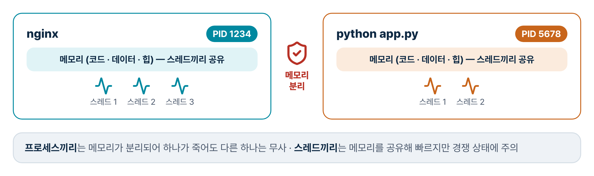
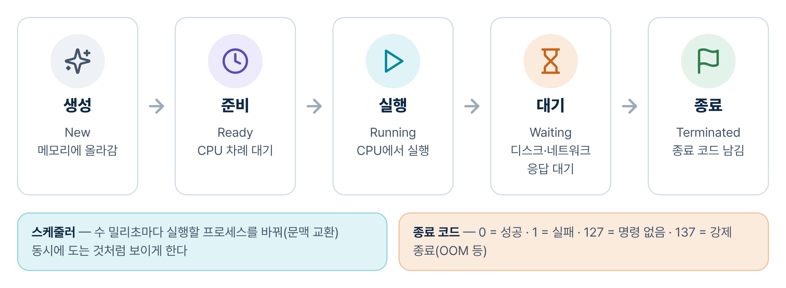

<sub>[🏠 과정 목차](../../README.md) › [1주차](../README.md) › [2일차](README.md) › 3/8교시</sub>

# 3교시 · 프로그램·프로세스·스레드

> [!NOTE]
> **이번 시간에 할 일**
>
> - 프로그램, 프로세스, 스레드를 구분합니다.
> - 프로세스가 생기고, 실행되고, 끝나는 생명주기를 이해합니다.
> - **종료 코드(exit code)**가 자동화에서 왜 중요한지 설명합니다.
> - 컨테이너와 Kubernetes 파드가 결국 "프로세스"라는 것을 연결합니다.

## 프로그램과 프로세스는 다르다

**프로그램**은 디스크에 저장된 실행 파일입니다. 아직 아무 일도 하지 않습니다. 이 프로그램을 실행하면 운영체제가 메모리를 나눠 주고 CPU 시간을 배정해 **실행 중인 상태**로 만드는데, 이것이 **프로세스(process)**입니다.

> **🧩 비유 — 레시피와 요리 중인 상태**
>
> **프로그램**은 요리책에 적힌 **레시피**입니다. **프로세스**는 그 레시피대로 지금 **요리하고 있는 상태**입니다. 같은 레시피(nginx 프로그램)로 동시에 여러 번 요리(nginx 프로세스 여러 개)할 수 있고, 각 요리는 자기 냄비와 재료(메모리)를 따로 씁니다.

| 개념 | 어디에 있나 | 예시 | 확인하는 방법 |
|---|---|---|---|
| 프로그램 | 디스크의 파일 | `/usr/sbin/nginx` | `ls`, `which nginx` |
| 프로세스 | 메모리에서 실행 중 | PID 1234번 nginx | `ps`, `top` |
| 스레드 | 프로세스 안의 실행 흐름 | nginx 워커의 처리 흐름들 | `top -H`, `ps -T` |

## 프로세스가 가진 것들



운영체제는 프로세스마다 다음 정보를 따로 관리합니다.

| 항목 | 설명 |
|---|---|
| PID (Process ID) | 프로세스를 구분하는 고유 번호 |
| PPID | 나를 만든 부모 프로세스의 번호 |
| 메모리 공간 | 코드, 데이터, 스택 — 다른 프로세스는 볼 수 없다 |
| 열린 파일·네트워크 연결 | 이 프로세스가 사용 중인 자원 목록 |
| 사용자(UID) | 누구의 권한으로 실행 중인가 |
| 환경 변수 | 실행할 때 전달받은 설정값 (예: `PORT=8080`) |
| 상태 | 실행 중, 대기 중, 종료됨 등 |

**프로세스끼리는 메모리가 분리**되어 있어서, 한 프로세스가 죽어도 다른 프로세스에는 영향이 없습니다. 이것이 2교시에서 본 운영체제의 **격리** 기능입니다.

## 스레드 — 프로세스 안의 여러 일꾼

**스레드(thread)**는 프로세스 안에서 동시에 실행되는 작업 흐름입니다. 같은 프로세스 안의 스레드들은 **메모리를 공유**합니다.

| 비교 | 프로세스 여러 개 | 스레드 여러 개 |
|---|---|---|
| 메모리 | 각자 따로 | 공유 |
| 만드는 비용 | 크다 | 작다 |
| 하나가 죽으면 | 다른 프로세스는 무사 | 보통 프로세스 전체가 죽음 |
| 데이터 주고받기 | 어렵다 (별도 통신 필요) | 쉽다 (같은 메모리) |
| 위험 | 상대적으로 안전 | 동시에 같은 데이터를 고치면 꼬일 수 있음 (경쟁 상태) |

어제 공부한 AWS 장애 기사를 기억하나요? 2025년 10월 AWS 버지니아 리전 장애의 근본 원인은 DynamoDB의 DNS 관리 자동화에 숨어 있던 **경쟁 상태(race condition)**였습니다. 두 작업이 같은 데이터를 거의 동시에 고치면서 순서가 꼬인 것입니다. 스레드와 동시성 문제는 이렇게 세계적인 장애로 이어지기도 합니다. 이 사례는 3일차 DNS 수업에서 자세히 봅니다.

## 프로세스의 생명주기



| 상태 | 뜻 |
|---|---|
| 생성 (New) | 프로그램이 메모리에 올라가는 중 |
| 준비 (Ready) | 실행할 준비가 됐고 CPU 차례를 기다리는 중 |
| 실행 (Running) | CPU에서 지금 명령을 실행하는 중 |
| 대기 (Waiting) | 디스크 읽기, 네트워크 응답 등을 기다리는 중 |
| 종료 (Terminated) | 일을 마치고 **종료 코드**를 남긴 상태 |

CPU 코어 하나는 한순간에 하나의 프로세스(스레드)만 실행할 수 있습니다. 그런데도 우리 컴퓨터에서 수백 개의 프로세스가 동시에 도는 것처럼 보이는 이유는, 운영체제의 **스케줄러**가 아주 짧은 시간(밀리초 단위)마다 실행할 프로세스를 바꿔 주기 때문입니다. 이것을 **문맥 교환(context switch)**이라고 합니다.

> **📈 트렌드 — Linux 스케줄러의 세대교체**
>
> Linux는 2007년부터 15년 넘게 **CFS(Completely Fair Scheduler)**라는 스케줄러를 써 왔습니다. 2023년 커널 6.6부터는 **EEVDF**라는 새 스케줄러로 바뀌기 시작했습니다. 학술 논문(1995년 Stoica 등)에 바탕을 둔 이 알고리즘은 공정성은 유지하면서 응답이 급한 작업을 더 잘 처리하도록 설계됐습니다. 30년 전 논문이 오늘 여러분의 클라우드 서버 안에서 돌아가고 있는 셈입니다.

## 종료 코드 — 자동화의 언어

프로세스가 끝나면 운영체제에 **종료 코드(exit code)**라는 숫자를 남깁니다.

| 종료 코드 | 관례상 의미 |
|---|---|
| `0` | 성공 |
| `1` | 일반적인 실패 |
| `2` | 명령 사용법 오류 |
| `126` | 실행 권한이 없음 |
| `127` | 명령을 찾을 수 없음 (오타, 설치 안 됨) |
| `130` | 사용자가 Ctrl+C로 중단 |
| `137` | 강제 종료됨 (`kill -9`, 메모리 초과로 OOM Kill 된 경우가 많음) |

사람은 화면의 메시지를 읽고 성공인지 판단하지만, **자동화 도구는 종료 코드만 봅니다.** 3주차 GitHub Actions의 파이프라인은 테스트 명령의 종료 코드가 0이 아니면 다음 단계(배포)로 넘어가지 않습니다. 4주차 Kubernetes에서 컨테이너가 `Exit Code: 137`로 죽었다면 "메모리가 부족했구나"를 먼저 의심합니다.

> **📘 강사 시연 — 종료 코드 확인하기**
>
> ```bash
> ls /tmp          # 정상 실행
> echo $?          # 직전 명령의 종료 코드 → 0
>
> ls /없는폴더      # 실패
> echo $?          # → 2 (No such file or directory)
>
> nginxx           # 오타
> echo $?          # → 127 (command not found)
> ```
> `$?`는 "방금 실행한 명령의 종료 코드"를 담고 있는 특별한 변수입니다. 1주차에는 직접 칠 필요 없이, **숫자를 읽는 법**만 기억해 두세요.

## 부모와 자식, 그리고 PID 1

Linux에서 새 프로세스는 기존 프로세스가 자기를 복제(`fork`)한 뒤, 복제본이 새 프로그램으로 자신을 바꾸는(`exec`) 방식으로 만들어집니다. 그래서 모든 프로세스는 **부모**가 있고, 거슬러 올라가면 컴퓨터가 켜질 때 가장 먼저 시작되는 **PID 1번** 프로세스(보통 `systemd`)에 닿습니다.

> [!IMPORTANT]
> **컨테이너와 PID 1**
>
> 2주차에 Docker 컨테이너 안에서 `ps`를 실행하면, 여러분의 앱이 **PID 1번**으로 보입니다. 컨테이너는 "자기만의 프로세스 세계"를 가진 격리된 프로세스이기 때문입니다(7교시). 그리고 **PID 1이 끝나면 컨테이너도 끝납니다.** "컨테이너가 바로 꺼져요"라는 초보자의 흔한 질문 대부분은 메인 프로세스가 곧바로 종료됐기 때문입니다. 종료 코드를 보면 이유를 알 수 있습니다.

> **🎓 학술 노트 — 프로세스라는 개념의 탄생**
>
> "프로세스"라는 개념은 1960년대 MIT의 **Multics** 프로젝트와 시분할(time-sharing) 시스템 연구에서 자리 잡았습니다. 여러 사용자가 한 대의 비싼 컴퓨터를 동시에 쓰려면, 실행 중인 각 작업을 독립된 단위로 관리하고 CPU를 번갈아 나눠 줘야 했기 때문입니다. 이 아이디어는 Multics에 참여했던 톰프슨과 리치를 통해 Unix로 이어졌고, 오늘날 Linux의 `fork`/`exec` 모델로 남았습니다.
>
> 한편 네덜란드의 컴퓨터 과학자 에츠허르 데이크스트라(Edsger Dijkstra)는 1965년 무렵 여러 프로세스가 같은 자원을 안전하게 나눠 쓰기 위한 **세마포어(semaphore)**를 제안했습니다. 앞에서 본 경쟁 상태를 막는 고전적인 해법이며, 지금도 운영체제 교과서의 핵심 주제입니다.
>
> - Dijkstra, E. W. (1968). Cooperating sequential processes. In *Programming Languages*. Academic Press.

## 정리

- **프로그램**은 디스크의 파일, **프로세스**는 실행 중인 프로그램, **스레드**는 프로세스 안의 실행 흐름입니다.
- 프로세스끼리는 메모리가 분리되어 안전하고, 스레드끼리는 메모리를 공유해 빠르지만 경쟁 상태에 주의해야 합니다.
- **종료 코드 0은 성공**, 0이 아니면 실패입니다. 자동화 도구는 이 숫자로 판단합니다.
- 컨테이너는 격리된 프로세스이며, 메인 프로세스(PID 1)가 끝나면 컨테이너도 끝납니다.

> **✅ 확인 문제**
>
> 1. 같은 nginx 프로그램을 3번 실행하면 프로세스는 몇 개가 되나요?
> 2. 같은 프로세스 안의 스레드들이 공유하는 것은 무엇인가요?
> 3. 명령을 실행했더니 종료 코드가 127입니다. 가장 먼저 무엇을 의심해야 하나요?
> 4. Kubernetes에서 컨테이너가 `Exit Code: 137`로 종료됐습니다. 흔한 원인은?
> 5. 컨테이너 안의 PID 1 프로세스가 종료되면 컨테이너는 어떻게 되나요?
>
> <details><summary>정답</summary>
>
> 1. 3개 (각각 다른 PID를 가짐)
> 2. 메모리 (코드, 데이터, 힙)
> 3. 명령어 오타이거나 프로그램이 설치되지 않은 경우 (command not found)
> 4. 메모리 제한을 넘어 OOM Kill 되었거나, 강제 종료(`kill -9`)된 경우
> 5. 컨테이너도 함께 종료됩니다.
>
> </details>

## 참고 문헌

- Arpaci-Dusseau, R. H., & Arpaci-Dusseau, A. C. (2018). *Operating Systems: Three Easy Pieces* — Part I: Virtualization (Processes).
- Dijkstra, E. W. (1968). Cooperating sequential processes.
- Stoica, I., & Abdel-Wahab, H. (1995). Earliest Eligible Virtual Deadline First: A Flexible and Accurate Mechanism for Proportional Share Resource Allocation. Technical Report.
- The Linux Kernel Documentation. *EEVDF Scheduler*. docs.kernel.org
- AWS (2025). *Summary of the Amazon DynamoDB Service Disruption in the Northern Virginia (US-EAST-1) Region*. aws.amazon.com/message/101925

---

| 이전 | 목차 | 다음 |
|:--|:--:|--:|
| ⬅️ [2교시 · 운영체제가 하는 일](lesson-02.md) | [⬆️ 2일차 목차](README.md) | [4교시 · 파일과 저장소](lesson-04.md) ➡️ |
