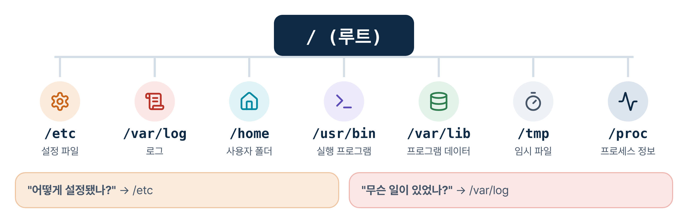
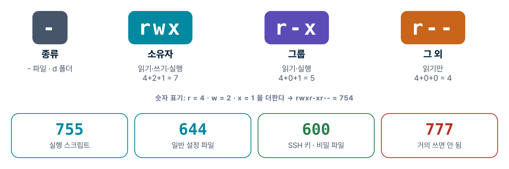
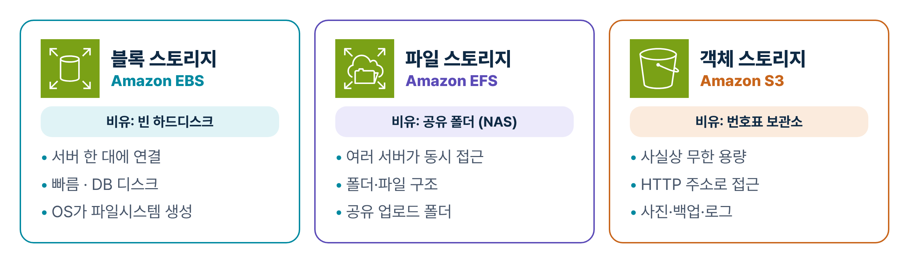

<sub>[🏠 과정 목차](../../README.md) › [1주차](../README.md) › [2일차](README.md) › 4/7교시</sub>

# 4교시 · 파일과 저장소

> [!NOTE]
> **이번 시간에 할 일**
>
> - Linux 파일시스템의 구조와 경로(절대·상대)를 읽을 수 있습니다.
> - 파일 권한 `rwxr-xr-x`를 해석할 수 있습니다.
> - 사라지는 데이터와 남는 데이터를 구분합니다.
> - 블록·파일·객체 스토리지의 차이를 알고 AWS 서비스와 연결합니다.

## Linux의 디렉터리 구조

Windows는 `C:\`, `D:\`처럼 드라이브마다 시작점이 따로 있지만, Linux는 **`/`(루트)라는 단 하나의 뿌리**에서 모든 것이 뻗어 나갑니다.



| 경로 | 무엇이 있나 | 언제 보게 되나 |
|---|---|---|
| `/` | 모든 것의 시작점 (루트) | 항상 |
| `/home/사용자명` | 각 사용자의 개인 폴더 | 실습 파일을 둘 곳 |
| `/root` | 관리자(root)의 개인 폴더 | 관리 작업 |
| `/etc` | 시스템과 프로그램의 **설정 파일** | nginx 설정 `/etc/nginx/nginx.conf` |
| `/var/log` | **로그 파일** | 장애 분석 |
| `/var/lib` | 프로그램이 저장하는 데이터 | Docker 데이터 `/var/lib/docker` |
| `/usr/bin`, `/bin` | 실행 프로그램 | `ls`, `cat`, `python3` |
| `/tmp` | 임시 파일 (재부팅 시 지워질 수 있음) | 잠깐 쓰는 파일 |
| `/proc` | 실행 중인 프로세스와 커널 정보 (가상) | 프로세스 확인 |
| `/dev` | 장치 파일 (디스크, 터미널 등) | 디스크 연결 |

> [!TIP]
> **로그는 /var/log, 설정은 /etc**
>
> 장애가 났을 때 가장 먼저 볼 곳 두 군데만 기억해도 반은 성공입니다. **"무엇이 일어났나"는 `/var/log`**, **"어떻게 설정됐나"는 `/etc`**. 컨테이너 시대에는 로그가 파일 대신 표준 출력으로 나오는 경우가 많지만(2주차), 서버 자체를 볼 때는 여전히 이 두 곳이 출발점입니다.

### 절대 경로와 상대 경로

| 종류 | 예시 | 뜻 |
|---|---|---|
| 절대 경로 | `/home/student/app/index.html` | 루트(`/`)부터 시작하는 전체 주소 |
| 상대 경로 | `app/index.html` | **지금 있는 위치**를 기준으로 한 주소 |
| 현재 폴더 | `.` | 지금 위치 |
| 상위 폴더 | `..` | 한 단계 위 |
| 홈 폴더 | `~` | 내 홈 폴더 (`/home/student`) |

"파일을 찾을 수 없습니다(No such file or directory)" 오류의 상당수는 **지금 내가 어느 폴더에 있는지 착각**해서 상대 경로가 엉뚱한 곳을 가리키기 때문입니다. 그래서 5교시에서 볼 `pwd`(현재 위치 출력) 명령이 생각보다 자주 쓰입니다.

## "모든 것은 파일이다"

Unix와 Linux에는 **"모든 것은 파일이다(Everything is a file)"**라는 유명한 설계 원칙이 있습니다. 일반 문서뿐 아니라 디스크(`/dev/sda`), 터미널, 실행 중인 프로세스 정보(`/proc/1234/`)까지 파일처럼 읽고 쓸 수 있게 만들었습니다. 덕분에 `cat`, `grep` 같은 똑같은 도구로 시스템의 거의 모든 것을 들여다볼 수 있습니다.

## 파일 권한 읽기

Linux는 여러 사용자가 함께 쓰는 시스템에서 출발했기 때문에, 파일마다 **누가 무엇을 할 수 있는지** 정해져 있습니다.



`ls -l` 명령을 실행하면 이런 줄이 보입니다.

```text
-rwxr-xr--  1  student  dev  2048  Nov 24 10:00  deploy.sh
```

| 부분 | 값 | 뜻 |
|---|---|---|
| 첫 글자 | `-` | 일반 파일 (`d`면 디렉터리) |
| 소유자 권한 | `rwx` | 소유자 student는 읽기·쓰기·실행 가능 |
| 그룹 권한 | `r-x` | dev 그룹은 읽기·실행 가능, 쓰기 불가 |
| 그 외 권한 | `r--` | 나머지 사용자는 읽기만 가능 |

권한은 숫자로도 씁니다. **r=4, w=2, x=1**을 더해서 세 자리로 표현합니다.

| 표기 | 계산 | 의미 | 쓰임 |
|---|---|---|---|
| `755` | rwx(7) r-x(5) r-x(5) | 소유자만 수정, 모두 실행 가능 | 실행 스크립트 |
| `644` | rw-(6) r--(4) r--(4) | 소유자만 수정, 모두 읽기 가능 | 일반 설정 파일 |
| `600` | rw-(6) ---(0) ---(0) | 소유자만 읽고 쓸 수 있음 | **SSH 키, 비밀 파일** |
| `777` | rwx rwx rwx | 누구나 모든 것 가능 | **거의 쓰면 안 됨** |

> [!WARNING]
> **chmod 777은 문제를 덮는 것이지 해결하는 것이 아니다**
>
> "권한 오류(Permission denied)가 나면 777로 바꾸세요"라는 답을 인터넷에서 자주 봅니다. 어제 3교시에서 본 것처럼, 이것은 **누구나 그 파일을 고치고 실행할 수 있게 문을 활짝 여는 것**입니다. 올바른 해결은 "누가 이 파일에 접근해야 하는가"를 확인하고, 그 사용자에게만 필요한 권한을 주는 것입니다. 5주차 AWS의 SSH 키 파일은 반드시 `600`이어야 하며, 권한이 너무 열려 있으면 SSH가 아예 접속을 거부합니다.

> **🎓 학술 노트 — 최소 권한 원칙 (1975)**
>
> MIT의 제롬 솔처(Jerome Saltzer)와 마이클 슈뢰더(Michael Schroeder)는 1975년 논문 「컴퓨터 시스템에서의 정보 보호(The Protection of Information in Computer Systems)」에서 보안 설계 원칙 여덟 가지를 제시했습니다. 그중 가장 유명한 것이 **최소 권한 원칙(principle of least privilege)**입니다. "모든 프로그램과 사용자는 일을 하는 데 **꼭 필요한 최소한의 권한**만 가져야 한다."
>
> 50년 전 원칙이지만 오늘날 클라우드 보안의 중심에 그대로 있습니다. Linux 파일 권한, 4주차 Kubernetes RBAC, 5주차 AWS IAM 정책이 모두 이 원칙을 구현하는 도구입니다. 어제 본 "AI 에이전트에게도 최소 권한을" 역시 같은 원칙입니다.
>
> - Saltzer, J. H., & Schroeder, M. D. (1975). The protection of information in computer systems. *Proceedings of the IEEE*, 63(9), 1278–1308.

## 사라지는 데이터와 남는 데이터

초보자가 클라우드와 컨테이너에서 가장 많이 겪는 사고는 **"데이터가 사라졌어요"**입니다. 어떤 데이터가 남고 어떤 데이터가 사라지는지 미리 구분해 두면 대부분 막을 수 있습니다.

| 위치 | 재부팅하면 | 서버·컨테이너를 지우면 |
|---|---|---|
| 메모리 | 사라짐 | 사라짐 |
| `/tmp` | 사라질 수 있음 | 사라짐 |
| 컨테이너 내부 파일 | 남음 (컨테이너 재시작 시) | **사라짐** |
| Docker 볼륨 / EBS 볼륨 | 남음 | **따로 지우기 전까지 남음** |
| S3 같은 객체 스토리지 | 남음 | 남음 (별개 서비스) |

2주차 Docker 수업의 첫 실험이 바로 "데이터베이스 컨테이너를 지웠다가 다시 만들면 데이터가 어떻게 되나?"입니다. 오늘 이 표를 기억해 두면 그 실험의 결과를 미리 예측할 수 있습니다.

## 스토리지의 세 가지 종류

클라우드 스토리지는 데이터를 다루는 **단위**에 따라 세 가지로 나뉩니다.



| 종류 | 다루는 단위 | 비유 | 특징 | AWS 서비스 |
|---|---|---|---|---|
| 블록 스토리지 | 일정 크기의 블록 | 빈 하드디스크 | 빠름, 서버 한 대에 연결, OS가 파일시스템을 만들어 씀 | **EBS** |
| 파일 스토리지 | 파일과 폴더 | 공유 폴더(NAS) | 여러 서버가 동시에 같은 폴더를 씀 | **EFS** |
| 객체 스토리지 | 객체(파일 + 메타데이터) + 고유 주소 | 물품 보관소 번호표 | 거의 무한한 용량, HTTP로 접근, 저렴 | **S3** |

> **📘 언제 무엇을 쓸까?**
>
> - **데이터베이스 디스크** → 빠른 블록 스토리지(EBS). DB는 작은 데이터를 매우 자주 읽고 쓰기 때문입니다.
> - **여러 웹 서버가 함께 쓰는 업로드 폴더** → 파일 스토리지(EFS).
> - **사용자가 올린 사진, 동영상, 백업, 로그 보관** → 객체 스토리지(S3). 용량이 계속 늘어나고 인터넷 주소로 꺼내 쓰기 좋습니다.

> **📈 트렌드 — 객체 스토리지가 데이터의 기본 저장소가 되다**
>
> 2006년 AWS가 처음 내놓은 서비스가 EC2가 아니라 **S3**였다는 것을 기억하나요? 이후 객체 스토리지는 클라우드 데이터의 기본 창고가 되었습니다. 최근에는 대용량 데이터 분석과 AI 학습 데이터도 S3 같은 객체 스토리지에 두고, 필요할 때 연산 자원을 붙여 처리하는 **"저장과 계산의 분리"**가 표준 설계가 되고 있습니다. 서버를 지워도 데이터는 남아 있어야 한다는 클라우드의 원칙과 잘 맞기 때문입니다.

## 정리

- Linux는 **`/` 하나의 뿌리**에서 시작합니다. 설정은 `/etc`, 로그는 `/var/log`.
- 권한 `rwx`는 r=4, w=2, x=1. 비밀 파일은 `600`, `777`은 피합니다.
- **최소 권한 원칙**은 Linux 권한부터 IAM까지 이어지는 보안의 기본입니다.
- 메모리와 컨테이너 내부 파일은 사라지고, 볼륨과 객체 스토리지는 남습니다.
- 블록(EBS)·파일(EFS)·객체(S3) 스토리지는 쓰임새가 다릅니다.

> **✅ 확인 문제**
>
> 1. nginx의 설정 파일과 로그는 보통 어느 디렉터리에 있나요?
> 2. `rw-r--r--`를 숫자로 바꾸면?
> 3. SSH 개인 키 파일에 알맞은 권한 숫자는?
> 4. 컨테이너를 삭제했더니 데이터가 사라졌습니다. 데이터를 남기려면 무엇을 써야 하나요?
> 5. 사용자 프로필 사진 수백만 장을 저장하기에 가장 알맞은 스토리지 종류와 AWS 서비스는?
>
> <details><summary>정답</summary>
>
> 1. 설정은 `/etc/nginx/`, 로그는 `/var/log/nginx/`
> 2. `644`
> 3. `600`
> 4. 볼륨 (Docker 볼륨, 클라우드라면 EBS 등)
> 5. 객체 스토리지 — Amazon S3
>
> </details>

## 참고 문헌

- Saltzer, J. H., & Schroeder, M. D. (1975). The protection of information in computer systems. *Proceedings of the IEEE*, 63(9).
- Linux Foundation. *Filesystem Hierarchy Standard (FHS) 3.0*. refspecs.linuxfoundation.org
- AWS. *Amazon EBS, Amazon EFS, Amazon S3 — Choosing a storage service*. docs.aws.amazon.com
- Kerrisk, M. (2010). *The Linux Programming Interface*. No Starch Press.

---

| 이전 | 목차 | 다음 |
|:--|:--:|--:|
| ⬅️ [3교시 · 프로그램·프로세스·스레드](lesson-03.md) | [⬆️ 2일차 목차](README.md) | [5교시 · Linux 명령어 맛보기 (강사 시연)](lesson-05.md) ➡️ |
